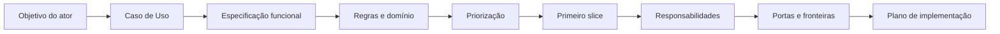
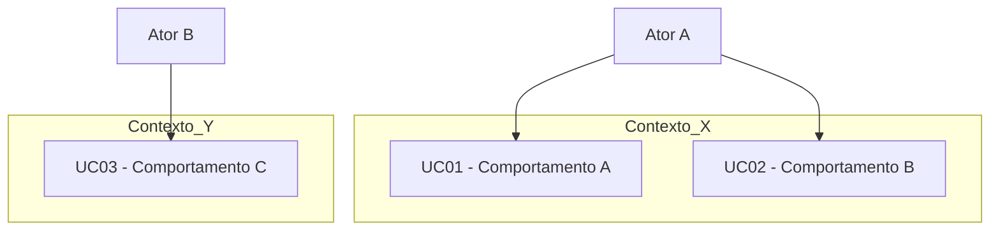
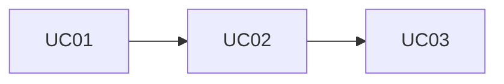
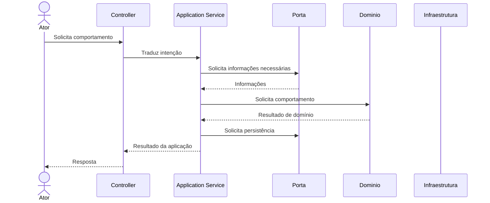
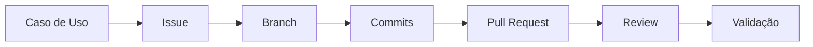

# Blueprint de Implementação do Primeiro Slice do Sistema

**Trabalho:** Do Caso de Uso ao Primeiro Slice: Blueprint de Implementação do Sistema

---

## Objetivo

Este trabalho tem como objetivo fazer com que cada aluno ou equipe avance da compreensão do domínio e da especificação funcional para o planejamento consciente do primeiro *slice* do sistema, sem ainda exigir sua implementação prática.

A atividade deve ser realizada exclusivamente sobre o sistema que o aluno ou a equipe vem desenvolvendo ao longo da disciplina.

O exemplo trabalhado em aula com o CeliLac e com o Caso de Uso *Confirmar Pedido* serve apenas como referência de raciocínio. Ele não deve ser copiado mecanicamente para outros projetos.

> **A pergunta central deste trabalho é:**
> *Como transformar um Caso de Uso relevante do nosso sistema em um plano coerente de implementação, preservando objetivo do ator, regras do domínio, responsabilidades arquiteturais, fronteiras e rastreabilidade?*

Ao final da atividade, espera-se que a equipe tenha produzido um blueprint do primeiro *slice*, suficientemente claro para orientar a implementação futura.

---

## Continuidade com o desenvolvimento já realizado

Este trabalho não inicia um sistema novo. Ele deve utilizar como entrada o conhecimento já produzido nas atividades anteriores, incluindo, quando aplicável:

- Problema e contexto;
- Atores;
- Fluxos;
- Operações;
- Fatos, hipóteses e decisões;
- Conceitos do domínio, Entidades e Objetos de Valor;
- Relações e cardinalidades;
- Regras de Negócio e invariantes;
- Estados e transições;
- Responsabilidades arquiteturais e decisões já registradas na documentação do projeto.

A proposta é evoluir esse conhecimento até um plano de implementação coerente.

---

> ### ⚠️ Atenção: O que este trabalho NÃO exige
>
> Nesta atividade, **não é necessário implementar** o Caso de Uso selecionado.
>
> Também **não é necessário**:
> - Configurar ORM;
> - Criar banco de dados ou integrar PostgreSQL;
> - Configurar Docker;
> - Implementar repositories concretos;
> - Criar migrations;
> - Entregar endpoint funcional;
> - Demonstrar execução ponta a ponta;
> - Produzir testes automatizados;
> - Apresentar containers em execução.
>
> Esses elementos aparecem nos materiais como parte da arquitetura e do planejamento da implementação, mas a execução prática será trabalhada posteriormente.
>
> O objetivo atual é **compreender e documentar** como o primeiro *slice* deverá ser implementado.

---

> ### ⚠️ Atenção: Revisões e governança do projeto
>
> Durante esta atividade, a equipe pode perceber que algum entendimento anterior precisa ser revisto.
> Podem surgir, por exemplo:
> - Um Caso de Uso amplo demais;
> - Uma Regra de Negócio ainda não explicitada;
> - Uma responsabilidade mal posicionada;
> - Uma dependência não percebida;
> - Uma falha importante ainda não analisada;
> - Uma fronteira que precisa ser revista;
> - Um conceito de domínio que precisa ser refinado.
>
> **Não será obrigatória a atualização e o reenvio dos trabalhos anteriores nesta entrega.**
>
> Entretanto, toda revisão relevante deverá ser registrada neste documento para preservar a **governança do projeto**.
> *Governança significa conseguir acompanhar o que mudou, por que mudou e quais documentos ou decisões são impactados.*

---

## Princípio central

O trabalho deverá seguir esta linha de raciocínio:

> **A tecnologia deve aparecer como resposta a uma necessidade já identificada.**  
> Não parta da estrutura técnica para descobrir o comportamento. Parta do comportamento para planejar a estrutura técnica necessária.

---

## ETAPA 1 — Retomada do sistema

Apresente uma síntese do sistema. Inclua:

- Nome do sistema;
- Problema central;
- Público ou atores principais;
- Objetivo principal da solução;
- Principais conceitos do domínio já identificados;
- Principais Regras de Negócio já conhecidas;
- Principais decisões arquiteturais já assumidas.

*Não reproduza integralmente documentos anteriores.*

**Resultado esperado:** Permitir que qualquer leitor compreenda de onde o planejamento desta atividade está partindo.

---

## ETAPA 2 — Atores e objetivos

Revise os atores já identificados. Para cada ator, registre os principais objetivos que deseja alcançar no sistema.

| Ator | Objetivo | Resultado observável |
| :--- | :--- | :--- |
| | | |

> ### ⚠️ Atenção
> **Ator não é simplesmente qualquer componente técnico.**  
> Não trate automaticamente como atores: banco de dados, ORM, cache, logger, bibliotecas ou módulos internos.  
> Um sistema externo pode ser ator secundário quando participa efetivamente da interação.

---

## ETAPA 3 — Identificação e revisão dos Casos de Uso

A partir dos objetivos dos atores, identifique ou revise os Casos de Uso do sistema.

Um Caso de Uso deve possuir:
- Ator;
- Objetivo claro;
- Resultado observável;
- Interação relevante com o sistema;
- Nome com intenção explícita.

Utilize a tabela a seguir:

| ID | Caso de Uso | Ator principal | Objetivo | Resultado observável | Situação |
| :--- | :--- | :--- | :--- | :--- | :--- |
| UC01 | | | | | Mantido / Revisado / Novo |

**Evite:**
- Nomes de telas ou páginas;
- Endpoints;
- Operações internas;
- Nomes vagos como "Gerenciar Sistema".

> **Regra:** Caso de Uso não é tela. Caso de Uso não é endpoint. Caso de Uso não é operação interna.

---

## ETAPA 4 — Verificação dos Casos de Uso

Para cada Caso de Uso candidato, responda:

1. [ ] Existe um ator com objetivo claro?
2. [ ] O resultado é observável pelo ator?
3. [ ] Existe uma interação relevante com o sistema?

Caso alguma resposta seja negativa, investigue se o item é, na verdade:
- Regra de Negócio;
- Invariante;
- Serviço de Domínio;
- Capacidade interna;
- Requisito transversal;
- Detalhe arquitetural ou de infraestrutura.

Registre as revisões:

| Item inicialmente identificado | Classificação inicial | Classificação atual | Justificativa |
| :--- | :--- | :--- | :--- |
| | Caso de Uso | | |

---

## ETAPA 5 — Organização dos Casos de Uso

Apresente duas visões complementares:

### 5.1 Casos de Uso por ator
Mostre quais objetivos cada ator deseja atingir.

### 5.2 Casos de Uso por contexto ou responsabilidade
Quando a equipe já possuir fronteiras ou contextos identificados, indique onde cada comportamento parece pertencer. Caso ainda exista incerteza, registre-a.

**Exemplo de estrutura Mermaid:**

*(O diagrama deverá representar o sistema da equipe).*

---

## ETAPA 6 — Especificação funcional dos Casos de Uso centrais

Selecione pelo menos **três Casos de Uso relevantes**, desde que realmente existam no sistema.

Para cada um, documente:

### Identificação
- **ID:**
- **Nome:**
- **Objetivo:**
- **Ator principal:**
- **Atores secundários (se houver):**

### Pré-condições
O que precisa ser verdadeiro antes do início?

### Pós-condições
O que precisa ser verdadeiro após a conclusão bem-sucedida?

### Fluxo principal
Descreva o caminho esperado de sucesso.

### Fluxos alternativos
Registre:
- Variações de negócio;
- Impedimentos e recusas;
- Condições alternativas;
- Falhas relevantes.

### Regras relacionadas
Relacione as Regras de Negócio que orientam ou restringem o comportamento.

> ⚠️ **Atenção:** Pré-condição não é validação de entrada. Regra de Negócio não deve desaparecer dentro do fluxo.

---

## ETAPA 7 — Rastreabilidade com o domínio

Para cada Caso de Uso especificado, registre:

| Caso de Uso | Conceitos do domínio | Regras / Invariantes relacionadas | Contexto / responsabilidade |
| :--- | :--- | :--- | :--- |
| | | | |

Responda também:
1. Que elementos das análises anteriores justificam este Caso de Uso?
2. Este Caso de Uso revelou alguma lacuna ou problema no modelo anterior?

---

## ETAPA 8 — Dependências entre Casos de Uso

Identifique dependências relevantes. Uma dependência não significa obrigatoriamente que um Caso de Uso chama outro; pode significar que um comportamento depende de um estado ou resultado previamente produzido.

| Caso de Uso | Depende de | Tipo de dependência | Justificativa |
| :--- | :--- | :--- | :--- |
| | | Estado / Comportamento / Informação / Outra | |

Quando fizer sentido, ilustre com um diagrama Mermaid:

---

## ETAPA 9 — Priorização e MVP

Analise os Casos de Uso considerando:
- Valor central;
- Desbloqueio de outros comportamentos;
- Dependências obrigatórias;
- Validação de hipóteses;
- Risco e possibilidade de adiamento.

Classifique-os em:
- Casos de Uso centrais do MVP;
- Casos de Uso secundários do MVP;
- Casos de Uso futuros.

| Caso de Uso | Valor central | Dependências | Risco | Pode ser adiado? | Classificação |
| :--- | :--- | :--- | :--- | :--- | :--- |
| | | | | | Central / Secundário / Futuro |

> **Regra:** MVP reduz escopo, não qualidade.

---

## ETAPA 10 — Escolha do primeiro slice

Selecione um Caso de Uso real para orientar o primeiro *slice* futuro. Explique:
- Qual Caso de Uso foi escolhido;
- Qual ator possui o objetivo;
- Qual valor ele entrega;
- Por que ele é representativo;
- Quais conceitos do domínio participam;
- Quais regras relevantes ele atravessa;
- Quais dependências possui;
- Por que é adequado para o primeiro recorte.

Defina claramente:
- **Entra no slice:**
- **Não entra no slice:**

**Resultado esperado:** Demonstrar que a equipe consegue controlar o escopo sem eliminar responsabilidades importantes.

---

## ETAPA 11 — Linguagem ubíqua do slice

Liste os termos que deverão manter significado consistente durante a futura implementação.

| Termo | Significado no sistema | Termos que não devem ser usados como sinônimo sem justificativa |
| :--- | :--- | :--- |
| | | |

Esses termos deverão futuramente orientar: nomes de classes, métodos, enums, mensagens, testes, documentação e contratos.

---

## ETAPA 12 — Regra central e comportamento do domínio

Identifique a principal decisão de negócio associada ao *slice*. Responda:
- Qual regra central precisa ser protegida?
- Qual conceito do domínio conhece essa regra?
- Que estado pode mudar?
- Quais transições parecem válidas?
- Quais transições devem ser impedidas?
- Que alteração não deveria ocorrer por simples atribuição?

Explique conceitualmente como o domínio deverá expressar o comportamento.

**Exemplo estrutural:**
- ❌ **Evitar:** `objeto.status = NOVO_ESTADO`
- ✅ **Preferir conceitualmente:** `objeto.executarComportamento(...)`

*(O exemplo é apenas ilustrativo).*

---

## ETAPA 13 — Responsabilidades arquiteturais

Decomponha o Caso de Uso em responsabilidades.

| Responsabilidade | Papel arquitetural | Quem deverá assumi-la? | Justificativa |
| :--- | :--- | :--- | :--- |
| Receber solicitação | Fronteira | | |
| Coordenar Caso de Uso | Aplicação | | |
| Decidir Regra de Negócio | Domínio | | |
| Obter informação | Aplicação / Porta | | |
| Persistir estado | Porta / Infraestrutura | | |
| Traduzir resultado | Fronteira | | |

### Distinção conceitual:
- **Controller:** recebe e traduz;
- **Application Service / Handler:** coordena;
- **Domínio:** decide e protege regras e invariantes;
- **Infraestrutura:** implementa detalhes técnicos.

> ⚠️ **Atenção:** O nome `service` em uma classe não define automaticamente sua responsabilidade arquitetural.

---

## ETAPA 14 — Modelo mínimo necessário ao slice

Identifique quais elementos do domínio deverão existir para sustentar corretamente o comportamento selecionado. Não é necessário expandir o sistema inteiro.

Explique:
- Quais conceitos já existem;
- Quais serão reutilizados;
- Quais precisam ser refinados;
- Quais comportamentos deverão existir;
- Quais estados precisam ser conhecidos;
- Quais elementos não precisam entrar neste primeiro recorte.

---

## ETAPA 15 — Portas e dependências externas

Pergunte: *O que o Caso de Uso precisa obter ou persistir que não pertence à execução puramente interna do domínio?*

Identifique as portas necessárias:

| Porta / Contrato | Necessidade expressa | Operações realmente necessárias | Quem dependerá dela? |
| :--- | :--- | :--- | :--- |
| | | | |

> ⚠️ **Atenção:** Repository não deve ser entendido automaticamente como banco de dados, ORM, tabela ou CRUD genérico. O contrato expressa o que o núcleo precisa. A infraestrutura futura resolverá como realizar isso tecnicamente.

---

## ETAPA 16 — Planejamento da interface HTTP

Defina como o Caso de Uso poderá ser acessado futuramente pela interface HTTP. Documente:
- Método HTTP;
- Rota;
- Parâmetros;
- Corpo (se necessário);
- Resultado esperado;
- Principais respostas.

> **Regra:** Endpoint não é Caso de Uso. O endpoint é apenas uma forma de solicitar o comportamento.

---

## ETAPA 17 — DTO, Command e Query

Analise se esses artefatos serão necessários. Para cada um, responda:
- Qual responsabilidade representa?
- Existe uma fronteira real que justifica sua existência?
- Transporta dados?
- Representa intenção de mudança?
- Representa consulta?
- Coordena comportamento?

*Não crie artefatos apenas porque apareceram nos exemplos de aula.*

> **Lembrete:**
> - **DTO:** transporte;
> - **Command:** intenção de mudança;
> - **Query:** intenção de leitura;
> - **Entidade de Domínio:** conceito e comportamento do negócio.  
> *(DTO / Command ≠ Entidade de Domínio)*

---

## ETAPA 18 — Planejamento da persistência

Sem implementar, descreva como a persistência deverá participar do *slice*. Responda:
- Que informações precisam ser recuperadas?
- Que informações precisam ser persistidas?
- Que estado precisa sobreviver entre execuções?
- Que porta expressará essa necessidade?
- Que parte deverá permanecer independente de ORM e PostgreSQL?
- Que parte futura pertencerá à infraestrutura?

> **Importante:** Não é necessário definir tabelas definitivas, escrever SQL, configurar ORM, criar migrations ou conectar PostgreSQL. O objetivo é planejar a responsabilidade da persistência.

---

## ETAPA 19 — Planejamento de ORM, PostgreSQL e Docker

Os materiais apresentam ORM, PostgreSQL e Docker como recursos que participarão futuramente do *slice*. Nesta atividade, descreva apenas por que serão necessários e qual papel deverão cumprir.

Para cada tecnologia, responda:

### ORM
- Que problema técnico deverá resolver?
- De que parte arquitetural deverá permanecer isolado?

### PostgreSQL
- Que necessidade de persistência concreta deverá atender?
- Quais conceitos do domínio não deverão depender diretamente dele?

### Docker
- Que necessidade operacional deverá resolver?
- Quais serviços precisarão futuramente compor o ambiente reproduzível?

> ⚠️ **Atenção:** Não é necessário apresentar `docker-compose.yml`, containers em execução, configuração de conexão, instalação do ORM, migrations ou comandos de banco.

---

## ETAPA 20 — Resultados e falhas

Identifique os principais resultados possíveis do *slice*. Classifique as falhas segundo seu significado.

| Situação | Categoria | Quem deverá identificar? | Significado interno | Possível tradução HTTP futura |
| :--- | :--- | :--- | :--- | :--- |
| | Aplicação / Domínio / Infraestrutura | | | |

### Categorias de referência:
- **Falha de aplicação:** O Caso de Uso não consegue prosseguir porque algum elemento necessário à coordenação não está disponível.
- **Violação ou impedimento de domínio:** O elemento existe, mas a operação não é permitida pelas regras ou pelo estado atual.
- **Falha técnica / infraestrutura:** A execução futura não poderá prosseguir por problema técnico.

> **Regra fundamental:** O significado da falha vem antes de sua representação HTTP.

---

## ETAPA 21 — Fluxo arquitetural planejado

Represente o fluxo futuro do *slice* utilizando Mermaid.

*(O diagrama deve representar o sistema da equipe e incluir pelo menos um caminho de falha relevante).*

---

## ETAPA 22 — Blueprint de implementação

Construa um plano ordenado de implementação futura.

| Ordem | Passo | Objetivo | Dependência |
| :---: | :--- | :--- | :--- |
| 1 | Consolidar Caso de Uso | | |
| 2 | Refinar domínio mínimo | | |
| 3 | Definir coordenação da aplicação | | |
| 4 | Definir portas | | |
| 5 | Planejar interface HTTP | | |
| 6 | Planejar persistência | | |
| 7 | Planejar infraestrutura | | |
| 8 | Planejar validação | | |

> **Importante:** Esta etapa é um plano. Não é necessário executar os passos agora.

---

## ETAPA 23 — Planejamento de validação

Explique como a equipe saberá, futuramente, que o *slice* foi implementado corretamente.

Identifique:
- Cenário de sucesso;
- Principais variações;
- Principais impedimentos de domínio;
- Principais falhas de aplicação;
- Possíveis falhas técnicas;
- O que deverá ser verificado no domínio, na aplicação, na interface HTTP e na persistência.

*Não é necessário implementar testes nesta atividade.*

---

## ETAPA 24 — Governança futura da implementação

Planeje como a implementação deverá permanecer rastreável.

Explique como a equipe pretende relacionar: Caso de Uso, issue, branch, commits, Pull Request, revisão e validação.

*Não é necessário que todos esses elementos já existam.*

---

## ETAPA 25 — Revisões descobertas nesta atividade

Registre alterações ou dúvidas que surgiram durante esta etapa.

| Conhecimento anterior | Descoberta atual | Revisão necessária | Impacto |
| :--- | :--- | :--- | :--- |
| | | | |

Podem aparecer: revisão de regra, mudança de responsabilidade, ajuste de fluxo, nova pré-condição, nova falha, nova dependência, mudança de fronteira, revisão do modelo.

---

## ETAPA 26 — Pendências de governança

Registre o que deverá ser atualizado posteriormente.

| Artefato / Documento | Alteração necessária | Motivo | Prioridade |
| :--- | :--- | :--- | :---: |
| | | | Alta / Média / Baixa |

---

## ETAPA 27 — Reflexão crítica

Responda:

1. O Caso de Uso selecionado representa valor real para o ator?
2. O comportamento continuaria fazendo sentido sem HTTP?
3. Qual é a principal Regra de Negócio do *slice*?
4. Quem deverá protegê-la?
5. Qual parte deverá apenas coordenar?
6. Que dependências externas serão necessárias?
7. Algum artefato técnico inicialmente imaginado mostrou-se desnecessário?
8. Alguma responsabilidade estava posicionada incorretamente?
9. Qual falha foi mais difícil de classificar?
10. A persistência influenciou indevidamente o modelo em algum momento?
11. O que este trabalho revelou que a modelagem anterior ainda não mostrava?
12. Que documentação anterior deverá ser revisada?
13. A equipe considera o blueprint suficientemente claro para orientar uma implementação futura? Por quê?

---

## O que NÃO deve ser feito

Evite:
- Copiar o Caso de Uso utilizado pelo professor;
- Transformar tela em Caso de Uso;
- Transformar endpoint em Caso de Uso;
- Criar Caso de Uso para toda operação interna;
- Partir do banco para definir o domínio;
- Definir tabelas antes de compreender a necessidade;
- Colocar Regra de Negócio no Controller;
- Concentrar toda decisão no Application Service;
- Criar DTO, Command ou Query sem justificativa;
- Criar Repository apenas como CRUD genérico;
- Copiar estrutura de pastas mecanicamente;
- Antecipar microserviços;
- Inventar falhas para completar tabelas;
- Apresentar implementação que ainda não foi trabalhada em aula como se fosse requisito obrigatório.

---

## Uso de Inteligência Artificial

Ferramentas de IA podem ser utilizadas como apoio à análise e revisão. Podem ajudar a:
- Questionar Casos de Uso;
- Identificar hipóteses ocultas;
- Revisar responsabilidades;
- Apontar inconsistências;
- Sugerir perguntas;
- Questionar fronteiras;
- Revisar rastreabilidade;
- Identificar falhas não consideradas.

> **Entretanto:** A equipe deve compreender, explicar, justificar e defender todo o conteúdo entregue. A IA não deve substituir o raciocínio da equipe.

---

## Apêndice — Uso de Inteligência Artificial

Caso tenha sido utilizada IA, registre:

- **Ferramenta utilizada:**
- **Finalidade:**
- **Principais contribuições:**
- **Hipóteses reveladas:**
- **Decisões questionadas:**
- **Sugestões rejeitadas:**

### Avaliação crítica:
- Onde a IA ajudou?
- Onde apresentou limitações?
- Tentou inventar informações?
- Sugeriu decisões técnicas prematuras?
- Apresentou respostas convincentes sem evidência?
- Como a equipe verificou suas sugestões?

> **Questão final obrigatória:**  
> *Se a IA fosse retirada agora, a equipe conseguiria explicar e defender o Caso de Uso, o blueprint, as responsabilidades e todas as decisões registradas? Justifique.*

---

## Entregável

A entrega deverá ser composta por **um único arquivo em formato Markdown (`.md`)**.

### Formato obrigatório
O arquivo deverá:
- Possuir extensão `.md`;
- Conter todo o conteúdo solicitado;
- Ser autossuficiente;
- Utilizar títulos, listas e tabelas em Markdown;
- Explicar decisões, e não apenas listar respostas;
- Permitir compreensão sem depender de apresentação oral.

### Diagramas
Todos os diagramas deverão ser feitos em **Mermaid** dentro do próprio Markdown. Não utilizar imagens exportadas (PNG, JPG), screenshots ou links externos.

### Organização sugerida do arquivo
1. Retomada do sistema
2. Atores e objetivos
3. Identificação e revisão dos Casos de Uso
4. Verificação dos Casos de Uso
5. Organização por ator e contexto
6. Especificações funcionais
7. Rastreabilidade com o domínio
8. Dependências entre Casos de Uso
9. Priorização e MVP
10. Escolha do primeiro slice
11. Linguagem ubíqua
12. Regra central e comportamento do domínio
13. Responsabilidades arquiteturais
14. Modelo mínimo necessário
15. Portas e dependências
16. Planejamento da interface HTTP
17. DTO / Command / Query
18. Planejamento da persistência
19. Planejamento de ORM, PostgreSQL e Docker
20. Resultados e falhas
21. Fluxo arquitetural planejado
22. Blueprint de implementação
23. Planejamento de validação
24. Governança futura
25. Revisões descobertas
26. Pendências de governança
27. Reflexão crítica
28. Apêndice — Uso de IA *(quando aplicável)*

---

## Critérios de avaliação

| Critério | Pontos |
| :--- | :---: |
| Continuidade e rastreabilidade com o conhecimento anterior | 10 |
| Qualidade da identificação e especificação dos Casos de Uso | 15 |
| Relação entre Casos de Uso, domínio e regras | 15 |
| Priorização, MVP e justificativa do primeiro slice | 10 |
| Distribuição de responsabilidades e fronteiras | 15 |
| Qualidade do blueprint de implementação | 15 |
| Análise de resultados, falhas e dependências | 10 |
| Governança, revisões e reflexão crítica | 10 |
| **Total** | **100** |

### Critérios de excelência
Tendem a se destacar os trabalhos que:
- Partem efetivamente do sistema da equipe;
- Preservam rastreabilidade com o conhecimento anterior;
- Diferenciam Caso de Uso de tela, endpoint e operação interna;
- Especificam comportamento sem antecipar tecnologia;
- Relacionam Regras de Negócio ao domínio correto;
- Distinguem coordenação de decisão;
- Justificam claramente o primeiro *slice*;
- Controlam o escopo;
- Identificam portas por necessidade;
- Não confundem Repository com banco ou ORM;
- Tratam PostgreSQL, ORM e Docker como tecnologias futuras de suporte;
- Classificam falhas pelo significado;
- Apresentam um plano de implementação coerente;
- Registram revisões e pendências de governança;
- Conseguem explicar cada decisão tomada.

---

## Princípios para lembrar

- Caso de Uso é comportamento orientado a objetivo.
- Caso de Uso não é tela.
- Caso de Uso não é endpoint.
- O domínio decide; a aplicação coordena.
- Controller recebe e traduz.
- Repository expressa uma necessidade; não é o banco.
- DTO transporta dados; não é Entidade de Domínio.
- Command representa intenção de mudança; não obriga CQRS completo.
- MVP reduz escopo, não qualidade.
- Significado da falha vem antes da tradução HTTP.
- PostgreSQL, ORM e Docker aparecem como parte do plano futuro, não como exigência prática desta entrega.
- **Comportamento → Responsabilidades → Modelo → Portas → Tecnologia necessária.**

---

## Resultado esperado

Ao concluir este trabalho, o aluno ou a equipe deverá possuir um blueprint consistente do primeiro *slice* do próprio sistema capaz de explicar:
- Qual comportamento será implementado;
- Quem deseja realizá-lo;
- Qual objetivo ele atende;
- Quais regras precisam ser preservadas;
- Quais conceitos do domínio participam;
- Quem deverá coordenar;
- Quem deverá decidir;
- Que informações externas serão necessárias;
- Quais portas deverão existir;
- Como a interface HTTP poderá acionar o comportamento;
- Como resultados e falhas deverão ser tratados;
- Onde ORM, PostgreSQL e Docker entrarão futuramente;
- Em que ordem a implementação poderá ser realizada;
- Quais documentos anteriores precisarão ser revisados.

*O objetivo não é entregar código funcional nesta etapa. O objetivo é chegar a um ponto em que a futura implementação possa começar com direção, justificativa, rastreabilidade e coerência arquitetural.*