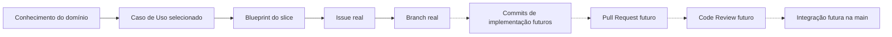

# Preparação e Governança de Repositório para o Primeiro Slice

**Trabalho:** Preparação e Governança do Repositório para o Primeiro Slice  
**Disciplina:** Desenvolvimento de Software - DSC 2026/1  
**Objeto da atividade:** Sistema desenvolvido pelo aluno ou pela equipe  
**Entrega:** Um `relatorio.md` e links verificáveis para os elementos criados no GitHub  

---

## 1. Objetivo

Nesta atividade, você deverá preparar de forma prática o repositório do seu sistema para receber a implementação futura do primeiro *slice*, aplicando os procedimentos de Git e GitHub estudados nos materiais e relacionando-os ao Caso de Uso selecionado anteriormente.

Ao final, o projeto deverá possuir uma base documentada, versionada e rastreável: uma organização, um repositório, documentação inicial, histórico de commits, política de colaboração e uma Issue associada ao primeiro *slice*. Você também deverá demonstrar que compreende o propósito de Pull Requests e Code Reviews, sem precisar executá-los nesta entrega.

> O trabalho é sobre o sistema da própria equipe ou do próprio aluno. O *UC07 - Confirmar Pedido* e os nomes utilizados nos materiais são exemplos didáticos: não devem ser copiados quando não corresponderem ao domínio do projeto.

---

## 2. Continuidade e escopo

Este trabalho parte do conhecimento e das decisões documentadas nas atividades anteriores: problema, domínio, atores, regras, Casos de Uso e blueprint do primeiro *slice*. Não refaça os trabalhos anteriores: recupere somente as informações necessárias para preparar e justificar a governança do repositório.

Nesta entrega, são **obrigatórias as ações práticas** de organização, documentação, Git, repositório, Issue e branch. **Não será exigida implementação** de funcionalidade, Controller, Application Service, Repository concreto, ORM, PostgreSQL, Docker, migrations, testes do Caso de Uso ou execução ponta a ponta. Os materiais de arquitetura descrevem essas responsabilidades e tecnologias, mas deixam sua implementação para etapas posteriores.

> **Pull Request e Code Review:** os materiais explicam sua função, conteúdo e critérios de qualidade, mas não apresentam o mesmo detalhamento operacional da interface que oferecem para a preparação do repositório e o trabalho com Git. Por isso, nesta atividade serão cobrados o planejamento e os critérios de PR/review — não sua execução obrigatória. Não crie alterações artificiais apenas para simular um PR.

### Governança dos documentos anteriores

Não será obrigatório atualizar e reenviar os trabalhos anteriores. Entretanto, qualquer divergência descoberta agora deverá ser registrada no relatório, identificando qual documento ou decisão precisará de revisão. Essas revisões serão importantes para manter a documentação confiável durante o desenvolvimento futuro.

---

## 3. Atividades

### Etapa A — Identificação do projeto e do primeiro slice

Apresente uma síntese curta e identificável do projeto:
* Nome do sistema e integrantes, quando houver;
* Problema que o sistema resolve;
* Caso de Uso selecionado para o primeiro *slice*, com seu identificador, se já existir;
* Ator, objetivo e resultado observável;
* Regra central, conceito de domínio envolvido e limites do recorte;
* Referência à documentação anterior que justifica a escolha.

Preencha a tabela a seguir:

| Elemento | Informação do projeto | Origem na documentação anterior |
| ----- | ----- | ----- |
| **Sistema** | ... | ... |
| **Caso de Uso** | ... | ... |
| **Regra central** | ... | ... |
| **Conceito principal do domínio** | ... | ... |
| **Limites do primeiro slice** | ... | ... |

*Não é necessário reproduzir a especificação funcional completa nem o blueprint inteiro.*

---

### Etapa B — Organização e repositório no GitHub (execução prática)

Crie ou utilize uma GitHub Organization correspondente ao projeto e crie nela o repositório do sistema. Caso o repositório já exista, verifique e justifique como ele atende aos critérios.

O repositório deve:
* Pertencer à organização, e não apenas à conta pessoal de um integrante;
* Ter nome representativo do sistema, e não apenas do Caso de Uso;
* Possuir descrição compreensível;
* Conter a branch principal `main`;
* Ter visibilidade e acessos adequados à orientação da disciplina.

Registre o link da Organization e o link do repositório. Explique em um parágrafo por que o repositório deve ser considerado um ativo do projeto.

---

### Etapa C — Documentação inicial no repositório (execução prática)

Crie ou atualize no repositório:

* **`README.md`**: deve informar, de modo objetivo, nome e propósito do sistema, contexto, responsáveis, tecnologias previstas (distinguindo previstas de efetivamente configuradas), estágio atual, primeiro *slice* escolhido, organização do repositório e referência à documentação complementar. *Não afirme que a API, o banco ou os containers estão funcionando se isso não foi realizado.*
* **`docs/visao-geral.md`**: deve consolidar o problema, contexto do domínio, fronteiras já identificadas, Caso de Uso selecionado, regra central, conceitos relacionados, decisões arquiteturais iniciais e referências aos artefatos anteriores. Esta visão geral é uma síntese, não um novo trabalho de análise.
* **`.gitignore`**: inclua exclusões pertinentes aos arquivos e ferramentas efetivamente usados ou já previstos, sem apagar documentos úteis do projeto. *Não versionar segredos, tokens, senhas nem arquivos `.env` com valores sensíveis.*
* **`.env.example`**: inclua apenas se houver variáveis de ambiente já conhecidas que precisem ser documentadas; use nomes e valores de exemplo não sensíveis. *Não é necessário criar uma configuração técnica que ainda não existe.*

No relatório, inclua links para os arquivos do repositório e uma análise breve: *alguém de fora da equipe consegue compreender o sistema, seu estágio e o próximo passo a partir desses documentos?*

---

### Etapa D — Git local e histórico (execução prática)

Utilize o repositório local para realizar mudanças reais na documentação. Demonstre a sequência estudada:

```bash
git clone <URL_DO_REPOSITORIO>
cd <NOME_DO_REPOSITORIO>
git status
git add .
git commit -m "docs (project): registra visão geral do sistema"
git push origin main
```

*(Os comandos são exemplos, adapte-os ao estado real do repositório. Se o repositório já estiver clonado, não é necessário cloná-lo novamente. Se o primeiro commit já existir, não o recrie artificialmente. Verifique o estado antes de cada operação).*

No relatório, registre:

| Ação real | Evidência ou referência | O que demonstra |
| ----- | ----- | ----- |
| **Trabalho local / git status** | Descrição ou saída textual relevante | |
| **Preparação das alterações / staging** | Descrição sucinta | |
| **Commit de documentação** | Link ou hash do commit | |
| **Publicação no remoto** | Link para o histórico/commit publicado | |

Explique a diferença entre editar um arquivo, prepará-lo com `git add`, registrar com `git commit` e publicar com `git push`. *Qualidade e coerência do histórico valem mais que quantidade de commits.*

---

### Etapa E — Colaboração e permissões (execução prática e justificativa)

Configure ou verifique os membros e os acessos necessários na Organization e no repositório. Quando houver equipe, utilize Team se for adequado à organização do projeto. Para trabalho individual, apresente a responsabilidade administrativa e eventuais necessidades de acesso para leitura/revisão, sem inventar colaboradores.

| Membro ou Team | Função | Acesso concedido ou necessário | Justificativa |
| ----- | ----- | ----- | ----- |
| | | Read / Triage / Write / Maintain / Admin | |

Explique por que aplicou o princípio do menor privilégio. Não atribua Admin a todas as pessoas apenas por conveniência. Registre apenas informações necessárias à avaliação, sem divulgar dados privados de integrantes ou credenciais.

---

### Etapa F — Issue vinculada ao primeiro slice (execução prática)

Crie uma Issue real no repositório para representar a implementação futura do Caso de Uso selecionado. A Issue deve conter:
* Título específico, descrevendo o comportamento do projeto;
* Objetivo do trabalho;
* Referência à especificação do Caso de Uso;
* Regras do domínio relevantes;
* Dependências e limites do recorte;
* Resultado esperado;
* Critérios de aceitação que possam ser verificados quando a implementação existir.

*Não registre os critérios de aceitação como concluídos antecipadamente.*

No relatório, inclua o link da Issue e explique por que ela é uma unidade de trabalho, e não substituta da especificação funcional.

---

### Etapa G — Branch de trabalho (execução prática)

Crie uma branch vinculada à preparação documental ou à Issue do primeiro *slice*. O nome deve comunicar a finalidade real do trabalho. Antes de criá-la, assegure-se de que sua `main` local está atualizada e que não há alterações não registradas que possam ser afetadas.

Exemplo didático:

```bash
git switch main
git pull --rebase origin main
git switch -c feat/issue-7-comportamento-escolhido
```

Use o número verdadeiro da Issue e um nome correspondente ao seu projeto. Uma branch `feat/...` pode ficar preparada para o desenvolvimento futuro e não precisa conter código funcional nesta etapa. Como alternativa, se estiver registrando uma mudança documental real, uma branch `docs/...` é apropriada.

Publique a branch no remoto para possibilitar sua verificação:

```bash
git push -u origin <NOME_REAL_DA_BRANCH>
```

Registre seu nome, link da branch e a relação dela com a Issue ou a mudança documental. Não realize commits vazios ou mudanças artificiais apenas para cumprir o requisito.

---

### Etapa H — Planejamento do Pull Request e do Code Review

*Esta etapa é de planejamento, não de execução obrigatória.*

#### Pull Request
Descreva o conteúdo que um futuro Pull Request deverá apresentar para que a mudança possa ser compreendida e avaliada:
* Objetivo e resumo da mudança;
* Issue relacionada;
* Decisões relevantes;
* Modo de validação e evidências;
* Limitações conhecidas;
* Pontos que merecem atenção na revisão.

Explique por que um `push` para uma branch remota não equivale a integrar a mudança à `main`.

#### Code Review
Elabore um checklist enxuto para orientar um futuro revisor:

| Dimensão | Pergunta de revisão relacionada ao primeiro slice |
| ----- | ----- |
| **Domínio** | A regra central está protegida no lugar correto? |
| **Aplicação / Arquitetura** | A coordenação está separada da decisão de negócio? Os limites e dependências previstos foram respeitados? |
| **Qualidade** | Os nomes e as mudanças comunicam intenção? |
| **Validação futura** | As evidências correspondem aos critérios de aceite? |

Complemente com um exemplo de comentário técnico construtivo, relativo a uma possível inconsistência do seu próprio *slice*, e explique como o autor deveria responder: analisar, corrigir ou justificar, e permitir nova avaliação.

*Não é necessário abrir PR, solicitar aprovação, executar Code Review ou realizar merge nesta entrega. Se a equipe já tiver um PR real de documentação, poderá citá-lo como evidência complementar, sem pontuação adicional automática.*

---

### Etapa I — Rastreabilidade do trabalho

Crie um diagrama Mermaid adaptado ao estado real do projeto. Diferencie o que já existe daquilo que está planejado. Exemplo estrutural:



Explique como um futuro desenvolvedor poderá percorrer essa cadeia para descobrir por que determinado código foi criado.

---

### Etapa J — Revisões de documentação e reflexão crítica

Identifique problemas, divergências ou descobertas que afetam a documentação anterior.

| Artefato ou decisão anterior | Revisão identificada | Justificativa | Impacto futuro |
| ----- | ----- | ----- | ----- |
| | | | |

*Se não houver revisões, explique por que o material anterior continua coerente com a preparação atual.*

Responda também, de forma objetiva:

1. O que a organização do repositório revelou sobre o estágio real do projeto?
2. Qual é a ligação verificável entre o Caso de Uso, a Issue e a branch?
3. Por que um commit com mensagem clara é mais útil do que um commit chamado "final"?
4. Qual risco existe ao manter alterações sem revisão na `main`?
5. Que parte do processo de PR/review sua equipe ainda precisará praticar antes da implementação efetiva?
6. O que precisa estar pronto para que outra pessoa continue o desenvolvimento sem depender de explicações informais?

---

## 4. Formato obrigatório e entrega

Entregue um **único arquivo `.md`** contendo o relatório das etapas anteriores. O relatório deverá ser autossuficiente e apresentar links verificáveis para a Organization, repositório, arquivos, commits, Issue e branch.

O código e os documentos versionados permanecem no GitHub; não é necessário copiá-los integralmente para o relatório.

* **Texto, tabelas e listas:** Markdown.
* **Diagramas, fluxos e representações gráficas:** obrigatoriamente Mermaid incorporado ao Markdown.
* **Links:** inclua URLs reais de artefatos efetivamente criados.
* **Evidências:** prefira links e hashes verificáveis. Capturas de tela não substituem os artefatos do GitHub.
* **Sem implementação fictícia:** não apresente um recurso futuro como se já estivesse pronto.
* **Acesso de avaliação:** verifique se o professor poderá acessar os links. Repositórios privados exigem acesso autorizado; não é necessário torná-los públicos apenas para entregar o trabalho.

### Estrutura sugerida do relatório

1. Identificação do sistema e do primeiro slice
2. Organization e repositório
3. README e documentação inicial
4. Registro das operações Git e commits
5. Membros, Teams e permissões
6. Issue e critérios de aceitação
7. Branch e propósito
8. Planejamento do Pull Request
9. Planejamento do Code Review
10. Rastreabilidade em Mermaid
11. Revisões e pendências de governança
12. Reflexão crítica
13. Apêndice de uso de IA, quando aplicável

---

## 5. Critérios de avaliação

| Critério | Pontos |
| ----- | ----- |
| Continuidade com o Caso de Uso e blueprint anteriores | 10 |
| Organization e repositório adequadamente configurados | 10 |
| README.md, docs/visao-geral.md e higiene do repositório | 15 |
| Git local, commits, publicação e histórico coerente | 15 |
| Membros, Teams e permissões justificadas | 10 |
| Issue real, critérios de aceite e vínculo com o Caso de Uso | 15 |
| Branch real com identificação e finalidade rastreável | 10 |
| Planejamento fundamentado de PR e Code Review | 10 |
| Rastreabilidade, revisões e reflexão crítica | 5 |
| **Total** | **100** |

*A avaliação considera a qualidade, correção e verificabilidade dos artefatos, não a quantidade artificial de commits, branches ou comentários. Em projetos individuais, a configuração de colaboradores e Teams será avaliada pela adequação ao caso, sem exigir integrantes inexistentes.*

---

## 6. Uso de Inteligência Artificial

É permitido usar IA para organizar a documentação, revisar nomes de branches, sugerir estrutura de Issue e questionar decisões. A IA não comprova a execução de operações no GitHub: os links e o histórico deverão corresponder a ações realmente realizadas.

Se utilizou IA, inclua um apêndice com: ferramenta, finalidade, principais sugestões, verificações efetuadas, ajustes ou sugestões rejeitadas e uma reflexão sobre o que foi compreendido independentemente da ferramenta.

---

## 7. Resultado esperado

Ao concluir a atividade, o aluno ou a equipe deverá ter um repositório real, organizado e acessível para avaliação, com documentação inicial, histórico de mudanças, política coerente de colaboração, Issue do primeiro *slice* e branch rastreável. Também deverá saber como e por que utilizar Pull Requests e Code Reviews quando começar a implementação futura.

> Nesta etapa, o resultado principal não é um backend implementado: é uma **base confiável** para que a implementação possa começar sem perder o vínculo com o domínio, o Caso de Uso e as decisões anteriores.