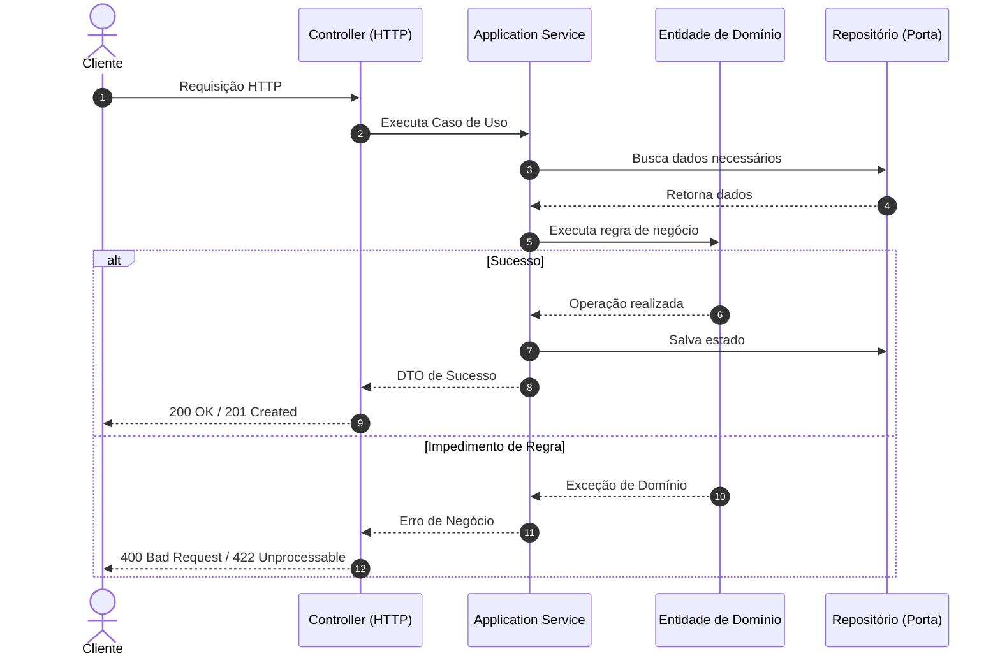

# Base Técnica NestJS 12 e Planejamento do Primeiro Slice Arquitetural

**NestJS 12: Base Técnica Validada e Transição para o Primeiro Slice do Sistema**

* **Disciplina:** Desenvolvimento de Sistemas - DSC 2026/1
* **Modalidade:** Individual ou em equipe, conforme o projeto desenvolvido na disciplina
* **Objeto de estudo:** Exclusivamente o sistema que o aluno ou a equipe vem desenvolvendo
* **Entrega principal:** Um arquivo Markdown (`.md`)
* **Evidência complementar:** Repositório GitHub com a aplicação NestJS e os artefatos práticos produzidos

---

## Apresentação

Nas atividades anteriores, foram investigados o problema, o domínio, os Casos de Uso, as decisões arquiteturais, o primeiro recorte funcional e a governança do repositório. Agora será preparada a base técnica real do backend, com **Node.js 24**, **pnpm 12** e **NestJS 12**, e comprovado seu funcionamento por meio de requisições HTTP.

A atividade possui duas frentes diferentes, que não devem ser confundidas:

1. **Execução prática:** Preparar e validar o ambiente, criar a aplicação NestJS 12, iniciá-la, estudar os arquivos gerados e comprovar a resposta `Hello World!` por três clientes HTTP.
2. **Análise aplicada ao próprio projeto:** Explicar como a base técnica poderá evoluir, no futuro, para o primeiro *slice* arquitetural já selecionado, distinguindo responsabilidades, regras de negócio, contratos e infraestrutura sem implementar esse *slice* agora.

> **Aviso Didático:** O exemplo *UC07 - Confirmar Pedido* apresentado no material é exclusivamente didático. Não o reproduza como se fosse o domínio do projeto da equipe. Cada equipe deverá adaptar a análise ao seu sistema e ao seu Caso de Uso selecionado.

---

## Questão Orientadora

> *Como demonstrar que temos uma aplicação NestJS 12 efetivamente funcional e, ao mesmo tempo, preservar as decisões de domínio e arquitetura que orientarão a implementação posterior do primeiro comportamento real do nosso sistema?*

---

## Limites da Atividade (Leitura Obrigatória)

* **Execução obrigatória:** É obrigatório executar e validar a base técnica do backend. Não basta apresentar comandos copiados ou descrever como a aplicação funcionaria.
* **Escopo limitado:** Não será exigida nesta entrega a implementação do primeiro *slice* de negócio, nem a construção de entidades de domínio, Application Services reais, DTOs de negócio, Commands, repositories concretos, ORM, conexão PostgreSQL, Docker, migrations, autenticação, autorização ou testes automatizados de regras de negócio.
* **Sem simulação no código:** Não crie endpoints adicionais ou altere o template `Hello World!` para simular uma implementação arquitetural. A análise do *slice* pode utilizar tabelas, descrições, contratos conceituais e diagramas Mermaid.

---

## Continuidade Documental e Governança

Este trabalho não substitui nem exige o reenvio dos trabalhos anteriores. Se o estudo da base técnica ou da arquitetura revelar inconsistências nos documentos já produzidos, registre-as neste arquivo, indicando qual documento precisa de revisão, por quê e qual é o impacto esperado. A atualização efetiva dos documentos anteriores pode ocorrer posteriormente, mas essas pendências devem permanecer rastreáveis para a governança do projeto.

---

# PARTE A: Preparação e Execução Prática do Backend

## Etapa 1: Identificação do Sistema e do Ponto de Partida

Apresente sinteticamente:
* Nome do sistema e responsáveis;
* Endereço da Organization e do repositório GitHub;
* Problema que o sistema resolve e público interessado;
* Caso de Uso / primeiro *slice* já selecionado e motivo da escolha, em poucas linhas;
* Estágio do backend antes de iniciar este trabalho (inexistente, parcialmente criado ou já inicializado);
* Sistema operacional e terminal utilizados, sem expor dados pessoais sensíveis.

*(Não reescreva o trabalho de especificação funcional ou o blueprint anterior. Faça referência aos artefatos existentes).*

---

## Etapa 2: Inventário e Compatibilidade do Ambiente

Execute os comandos apropriados no terminal e registre saídas reais, sem inventar resultados:

```bash
node -v
npm -v
pnpm -v
nest --version
```

Preencha a tabela abaixo:

| Ferramenta | Versão observada | Linha adotada | Compatível? | Intervenção necessária? |
| :--- | :--- | :--- | :--- | :--- |
| **Node.js** | | 24, compatível com Nest CLI 12 | | |
| **npm** | | Compatível com Node.js | | |
| **pnpm** | | 12 | | |
| **Nest CLI** | | 12 | | |

* Explique a diferença entre Node.js, npm, pnpm, TypeScript, framework NestJS e Nest CLI.
* Justifique a escolha de um único gerenciador de dependências para o projeto.
* Non confunda a versão global da CLI com a versão do framework instalado no projeto.

> **Critério:** Verificar antes de instalar. Ferramentas presentes e compatíveis não devem ser reinstaladas apenas para cumprir a atividade.

---

## Etapa 3: Diagnóstico e Recuperação (Somente se Necessário)

Se ocorreu alguma falha, registre-a usando a estrutura abaixo:

| Sintoma real | Interpretação | Diagnóstico executado | Correção aplicada | Validação após a correção |
| :--- | :--- | :--- | :--- | :--- |
| | | | | |

*(Considere, quando ocorrerem: `command not found`, versão incompatível, executável fora do `PATH` ou `ERR_PNPM_NO_GLOBAL_BIN_DIR`. Adapte os procedimentos ao sistema operacional utilizado).*

> Se não houve falhas, registre expressamente: *"Não foi necessária recuperação do ambiente"*, explicando como a compatibilidade foi comprovada. Não provoque erros, não altere `PATH` ou `PNPM_HOME` preventivamente e não invente um incidente.

---

## Etapa 4: Criação ou Verificação da Aplicação NestJS 12

Utilize o ambiente validado para criar a estrutura inicial do backend do seu sistema, com nome coerente com o repositório e com o projeto.

Ao criar a aplicação, utilize as escolhas padronizadas:
* **pnpm** como gerenciador de pacotes;
* **ESM** como sistema de módulos;
* **Vitest** como ferramenta de testes selecionada;
* **Não** configurar `@nestjs/observe` nesta etapa.

Registre o comando efetivamente utilizado, as decisões apresentadas pela CLI e eventuais diferenças entre seu ambiente e os exemplos. Se a estrutura já existia, não recrie o projeto: confira o estado real, a compatibilidade e a organização do repositório.

*Diferencie estrutura gerada, dependências instaladas, aplicação iniciada e aplicação validada. Explique como verificou cada uma dessas condições.*

---

## Etapa 5: Dependências, Projeto e Execução

Na raiz da aplicação, verifique:
* `package.json` e o script `start:dev`;
* A presença das dependências instaladas;
* `pnpm-lock.yaml` como registro de resolução de dependências;
* A versão local do framework executando:

```bash
pnpm list @nestjs/core
```

Inicie a aplicação com:

```bash
pnpm start:dev
```

* Informe a versão efetiva de `@nestjs/core`, a saída relevante dos logs, a porta em uso e a URL de teste.
* Explique por que uma mensagem de inicialização bem-sucedida ainda não comprova que uma requisição HTTP obteve resposta.

> **Atenção:** Se a instalação de dependências já foi concluída, não repita `pnpm install` desnecessariamente. Se uma porta estiver ocupada, investigue a causa e registre a solução adotada em vez de presumir o resultado.

---

## Etapa 6: Leitura dos Arquivos Gerados

Inspecione os arquivos reais da aplicação, sem precisar alterar o código, e preencha:

| Arquivo | O que identificou no código? | Qual é o papel no Hello World? |
| :--- | :--- | :--- |
| `package.json` | | |
| `src/main.ts` | | |
| `src/app.module.ts` | | |
| `src/app.controller.ts` | | |
| `src/app.service.ts` | | |

* Explique o caminho pelo qual a mensagem retornada pelo `AppService` chega à resposta HTTP.
* Diferencie Module, Controller e Provider/Service no template de conceitos arquiteturais como Domínio, Application Service e Bounded Context.

---

## Etapa 7: Três Experimentos HTTP Obrigatórios

Com a mesma aplicação em execução, realize os seguintes experimentos na rota inicial `GET /`:

* **Experimento A (Navegador):** Acesse a URL local da aplicação, normalmente `http://localhost:3000/`.
* **Experimento B (REST Client):** Crie um arquivo `requests.http` contendo a requisição correspondente à porta efetivamente utilizada:
  ```http
  GET http://localhost:3000/
  ```
* **Experimento C (cURL):** Em outro terminal, execute a requisição equivalente. Para observar também os cabeçalhos, utilize a opção `-i`:
  ```bash
  curl -i http://localhost:3000/
  ```

Registre o resultado observado em cada cliente:

| Cliente | Requisição realizada | Status observado | Corpo observado | Evidência no relatório/repositório |
| :--- | :--- | :--- | :--- | :--- |
| **Navegador** | | | | |
| **REST Client** | | | | |
| **cURL** | | | | |

> O cenário de referência é `200 OK` e `Hello World!`. Não invente saídas: se algo divergiu, registre o resultado e investigue. Compare o que permanece igual (servidor, rota, comportamento esperado) e o que muda (cliente e forma de visualizar a resposta).

Inclua o conteúdo relevante do `requests.http` no repositório e registre evidências textuais das execuções no Markdown.

---

## Etapa 8: Checkpoint de Prontidão Técnica

Complete a tabela com **Sim / Não / Parcial**, acompanhada de evidência ou explicação:

| Verificação | Situação | Evidência / Observação |
| :--- | :---: | :--- |
| Ferramentas e versões compatíveis | | |
| Projeto NestJS 12 criado ou validado | | |
| `pnpm` utilizado como gerenciador do projeto | | |
| Configuração ESM/Vitest conferida | | |
| Dependências instaladas | | |
| Framework NestJS 12 verificado no projeto | | |
| Aplicação iniciada sem erro bloqueante | | |
| Porta e endereço identificados | | |
| Principais arquivos compreendidos | | |
| `GET /` validado no navegador | | |
| `GET /` validado no REST Client | | |
| `GET /` validado no cURL | | |
| Código e documentação relevantes versionados no GitHub | | |

*Explique, em um parágrafo, o que o Hello World comprova e o que ainda não comprova sobre o sistema.*

---

# PARTE B: Transição Arquitetural Aplicada ao Sistema da Equipe

*Todas as etapas desta parte são de análise e planejamento. Elas devem utilizar o Caso de Uso já selecionado e a documentação produzida anteriormente; não exigem código de negócio funcional.*

---

## Etapa 9: Da Prova de Vida ao Comportamento Real

Identifique o primeiro Caso de Uso do seu sistema, reaproveitando o recorte previamente estabelecido:

| Item | Definição fundamentada no próprio projeto | Referência à documentação anterior |
| :--- | :--- | :--- |
| **Caso de Uso** | | |
| **Ator e objetivo** | | |
| **Resultado esperado** | | |
| **Conceitos do domínio envolvidos** | | |
| **Regra de negócio central** | | |
| **Elementos incluídos no primeiro recorte** | | |
| **Elementos deliberadamente excluídos** | | |

*Explique por que um endpoint simples Hello World! não substitui a implementação deste comportamento.*

---

## Etapa 10: Responsabilidades Antes de Classes e Pastas

Decomponha o comportamento selecionado em ações e decisões necessárias, sem partir de uma árvore de diretórios pré-definida:

| Responsabilidade identificada | Papel arquitetural provável (Interface / Aplicação / Domínio / Infraestrutura) | Por que pertence a esse papel? | Evidência no Caso de Uso |
| :--- | :--- | :--- | :--- |
| | | | |

> **Princípio:** Controller recebe e traduz; Application Service coordena; Domínio decide e protege invariantes; Infraestrutura realiza detalhes técnicos. Evite atribuir regras de negócio a um Service genérico apenas por causa do nome fornecido pelo NestJS.

---

## Etapa 11: Comportamento, Estados e Invariantes

Identifique a regra central e, quando aplicável, a mudança de estado prevista para o primeiro *slice*. Responda:

1. Qual conceito do domínio precisa proteger a decisão?
2. Qual operação representa intenção de negócio, em vez de simples atribuição de um campo?
3. Que condições permitem ou impedem a operação?
4. Que informações deverão ser fornecidas ao domínio pela coordenação da aplicação?
5. Que dúvidas ainda impedem uma decisão definitiva?

*Caso exista ciclo de vida significativo, represente as transições planejadas em Mermaid, distinguindo transições permitidas, impedimentos e hipóteses. Não force um diagrama de estados para um Caso de Uso que não o justifique.*

---

## Etapa 12: Portas, Persistência e Limites Técnicos

Analise o que o Caso de Uso precisará obter ou preservar e quem deverá resolver os detalhes técnicos no futuro:

| Necessidade | Porta/abstração candidata | Quem a utiliza? | Possível implementação futura | Justificativa |
| :--- | :--- | :--- | :--- | :--- |
| | | | | |

* Explain por que Repository não é automaticamente uma tabela, um ORM nem o PostgreSQL.
* Indique, sem configurar, onde ORM, PostgreSQL e Docker poderão participar futuramente, caso sejam necessários ao *slice*.

> Não crie tabelas definitivas nem mapeamentos persistentes nesta entrega.

---

## Etapa 13: Fronteira HTTP e Intenção do Caso de Uso

Planeje a futura entrada HTTP do comportamento selecionado:

| Elemento | Proposta da equipe | Justificativa |
| :--- | :--- | :--- |
| **Método e rota** | | |
| **Dados recebidos na entrada** | | |
| **Necessidade de DTO** | Sim / Não / Em análise | |
| **Intenção Command ou Query** | | |
| **Componente que coordena** | | |
| **Comportamento solicitado ao domínio** | | |
| **Resultado independente de HTTP** | | |
| **Representação HTTP possível** | | |

> Não crie DTO, Command ou Query apenas para preencher a tabela. Diferencie endpoint, intenção, coordenação, regra de negócio e representação HTTP.

---

## Etapa 14: Resultados, Impedimentos e Falhas

Considere o comportamento real de seu sistema (não utilize o exemplo didático do professor):

| Cenário do próprio sistema | Significado | Categoria | Quem reconhece? | Possível tradução HTTP | Certeza / Dúvida |
| :--- | :--- | :--- | :--- | :--- | :--- |
| **Sucesso** | | | | | |
| **Informação necessária ausente** | | Aplicação (a justificar) | | | |
| **Operação impedida por regra/estado** | | Domínio (a justificar) | | | |
| **Falha técnica plausível** | | Infraestrutura (a justificar) | | | |

> A classificação deve preceder a escolha de status HTTP. A equipe não precisa inventar uma falha em cada categoria se isso não fizer sentido para o seu Caso de Uso; nesses casos, explique a ausência. Não represente indiscriminadamente todos os problemas como `500` nem devolva `200` para ocultar falhas.

---

## Etapa 15: Diagrama do Slice Futuro

Elabore em Mermaid um diagrama de sequência representando o comportamento que será implementado futuramente, incluindo as responsabilidades realmente necessárias ao seu sistema.

O diagrama deve contemplar:
* Ator/cliente e fronteira HTTP;
* Coordenação na aplicação;
* Domínio e sua decisão;
* Portas e infraestrutura necessárias;
* Resultado de sucesso;
* Ao menos uma alternativa/impedimento significativo (utilizando blocos `alt`/`else` no Mermaid).

*Explique o diagrama em texto, indicando o que já existe de fato (base NestJS) e o que está apenas planejado (comportamento real).*



---

## Etapa 16: Próximos Passos, Rastreabilidade e Governança

Monte um plano conciso do próximo desenvolvimento, sem executá-lo agora:

| Passo futuro | Objetivo | Dependência | Evidência de conclusão esperada |
| :--- | :--- | :--- | :--- |
| | | | |

* Inclua uma referência ao trabalho já organizado no GitHub (Issue/branch quando existentes) e explique como o novo backend técnico se relaciona com a documentação do primeiro *slice*.

Registre pendências de atualização documental:

| Artefato anterior | Revisão percebida | Motivo/evidência | Impacto futuro | Prioridade |
| :--- | :--- | :--- | :--- | :--- |
| | | | | |

---

## Etapa 17: Reflexão Crítica

Responda com base no que foi efetivamente realizado:

1. Que evidência demonstra que sua aplicação NestJS está funcionando, além do log de inicialização?
2. Que dificuldade técnica ocorreu? Se não houve, qual checkpoint evitou intervenções desnecessárias?
3. Qual diferença foi percebida entre Nest CLI e framework NestJS?
4. O que os arquivos do template explicam sobre a requisição `GET /`?
5. Por que o NestJS não determina sozinho a arquitetura do sistema?
6. Em que o primeiro *slice* da equipe difere do `Hello World!`?
7. Qual regra do domínio exigirá maior cuidado durante a implementação?
8. Qual responsabilidade seria fácil posicionar incorretamente em um Service ou Controller?
9. Que parte do blueprint anterior foi confirmada ou precisa ser refinada?
10. O que ainda não está pronto para afirmar que o primeiro *slice* do seu sistema funciona?

---

## Apêndice: Uso de Inteligência Artificial

O uso de IA é permitido como apoio a explicações, diagnóstico, revisão de documentação, questionamento de hipóteses e interpretação de erros. A equipe continua responsável pela exatidão dos comandos, código, saídas de terminal, decisões e conclusões.

Se utilizou IA, preencha as informações abaixo:

* **Ferramenta utilizada:**
* **Finalidade:**
* **Exemplos de perguntas feitas:**
* **Contribuição real:**
* **Sugestões rejeitadas/corrigidas:**
* **Método de verificação:**
* **Resposta à pergunta:** *"Conseguiríamos explicar e repetir os procedimentos e defender as decisões sem a IA?"*

> É proibido tratar saídas simuladas por IA como evidência de execução real.

---

## Entrega e Formatação — Obrigatórios

* **Arquivo único:** Entregue um único arquivo `principal.md` (ou `relatorio.md`) contendo todas as seções solicitadas, nome do sistema, integrantes e link do repositório.
* **Formatação em Markdown:** Toda a redação, títulos, tabelas, códigos e listas devem estar estritamente formatados em Markdown.
* **Diagramas em Mermaid:** Todos os fluxos/diagramas devem ser codificados em blocos Mermaid no próprio Markdown, acompanhados de explicação em texto.
* **Blocos de Código:** Comandos, configurações e respostas devem utilizar blocos de código identificados (`bash`, `http`, `text`, `json`, etc.).
* **Repositório GitHub:** Inclua link válido para o repositório contendo a aplicação NestJS 12, `package.json`, lockfile, código do template e o `requests.http` utilizado.
* **Regras de Segurança:** Informações de conta, tokens, senhas, arquivos `.env` com segredos, caminhos sensíveis e outros dados privados **não** devem aparecer nas evidências.

---

## Cobre de Avaliação

| Critério | Pontos |
| :--- | :---: |
| Continuidade com o projeto e rastreabilidade documental | 10 |
| Verificação, compatibilidade e diagnóstico responsável do ambiente | 15 |
| Criação/configuração e execução efetiva da aplicação NestJS 12 | 15 |
| Leitura fundamentada dos arquivos e componentes do template | 10 |
| Validação HTTP pelos três clientes e qualidade das evidências | 20 |
| Aplicação do raciocínio arquitetural ao primeiro *slice* da equipe | 15 |
| Análise de portas, fronteira HTTP, resultados e falhas | 5 |
| Governança, documentação, Mermaid e reflexão crítica | 10 |
| **Total** | **100** |

---

## Resultado Esperado

Ao concluir, a equipe deverá possuir:
* Ambiente compatível e diagnosticado quando necessário;
* Aplicação NestJS 12 real, executável e versionada;
* `GET /` validado por navegador, REST Client e cURL;
* Compreensão dos arquivos e mecanismos iniciais do NestJS;
* Distinção explícita entre base técnica validada e primeiro Caso de Uso implementado;
* Análise documentada de como a base evoluirá para o primeiro *slice* do seu sistema;
* Pendências de governança registradas para etapas futuras.

> **Conclusão:** A base técnica estará pronta quando executarmos e observarmos seu funcionamento. O primeiro *slice* só estará pronto quando, em etapa posterior, o sistema efetivamente realizar um comportamento de negócio com as responsabilidades e regras corretas.