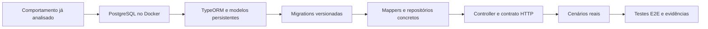
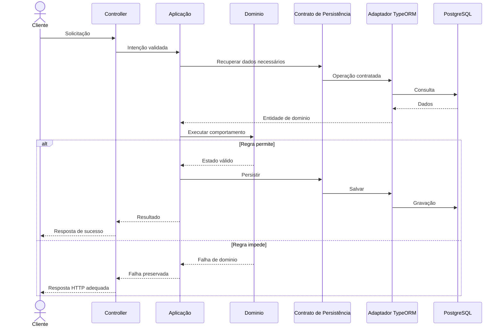

# Implementação e Validação de API Persistente com NestJS e PostgreSQL

**Trabalho:** Do Domínio à API Persistente: Implementação e Validação do Primeiro Slice  
**Disciplina:** Desenvolvimento de Sistemas - DSC 2026/1  
**Base de estudo:** materiais da Missão 07 (unidades 01 a 08)  
**Modalidade:** individual ou em equipe, conforme o projeto já desenvolvido  
**Objeto obrigatório:** o sistema próprio de cada aluno ou equipe  

## Objetivo

Implementar e validar um comportamento real, delimitado e rastreável do sistema que você já desenvolve, conectando a aplicação NestJS ao PostgreSQL com Docker Compose e TypeORM, preservando as responsabilidades do domínio e da aplicação, expondo o comportamento por HTTP e verificando seu resultado com cenários reais e testes automatizados de ponta a ponta (E2E).

A trajetória deste trabalho é:



A atividade deve ser aplicada ao sistema da equipe. UC07 Confirmar Pedido, Order, Payment e as rotas do CeliLac são referências didáticas, e não requisitos ou nomes que devam ser copiados. Escolha os conceitos, regras, estados, entidades e rotas que efetivamente pertencem ao seu projeto.

## Continuidade e condições de partida

Este trabalho desenvolve, na prática, um primeiro slice anteriormente especificado ou planejado. Retome a documentação do problema, os Casos de Uso, o modelo de domínio, as regras, o blueprint e as decisões de arquitetura e governança já produzidas. Não refaça integralmente essas análises. Use-as para justificar o código implementado.

Antes de iniciar, verifique e registre o estágio real do projeto: aplicação NestJS 12 executável, comportamento selecionado, entidades de domínio e contratos de persistência já existentes, testes unitários disponíveis e repositório GitHub acessível. Os materiais desta missão partem da premissa de que o comportamento de domínio e seus contratos já foram trabalhados anteriormente.

Se algum pré-requisito ainda não estiver implementado no projeto da equipe, registre explicitamente a lacuna, implemente somente o mínimo necessário para sustentar o slice e explique sua origem e suas implicações. Não declare que um teste passou, que uma regra já existia ou que um componente estava concluído quando isso não ocorreu. Ajustes no domínio devem ser justificados e protegidos por testes.

## Delimitação do slice

Escolha um Caso de Uso com persistência e resultado observável, compatível com o sistema e viável para esta etapa. Ele deverá permitir, de modo legítimo, demonstrar: leitura e/ou gravação real, participação da regra do domínio, interação HTTP e verificação de um efeito persistido. Outros conceitos poderão atuar como suporte, sem obrigar a implementação de todos os Casos de Uso do sistema.

Quantidade não substitui coerência: não crie entidades, pagamentos, estados, endpoints ou falhas artificiais para reproduzir os exemplos do professor ou aumentar o volume de código.

## Identificação do projeto e rastreabilidade

### Etapa 1

Apresente, de forma sucinta:

| Item | Informação |
|---|---|
| Sistema | |
| Aluno(s)/ equipe | |
| URL da Organization, se houver | |
| URL do repositório | |
| Branch e referência de commit avaliado | |
| Caso de Uso selecionado | |
| Ator e objetivo | |
| Regra principal do domínio | |
| Resultado observável | |
| Documentação de origem | |

Justifique por que o recorte escolhido representa valor real ao ator. Indique o que entra e o que fica fora desta implementação. Relacione a especificação funcional e o blueprint anteriores ao que será construído.

### Etapa 2: Levantamento do estado inicial e preservação da arquitetura

Localize no repositório os componentes já existentes: conceito(s) do domínio, Application Service ou equivalente, regras/invariantes, contratos de repositório, testes unitários, módulos NestJS e configuração existente.

Preencha:

| Responsabilidade | Elemento real do projeto | Já existe? | Alteração necessária? |
|---|---|---|---|
| Regra e comportamento de domínio | | | |
| Coordenação do Caso de Uso | | | |
| Porta(s) de persistência | | | |
| Adaptador(es) concretos | | | |
| Representação HTTP | | | |

**Regra arquitetural:** o domínio decide a validade das mudanças e protege invariantes, a aplicação coordena, a infraestrutura persiste, o Controller recebe e traduz. A introdução do banco não autoriza mover a regra de negócio para o repositório, ORM ou Controller.

### Etapa 3: PostgreSQL isolado em Docker Compose

Implemente e valide, no repositório do próprio sistema, um `compose.yaml` funcional para PostgreSQL. Nesta etapa, não é necessário executar o backend dentro do Docker, os materiais começam pelo banco isolado.

Documente:
- Serviço PostgreSQL, imagem utilizada, porta publicada, configurações de ambiente, volume nomeado e verificação de saúde, quando configurada.
- Validação do Compose, inicialização, inspeção do estado do container e conexão com psql.
- Uma consulta SQL que comprove acesso ao banco.
- Teste controlado de persistência após recriação do container sem remoção do volume, explicando o que foi preservado e por quê.

Comandos de referência, adaptando o nome do serviço e o usuário/banco efetivos:
```bash
docker compose config
docker compose up -d
docker compose ps
docker compose exec postgres psql -U USUARIO -d BANCO
```
**Atenção:** não use `docker compose down -v` para validar persistência: ele remove os volumes declarados e pode apagar dados. Não reutilize credenciais didáticas em produção.

### Etapa 4: TypeORM e fronteira com o domínio

Instale ou confira as dependências `@nestjs/typeorm`, `typeorm` e `pg`, sem duplicar instalações. Explique a função de cada uma e demonstre a separação entre Entidade de Domínio e ORM Entity.

| Conceito do domínio | Representação TypeORM | Motivo da separação |
|---|---|---|
| | | |

Verifique que as classes de domínio e a coordenação do Caso de Uso não importam diretamente TypeORM, driver PostgreSQL nem decorators de persistência. Registre o resultado da verificação.

### Etapa 5: Conexão NestJS-PostgreSQL e configuração segura

Integre TypeORM ao NestJS utilizando configuração compatível com a estrutura real do projeto. Empregue variáveis de ambiente para host, porta, banco, usuário e senha, mantenha um `.env.example` sem credenciais reais e proteja o `.env` no `.gitignore`.

Registre a configuração de conexão e o(s) módulo(s) em que ela ocorre.
- Utilize `synchronize: false`.
- Demonstre que NestJS inicia e que a conexão PostgreSQL é estabelecida.
- Diferencie aplicação iniciada, conexão estabelecida e operações de leitura/gravação comprovadas: são três verificações diferentes.

**Não envie senhas, tokens ou strings de conexão sensíveis no relatório, nos commits ou nas evidências.**

### Etapa 6: Modelos de persistência derivados do próprio domínio

Implemente as ORM Entities necessárias ao slice. Os campos devem derivar de informação real do domínio que precise ser persistida, não de uma cópia das classes `OrderEntity` e `PaymentEntity`.

| Elemento do domínio | Campo persistido | Tipo/identidade/restrição | Justificativa |
|---|---|---|---|
| | | | |

Explique a decisão sobre quem gera os identificadores, os estados persistidos, campos opcionais, relacionamentos e a capacidade de reconstruir uma entidade de domínio válida. Não exponha setters arbitrários no domínio apenas para satisfazer o ORM.

### Etapa 7: Migrations: esquema versionado e reproduzível

Prepare o Datasource destinado à CLI do TypeORM, registre as ORM Entities e configure scripts compatíveis com ESM e o projeto efetivo. Gere e inspecione a migration antes de aplicá-la.

Registre:
1. Como a migration foi gerada e em qual arquivo ficou versionada.
2. Que estruturas ela cria ou altera (up) e como reverte (down).
3. Identificadores, tipos, nulidade, unicidade, restrições, relacionamentos e estados relevantes.
4. Se foi usado schema public ou schemas específicos e por quê. Schemas por módulo são uma possibilidade demonstrada nos materiais, não uma imposição automática para todos os projetos.
5. Evidência de aplicação da migration e consulta ao esquema resultante no banco correto.

Mantenha `synchronize: false`. Não substitua migrations por alterações manuais sem registro. Não aplique uma migration sem confirmar o banco de destino.

### Etapa 8: Mappers: tradução sem executar regras

Implemente os mappers necessários entre ORM Entity e Entidade de Domínio, de acordo com os contratos reais de cada classe.
- Preserve identidade, estado e dados necessários às invariantes.
- Utilize mecanismo legítimo de reconstituição (construtor, factory ou outro já definido), sem chamar o comportamento de negócio apenas para restaurar um estado previamente persistido.
- Não transfira as decisões de negócio para o Mapper.

Inclua testes das conversões, com preservação dos campos essenciais e tratamento de dados inválidos quando a API do domínio exigir.
Explique um caso no qual uma conversão incorreta poderia comprometer o comportamento do sistema, mesmo com o PostgreSQL funcionando.

### Etapa 9: Adaptadores concretos e injeção de dependências

Implemente as portas de persistência necessárias ao Caso de Uso usando adaptadores TypeORM, preserve as assinaturas de contrato e retorne representações de domínio, não ORM Entities, quando o contrato assim determinar.

Verifique as operações necessárias ao slice, por exemplo: localizar por identificador, recuperar um elemento relacionado e persistir a alteração válida. Não exija `findByOrderId` ou múltiplos repositórios se não fizerem sentido no domínio da equipe.

Registre os tokens/providers utilizados na injeção de dependências do NestJS e explique como a aplicação recebe a implementação correta sem depender diretamente dela.

Inclua uma verificação real de leitura e gravação que demonstre a conexão entre porta, Mapper, adaptador e PostgreSQL, sem contornar a regra do domínio para obter um estado final.

### Etapa 10: Exposição HTTP do Caso de Uso

Implemente um Controller NestJS para o Caso de Uso selecionado.

Documente:

| Elemento | Contrato real |
|---|---|
| Método HTTP | |
| Rota | |
| Parâmetros/body necessários | |
| Validação de entrada | |
| Componente de aplicação acionado | |
| Resposta de sucesso | |

Use Pipes e DTOs quando o contrato de transporte justificar. Não invente body ou DTO apenas por formalidade. Distinga erro de formato de entrada de recurso inexistente e de violação de Regra de Negócio.
O Controller não deve consultar o ORM, alterar estados de domínio diretamente ou reproduzir a regra de negócio. Preserve as assinaturas reais do Application Service.

### Etapa 11: Resultados, erros e tradução HTTP

Identifique os resultados e falhas realmente aplicáveis ao Caso de Uso da equipe e registre seu significado antes de escolher o status HTTP.

| Cenário | Categoria (entrada/aplicação/domínio/infraestrutura) | Onde é identificado | Resposta HTTP esperada | Justificativa |
|---|---|---|---|---|
| Sucesso | | | | |
| Falha relevante 1 | | | | |
| Falha relevante 2 | | | | |
| Falha técnica | | | | |

Implemente o tratamento de falhas compatível com os materiais, incluindo Exception Filter, quando houver exceções de aplicação/domínio a traduzir. Não acople as exceções do domínio a HttpException apenas para obter um status.

Confirme que a API não expõe SQL, stack traces, credenciais ou detalhes internos. Preserve o tratamento padrão de erros que o filtro não reconhece.

### Etapa 12: Cenários reais com PostgreSQL

Prepare dados reais para verificar o comportamento da API, usando mecanismos legítimos de criação e persistência, compatíveis com os estados e invariantes do domínio.

Inclua, no mínimo:
- um cenário de sucesso com efeito persistido observável;
- dois cenários distintos de impedimento ou falha, fundamentados no Caso de Uso real (por exemplo, identificador inválido, recurso inexistente, estado incompatível, condição de negócio não atendida);
- verificação do estado persistido após a operação de sucesso e após uma falha que não deveria alterar dados.

Se algum tipo de cenário não existir no domínio, não o invente. Explique a inaplicabilidade e selecione outro cenário legítimo.

Disponibilize requisições reproduzíveis em arquivo `.http` versionado no repositório, utilizando REST Client ou equivalente demonstrado. Registre também como reproduzi-las por curl quando pertinente. Não use UUIDS fixos cuja existência não seja garantida por preparação de dados.

### Etapa 13: Testes automatizados E2E

Implemente teste(s) E2E para o slice, utilizando o runner que já estiver configurado no projeto (nos materiais, o exemplo usa Vitest e Supertest). Não copie configuração Jest para um projeto Vitest.

O teste de sucesso deverá:
1. Preparar o ambiente e iniciar a aplicação NestJS.
2. Preparar os dados válidos do cenário no banco de teste.
3. Enviar a requisição pela fronteira HTTP.
4. Conferir status e corpo da resposta.
5. Reler o estado persistido e verificar o efeito esperado.
6. Limpar exclusivamente os dados criados pelo teste.
7. Encerrar a aplicação e liberar recursos.

Acrescente testes automatizados para pelo menos dois cenários de falha relevantes, verificando tanto a resposta HTTP quanto a preservação de estado quando aplicável.

**Requisito de segurança:** testes que gravam, apagam ou limpam dados devem operar em banco de teste identificado e isolado, nunca em produção. Garanta isolamento entre cenários e limpeza confiável mesmo em execução repetida. Escolha `beforeAll`, `beforeEach`, `afterAll` e `afterEach` conscientemente, conforme os recursos e a estratégia de isolamento.

Não confunda teste unitário de regra com teste E2E da fronteira HTTP. Não use mocks para substituir o PostgreSQL no cenário que afirma comprovar persistência real.

### Etapa 14: Diagrama do fluxo realmente implementado

Inclua no Markdown um diagrama Mermaid de sequência, com nomes e componentes do sistema da equipe, mostrando entrada HTTP, coordenação, decisão de domínio, contrato de persistência, adaptador, TypeORM e PostgreSQL. Apresente também um caminho de falha.

Exemplo de sintaxe estrutural (não copiar os nomes para o trabalho):



O exemplo é didático: em execução real, o fluxo entre contratos, implementações e entidades pode ser organizado de outra forma. O diagrama entregue deve corresponder ao código existente, não apenas à arquitetura idealizada.

### Etapa 15: Evidências verificáveis

Registre o comando efetivamente executado, o resultado esperado, o resultado observado e a localização da evidência.

| Verificação | Comando/ação real | Resultado observado | Evidência (arquivo, trecho de log sanitizado, commit ou referência) |
|---|---|---|---|
| PostgreSQL em execução | | | |
| Volume persistente | | | |
| TypeORM conectado | | | |
| Migration aplicada | | | |
| Leitura/gravação real | | | |
| API respondendo | | | |
| Cenário de sucesso | | | |
| Cenários de falha | | | |
| Testes E2E | | | |
| Testes unitários existentes | | | |

Logs e comandos podem ser incluídos em blocos de código no Markdown, com saídas reduzidas ao trecho pertinente e dados sensíveis ocultados. Screenshots são opcionais e não substituem evidências técnicas reproduzíveis.

### Etapa 16: Reprodutibilidade e governança GitHub

Atualize `README.md` do backend para permitir que outra pessoa, a partir do repositório, possa:
- identificar versões, dependências e pré-requisitos;
- criar o arquivo de ambiente a partir de `.env.example`;
- iniciar o PostgreSQL;
- instalar dependências do projeto;
- aplicar migrations na base prevista;
- iniciar a API;
- preparar cenários de teste;
- executar requisições HTTP;
- executar testes unitários e E2E;
- encerrar os serviços sem perda não intencional de dados.

Registre Issue(s), branch, commits e Pull Request(s) quando efetivamente utilizados, indique links reais. Não invente um PR ou review para completar a documentação. Mantenha o histórico rastreável e não faça commits de segredos ou artefatos locais como `node_modules`.

### Etapa 17: Revisões e pendências de governança

Durante a implementação, podem aparecer inconsistências entre documentação anterior e código atual: campos necessários à reconstituição, cardinalidades, nomes, estados, regras, contratos, erros e responsabilidades.

| Documento/decisão anterior | Descoberta atual | Revisão necessária | Impacto no desenvolvimento | Prioridade |
|---|---|---|---|---|
| | | | | |

Não será obrigatória a atualização e o reenvio dos trabalhos anteriores nesta entrega. Contudo, as revisões encontradas devem ser registradas, pois sua execução futura é necessária para manter a governança, a coerência e a rastreabilidade do sistema. Mudanças realizadas no código agora devem ser devidamente documentadas no repositório atual.

### Etapa 18: Análise crítica

Responda com base no seu código e nas execuções realizadas:
1. O que mudou entre um Caso de Uso testado com dublês e um Caso de Uso persistido em PostgreSQL real?
2. Qual é a evidência de que o domínio permaneceu independente de TypeORM e HTTP?
3. Como a equipe reconstrói entidades de domínio sem repetir transições de negócio?
4. Que restrições a migration materializa? Há alguma que precise ser protegida no domínio e não apenas no banco?
5. O que diferencia o resultado do Application Service da resposta HTTP?
6. Qual foi a falha mais difícil de classificar ou traduzir?
7. Que cenário demonstra que uma resposta HTTP correta não basta para comprovar persistência?
8. Como os testes evitam interferência entre execuções e perda de dados externos ao teste?
9. Qual limitação concreta ainda existe no primeiro slice?
10. Quais decisões ou documentos anteriores precisarão de revisão e por quê?

### Uso de Inteligência Artificial

IA pode auxiliar com diagnóstico, testes, leitura de código, identificação de acoplamento e revisão de contratos. A equipe permanece responsável pelo comportamento, pelas decisões, pela segurança dos dados e pela interpretação das evidências. Não apresente saídas inventadas por IA como resultados executados.

Se usar IA, inclua um apêndice no Markdown com: ferramenta/modelo (quando conhecido), finalidade, trechos ou decisões influenciados, validação humana realizada, problemas encontrados, sugestões rejeitadas e reflexão sobre a capacidade de explicar todo o código entregue sem a ferramenta.

## Entregáveis e forma de envio

### Entrega no ClassHero (obrigatória)

Envie um único arquivo principal em Markdown (`.md`), contendo as etapas realizadas, tabelas, justificativas, evidências, diagramas Mermaid e links reais para o repositório. Não envie o código-fonte em ZIP como substituição do repositório.

O arquivo principal deverá ser organizado, autossuficiente e compreensível sem explicação oral. Pode conter trechos de código e saídas curtas de terminal em blocos Markdown. Todos os gráficos, diagramas, fluxos e representações visuais usados como diagramas deverão ser escritos em Mermaid dentro do próprio `.md`.

### Entrega no GitHub (obrigatória)

Atualize o repositório GitHub do mesmo sistema desenvolvido nas atividades anteriores. O código implementado não precisa ser colado integralmente no relatório, pois será avaliado no GitHub.

O repositório deverá disponibilizar, conforme aplicável ao slice:
- backend NestJS e arquivos de configuração necessários à execução;
- `compose.yaml` com PostgreSQL e volume persistente;
- configuração TypeORM e `.env.example` seguro;
- ORM Entities e migrations versionadas;
- Mappers e repositórios concretos;
- registros de módulos, providers e injeção de dependências;
- Controller, validação HTTP e tradução de erros;
- arquivo(s) `.http` com cenários reproduzíveis;
- testes relevantes, incluindo E2E com persistência real;
- `README.md` atualizado com instruções de reprodução;
- histórico de commits que permita identificar a evolução.

No Markdown informe explicitamente: URL do repositório, branch e hash do commit final a ser avaliado. Em repositórios privados, garanta o acesso necessário ao professor, um link inacessível não permite validar o código.

O que não é exigido: implementar todo o sistema, reproduzir o CeliLac, adicionar pagamentos quando inexistentes no domínio, criar frontend, introduzir microserviços, mensageria ou integrações externas reais, configurar observabilidade avançada ou CI/CD sofisticado. O objetivo é um primeiro slice real, pequeno e completo, não volume de funcionalidades.

## Critérios de avaliação

| Critério | Pontos |
|---|---|
| Coerência com o Caso de Uso e rastreabilidade do sistema da equipe | 10 |
| Docker Compose, PostgreSQL, volume e evidências de conexão/persistência | 10 |
| Configuração TypeORM, ORM Entities e separação domínio/infraestrutura | 10 |
| Migrations versionadas e esquema validado | 10 |
| Mappers, adaptadores e injeção de dependências, com leitura/gravação real | 20 |
| Controller, contrato HTTP, validação e tratamento de falhas | 15 |
| Cenários reais e testes E2E com verificação de persistência e limpeza | 15 |
| Reprodutibilidade, evidências, GitHub, governança e análise crítica | 10 |
| **Total** | **100** |

A avaliação considera coerência e evidência técnica, não a quantidade de tabelas, classes, endpoints ou testes. Uma funcionalidade afirmada, mas não implementada, terá avaliação distinta de uma funcionalidade implementada e demonstrada. Impedimentos precisam ser descritos com precisão, acompanhados de diagnóstico e estado atual, não devem ser apresentados como resultados concluídos.

## Resultado esperado

Ao concluir a atividade, a equipe deverá demonstrar que o primeiro Caso de Uso escolhido não está apenas documentado nem apenas acessível por um endpoint - ele atravessa as fronteiras necessárias, preserva as regras do domínio, realiza operações reais com PostgreSQL, expõe resultados e falhas coerentes via HTTP e possui testes e evidências que permitem avaliar seu comportamento de ponta a ponta.

`Comportamento do domínio → aplicação → contratos → adaptadores → TypeORM → PostgreSQL → fronteira HTTP → cenários → testes E2E → governança.`