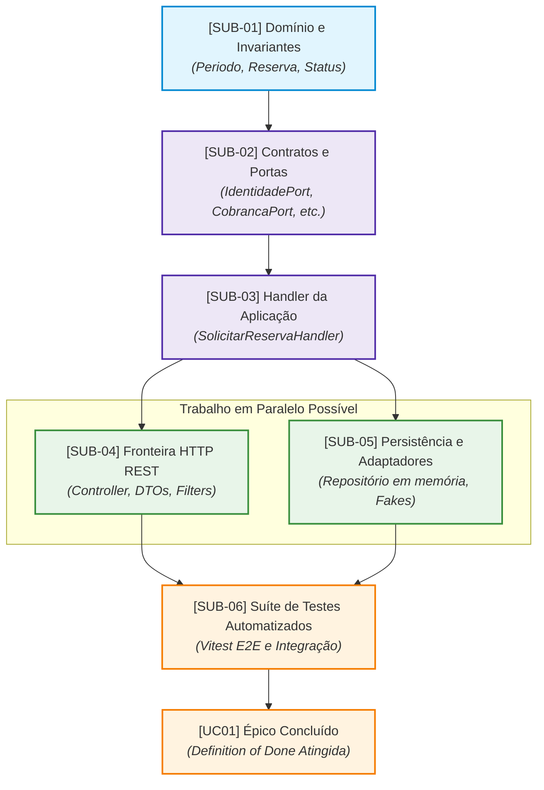

# Artefato 6 — Matriz de Dependências Técnicas

**Sistema:** MyCondo — Plataforma Integrada de Gestão de Condomínios  
**Caso de Uso:** UC01 — Solicitar Reserva de Área Comum  
**Responsável Técnico:** Vinicius Martins Nunes  
**Documentos de Referência:** `docs/trabalho_6_sistema_condominio.md`, `docs/trabalho_8_sistema_condominio.md`  
**Data do Planejamento:** 03 de novembro de 2026  

---

## 1. Mapeamento de Interdependências Técnicas

A tabela a seguir explicita a ordem de precedência técnica e as condições de desbloqueio entre as 6 Sub-Issues do caso de uso **UC01**, orientando o fluxo de trabalho da equipe de desenvolvimento sem riscos de retrabalho ou bloqueios circulares.

| Atividade | Atividades Pré-requisito | Justificativa Técnica da Dependência | Condição de Desbloqueio | Permite Paralelismo? |
| :---: | :---: | :--- | :--- | :---: |
| **SUB-01** (Domínio e Invariantes) | *Nenhum* | O domínio é o núcleo do sistema corporativo (Clean Architecture / Onion Architecture) e não depende de nenhuma outra camada ou framework externo. | Imediatamente desbloqueada para implementação. | **Não aplicável** (Primeira atividade a ser executada) |
| **SUB-02** (Contratos e Portas) | **SUB-01** | As portas de aplicação e repositório dependem dos tipos, enums e objetos de valor modelados no domínio (ex.: `Periodo`, `Reserva`, `ReservaStatus`). | `SUB-01` concluída com tipos e entidades exportados. | **Não** (Depende diretamente dos tipos do domínio) |
| **SUB-03** (Handler da Aplicação) | **SUB-01** **SUB-02** | O Handler orquestra as portas (`SUB-02`) e aciona os métodos de domínio (`SUB-01`) para criar a reserva e verificar sobreposição de agenda. | `SUB-01` e `SUB-02` aprovadas e integradas. | **Não** (Exige portas e domínio finalizados) |
| **SUB-04** (Fronteira HTTP REST) | **SUB-02** **SUB-03** | O Controller precisa instanciar o `SolicitarReservaCommand` (`SUB-02`) e delegar a execução ao `SolicitarReservaHandler` (`SUB-03`), além de mapear suas exceções. | `SUB-02` e `SUB-03` implementadas e testadas. | **Sim, parcial** (Pode ser iniciada em paralelo com `SUB-05` após `SUB-03`) |
| **SUB-05** (Persistência e Adaptadores) | **SUB-02** **SUB-03** | Os adaptadores concretos implementam as interfaces das portas (`SUB-02`) e o repositório persiste as instâncias manipuladas pelo Handler (`SUB-03`). | `SUB-02` e `SUB-03` implementadas e tipadas. | **Sim, parcial** (Pode ser executada em paralelo com `SUB-04`) |
| **SUB-06** (Suíte de Testes Automatizados) | **SUB-01** a **SUB-05** | A suíte de testes ponta a ponta e de integração necessita de todas as camadas (domínio, aplicação, HTTP e adaptadores) montadas no módulo NestJS. | Todas as sub-issues anteriores (`SUB-01` a `SUB-05`) concluídas. | **Não** (Atividade integradora final do Épico) |

---

## 2. Diagrama de Fluxo e Precedência Técnica

O fluxo de precedência pode ser visualizado como um Grafo Acíclico Dirigido (DAG), demonstrando que o planejamento é livre de acoplamentos circulares e viabiliza pontos de paralelismo:

---

## 3. Análise do Caminho Crítico e Oportunidades de Otimização

1. **Caminho Crítico do Planejamento:**
   $$\text{SUB-01} \rightarrow \text{SUB-02} \rightarrow \text{SUB-03} \rightarrow \text{SUB-04} \text{ (ou SUB-05)} \rightarrow \text{SUB-06}$$
   - Qualquer atraso em `SUB-01`, `SUB-02` ou `SUB-03` posterga diretamente o início dos adaptadores e da fronteira HTTP.
2. **Janela de Paralelismo:**
   - Assim que o `SolicitarReservaHandler` (`SUB-03`) estiver implementado e estabilizado, os membros da equipe podem atuar simultaneamente na implementação do Controller HTTP (`SUB-04`) e dos Adaptadores de Infraestrutura/Repositório (`SUB-05`), reduzindo o tempo total do ciclo de desenvolvimento (*lead time*).
3. **Ausência de Bloqueios Circulares:**
   - A ordenação estrita garante que dependências sempre fluam das camadas externas para as internas ou sigam contratos de inversão de dependência (*Dependency Inversion Principle*), impedindo ciclos entre componentes.

