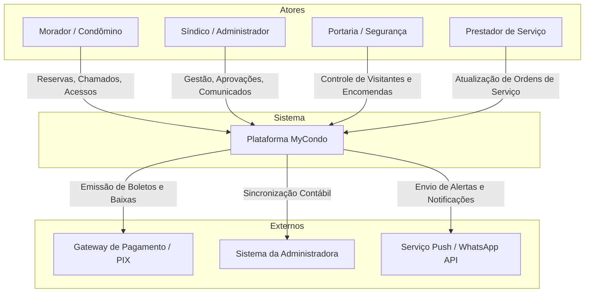
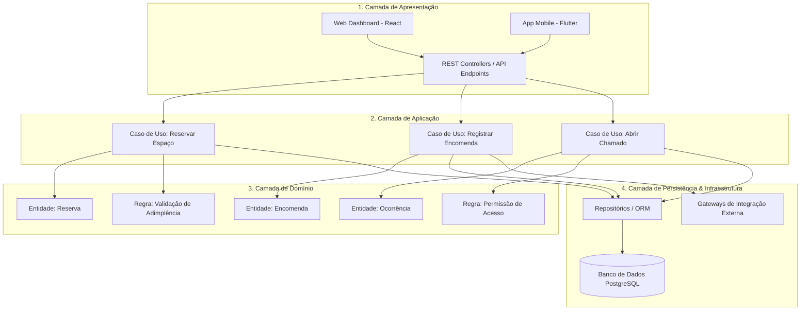
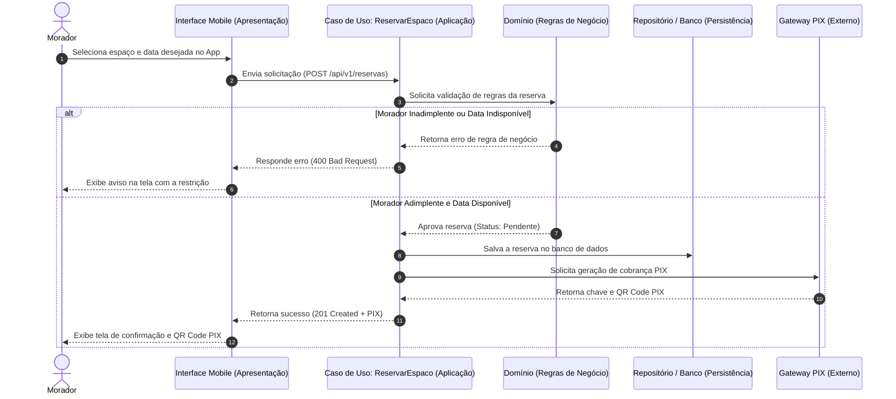
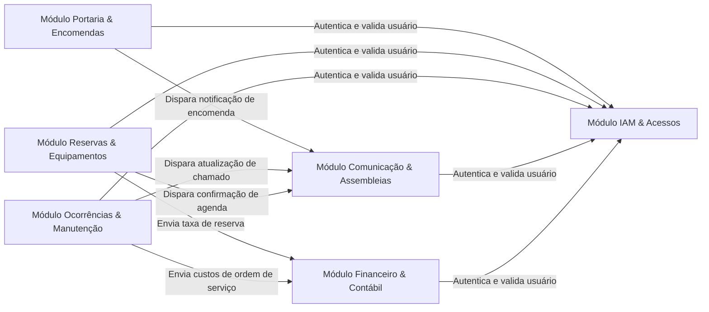

# Análise Arquitetural de Sistema Corporativo: MyCondo
**Plataforma Integrada de Gestão Corporativa de Condomínios**

---

### Identificação
* **Disciplina:** Sistemas Corporativos
* **Tema Escolhido:** Sistema de Gestão de Condomínios
* **Nome do Aluno:** Vinicius Martins Nunes
* **Data:** 1 de Setembro de 2026

---

## 1. Introdução e Descrição do Problema

A gestão de condomínios residenciais e comerciais enfrenta severos gargalos operacionais decorrentes da descentralização de informações, falhas na comunicação entre moradores e administração, falta de rastreabilidade na entrega de encomendas, burocracia na reserva de espaços comuns e falta de transparência nas prestações de contas. Processos manuais ou fragmentados em múltiplos canais informais geram atrito social, falhas de segurança na portaria e ineficiência na gestão financeira.

O MyCondo surge como uma plataforma corporativa web e mobile projetada para centralizar, automatizar e auditar todas as operações condominiais em uma única infraestrutura. O sistema visa harmonizar a convivência e a gestão ao integrar portaria, moradores, síndicos, conselheiros e prestadores de serviços. O contexto de uso abrange desde pequenos condomínios residenciais até grandes complexos multi-torres e comerciais, exigindo alta disponibilidade, confiabilidade de dados e rígido controle de acesso baseado em papéis.

---

## 2. Identificação dos Atores

Os atores que interagem com a plataforma MyCondo possuem papéis, responsabilidades e necessidades de uso bem delimitados dentro do ecossistema corporativo:

*   **Morador / Condômino:** Utiliza o sistema predominantemente via aplicativo mobile para gerenciar sua rotina no condomínio. Suas interações incluem solicitar reservas de áreas comuns (ex: salão de festas), registrar ocorrências com anexos de foto, pré-autorizar a entrada de visitantes via QR Code, receber alertas instantâneos de encomendas na portaria e participar de votações e assembleias virtuais.
*   **Síndico / Administrador:** Acessa o sistema via painel web corporativo e mobile para supervisionar toda a operação do condomínio. Interage com a plataforma gerenciando o cadastro de moradores e unidades, aprovando orçamentos e ordens de serviço, emitindo comunicados oficiais, moderando assembleias digitais e acompanhando relatórios de prestação de contas.
*   **Portaria / Operador de Segurança:** Interage com uma interface web/tablet otimizada para agilidade operacional na guarita. Suas responsabilidades incluem registrar a entrada e saída de visitantes e prestadores de serviço, protocolar a recepção de encomendas com foto e acionar alertas de segurança ou emergência.
*   **Prestador de Serviço / Terceirizado:** Acessa o sistema via web ou mobile com permissões restritas para visualizar ordens de serviço atribuídas a ele, atualizar o status de manutenções preventivas ou corretivas (ex: manutenção do elevador, limpeza da piscina) e anexar laudos técnicos.
*   **Administradora de Condomínios (Sistema Externo):** Entidade jurídica parceira que atua como um ator sistêmico. Interage com o MyCondo via integrações de API para sincronizar lançamentos contábeis, emitir e dar baixa em boletos de taxa condominial e gerar relatórios de inadimplência.

---

## 3. Módulos do Sistema

A decomposição funcional do backend do MyCondo foi projetada focando na separação clara de responsabilidades, garantindo alta coesão interna em cada módulo e baixo acoplamento entre eles:

*   **Módulo de Gestão de Usuários e Acessos (IAM):** Centraliza o controle de identidades, autenticação (login/senha, tokens), autorização baseada em papéis (RBAC - morador, síndico, porteiro) e a gestão cadastral de perfis, unidades e vínculo de moradores a seus respectivos apartamentos.
*   **Módulo de Controle de Portaria e Encomendas:** Responsável pelo gerenciamento em tempo real do fluxo da guarita. Regula o registro de entradas/saídas de visitantes e prestadores de serviço, a geração de autorizações prévias por QR Code e o protocolo de recebimento e entrega de encomendas com registro fotográfico.
*   **Módulo de Reservas e Equipamentos:** Controla a agenda, disponibilidade e regras de uso das áreas comuns (salões de festa, churrasqueiras, quadras). Valida critérios como limite de reservas simultâneas por unidade, antecedência mínima e checagem de regras de adimplência.
*   **Módulo de Ocorrências e Manutenção:** Funciona como um centro de atendimento (helpdesk) do condomínio. Gerencia o ciclo de vida completo de chamados registrados por moradores, a programação de manutenções preventivas do prédio (ex: elevadores, bombas d'água) e a emissão/acompanhamento de ordens de serviço.
*   **Módulo de Comunicação e Assembleias:** Gerencia os canais oficiais de contato. Responsável pelo mural digital de avisos, enquetes rápidas, envio de notificações push/e-mail e a realização de assembleias virtuais com votações auditáveis e assinatura digital.
*   **Módulo Financeiro e de Prestação de Contas:** Mantém o histórico de lançamentos contábeis do condomínio, controle de inadimplência, geração de relatórios de balancetes mensais e a comunicação via API com gateways bancários e sistemas de administradoras externas.

---

## 4. Arquitetura em Camadas

O MyCondo adota uma **Arquitetura em Camadas (Layered Architecture)** padronizada para garantir a separação de preocupações (*Separation of Concerns*). Essa abordagem isola a lógica fundamental de negócio de detalhes de infraestrutura e interfaces visuais, permitindo a evolução sustentável do sistema:

```text
+-------------------------------------------------------+
|              CAMADA DE APRESENTAÇÃO                   |
|   (Web Frontend, Mobile App, REST APIs, Controllers)  |
+-------------------------------------------------------+
|
v
+-------------------------------------------------------+
|               CAMADA DE APLICAÇÃO                     |
|     (Casos de Uso, DTOs, Orquestração, Transações)    |
+-------------------------------------------------------+
|
v
+-------------------------------------------------------+
|                CAMADA DE DOMÍNIO                      |
| (Entidades, Objetos de Valor, Regras de Negócio, Interfaces)|
+-------------------------------------------------------+
^
|
+-------------------------------------------------------+
|              CAMADA DE PERSISTÊNCIA                   |
|    (Repositórios, Mapeamento ORM, Acesso ao Banco)    |
+-------------------------------------------------------+
```

*   **Camada de Apresentação:** Responsável pelas interfaces de usuário (Web em React para administradores/portaria e Mobile em Flutter para moradores) e pela exposição das APIs REST. Recebe as requisições HTTP, valida a formatação inicial dos dados e converte os resultados para exibição na tela.
*   **Camada de Aplicação:** Atua como a orquestradora dos fluxos do sistema. Coordena a execução dos casos de uso (ex: `ReservarEspacoUseCase`, `RegistrarEncomendaUseCase`), gerencia transações de banco de dados e aciona o envio de notificações. Ela não toma decisões de negócio, apenas organiza a execução.
*   **Camada de Domínio:** Representa o coração do MyCondo. Abriga as entidades principais (`Reserva`, `Morador`, `Ocorrência`), objetos de valor (`CPF`, `ValorMonetario`) e a implementação estrita das regras de negócio (ex: "um morador marcado como inadimplente é impedido de reservar áreas comuns"). É totalmente isolada de bibliotecas externas ou bancos de dados.
*   **Camada de Persistência:** Gerencia o armazenamento e a recuperação de dados em banco de dados relacional (PostgreSQL) por meio do padrão de repositórios e ORM. Também encapsula a comunicação técnica com APIs externas (gateways de pagamento e serviços de mensagem).

---

## 5. Diagramas

### 5.1. Diagrama de Ecossistema

O Diagrama de Ecossistema apresenta a visão macro do MyCondo, destacando as fronteiras do sistema, os atores humanos que com ele interagem no dia a dia e as integrações com plataformas externas:
 

	
### 5.2. Diagrama Arquitetural

O Diagrama Arquitetural detalha a organização interna do MyCondo dividida em suas quatro camadas lógicas, explicitando a separação de responsabilidades e o fluxo de dados desde a interface de usuário até a persistência:


	
### 5.3. Diagrama de Fluxo do Sistema

O Diagrama de Fluxo (Diagrama de Sequência) ilustra a execução ponta a ponta do caso de uso principal do sistema: **Reserva de Área Comum pelo Morador com Validação de Adimplência e Geração de Pagamento**. O diagrama demonstra como a informação trafega ordenadamente através das quatro camadas do MyCondo até o serviço externo:


	
### 5.4. Diagrama de Módulos

O Diagrama de Módulos ilustra a decomposição funcional do backend do MyCondo, destacando a independência de cada módulo e as interconexões necessárias para o funcionamento integrado do sistema:


	
---
	
## 6. Reflexão Arquitetural

### 6.1. Organização inicial do sistema
O sistema será projetado inicialmente como um **Monólito Modular** e não como um sistema distribuído (microsserviços). Essa decisão justifica-se pelo domínio bem delimitado e pela complexidade operacional e infraestrutural que microsserviços trariam para o tamanho inicial da equipe e do produto. Um monólito bem estruturado em camadas permite fácil implantação inicial, enquanto a divisão rigorosa em módulos (descrita na seção 3) preserva a capacidade de evolução e extração de serviços futuros, caso o crescimento exija.

### 6.2. Módulo de maior complexidade
O **Módulo Financeiro e de Prestação de Contas** apresenta a maior complexidade. Ele exige alta consistência de dados (ACID) por lidar com transações financeiras, conciliações bancárias, geração de boletos via gateways externos e cálculos de multas/juros. Qualquer falha neste módulo compromete a confiança dos condomínios na plataforma e gera prejuízos reais.

### 6.3. Desafios técnicos e arquiteturais
1. **Disponibilidade:** O módulo de Portaria atua em tempo real 24/7. O sistema não pode ficar fora do ar, senão moradores não entram em casa e visitantes ficam retidos na rua.
2. **Consistência de Dados:** Ao realizar reservas com taxas, as validações de regras de negócio (adimplência) devem estar perfeitamente sincronizadas com o banco de dados.
3. **Segurança e Privacidade:** O sistema armazenará dados sensíveis, como documentos e informações financeiras dos condôminos, exigindo rigoroso isolamento e criptografia para conformidade legal (ex: LGPD).

### 6.4. Resposta arquitetural aos desafios
A arquitetura em camadas protege a **Consistência** e a **Segurança**, isolando as regras na *Camada de Domínio*, impedindo que dados entrem de forma corrompida. A *Camada de Persistência* centraliza a segurança de banco de dados. O grande desafio que ainda permanece como limitação no monólito é a **Disponibilidade** de serviços isolados: se houver um pico de acessos no módulo de comunicação derrubando o sistema, o módulo de Portaria, que não poderia parar, cairá junto por estar no mesmo pacote.

---

## 7. ADR-001 - Decisão Arquitetural Inicial

* **Contexto:** Necessidade de definir a estratégia de implantação e distribuição do sistema na fase inicial (MVP/V1) do MyCondo.
* **Decisão:** Adoção de arquitetura Monolítica Modular.
* **Alternativas consideradas:** Arquitetura de Microsserviços (descartada pela alta complexidade de orquestração e custos iniciais de infraestrutura) e Arquitetura Serverless (descartada pelo risco de vendor lock-in).
* **Justificativa:** O domínio é altamente integrado e as regras de negócio interagem fortemente (ex: Reservas dependem do Financeiro e do IAM). Um monólito modular respeita a coesão, viabiliza o controle transacional simplificado do banco de dados relacional e é mais barato para colocar em produção nos primeiros meses.
* **Benefícios esperados:** Menor complexidade operacional para a equipe desenvolvedora inicial, facilidade de debugging (rastreabilidade) e menor custo de infraestrutura de rede e nuvem.
* **Riscos e consequências aceitas:** Risco de "single point of failure" (se o servidor central cair, tudo cai) e necessidade de refatoração a médio/longo prazo (extração de módulos) quando a volumetria de condomínios aumentar drasticamente.

---

## 8. Funcionalidade Inovadora

**Controle de Acesso por Biometria Facial e IA (Integração IoT)**
* **Descrição e Necessidade:** A portaria é um gargalo de segurança e tempo. A funcionalidade propõe a instalação de totens com reconhecimento facial treinados por Inteligência Artificial (IA) integrados ao MyCondo, permitindo acesso imediato de moradores autorizados sem a necessidade de chaves, tags ou contato manual.
* **Atores beneficiados:** Moradores (praticidade e rapidez) e Portaria/Segurança (redução de carga de trabalho e eliminação de falha humana na identificação).
* **Impacto na Arquitetura:** Afeta diretamente o *Módulo de Controle de Portaria e Encomendas* e o *Módulo IAM*, exigindo a criação de um serviço específico para processamento e validação de imagens (IA), possivelmente requerendo uma integração externa ou infraestrutura cloud capaz de processar dados biométricos pesados com baixíssima latência.

---

## 9. Cenário de Evolução

**Cenário:** A base de clientes da plataforma saltou de 50 para 5.000 condomínios, e o tráfego gerado pelo módulo de *Comunicação (Envio de Push/Email e Enquetes)* está degradando a performance geral, deixando a portaria lenta nos horários de pico (ex: 18h).

1. **O que permanece na arquitetura?** A organização interna em Camadas (Apresentação, Aplicação, Domínio, Persistência) e as interfaces/APIs de comunicação dos demais módulos permanecem iguais.
2. **O que precisaria ser alterado?** O módulo de Comunicação precisaria ser extraído do monólito e transformado em um microsserviço independente. Além disso, a comunicação síncrona atual daria lugar a uma comunicação assíncrona baseada em eventos (ex: Message Brokers como RabbitMQ ou Kafka).
3. **Alguma decisão arquitetural precisaria ser revista?** Sim, a decisão registrada na `ADR-001`. A arquitetura estritamente monolítica não comportaria mais essa volumetria mista, exigindo a adoção híbrida com microsserviços críticos.
4. **A arquitetura proposta favorece ou dificulta essa evolução?** **Favorece.** Por termos adotado um Monólito *Modular* com limites muito claros entre os domínios, a extração do Módulo de Comunicação para um serviço separado exige muito menos refatoração do que em um monólito desestruturado ("Spaghetti code").
	
## 10. Conclusão e Considerações Finais

A proposta arquitetural do **MyCondo** estabelece uma infraestrutura sólida, escalável e segura para a transformação digital da gestão condominial corporativa. Ao adotar uma **Arquitetura em Camadas (Layered Architecture)** aliada à decomposição em módulos funcionais com responsabilidades bem definidas, o sistema assegura o desacoplamento entre regras de negócio complexas, interfaces de usuário e tecnologias de persistência.

A especificação clara dos atores e dos fluxos operacionais — acompanhada pelos diagramas de ecossistema, arquitetura, sequência e módulos — demonstra a viabilidade técnica da solução no combate a gargalos históricos, como falhas de segurança na guarita, burocracia na reserva de áreas comuns e falta de rastreabilidade na comunicação.

Como perspectivas de evolução da plataforma, destacam-se:
* **Integração com IoT e Hardware de Segurança:** Conexão direta do sistema com leitores de biometria facial, cancelas automáticas de garagem e sensores de monitoramento de bombas d'água.
* **Evolução para Microsserviços:** Migração gradual dos módulos de maior volumetria (como Portaria/Encomendas e Notificações) para microsserviços autônomos à medida que a base de condomínios atendida expanda.
* **Inteligência Artificial Aplicada:** Implementação de algoritmos preditivos para gestão de manutenção preventiva de equipamentos e assistentes virtuais para atendimento de primeiro nível aos moradores.