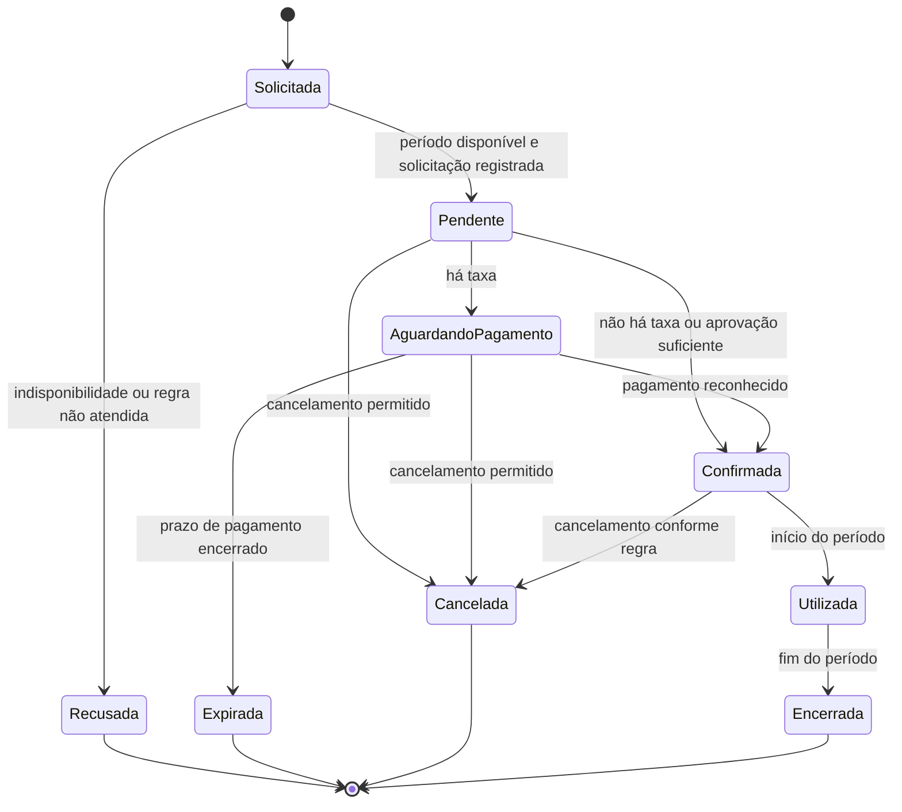
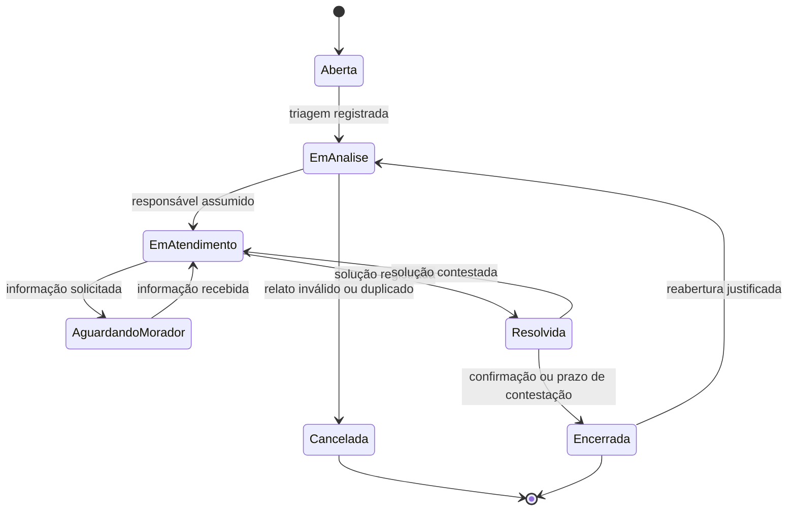
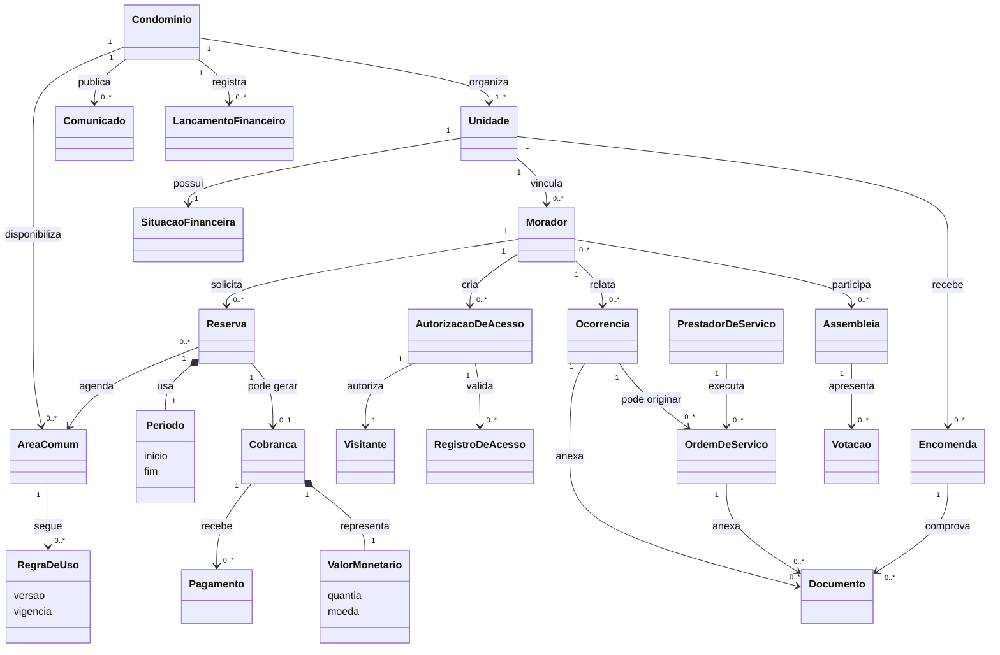

# Trabalho 2 — Da Informação ao Domínio: construindo o modelo conceitual do MyCondo

**Disciplina:** Sistemas Corporativos  
**Tema:** Sistema de Gestão de Condomínios  
**Aluno:** Vinicius Martins Nunes  
**Data:** 5 de outubro de 2026

> **Nota de leitura do modelo:** este documento é uma evolução do Trabalho 1. As classificações e cardinalidades são provisórias quando não há evidência suficiente. Os termos **fato**, **hipótese**, **questão em aberto** e **decisão** indicam o grau de conhecimento atual, e não detalhes de implementação.

## 1. Apresentação e retomada do sistema

O **MyCondo** é uma plataforma para centralizar a gestão de condomínios residenciais, comerciais e de múltiplas torres. O problema central é a dispersão de informações e processos em canais informais: reservas são difíceis de controlar, a portaria perde rastreabilidade de visitantes e encomendas, chamados não têm acompanhamento e a prestação de contas não é transparente.

Os principais atores identificados no Ciclo 1 são **morador/condômino**, **síndico/administrador**, **portaria/operador de segurança**, **prestador de serviço** e a **administradora de condomínios**, que pode trocar informações com o sistema. O sistema também se relaciona com serviços externos de pagamento e de notificação, mas esses serviços não são o foco do modelo conceitual deste trabalho.

O fluxo principal escolhido no Trabalho 1 foi:

1. o morador seleciona uma área comum e um período;
2. o sistema verifica a disponibilidade;
3. verifica a situação de adimplência e as regras da área;
4. se as condições forem atendidas, registra a reserva como pendente;
5. quando houver taxa, é criada uma cobrança;
6. a reserva pode ser confirmada após o pagamento ou após a aprovação exigida pelo condomínio;
7. o morador recebe a confirmação e a área fica indisponível para conflito de agenda.

As principais operações já identificadas foram: cadastrar moradores e unidades; autorizar visitantes; registrar entradas e saídas; receber e entregar encomendas; reservar áreas comuns; abrir e acompanhar ocorrências; criar e executar ordens de serviço; emitir comunicados; realizar assembleias e votações; registrar lançamentos financeiros; controlar cobranças, pagamentos e inadimplência; e gerar prestação de contas.

As informações que o sistema precisa conhecer ou preservar incluem identidade e vínculo do morador com a unidade, áreas e períodos reservados, situação da reserva, regras de uso, situação financeira da unidade, visitantes autorizados, registros de acesso, encomendas, ocorrências, ordens de serviço, documentos anexados, comunicados, votos e lançamentos financeiros.

### Glossário de termos do domínio

| Termo | Significado adotado neste trabalho |
|---|---|
| Unidade | Apartamento, sala ou outro espaço privativo vinculado a um condomínio. |
| Área comum | Espaço compartilhado que pode ser utilizado conforme disponibilidade e regras do condomínio. |
| Reserva | Solicitação persistida para utilizar uma área comum em um período específico. |
| Adimplência | Condição financeira usada pelo condomínio para decidir se uma operação pode prosseguir. |
| Autorização de acesso | Permissão com validade e condições para a entrada de visitante. |
| Registro de acesso | Fato histórico de entrada ou saída registrado pela portaria. |
| Invariante | Condição que deve continuar verdadeira para que o modelo permaneça consistente. |
| Objeto de valor | Conceito definido por seus atributos, sem identidade própria no contexto analisado. |

## 2. Candidatos a conceitos do domínio

Os candidatos abaixo foram extraídos do fluxo principal, das operações e das informações do Trabalho 1. Eles ainda não são automaticamente entidades.

| Conceito candidato | De onde surgiu? | Por que parece relevante? | Grau de certeza |
|---|---|---|---|
| Condomínio | Contexto e atores | Delimita o ambiente em que regras, unidades e áreas existem | Fato |
| Unidade | Informação necessária | É o apartamento ou espaço ao qual moradores e obrigações financeiras se vinculam | Fato |
| Morador | Atores e operações | Solicita reservas, abre ocorrências, autoriza visitantes e recebe encomendas | Fato |
| Área comum | Fluxo de reserva | É o recurso cuja utilização é disputada e regulada | Fato |
| Reserva | Fluxo principal | Representa a intenção e o compromisso de usar uma área em determinado período | Fato |
| Período | Fluxo e disponibilidade | Permite verificar conflitos de agenda e antecedência | Fato |
| Regra de uso | Operação de reservas | Define limites, antecedência, horários e condições de utilização | Hipótese |
| Situação financeira | Validação da reserva | A adimplência pode impedir ou permitir determinada operação | Fato; detalhes em aberto |
| Cobrança | Fluxo principal e financeiro | Pode ser necessária para uma reserva com taxa | Hipótese |
| Pagamento | Fluxo principal e financeiro | Pode mudar a situação de uma cobrança e da reserva | Fato; relação exata ainda em aberto |
| Visitante | Operações de portaria | Pessoa cuja entrada pode ser previamente autorizada e registrada | Fato |
| Autorização de acesso | Operações de portaria | Liga uma pessoa a uma permissão de entrada com validade | Hipótese |
| Registro de acesso | Operações de portaria | Preserva a entrada e a saída para fins operacionais e de segurança | Fato |
| Encomenda | Operações de portaria | Precisa ser recebida, armazenada e entregue com rastreabilidade | Fato |
| Ocorrência | Operações de atendimento | Representa uma situação relatada e seu acompanhamento | Fato |
| Ordem de serviço | Manutenção | Formaliza uma manutenção atribuída a um prestador | Fato |
| Prestador de serviço | Atores e manutenção | Executa e atualiza serviços do condomínio | Fato |
| Comunicado | Comunicação | Registra uma informação oficial dirigida a um público | Fato |
| Assembleia | Comunicação e governança | Organiza uma reunião com pauta e possíveis deliberações | Fato |
| Votação | Assembleia | Registra uma decisão coletiva e seus participantes | Fato |
| Lançamento financeiro | Financeiro e prestação de contas | Registra receitas, despesas ou outros movimentos do condomínio | Fato |
| Documento/anexo | Ocorrências, manutenção e encomendas | Dá suporte e evidência a outros conceitos | Hipótese |
| Valor monetário | Cobrança e lançamentos | Representa quantias sem identidade própria | Fato |
| Status | Fluxos e mudanças | Descreve a condição atual de uma reserva, ocorrência ou ordem | Outro tipo de conceito |

## 3. Investigação de identidade

Identidade foi analisada pela necessidade de distinguir ocorrências ao longo do tempo, e não pela futura existência de um campo identificador.

| Conceito | Identidade parece relevante? | Evidência / justificativa | Classificação atual |
|---|---|---|---|
| Condomínio | Sim | Regras, unidades, áreas e finanças pertencem a um condomínio específico | Provável entidade |
| Unidade | Sim | A unidade permanece reconhecível mesmo quando muda seu morador ou sua situação financeira | Provável entidade |
| Morador | Sim | O mesmo morador pode mudar telefone, vínculo ou permissões e ainda ser a mesma pessoa no domínio | Provável entidade |
| Área comum | Sim | A área tem regras, disponibilidade e histórico próprios | Provável entidade |
| Reserva | Sim | Cada solicitação precisa ser acompanhada, alterada, cancelada e consultada posteriormente | Provável entidade |
| Período | Não, em princípio | Seu significado está nos valores de início e fim usados para comparar intervalos | Provável objeto de valor |
| Regra de uso | Talvez | Pode ter vigência e histórico próprios, mas ainda não sabemos se é configurada como uma política versionada | Informação insuficiente |
| Situação financeira | Não como ocorrência isolada | Parece ser uma condição derivada de cobranças e pagamentos | Outro tipo: estado/resultado |
| Cobrança | Sim | Precisa ser conciliada, vencida, paga ou cancelada | Provável entidade |
| Pagamento | Sim | Uma baixa precisa ser rastreável, mesmo que os valores se repitam | Provável entidade |
| Visitante | Talvez | A pessoa pode ser referenciada em diferentes autorizações, mas o domínio pode tratar cada visita de modo independente | Hipótese de entidade; validar |
| Autorização de acesso | Sim | Possui validade, situação e uso específico | Provável entidade |
| Registro de acesso | Sim | É um fato histórico que não deve ser confundido com outro registro | Provável entidade |
| Encomenda | Sim | Tem ciclo de recebimento, guarda e entrega associado a uma unidade | Provável entidade |
| Ocorrência | Sim | É acompanhada até resolução e pode receber interações e anexos | Provável entidade |
| Ordem de serviço | Sim | Tem atribuição, prazo, execução e conclusão próprios | Provável entidade |
| Prestador de serviço | Sim | Pode executar várias ordens e manter dados atualizados | Provável entidade |
| Comunicado | Sim | É uma publicação específica que pode ser consultada depois | Provável entidade |
| Assembleia | Sim | Possui convocação, pauta, período e resultado próprios | Provável entidade |
| Votação | Sim, provavelmente | Uma decisão coletiva precisa ser preservada e auditada | Provável entidade; estrutura em aberto |
| Lançamento financeiro | Sim | Cada receita ou despesa precisa permanecer rastreável | Provável entidade |
| Documento/anexo | Talvez | O mesmo arquivo pode ser apenas um valor anexado ou um artefato auditável com histórico | Informação insuficiente |
| Valor monetário | Não | Dois valores com a mesma quantia e moeda têm o mesmo significado neste contexto | Provável objeto de valor |
| Status | Não | Representa a condição de outro conceito, não uma ocorrência autônoma | Outro tipo: estado |

## 4. Entidades e Objetos de Valor

Esta é a classificação atual. Ela poderá ser revista após entrevistas com síndicos, portaria e administradoras.

| Conceito | Classificação atual | Justificativa | Evidência | Grau de certeza |
|---|---|---|---|---|
| Condomínio | Entidade | Define o contexto e mantém identidade mesmo com mudanças administrativas | O sistema atende vários condomínios | Confirmada |
| Unidade | Entidade | Mantém identidade e histórico de ocupação e obrigações | Moradores e finanças são vinculados à unidade | Confirmada |
| Morador | Entidade | É reconhecido ao longo do tempo e pode ter dados alterados | Ator que executa várias operações | Confirmada |
| Área comum | Entidade | Possui agenda, regras e histórico de uso | É recurso reservado | Confirmada |
| Reserva | Entidade | Possui ciclo de vida e deve ser distinguida de outras reservas | Fluxo principal | Confirmada |
| Período | Objeto de Valor | É definido pelo intervalo de início e fim; a igualdade depende dos valores | Validação de disponibilidade | Hipótese forte |
| Regra de uso | Informação insuficiente | Pode ser entidade se houver versões e vigências, ou valor/configuração se for apenas uma descrição | O Trabalho 1 cita regras, mas não seu ciclo de alteração | Dúvida |
| Situação financeira | Outro tipo de conceito | É um estado ou resultado calculado a partir de obrigações e pagamentos | Usada como condição de reserva | Confirmada como estado; cálculo em aberto |
| Cobrança | Entidade | Tem vencimento, situação e histórico de conciliação | Taxa de reserva e taxa condominial | Hipótese forte |
| Pagamento | Entidade | Representa um fato financeiro que deve ser conciliado | Integração com gateway | Hipótese |
| Visitante | Entidade provisória | Pode precisar ser reconhecido em autorizações recorrentes; não sabemos se o domínio exige cadastro persistente | Controle de portaria | Hipótese |
| Autorização de acesso | Entidade | Tem validade, situação e eventual uso | Pré-autorização de visitante | Confirmada |
| Registro de acesso | Entidade | Preserva fato histórico de entrada ou saída | Segurança e portaria | Confirmada |
| Encomenda | Entidade | Tem recebimento, guarda e entrega | Registro de encomendas | Confirmada |
| Ocorrência | Entidade | Tem ciclo de atendimento, responsável e resolução | Helpdesk condominial | Confirmada |
| Ordem de serviço | Entidade | Tem execução e atualização por um prestador | Manutenção preventiva/corretiva | Confirmada |
| Prestador de serviço | Entidade | Possui relação duradoura com várias ordens | Ator do sistema | Confirmada |
| Comunicado | Entidade | Uma publicação específica pode ser lida e auditada | Mural digital | Confirmada |
| Assembleia | Entidade | Reúne pauta, participantes e decisões em um evento específico | Assembleias virtuais | Confirmada |
| Votação | Entidade provisória | O resultado e os votos precisam ser auditáveis, mas sua composição ainda não foi detalhada | Assembleia e decisões | Hipótese |
| Lançamento financeiro | Entidade | Cada lançamento precisa ser explicado e preservado na prestação de contas | Módulo financeiro | Confirmada |
| Documento/anexo | Informação insuficiente | Pode ter identidade própria ou ser apenas um valor associado | Fotos e laudos foram citados | Dúvida |
| Valor monetário | Objeto de Valor | Seu significado é quantia, moeda e eventualmente precisão; não há ciclo próprio | Cobranças e lançamentos | Confirmada |
| Status | Outro tipo de conceito | É estado de entidades, não objeto de negócio independente | Fluxo de reserva e chamados | Confirmada |

## 5. Casos de classificação ambígua

### 5.1 Visitante

Inicialmente, **Visitante** poderia ser apenas uma informação preenchida em uma autorização de acesso, porque a portaria talvez só precise de nome e documento para uma visita. A alternativa é tratá-lo como entidade, caso o condomínio reconheça a mesma pessoa em autorizações recorrentes e precise consultar seu histórico.

A evidência disponível confirma a necessidade de registrar a entrada de visitantes, mas não confirma se existe cadastro persistente da pessoa. A decisão atual é mantê-lo como **entidade provisória**, pois a identidade pode ser relevante para segurança. Essa classificação muda se a regra do condomínio disser que cada visita é anônima e independente; nesse caso, a pessoa poderá ser um conjunto de valores dentro de uma autorização.

**Investigação e decisão de trabalho:** o modelo assume, para fins de cardinalidade e histórico, que um visitante pode aparecer em várias autorizações e que seu histórico de acessos pode ser consultado. Portanto, **Visitante permanece entidade provisória**. A entrevista deve confirmar se há reconhecimento por documento, telefone ou outro conjunto de dados e se a legislação/política de privacidade permite manter esse histórico. Se a resposta for negativa, a relação será substituída por `Autorização de acesso contém Dados do visitante`, um objeto de valor sem identidade.

### 5.2 Regra de uso

Uma regra de uso pode parecer uma simples configuração da área comum, como horário e limite de reservas. Porém, se o condomínio altera a regra, o histórico da regra que vigorava na data de uma reserva pode ser importante para resolver conflitos.

Ainda não há evidência de que regras possuam versões, vigência ou aprovação próprias. A decisão atual é mantê-la como **informação insuficiente**, sem forçar uma entidade nem um objeto de valor. A classificação deverá mudar quando for esclarecido se o síndico pode versionar regras e se reservas antigas devem preservar a regra aplicada.

**Investigação e decisão de trabalho:** uma regra será considerada **entidade** se tiver identificador conceitual, vigência, versão, autor/aprovador ou histórico de alterações. Caso seja apenas um conjunto imutável de parâmetros da área, será **objeto de valor/configuração**. Como a reserva precisa ser avaliada segundo a regra vigente na data da solicitação, o modelo adota provisoriamente a primeira alternativa: regras possuem versão e vigência, mas essa decisão só será confirmada após verificar uma política real de alteração e a necessidade de preservar a regra aplicada em reservas antigas.

### 5.3 Documento/anexo

Fotos de encomendas, fotos de ocorrências e laudos de manutenção foram citados como anexos. Eles podem ser apenas valores anexados a um conceito, mas também podem possuir identidade, controle de acesso, autoria, substituição e histórico.

Como o ciclo de vida e a exigência de auditoria não foram definidos, a classificação atual é **informação insuficiente**. A decisão não é técnica: depende de saber se o domínio precisa tratar o documento como evidência independente.

**Investigação e decisão de trabalho:** fotos, laudos e comprovantes serão tratados como **entidade provisória Documento**, quando tiverem autoria, data, tipo, controle de acesso, substituição ou retenção obrigatória. Um arquivo descartável, sem consulta ou auditoria independente, será um objeto de valor anexado ao conceito principal. A decisão de trabalho é usar a entidade provisória para preservar evidências de ocorrências, manutenção e encomendas; a validação deve confirmar quais tipos exigem autoria, histórico e permissão de acesso.

### 5.4 Critérios de confirmação das classificações

As classificações ambíguas não serão decididas pela existência de uma futura tabela. Serão confirmadas por evidências do domínio:

| Conceito | Evidência que confirma identidade | Evidência que favorece objeto de valor | Decisão atual |
|---|---|---|---|
| Visitante | Reutilização da pessoa em autorizações, consulta de histórico ou bloqueio de acesso | Cada visita é independente e os dados só existem dentro da autorização | Entidade provisória |
| Regra de uso | Versão, vigência, autoria, aprovação ou aplicação histórica | Apenas parâmetros substituíveis da área, sem histórico próprio | Entidade provisória versionada |
| Documento/anexo | Auditoria, autoria, controle de acesso, retenção ou substituição | Arquivo descartável, sem consulta independente | Entidade provisória para evidências |

Essas decisões são suficientes para construir o modelo atual, mas continuam marcadas como provisórias porque dependem de entrevistas com síndico, portaria e administradora.

## 6. Relações entre conceitos

As frases abaixo expressam significado do domínio, e não tabelas ou chaves.

| Origem | Relação | Conceito relacionado | Significado no domínio | Justificativa / evidência |
|---|---|---|---|---|
| Condomínio | organiza | Unidade | Um condomínio é composto por unidades administradas naquele contexto | Cadastro e vínculo condominial |
| Unidade | é ocupada por | Morador | Uma unidade possui um ou mais moradores vinculados | Atores são vinculados a apartamentos |
| Condomínio | disponibiliza | Área comum | As áreas pertencem ao contexto do condomínio | Reservas ocorrem dentro de um condomínio |
| Morador | solicita | Reserva | O morador pede o uso de uma área em um período | Fluxo principal |
| Reserva | agenda | Área comum | A reserva ocupa uma área em um período específico | Controle de disponibilidade |
| Reserva | é definida por | Período | O intervalo determina quando o uso ocorrerá | Validação de conflito |
| Reserva | pode gerar | Cobrança | Uma reserva sujeita a taxa origina uma obrigação financeira | Fluxo com taxa/Pix |
| Cobrança | é quitada por | Pagamento | O pagamento pode liquidar uma cobrança | Integração financeira |
| Morador | autoriza | Visitante | O morador pode permitir a entrada de uma pessoa | Pré-autorização de visitantes |
| Autorização de acesso | registra | Visitante | A autorização identifica quem está autorizado e em que condições | Operação de portaria |
| Registro de acesso | utiliza | Autorização de acesso | A entrada ou saída pode ser conferida contra uma autorização | Regra de segurança; validar exceções |
| Portaria | recebe | Encomenda | O operador registra que uma encomenda chegou | Fluxo de encomendas |
| Encomenda | é destinada a | Unidade | A encomenda deve ser associada ao destinatário condominial | Notificação ao morador |
| Morador | relata | Ocorrência | O morador abre um chamado sobre um problema | Helpdesk |
| Ocorrência | pode originar | Ordem de serviço | Um problema pode exigir execução de manutenção | Operações de manutenção |
| Prestador de serviço | executa | Ordem de serviço | O prestador realiza o trabalho atribuído | Atualização de manutenção |
| Condomínio | publica | Comunicado | A administração comunica informação oficial ao público definido | Mural e notificações |
| Assembleia | apresenta | Votação | Uma assembleia pode conter deliberações submetidas aos participantes | Votação auditável |
| Morador | participa de | Assembleia | O condômino participa conforme regras de convocação e elegibilidade | Assembleias virtuais |
| Condomínio | registra | Lançamento financeiro | O condomínio mantém receitas, despesas e demais movimentos | Prestação de contas |
| Lançamento financeiro | pode originar | Cobrança | Alguns lançamentos representam valores a cobrar | Taxas condominiais |

## 7. Cardinalidades

As cardinalidades abaixo representam o conhecimento atual. Onde não existe evidência, a incerteza fica registrada em vez de ser preenchida por conveniência técnica.

| Relação | Cardinalidade atual | Evidência | Grau de certeza |
|---|---|---|---|
| Condomínio organiza Unidade | 1:N; um condomínio tem uma ou várias unidades | Um condomínio só é tratado como ativo quando possui ao menos uma unidade cadastrada | Confirmada no escopo atual |
| Unidade é ocupada por Morador | 1:N; uma unidade pode ter nenhum ou vários moradores | Há unidades desocupadas e unidades com mais de um morador | Hipótese forte |
| Condomínio disponibiliza Área comum | 1:N; um condomínio pode ter nenhuma ou várias áreas | O escopo inclui condomínios sem a mesma estrutura de áreas | Hipótese |
| Morador solicita Reserva | 1:N; um morador pode solicitar nenhuma ou várias reservas | O fluxo permite repetição ao longo do tempo | Confirmada |
| Área comum é agendada por Reserva | 1:N ao longo do tempo; cada reserva agenda uma área | Uma área recebe várias reservas em períodos diferentes | Confirmada |
| Reserva é definida por Período | 1:1 por composição; cada reserva tem exatamente um intervalo próprio | O período é parte da reserva e pode ser comparado por início e fim; não é compartilhado como identidade | Confirmada como composição |
| Reserva gera Cobrança | 1:0..1; uma reserva tem zero ou uma cobrança de taxa | A taxa é opcional no fluxo e uma cobrança representa a obrigação daquela reserva | Hipótese de trabalho |
| Cobrança é quitada por Pagamento | 1:0..N; uma cobrança pode ter nenhuma, uma ou várias tentativas/baixas | O gateway pode produzir tentativas, estornos ou pagamentos parciais; a política de liquidação ainda precisa ser validada | Decisão provisória |
| Morador autoriza Visitante | 1:N; uma autorização pertence a um morador e ele pode criar várias | A pré-autorização é uma operação atribuída ao morador | Confirmada no fluxo |
| Autorização de acesso registra Visitante | N:1; cada autorização referencia um visitante, que pode aparecer em várias autorizações | A decisão de trabalho mantém histórico de visitante recorrente | Hipótese de trabalho |
| Unidade recebe Encomenda | 1:N; uma unidade pode receber nenhuma ou várias encomendas | Encomendas chegam em momentos distintos | Confirmada |
| Morador relata Ocorrência | 1:N; um morador pode não relatar ou relatar várias | Operação de abertura de chamados | Confirmada |
| Ocorrência origina Ordem de serviço | 1:0..N; uma ocorrência pode não exigir serviço ou gerar várias ordens | Um chamado pode demandar diagnósticos ou execuções distintas | Hipótese de trabalho |
| Prestador executa Ordem de serviço | 1:N no histórico; cada ordem tem ao menos um responsável e um prestador pode executar várias | O modelo registra responsável principal; equipe ou subcontratação ainda exige validação | Decisão provisória |
| Condomínio publica Comunicado | 1:N; um condomínio publica nenhum ou vários comunicados | Mural digital | Confirmada |
| Assembleia apresenta Votação | 1:0..N; uma assembleia pode não deliberar ou deliberar várias matérias | Nem toda assembleia precisa de votação; cada matéria possui uma deliberação própria | Hipótese de trabalho |
| Condomínio registra Lançamento financeiro | 1:N; um condomínio registra vários movimentos ao longo do tempo | Prestação de contas | Confirmada |

## 8. Regras de negócio

| ID | Regra | Conceitos envolvidos | Evidência | Situação |
|---|---|---|---|---|
| RN01 | Uma reserva só pode ser aceita se o período solicitado estiver disponível para a área comum. | Reserva, Área comum, Período | Fluxo principal | Confirmada |
| RN02 | Uma reserva não pode ser confirmada quando a condição de adimplência exigida pelo condomínio não for satisfeita. | Reserva, Unidade, Situação financeira | Validação de adimplência do Trabalho 1 | Confirmada no escopo atual |
| RN03 | Uma reserva deve obedecer às regras de uso da área, incluindo antecedência e limites aplicáveis. | Reserva, Área comum, Regra de uso | Módulo de reservas | Hipótese; parâmetros precisam ser validados |
| RN04 | Uma reserva sujeita a taxa não deve ser considerada quitada antes de existir pagamento reconhecido, salvo se o condomínio permitir outra forma de aprovação. | Reserva, Cobrança, Pagamento | Fluxo com cobrança Pix | Hipótese |
| RN05 | Uma entrada de visitante deve ser vinculada a uma autorização válida ou a uma exceção autorizada pela portaria. | Visitante, Autorização, Registro de acesso | Controle de visitantes | Hipótese; exceções não foram especificadas |
| RN06 | Uma encomenda recebida deve permanecer associada a uma unidade até que seja registrada como entregue ou devolvida. | Encomenda, Unidade, Registro de acesso | Rastreabilidade de encomendas | Hipótese forte |
| RN07 | Uma ocorrência deve possuir uma situação que permita distinguir, no mínimo, abertura, acompanhamento e encerramento. | Ocorrência, Status | Ciclo de chamados | Confirmada em nível conceitual |
| RN08 | Uma ordem de serviço só deve ser encerrada quando o trabalho tiver sido concluído ou cancelado com justificativa. | Ordem de serviço, Prestador, Documento | Manutenção e laudos | Hipótese |
| RN09 | Um voto elegível deve ser contabilizado uma única vez para a deliberação correspondente. | Assembleia, Votação, Morador | Votações auditáveis | Hipótese forte |
| RN10 | Todo lançamento financeiro deve possuir uma explicação e permanecer rastreável na prestação de contas. | Lançamento financeiro, Condomínio | Transparência financeira | Confirmada como objetivo do sistema |

### 8.1 Parâmetros e validações das regras

| Regra | Parâmetros necessários | Condição de validação | Resultado quando não atendida |
|---|---|---|---|
| RN01 | Área, início e fim do período, estado das reservas existentes | `início < fim` e não existe reserva confirmada sobreposta na mesma área | Solicitação recusada ou mantida sem confirmação; o conflito é informado |
| RN02 | Unidade da reserva, situação financeira, data/hora da consulta e exceções autorizadas | A situação deve estar entre as condições permitidas pela política vigente do condomínio | Reserva não é confirmada e a justificativa fica registrada |
| RN03 | Antecedência mínima, limite de duração, limite de reservas por unidade/morador e horários permitidos | Todos os parâmetros da versão vigente da regra são satisfeitos | Solicitação recusada com o parâmetro violado identificado |
| RN04 | Valor, vencimento, estado da cobrança, prazo de pagamento e forma de aprovação alternativa | A cobrança é reconhecida como paga ou existe aprovação expressamente permitida | Reserva permanece pendente, é cancelada ou expira |
| RN05 | Visitante, autorização, validade, área/horário permitido e exceção da portaria | A autorização está vigente e corresponde ao visitante e ao momento do acesso, ou a exceção tem justificativa e responsável | Entrada bloqueada ou registrada como exceção não autorizada |
| RN06 | Unidade destinatária, estado da encomenda, momento do recebimento e entrega/devolução | A encomenda tem exatamente um estado ativo e toda mudança registra data e responsável | Operação rejeitada e situação anterior preservada |
| RN07 | Estado atual, evento, autor e data/hora da transição | A transição pertence ao ciclo permitido da ocorrência | Mudança rejeitada e histórico mantido |
| RN08 | Ordem, estado do trabalho, conclusão/cancelamento, justificativa e responsável | Só encerra com conclusão registrada ou cancelamento justificado | Ordem permanece aberta e o motivo é informado |
| RN09 | Assembleia, matéria, participante, elegibilidade e voto existente | Participante elegível ainda não votou naquela matéria | Voto duplicado ou inelegível não altera o resultado |
| RN10 | Tipo, valor, competência, descrição, origem e autor do lançamento | Campos obrigatórios existem e o lançamento publicado não pode ser apagado sem evento de estorno/retificação | Lançamento rejeitado ou retificado com trilha de auditoria |

## 9. Invariantes e proteção da consistência

Uma invariante é uma condição que precisa permanecer verdadeira para que o conceito continue válido. Nem toda regra anterior é uma invariante.

| Conceito protegido | Possível invariante | O que violaria? | Consequência da violação | Proteção conceitual | Evidência |
|---|---|---|---|---|---|
| Reserva | Uma reserva confirmada deve referenciar uma única área e um período válido | Confirmar sem área ou com intervalo inválido | Não seria possível saber o que foi reservado | Validar campos e transição antes da confirmação; rejeitar a operação | Fluxo de reserva |
| Agenda da área comum | Não podem existir duas reservas confirmadas conflitantes para a mesma área e período | Aprovar solicitações concorrentes | Dois moradores receberiam o mesmo espaço | Verificar sobreposição no momento da confirmação e revalidar concorrência | Regra de disponibilidade |
| Reserva com cobrança | Uma reserva dependente de pagamento não pode ser apresentada como quitada sem pagamento reconhecido | Marcar pagamento sem conciliação | Uso indevido e inconsistência financeira | Separar estados de cobrança e reserva; somente evento de pagamento conciliado permite confirmar | Fluxo Pix; detalhes ainda em validação |
| Encomenda | Uma encomenda não pode estar simultaneamente pendente e entregue | Registrar entrega sem alterar a situação | Perda de rastreabilidade | Transições exclusivas e registro de responsável, data e comprovante | Operação de portaria |
| Registro de acesso | Um registro deve indicar se representa entrada ou saída e o momento correspondente | Registro incompleto ou ambíguo | Histórico de segurança inconfiável | Exigir tipo, momento, pessoa e origem do registro; exceções precisam de justificativa | Controle de acessos |
| Ocorrência | Uma ocorrência encerrada deve conservar seu histórico e não voltar a aberta sem uma ação explícita | Alteração silenciosa do estado | Perda do histórico de atendimento | Manter eventos de transição e exigir ação autorizada para reabertura | Necessidade de acompanhamento |
| Votação | O resultado deve ser calculado a partir de votos elegíveis, sem duplicidade | Permitir dois votos da mesma participação | Resultado não confiável | Validar elegibilidade, unicidade por matéria e congelamento do resultado após encerramento | Auditoria de assembleia |
| Lançamento financeiro | Um lançamento já incluído na prestação de contas não deve desaparecer sem rastreabilidade | Exclusão sem justificativa | Prestação de contas incompleta | Impedir exclusão física; usar estorno/retificação com autor, motivo e data | Transparência financeira |

## 10. Estados e mudanças relevantes

### 10.1 Ciclo de vida da Reserva

A **Reserva** foi escolhida porque é a entidade central do fluxo principal e muda de situação em resposta a disponibilidade, pagamento, aprovação e cancelamento.

O estado inicial é **Solicitada**. **Pendente** indica que o pedido foi registrado, mas ainda não atende todas as condições de confirmação. **AguardandoPagamento** é aplicável quando há taxa. **Confirmada** autoriza o uso; **Utilizada** e **Encerrada** representam a passagem pelo período. **Recusada**, **Expirada** e **Cancelada** são estados finais sem uso autorizado.

São eventos relevantes: envio da solicitação, validação de disponibilidade, reprovação por inadimplência, geração da cobrança, reconhecimento do pagamento, aprovação administrativa, cancelamento, expiração do prazo e passagem do horário reservado. Seria inválido confirmar uma reserva com conflito de horário, confirmar uma reserva dependente de cobrança sem pagamento reconhecido ou retornar de **Encerrada** para um estado anterior. Os prazos de pagamento e as possibilidades de cancelamento ainda precisam ser validados.

### 10.2 Ciclo de vida da Ocorrência

A **Ocorrência** também possui um ciclo relevante, porque seu encerramento não pode apagar as interações nem impedir a auditoria do atendimento.

Uma ocorrência nasce **Aberta**, passa por triagem e atendimento e só pode ser **Resolvida** quando houver descrição da solução. **Encerrada** significa que o ciclo foi finalizado, mas o histórico permanece consultável. A reabertura exige motivo, autor e data; uma alteração silenciosa para **Aberta** violaria a rastreabilidade. Os prazos de contestação e os critérios de cancelamento ainda são questões abertas.

## 11. Primeiro modelo conceitual

O diagrama apresenta conceitos de domínio e relações sem representar tabelas, chaves ou tipos de banco de dados. As multiplicidades são as melhores estimativas justificadas até o momento.

O núcleo mais sustentado é **Condomínio–Unidade–Morador–Área comum–Reserva–Período**, pois deriva diretamente do fluxo escolhido. Portaria, manutenção, comunicação e financeiro ampliam o modelo porque aparecem como operações importantes no Trabalho 1. **RegraDeUso**, **Visitante**, **Votação** e **Documento/anexo** continuam com partes incertas e não devem ser interpretados como decisões definitivas de estrutura.

## 12. Evolução do modelo

### Versão 1 — Candidatos a conceitos

Foram levantados os substantivos presentes no fluxo e nas operações: morador, unidade, área, reserva, período, cobrança, visitante, encomenda, ocorrência, ordem de serviço, assembleia e lançamento financeiro.

### Versão 2 — Entidades e Objetos de Valor

Identidade e ciclo de vida levaram a tratar reserva, encomenda, ocorrência, ordem de serviço e lançamento financeiro como prováveis entidades. Período e valor monetário foram separados como objetos de valor. Status e situação financeira foram reconhecidos como estados ou resultados, não como entidades.

### Versão 3 — Relações

As relações passaram a ser expressas por verbos do domínio: o morador solicita reserva, a reserva agenda área, a cobrança é quitada por pagamento, a ocorrência pode originar ordem de serviço e o prestador executa a ordem.

### Versão 4 — Cardinalidades

Foram identificadas relações 1:N no cadastro e no histórico, 1:0..1 entre reserva e cobrança e 1:0..* em processos opcionais. A relação entre cobrança e pagamento e o cadastro persistente de visitantes permaneceram em aberto.

### Versão 5 — Regras e incertezas

Entraram no modelo a disponibilidade, a adimplência, as regras de uso, o pagamento reconhecido, a autorização de acesso, a unicidade do voto e a rastreabilidade financeira. Também foram explicitadas dúvidas sobre cancelamento, exceções de portaria, versionamento de regras e documentos.

### Versão 6 — Critérios de classificação e consistência

As classificações ambíguas passaram a ter critérios observáveis: histórico e reutilização sustentam identidade; autoria, vigência e auditoria sustentam ciclo de vida próprio; ausência desses elementos favorece objeto de valor. As cardinalidades foram revisadas para distinguir decisões de trabalho de pontos ainda dependentes de entrevista. As regras receberam parâmetros e resultados de validação, e cada invariante passou a indicar a proteção conceitual e a consequência de sua violação.

### Versão atual — Modelo conceitual

O modelo atual apresenta um núcleo de reservas apoiado por cadastro condominial, financeiro, portaria, manutenção e governança, além dos ciclos de Reserva e Ocorrência. Ele é suficiente para discutir responsabilidades conceituais, mas não deve ser tratado como modelo de dados ou como desenho final de agregados e fronteiras.

## 13. Revisões em relação ao Ciclo 1

1. **Entendimento confirmado:** a reserva de área comum realmente funciona como fluxo central capaz de conectar morador, unidade, área, período, situação financeira e cobrança. A modelagem confirmou que essa escolha do Trabalho 1 é coerente.
2. **Hipótese revista:** no Trabalho 1, a taxa de reserva aparece associada diretamente ao fluxo de geração de cobrança Pix. Na modelagem, ficou claro que a taxa pode ser opcional e que a confirmação não pode ser definida sempre como dependente de pagamento sem conhecer a política de cada condomínio.
3. **Nova informação com significado ampliado:** o registro de encomenda não é apenas uma notificação. Ele tem um ciclo próprio de recebimento, guarda e entrega e, portanto, precisa ser preservado como entidade.
4. **Nova questão descoberta:** ainda não sabemos se regras de uso são alteradas com vigência e histórico. Essa resposta pode alterar a classificação de RegraDeUso e a interpretação de reservas antigas.
5. **Revisão de escopo:** a biometria facial mencionada como funcionalidade inovadora no Trabalho 1 não foi colocada no núcleo do modelo. Ela é uma possível forma de registrar ou validar acesso, não um conceito necessário para explicar o domínio atual.

## 14. Análise crítica, incertezas e questões abertas

### 14.1 Avaliação crítica

- **Parte mais bem sustentada:** Reserva, porque está no fluxo principal e possui operações e estados claramente descritos.
- **Classificação mais incerta:** Visitante e RegraDeUso. A necessidade de cadastro persistente e de versionamento ainda não foi demonstrada.
- **Melhoria incorporada após a pré-análise:** os casos ambíguos agora possuem critérios de decisão, evidências esperadas e uma classificação de trabalho explícita, sem transformar hipótese em fato.
- **Relação mais frágil:** Registro de acesso utiliza Autorização de acesso. Pode haver entradas autorizadas presencialmente, emergências ou prestadores recorrentes sem pré-autorização.
- **Cardinalidade que exige mais validação:** Cobrança–Pagamento, pois tentativas, parcelamento, estorno e pagamentos parciais não foram definidos.
- **Proteção de consistência mais crítica:** a confirmação de reserva precisa revalidar a disponibilidade e a situação da cobrança no mesmo momento da transição, evitando conflito concorrente e confirmação sem pagamento.
- **Regra de maior impacto:** RN02, sobre adimplência. Se ela for alterada ou se houver exceções, muda o fluxo da reserva e a dependência do financeiro.
- **Decisão baseada principalmente em intuição:** tratar Visitante como entidade provisória. A decisão foi mantida como hipótese justamente para não ocultar essa fragilidade.
- **Informação que poderia mudar significativamente o modelo:** a política real de reservas, especialmente aprovação, cancelamento, cobrança, inadimplência e compartilhamento de áreas entre torres.
- **Parte provavelmente revista no próximo ciclo:** as fronteiras entre reservas, financeiro e portaria, além das responsabilidades pela proteção das regras.

### 14.2 Questões em aberto

1. Uma reserva exige aprovação do síndico ou a disponibilidade já basta?
2. Todo condomínio bloqueia reservas para inadimplentes ou há áreas e situações excepcionais?
3. A taxa é obrigatória, opcional, reembolsável ou parcelável?
4. O pagamento pode ser parcial, estornado ou substituído por aprovação manual?
5. Uma unidade pode possuir moradores sem vínculo de proprietário ou responsável?
6. Visitante recorrente possui cadastro persistente?
7. A portaria pode liberar acesso sem autorização prévia? Como a exceção é justificada?
8. Uma encomenda pode ser devolvida, recusada ou transferida para outra unidade?
9. Uma ocorrência pode gerar várias ordens de serviço e uma ordem pode atender várias ocorrências?
10. As regras de uso possuem vigência, versão e aprovação?
11. Como são definidos quórum, elegibilidade e peso dos votos em uma assembleia?
12. Quais documentos precisam de histórico, autoria e controle de acesso independente?

## 15. Reflexão da equipe

- **Descoberta que não era evidente no Ciclo 1:** a reserva não é apenas um registro de agenda. Ela articula disponibilidade, situação financeira, cobrança, regras de uso e um ciclo de vida com transições válidas e inválidas.
- **Conceito mais difícil de classificar:** Visitante, porque pode ser uma pessoa reconhecida ao longo do tempo ou apenas dados de uma visita.
- **Relação que exigiu maior discussão:** Reserva–Cobrança–Pagamento, pois a cobrança pode ser opcional e o pagamento pode ter estados e exceções ainda desconhecidos.
- **Entidade inicialmente tratada como informação simples:** Encomenda. A análise mostrou que recebimento, guarda e entrega formam um ciclo que precisa ser rastreado.
- **Conceito que deixou de parecer entidade:** Status e Situação financeira. Ambos descrevem a condição ou o resultado de outros conceitos.
- **Cardinalidade aparentemente óbvia que revelou-se hipótese:** Unidade–Morador e Cobrança–Pagamento. Há casos de unidades vazias, múltiplos moradores, tentativas, estornos e pagamentos parciais que precisam de confirmação.
- **Regra que mais influenciou o modelo:** a restrição de adimplência para confirmar reservas, porque conecta o núcleo de agenda ao financeiro.
- **Mudança na compreensão do sistema:** o MyCondo não é apenas um conjunto de módulos técnicos. É um domínio de fatos históricos e compromissos: uma reserva, um acesso, uma encomenda, uma ocorrência e um lançamento precisam conservar significado e rastreabilidade.

A equipe considera que possui um modelo conceitual **suficientemente fundamentado para avançar para a discussão de fronteiras e responsabilidades**, porque o núcleo foi derivado do fluxo do Ciclo 1, as relações possuem significado textual e as principais regras foram explicitadas. Entretanto, o modelo ainda não é definitivo: as questões sobre políticas de cada condomínio, pagamentos, visitantes e assembleias precisam ser validadas antes de definir agregados ou responsabilidades finais.

## Apêndice — Uso de Inteligência Artificial

### Ferramenta utilizada

Foi utilizado um assistente de IA integrado ao VS Code, por meio do **Copilot SDK**. O modelo específico não foi informado pela ferramenta nesta sessão.

### Finalidade

A IA foi utilizada como apoio à leitura do enunciado e do Trabalho 1, para organizar candidatos a conceitos, questionar identidade, separar entidades de objetos de valor, verificar relações e cardinalidades e apontar hipóteses que poderiam estar escondidas.

### Contribuições relevantes

- chamou atenção para a diferença entre um substantivo e uma entidade;
- questionou se Visitante e Documento/anexo possuem identidade persistente;
- separou Período e Valor monetário como objetos de valor provisórios;
- apontou que situação financeira e status representam estados, não necessariamente entidades;
- destacou que cardinalidades de pagamento, visitante e morador não poderiam ser inventadas;
- incentivou a registrar exceções de portaria, cancelamento e aprovação como questões abertas;
- sugeriu representar o ciclo de vida da Reserva, tornando inválidas as transições sem disponibilidade ou sem pagamento reconhecido quando a cobrança for exigida.

### Hipóteses reveladas e classificações questionadas

Durante a modelagem ficaram explícitas as hipóteses de que a inadimplência bloqueia reservas, de que algumas reservas geram cobrança, de que a autorização é necessária para acesso de visitante e de que a votação exige unicidade e elegibilidade. Todas foram marcadas como confirmadas ou provisórias conforme a evidência do Trabalho 1.

As classificações mais questionadas foram Visitante, RegraDeUso, Documento/anexo, Situação financeira e Pagamento. Em vez de forçar uma classificação, o modelo registra informação insuficiente quando o domínio ainda não foi esclarecido.

### Sugestão rejeitada

Não foi incorporada uma sugestão de transformar a biometria facial em conceito central do modelo. A biometria foi tratada no Trabalho 1 como funcionalidade inovadora e possível mecanismo de acesso; ela não é necessária para explicar o conceito de Registro de acesso e poderia antecipar uma decisão técnica antes de validar o domínio.

### Avaliação crítica do uso da IA

A IA ajudou a estruturar a investigação e a localizar inconsistências entre uma narrativa operacional e um modelo conceitual. Sua principal limitação é não possuir evidência sobre as políticas reais de um condomínio específico. Assim, poderia produzir respostas convincentes sobre aprovação, quórum, inadimplência ou pagamentos sem que essas regras tivessem sido confirmadas.

As sugestões foram verificadas contra o Trabalho 1 e contra o enunciado do Trabalho 2. Quando não havia evidência, a informação foi registrada como hipótese ou questão em aberto, e não como fato. A equipe considera que, se a IA fosse retirada agora, conseguiria explicar, justificar e defender cada elemento do modelo, pois as decisões foram derivadas dos fluxos, operações e informações documentados no Ciclo 1; a IA apenas ajudou a questionar e organizar essas decisões.