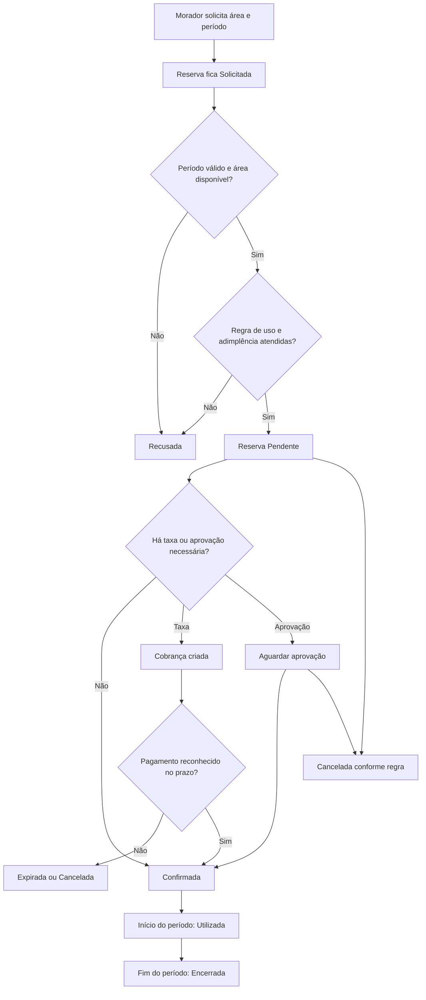
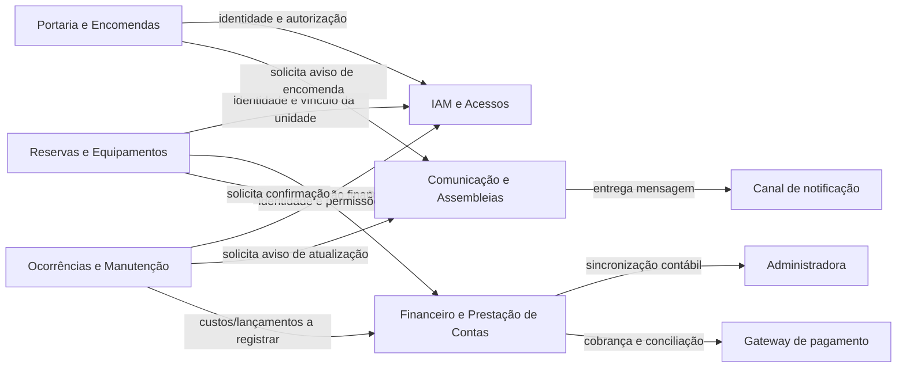

# Trabalho 3 — Revisão arquitetural baseada na evolução do conhecimento do domínio

**Disciplina:** Sistemas Corporativos  
**Sistema:** MyCondo — Plataforma integrada de gestão de condomínios  
**Aluno:** Vinicius Martins Nunes  
**Data:** 5 de outubro de 2026

> **Escopo deste trabalho:** este documento revisa a arquitetura apresentada no Trabalho 1 à luz do conhecimento produzido no Trabalho 2. As classificações **mantido**, **refinado**, **alterado**, **descartado** e **em aberto** descrevem o estado atual das decisões. O documento não define Bounded Contexts, agregados, microsserviços, APIs ou arquitetura física definitiva.

## 1. Síntese da arquitetura inicial

O **MyCondo** foi proposto no Trabalho 1 para resolver a dispersão de informações e processos da gestão condominial: reservas controladas informalmente, comunicação fragmentada, ausência de rastreabilidade de visitantes e encomendas, chamados sem acompanhamento e pouca transparência financeira.

Os atores iniciais eram **morador/condômino**, **síndico/administrador**, **portaria/operador de segurança**, **prestador de serviço** e **administradora de condomínios** como sistema externo. Gateways de pagamento e serviços de notificação também apareciam como integrações externas.

Os módulos inicialmente propostos foram:

- Gestão de Usuários e Acessos (IAM);
- Controle de Portaria e Encomendas;
- Reservas e Equipamentos;
- Ocorrências e Manutenção;
- Comunicação e Assembleias;
- Financeiro e Prestação de Contas.

A arquitetura escolhida foi uma **arquitetura em camadas**, com Apresentação, Aplicação, Domínio e Persistência. A Apresentação recebia as interações Web, Mobile e REST; a Aplicação orquestrava casos de uso e transações; o Domínio concentrava entidades e regras; e a Persistência cuidava de repositórios, banco e integrações técnicas.

O fluxo principal era a reserva de uma área comum pelo morador. O sistema verificava disponibilidade e adimplência, registrava a reserva como pendente, solicitava uma cobrança Pix quando aplicável e retornava a confirmação ou uma restrição.

Os principais desafios identificados eram disponibilidade da portaria, consistência das reservas e transações financeiras, segurança e privacidade de dados. O **ADR-001** registrou a decisão de iniciar com um **monólito modular**, em vez de microsserviços ou serverless, pela integração forte do domínio, menor custo e menor complexidade operacional.

O cenário de evolução previa crescimento de 50 para 5.000 condomínios, com o módulo de Comunicação degradando a portaria. A resposta inicial seria extrair Comunicação como microsserviço e adotar comunicação assíncrona, mantendo os demais módulos e camadas.

## 2. Descobertas do Trabalho 2 com impacto arquitetural

| Descoberta do Trabalho 2 | Elementos envolvidos | Possível impacto arquitetural | Grau de certeza |
|---|---|---|---|
| Reserva possui identidade e ciclo de vida | Reserva, Período, Área comum | O Domínio precisa proteger transições e impedir alterações que destruam o histórico | Confirmado |
| Disponibilidade deve ser preservada | Reserva, Área comum, Período | A confirmação exige proteção contra reservas conflitantes e concorrência | Confirmado |
| Adimplência influencia a reserva | Unidade, Situação financeira, Reserva | Reservas e Financeiro têm dependência de regra; a integração não pode ser apenas uma notificação | Confirmado no escopo atual |
| Cobrança de reserva pode ser opcional | Reserva, Cobrança, Pagamento | O fluxo não pode pressupor pagamento para todas as reservas; a política deve ser configurável no domínio | Hipótese forte |
| Pagamento tem identidade e conciliação | Cobrança, Pagamento, Valor monetário | O Financeiro precisa preservar histórico, tentativas, baixa e possíveis exceções | Hipótese; detalhes em aberto |
| Encomenda tem ciclo próprio | Encomenda, Unidade, Portaria | Portaria deve proteger estados de recebimento, guarda e entrega, e não apenas disparar notificação | Confirmado |
| Registro de acesso é histórico | Autorização, Visitante, Registro de acesso | O acesso precisa ser auditável; a autorização não pode ser o único registro | Confirmado |
| Visitante pode ou não ter cadastro persistente | Visitante, Autorização, Registro de acesso | A responsabilidade e o modelo de portaria dependem da política de identificação | Questão em aberto |
| Ocorrência pode originar ordem de serviço | Ocorrência, Ordem de serviço, Prestador | Manutenção não deve ser apenas uma extensão de chamados; o vínculo e seus estados precisam ser preservados | Hipótese forte |
| Votação exige elegibilidade e unicidade | Assembleia, Votação, Morador | Comunicação/Assembleias precisa proteger consistência de participação e resultado | Hipótese forte |
| Lançamento financeiro deve ser rastreável | Lançamento financeiro, Prestação de contas | Não basta editar saldos; o módulo financeiro precisa conservar histórico e justificativa | Confirmado |
| Regra de uso pode ter vigência | Área comum, Regra de uso, Reserva | A política aplicada à reserva pode precisar ser preservada, mas ainda não se conhece seu ciclo de alteração | Questão em aberto |
| Situação e Status são estados, não entidades independentes | Reserva, Ocorrência, Encomenda | Regras de transição pertencem ao domínio, não à persistência ou à interface | Confirmado |
| Período e Valor monetário são objetos de valor | Período, Valor monetário | Comparações e validações devem usar significado do valor, sem criar responsabilidades artificiais | Hipótese forte |

O impacto mais importante é que a arquitetura inicial, embora já previsse uma camada de Domínio, descrevia regras de modo genérico. O Trabalho 2 mostra que o Domínio precisa ser explicitamente responsável por invariantes de agenda, transições de estado, elegibilidade, rastreabilidade e condições financeiras. A Aplicação deve coordenar esses comportamentos, não substituí-los por verificações técnicas.

## 3. Revisão da descrição do problema

| Aspecto | Situação | Justificativa |
|---|---|---|
| Problema central | **Refinado** | A dispersão continua sendo o problema, mas agora sabemos que ela também ameaça invariantes: conflito de agenda, histórico de acesso, rastreabilidade de encomendas e prestação de contas. |
| Reservas | **Refinado** | Deixaram de ser apenas burocracia. São compromissos com ciclo de vida, condições de confirmação e possível cobrança. |
| Portaria | **Refinado** | A necessidade não é somente agilidade; é manter evidência de autorização, entrada, saída, recebimento e entrega. |
| Financeiro | **Refinado** | A transparência depende de lançamentos e pagamentos rastreáveis, não apenas de relatórios ou integrações. |
| Comunicação | **Mantido** | Mural, assembleias e notificações permanecem relevantes, embora as regras de votação tenham ganhado importância. |
| Segurança e privacidade | **Mantido** | O Trabalho 2 reforçou a necessidade de proteger registros históricos e documentos, sem alterar o problema original. |
| Hipótese de que todas as reservas dependem de pagamento | **Alterado** | A cobrança pode ser opcional e a política de confirmação depende do condomínio. |

A descrição atual passa a ser: **o MyCondo deve centralizar e preservar compromissos e fatos da vida condominial, permitindo que reservas, acessos, encomendas, atendimentos, deliberações e finanças evoluam por regras explícitas, sem perder consistência e rastreabilidade**. Essa formulação representa melhor o domínio conhecido do que uma descrição limitada à comunicação e automação.

## 4. Revisão dos atores

| Ator | Situação anterior | Situação atual | Classificação | Justificativa |
|---|---|---|---|---|
| Morador / Condômino | Usa reservas, chamados, acessos e assembleias | **Refinado** | Mantido | Continua sendo ator central, mas também participa de votações, autoriza visitantes, relata ocorrências e recebe encomendas conforme a unidade. |
| Síndico / Administrador | Supervisiona a operação | **Refinado** | Mantido | Além de aprovar e comunicar, pode definir políticas, resolver exceções e acompanhar invariantes operacionais. A extensão exata dessa autoridade está em aberto. |
| Portaria / Operador de segurança | Registra visitantes, acessos e encomendas | **Refinado** | Mantido | Passa a ser responsável por registrar fatos de segurança e transições de encomendas, não apenas por inserir dados e disparar alertas. |
| Prestador de serviço | Atualiza ordens de serviço | **Mantido** | Mantido | Continua externo ao núcleo administrativo, com responsabilidade sobre a execução e evidências da manutenção. |
| Administradora de condomínios | Integra lançamentos e boletos | **Refinado** | Mantido | A relação deve incluir conciliação e histórico financeiro, mas o limite entre administradora e MyCondo ainda não está definido. |
| Gateway de pagamento | Emite cobranças e retorna Pix | **Refinado** | Sistema externo | É um mecanismo externo de pagamento, não o proprietário da regra de confirmação da reserva. |
| Serviço de notificação | Envia Push/WhatsApp | **Mantido** | Sistema externo | Continua sendo canal de comunicação, sem assumir responsabilidade pela validade do comunicado ou da reserva. |
| Visitante | Tratado principalmente como dado da autorização | **Alterado** | Conceito/possível ator | O Trabalho 2 mostrou possível identidade e histórico. Ainda não é possível afirmar que seja usuário do sistema ou apenas participante de um acesso. |
| Unidade | Não era ator | **Mantido** | Conceito do domínio | Foi corretamente tratada como parte interna do domínio, não como ator, apesar de receber encomendas e possuir situação financeira. |

Não surgiu um ator obrigatório novo. **Visitante** ganhou relevância conceitual, mas não deve ser promovido automaticamente a ator autenticado. A classificação depende de saber se ele interage diretamente com o MyCondo ou apenas é registrado por morador e portaria.

## 5. Revisão dos módulos do sistema

| Módulo | Situação anterior | Descoberta relevante do Trabalho 2 | Situação atual | Justificativa |
|---|---|---|---|---|
| IAM e Acessos | Identidade, autenticação e papéis | Morador, unidade e permissões; registro de acesso é fato histórico; visitante pode ser persistente | **Refinado** | O módulo deve cuidar de identidade e autorização de interação. A validade do acesso e seu histórico devem permanecer relacionados a Portaria; não se deve colocar toda regra de acesso dentro do IAM. |
| Portaria e Encomendas | Visitantes, entradas, saídas e encomendas | Autorização e registro de acesso têm significados distintos; encomenda possui ciclo de recebimento, guarda e entrega | **Refinado** | O nome continua adequado, mas as responsabilidades precisam ser separadas conceitualmente: autorização/registro e ciclo da encomenda. A notificação é consequência, não responsabilidade principal. |
| Reservas e Equipamentos | Agenda, disponibilidade e regras de uso | Reserva tem estados; Período é valor; conflito é invariante; cobrança pode ser opcional | **Refinado** | Deve proteger o ciclo da Reserva e a agenda da Área comum. A decisão final sobre cobrança depende de uma política ainda não confirmada. |
| Ocorrências e Manutenção | Chamados e manutenções | Ocorrência pode originar uma ou mais ordens; ordem possui prestador e ciclo | **Refinado** | A separação conceitual entre relato e execução ficou mais clara. Não é necessário criar módulo novo antes de validar a relação entre ocorrências e ordens. |
| Comunicação e Assembleias | Avisos, notificações, enquetes e assembleias | Comunicado é entidade; votação exige elegibilidade e unicidade | **Refinado** | Deve proteger deliberações e votos, enquanto o envio de mensagens pode ser uma responsabilidade de apoio. A extração técnica futura não define a fronteira de domínio agora. |
| Financeiro e Prestação de Contas | Lançamentos, inadimplência, boletos e relatórios | Cobrança e Pagamento têm identidade; lançamento não pode desaparecer; adimplência influencia Reserva | **Refinado** | Deve preservar fatos financeiros e expor a situação financeira ao fluxo de reserva. A forma de integração com a administradora permanece em aberto. |

Nenhum módulo foi descartado. A principal mudança não é adicionar módulos, mas tornar explícitas responsabilidades que antes estavam agrupadas por conveniência funcional. As dependências mais importantes agora são: Reservas consulta uma condição financeira; Portaria registra fatos e pode provocar notificações; Ocorrências relaciona relato e execução; Comunicação recebe eventos ou solicitações sem ser dona das regras de origem.

## 6. Revisão do fluxo principal

### 6.1 O que estava simplificado

O fluxo do Trabalho 1 passava diretamente de validação para reserva pendente e geração de Pix. O Trabalho 2 revelou que essa sequência ocultava:

- o estado inicial **Solicitada**;
- a diferença entre **Pendente**, **Aguardando pagamento** e **Confirmada**;
- a possibilidade de reserva sem taxa;
- a rejeição por indisponibilidade, inadimplência ou regra de uso;
- expiração e cancelamento;
- a invariante de não haver conflito entre reservas confirmadas;
- a necessidade de preservar a regra de uso aplicada;
- transições inválidas, como confirmar sem pagamento quando ele é exigido ou reabrir reserva encerrada.

### 6.2 Fluxo revisado



O fluxo continua sendo coordenado pela Aplicação, mas as decisões em cada losango pertencem ao Domínio: disponibilidade, adimplência, regras de uso, pagamento exigido, aprovação e transições válidas. A Persistência deve conservar o histórico; ela não deve decidir se uma reserva é válida.

### 6.3 Fluxos secundários que ganharam importância

O recebimento e a entrega de encomendas passaram a ser um fluxo relevante porque possuem estados e exigem rastreabilidade. O registro de acesso também deixou de ser um simples cadastro auxiliar: uma entrada precisa poder ser confrontada com autorização ou exceção registrada. Esses fluxos não substituem a reserva como fluxo principal, mas influenciam a revisão dos módulos de Portaria e Comunicação.

## 7. Revisão do diagrama de módulos

O diagrama foi **alterado de forma limitada**. Os seis módulos foram mantidos, mas as dependências foram redesenhadas para refletir que regras permanecem nos módulos de domínio e que Comunicação não é proprietária das operações que geram notificações.



As setas representam dependências ou solicitações, não transferência de propriedade das regras. Por exemplo, Reservas pode consultar a situação financeira, mas a decisão de que uma reserva está confirmada continua sendo uma regra do domínio da Reserva. O diagrama não afirma que os módulos serão serviços separados; ele apenas torna visíveis as responsabilidades e dependências atuais.

## 8. Revisão da arquitetura em camadas

A arquitetura em camadas é **mantida**, porque o Trabalho 2 não demonstrou que outro estilo seria necessário. O que mudou foi a precisão da distribuição das responsabilidades.

```text
+--------------------------------------------------------------+
| APRESENTAÇÃO                                                |
| Interfaces Web/Mobile, operação da portaria e entrada       |
| de solicitações; validação de formato e autenticação inicial |
+--------------------------------------------------------------+
                              |
                              v
+--------------------------------------------------------------+
| APLICAÇÃO                                                   |
| Coordenação de casos de uso, transações, consultas,         |
| autorização de fluxo e publicação de notificações            |
+--------------------------------------------------------------+
                              |
                              v
+--------------------------------------------------------------+
| DOMÍNIO                                                     |
| Reserva, Área comum, Encomenda, Acesso, Ocorrência,         |
| Ordem de serviço, Financeiro e Assembleias;                 |
| regras, estados, invariantes, valores e políticas            |
+--------------------------------------------------------------+
                              ^
                              |
+--------------------------------------------------------------+
| PERSISTÊNCIA E INTEGRAÇÕES                                  |
| Repositórios, armazenamento histórico, conciliação técnica  |
| e adaptadores para serviços externos                         |
+--------------------------------------------------------------+
```

### Responsabilidades revisadas

- **Apresentação:** não decide adimplência, disponibilidade, elegibilidade ou transições. Pode validar formato e apresentar a decisão do domínio.
- **Aplicação:** coordena o caso de uso “solicitar reserva”, chama os objetos de domínio, abre a unidade transacional adequada e solicita notificações. Não deve duplicar as invariantes.
- **Domínio:** ganhou definição mais clara. Protege a não sobreposição de reservas confirmadas, as transições de Reserva, a validade de encomendas, a unicidade de votos e a rastreabilidade financeira.
- **Persistência:** conserva fatos e históricos e fornece consultas. Não transforma um status salvo em autorização de negócio. Gateways externos também são detalhes técnicos, mesmo quando o fato de pagamento possui significado de domínio.

Uma questão ainda não resolvida é o limite transacional entre Reserva e Financeiro. A arquitetura pode manter os módulos no mesmo monólito, mas não se deve concluir ainda se uma confirmação precisa de uma única transação ou de uma política de consistência eventual com compensação.

## 9. Revisão dos desafios arquiteturais

| Desafio | Já existia no Trabalho 1? | Evidência atual | Impacto | Situação |
|---|---|---|---|---|
| Disponibilidade da portaria | Sim | Registro de acesso e encomenda precisam funcionar durante toda a operação | Uma indisponibilidade impede entrada e rastreabilidade | Mantido |
| Consistência financeira | Sim | Cobrança, Pagamento e Lançamento têm identidade e histórico | Baixas e prestação de contas não podem ser sobrescritas sem justificativa | Refinado |
| Segurança e privacidade | Sim | Visitante, Registro de acesso, documentos e votos podem ser sensíveis | Necessidade de autorização contextual e histórico de acesso | Refinado |
| Concorrência na agenda | Parcialmente | Invariante impede duas reservas confirmadas conflitantes | Solicitações simultâneas podem produzir dupla confirmação | Novo |
| Transições de estado | Não explicitamente | Reserva, Ocorrência e Encomenda possuem ciclos e transições inválidas | Interfaces e persistência não podem alterar estados arbitrariamente | Novo |
| Dependência Reserva–Financeiro | Sim | Adimplência e pagamento influenciam confirmação, mas taxa é opcional | É necessário definir leitura, sincronização e exceções | Refinado |
| Integridade de votos | Não explicitamente | Voto elegível deve ser contado uma única vez | Resultado de assembleia pode ser inválido | Novo |
| Rastreabilidade de encomendas | Parcialmente | Encomenda percorre recebimento, guarda e entrega | Perda do estado gera conflito com morador e portaria | Refinado |
| Integração com administradora | Sim | Lançamentos e cobranças precisam ser conciliados | Divergência externa não pode apagar o histórico interno | Mantido |
| Escalabilidade da comunicação | Sim | Cenário de 5.000 condomínios continua plausível | Picos de notificações não devem bloquear operações críticas | Mantido |
| Dependência de canal externo | Sim | Notificação e pagamento são serviços externos | Falha externa não deve invalidar fatos já registrados sem regra explícita | Refinado |

O Trabalho 2 revelou desafios de consistência conceitual que não são resolvidos apenas escolhendo banco, fila ou microsserviço. Antes de escolher uma solução técnica, é preciso confirmar políticas de pagamento, cancelamento, exceções de portaria e votação.

## 10. Revisão do ADR-001

### 10.1 Avaliação

O contexto original continua válido: o MyCondo possui integração forte entre reservas, situação financeira, acessos, ocorrências e comunicação, e a equipe precisa reduzir complexidade operacional inicial. O monólito modular continua justificável.

O Trabalho 2, porém, acrescentou uma ressalva: módulos relacionados não podem compartilhar livremente regras e estados. A modularidade precisa ser baseada em responsabilidades e contratos conceituais, mesmo dentro do mesmo processo. O risco de um monólito sem isolamento interno ficou mais evidente por causa das invariantes de agenda, pagamento, acesso e votação.

### 10.2 ADR-001 — versão revisada

**Status:** **Revisado e mantido**.

**Contexto atualizado:** o domínio possui seis grupos funcionais integrados, entidades com ciclos de vida e regras que cruzam reservas, financeiro, portaria, manutenção e assembleias. Ainda não há evidência suficiente para definir fronteiras técnicas definitivas.

**Decisão atual:** manter um monólito modular organizado em camadas, com regras de domínio explícitas e dependências entre módulos controladas. Cada módulo deve proteger seus conceitos e invariantes; a Aplicação coordena os casos de uso sem duplicar decisões de negócio.

**Alternativas consideradas:** microsserviços continuam sendo uma possibilidade futura, especialmente para comunicação em caso de crescimento; serverless continua não sendo a decisão inicial por acoplamento operacional e dependência de fornecedor. Ainda não foi considerada uma extração técnica como solução para problemas conceituais não validados.

**Justificativa atualizada:** o novo conhecimento fortalece o monólito modular pela necessidade de consistência e integração, mas também exige modularidade real. Manter tudo no mesmo processo pode facilitar uma decisão transacional enquanto as políticas são investigadas; isso não autoriza acesso indiscriminado ao estado de outros módulos.

**Benefícios preservados:** menor complexidade de implantação, rastreabilidade, custo inicial reduzido e possibilidade de evolução.

**Novos riscos:** uma alteração em comunicação, financeiro ou portaria pode afetar invariantes de outros módulos; integrações externas podem produzir divergência; concorrência na agenda pode ser tratada de modo incorreto; e a falta de políticas confirmadas pode cristalizar decisões prematuras.

**Consequência aceita:** não será extraído um microsserviço apenas porque uma dependência parece desconfortável. A extração será reavaliada quando houver evidência de escala, autonomia de responsabilidade e comportamento operacional.

## 11. Revisão da funcionalidade inovadora

A funcionalidade proposta no Trabalho 1 foi **controle de acesso por biometria facial e IA**.

**Classificação atual: Refinada e em aberto para adoção.**

Ela continua relacionada a uma necessidade real de segurança e agilidade, mas não é necessária para o modelo conceitual atual. O Trabalho 2 mostrou que o domínio precisa de um **Registro de acesso** auditável, associado a uma autorização ou exceção. A biometria pode ser apenas um mecanismo de evidência/autenticação que alimenta esse registro.

Antes de qualquer implementação, seria necessário esclarecer:

- se o condomínio realmente pode e deseja usar dados biométricos;
- quem autoriza o tratamento e por quanto tempo;
- como lidar com falso positivo, falso negativo e indisponibilidade;
- qual é a alternativa manual;
- se uma falha biométrica pode bloquear o acesso de um morador;
- como o dado biométrico se relaciona com Visitante e Morador;
- quais requisitos legais e de privacidade se aplicam.

Portanto, a funcionalidade não foi descartada, mas não deve comandar a arquitetura nem criar um módulo técnico central antes dessas respostas. A responsabilidade de negócio continua sendo registrar e autorizar acesso; IA e biometria são possibilidades futuras.

## 12. Revisão do cenário de evolução

O cenário de crescimento para 5.000 condomínios continua plausível, mas foi reinterpretado com as invariantes do Trabalho 2.

### 12.1 O que permanece

- a organização em camadas;
- o cuidado com a disponibilidade da portaria;
- o monólito modular como ponto de partida;
- a necessidade de isolar Comunicação para evitar que notificações bloqueiem operações críticas;
- a preservação de regras e históricos do domínio.

### 12.2 O que precisa ser refinado

O problema não é somente volume de mensagens. É preciso separar o caminho crítico de confirmar uma reserva, registrar acesso ou receber encomenda do envio de uma notificação. A falha do canal de notificação não deve apagar uma reserva, desfazer uma entrega registrada ou impedir o histórico financeiro. A comunicação pode receber uma solicitação posterior, desde que a regra de negócio defina o que significa uma notificação pendente.

### 12.3 Decisão que pode ser revista

O ADR-001 deverá ser reavaliado se a escala demonstrar que Comunicação precisa de disponibilidade, processamento ou ciclo operacional independente. A extração de um serviço de comunicação é uma hipótese arquitetural, não uma decisão já tomada. A extração de Financeiro ou Reservas seria mais sensível, pois a dependência entre adimplência, cobrança e confirmação ainda não foi esclarecida.

### 12.4 A arquitetura favorece ou dificulta a evolução?

Ela favorece a evolução por possuir módulos nomeados e camadas separadas, mas somente se os módulos não compartilharem diretamente estados mutáveis. As relações Reserva–Financeiro e Portaria–Comunicação devem ser tratadas com contratos conceituais claros. A arquitetura dificulta a evolução quando uma regra é duplicada em interface, aplicação e persistência ou quando uma notificação é tratada como pré-condição de uma operação que já deveria estar registrada.

## 13. Matriz geral de evolução arquitetural

| Elemento | Situação no Trabalho 1 | Situação atual | Classificação | Evidência que sustenta a decisão |
|---|---|---|---|---|
| Problema | Centralização, comunicação, portaria e finanças | Compromissos e fatos precisam permanecer consistentes e rastreáveis | Refinado | Entidades, ciclos e invariantes do Trabalho 2 |
| Atores | Morador, síndico, portaria, prestador, administradora e externos | Papéis mantidos; visitante ganhou dúvida de identidade | Refinado | Revisão de atores e autorização |
| Módulos | Seis módulos funcionais | Seis mantidos, com responsabilidades internas mais precisas | Refinado | Conceitos, regras e invariantes associados |
| Fluxo | Reserva com adimplência, disponibilidade e Pix | Estados, exceções, cancelamento, expiração e cobrança opcional | Alterado | Ciclo de vida da Reserva |
| Arquitetura em camadas | Apresentação, Aplicação, Domínio e Persistência | Mantida com regras e invariantes explicitamente no Domínio | Refinado | Distinção entre orquestração e decisão |
| Desafios | Disponibilidade, consistência, segurança | Inclui concorrência, estados, votos e rastreabilidade | Refinado | Novas invariantes e relações |
| ADR-001 | Monólito modular | Mantido com modularidade e dependências mais controladas | Revisado | Integração forte e incertezas ainda abertas |
| Funcionalidade inovadora | Biometria facial e IA | Possibilidade de mecanismo de acesso, não núcleo do domínio | Refinado / em aberto | Registro de acesso e questões de privacidade |
| Cenário de evolução | Comunicação extraída sob alta escala | Mantido como hipótese condicionada a escala e autonomia | Refinado | Separação do caminho crítico e falhas externas |

## 14. Decisões que ainda não podem ser tomadas

| Questão | Por que ainda não podemos decidir? | Que informação falta? | Possível impacto |
|---|---|---|---|
| Reservas e Financeiro compartilham uma transação ou usam consistência posterior? | A confirmação pode depender de pagamento, mas o comportamento de falhas não foi definido | Política de confirmação, prazo, estorno, pagamento parcial e indisponibilidade do gateway | Pode alterar coordenação entre módulos e tratamento de compensação |
| Visitante é cadastro persistente? | O domínio só confirmou registros de visita e autorização | Política de visitantes recorrentes e necessidade de histórico por pessoa | Pode alterar IAM, Portaria e privacidade |
| Quem pode aprovar ou cancelar uma reserva? | O Trabalho 2 citou aprovação e cancelamento sem autoridade e prazos definidos | Regimento do condomínio e matriz de responsabilidades | Pode alterar estados e permissões |
| Regra de uso tem versão e vigência? | Não sabemos se reservas antigas preservam a política aplicada | Processo de alteração e aprovação das regras | Pode mudar RegraDeUso de configuração para conceito com histórico |
| Como tratar exceções de acesso? | Nem todo acesso pode ter pré-autorização e a emergência não foi modelada | Procedimento da portaria e autoridade para liberar | Pode alterar a invariante Registro–Autorização |
| Qual é o modelo de votação? | Quórum, peso, elegibilidade e procuração não foram definidos | Convenção e legislação aplicável ao condomínio | Pode mudar relações e regras de Assembleias |
| Uma ordem atende várias ocorrências? | A relação foi indicada como hipótese | Procedimento real de manutenção e faturamento | Pode alterar responsabilidades de Ocorrências e Manutenção |
| Quais documentos possuem ciclo próprio? | Fotos e laudos foram citados, mas não seu controle | Retenção, autoria, substituição e auditoria | Pode criar responsabilidade conceitual adicional |
| A biometria será adotada? | Necessidade e permissões legais não foram confirmadas | Decisão do condomínio, consentimento, segurança e alternativa manual | Pode introduzir requisitos de privacidade e disponibilidade |
| Quando extrair Comunicação? | Escala futura foi hipotética e não há métricas reais | Volume, latência, disponibilidade e custo | Pode alterar a distribuição física, mas não deve antecipar microsserviço |
| Quais fronteiras serão definitivas? | Ainda há questões de responsabilidades e regras | Entrevistas e validação dos fluxos reais | Pode revisar módulos, contratos e futuras fronteiras de domínio |

Registrar essas questões é uma decisão arquitetural responsável: não se deve usar uma tecnologia para esconder falta de conhecimento sobre o domínio.

## 15. Reflexão arquitetural

### Qual decisão do Trabalho 1 foi mais fortalecida?

A escolha do **monólito modular em camadas** foi fortalecida. O Trabalho 2 mostrou que Reserva, Financeiro, Portaria e Comunicação possuem relações reais e que várias regras ainda precisam ser validadas. Manter integração simples enquanto o conhecimento evolui é mais justificável do que distribuir prematuramente o sistema.

### Qual decisão ficou mais frágil?

A descrição de Reservas como um fluxo simples que gera Pix ficou frágil. A cobrança pode ser opcional, há estados intermediários, expiração e cancelamento, e a regra de adimplência ainda pode possuir exceções por condomínio.

### Qual foi a alteração mais significativa?

Foi a mudança da responsabilidade do Domínio: ele deixou de ser apenas o lugar abstrato das entidades e passou a ser explicitamente responsável por estados, invariantes e transições. Isso exige rever qualquer implementação que tratasse essas decisões como validação de tela, controller ou banco.

### Algum módulo deixou de fazer sentido?

Não. Porém, **Comunicação e Assembleias** reúne duas responsabilidades relacionadas, mas potencialmente diferentes: publicar mensagens e proteger deliberações. A separação interna pode precisar ser aprofundada depois de esclarecer as regras de assembleia; ainda não há evidência para criar um módulo ou contexto independente.

### Alguma responsabilidade mudou de lugar?

Sim. A verificação de disponibilidade, validade do período, adimplência aplicável, confirmação, expiração e cancelamento deve pertencer ao Domínio, sendo apenas coordenada pela Aplicação. Persistência fornece histórico; não autoriza transições. Comunicação entrega notificações, mas não decide se a operação de origem é válida.

### Alguma regra revelou problema na arquitetura anterior?

Sim. A invariante de que não podem existir reservas confirmadas conflitantes revela que uma simples sequência “validar e salvar” pode ser insuficiente sob concorrência. A arquitetura precisa tratar a confirmação como operação que protege uma regra de domínio, sem decidir ainda qual mecanismo técnico definitivo será usado.

### Alguma invariante mudou a compreensão sobre responsabilidades?

Sim. A invariante de rastreabilidade de encomenda mostra que Portaria não pode apenas receber dados e disparar push. A invariante de unicidade dos votos mostra que Assembleias não podem ser tratadas como uma enquete genérica sem regras de elegibilidade.

### Alguma decisão anterior foi tomada principalmente por intuição?

O uso de biometria facial foi uma proposta inovadora plausível, mas baseada mais em oportunidade tecnológica do que em uma necessidade de domínio validada. A extração futura de Comunicação também depende de um cenário de escala ainda hipotético. Ambas permanecem condicionais.

### Qual parte ainda possui maior incerteza?

As maiores incertezas estão na relação Reserva–Financeiro, nas exceções de Portaria, na política de visitantes e nas regras de Assembleia. Elas afetam estados, cardinalidades, permissões e possíveis fronteiras futuras.

### O que foi aprendido sobre domínio e arquitetura?

Aprendemos que arquitetura não deve apenas organizar telas, módulos ou tecnologias. Ela precisa proteger as decisões que dão significado aos conceitos: uma Reserva confirmada, um acesso registrado, uma encomenda entregue, um voto elegível e um lançamento financeiro rastreável. Quanto mais clara a regra do domínio, mais clara fica a responsabilidade arquitetural; quando a regra é incerta, a arquitetura também precisa preservar essa incerteza sem cristalizá-la.

### Defesa atual da arquitetura

Hoje conseguimos defender com segurança:

- a manutenção de camadas separando apresentação, coordenação, regras e persistência;
- o monólito modular como decisão inicial;
- a centralidade de Reserva, Área comum, Período, Unidade e Morador;
- a necessidade de o Domínio proteger estados, invariantes e histórico;
- a separação entre fatos de negócio e serviços externos de pagamento/notificação;
- a necessidade de isolamento do caminho crítico da portaria em relação a notificações.

Ainda precisamos investigar antes de defender decisões definitivas:

- a fronteira final entre Reservas e Financeiro;
- o modelo de identidade de Visitante;
- as regras de aprovação, cancelamento e exceção;
- as regras de votação;
- a adoção de biometria;
- o momento e a forma de qualquer extração para microsserviços.

## Apêndice — Uso de IA como apoio crítico

Foi utilizado um assistente de IA integrado ao VS Code, por meio do **Copilot SDK**, para confrontar o Trabalho 1 com o Trabalho 2, localizar decisões arquiteturais afetadas por novas regras e estruturar perguntas de revisão. A IA não foi tratada como fonte de fatos do condomínio.

As contribuições mais relevantes foram: apontar que a reserva possui estados e invariantes que não apareciam no fluxo inicial; separar a responsabilidade de Comunicação da regra que gera a notificação; destacar concorrência na agenda; questionar a ligação obrigatória entre pagamento e confirmação; e sugerir que biometria fosse mantida como mecanismo opcional, não como conceito central.

Sugestões sem evidência foram rejeitadas ou marcadas como questões abertas. Em particular, não foi adotada uma recomendação de transformar os módulos em microsserviços nem de definir Bounded Contexts, pois o enunciado proíbe antecipar essas decisões e o Trabalho 2 ainda deixou políticas importantes sem validação.

Se a IA fosse retirada, a equipe conseguiria defender as decisões mantidas e refinadas porque elas foram relacionadas aos fluxos, entidades, regras e invariantes dos trabalhos anteriores. As partes em aberto continuariam abertas; a IA ajudou a explicitá-las, mas não substitui entrevistas, evidências do domínio ou decisões da equipe.