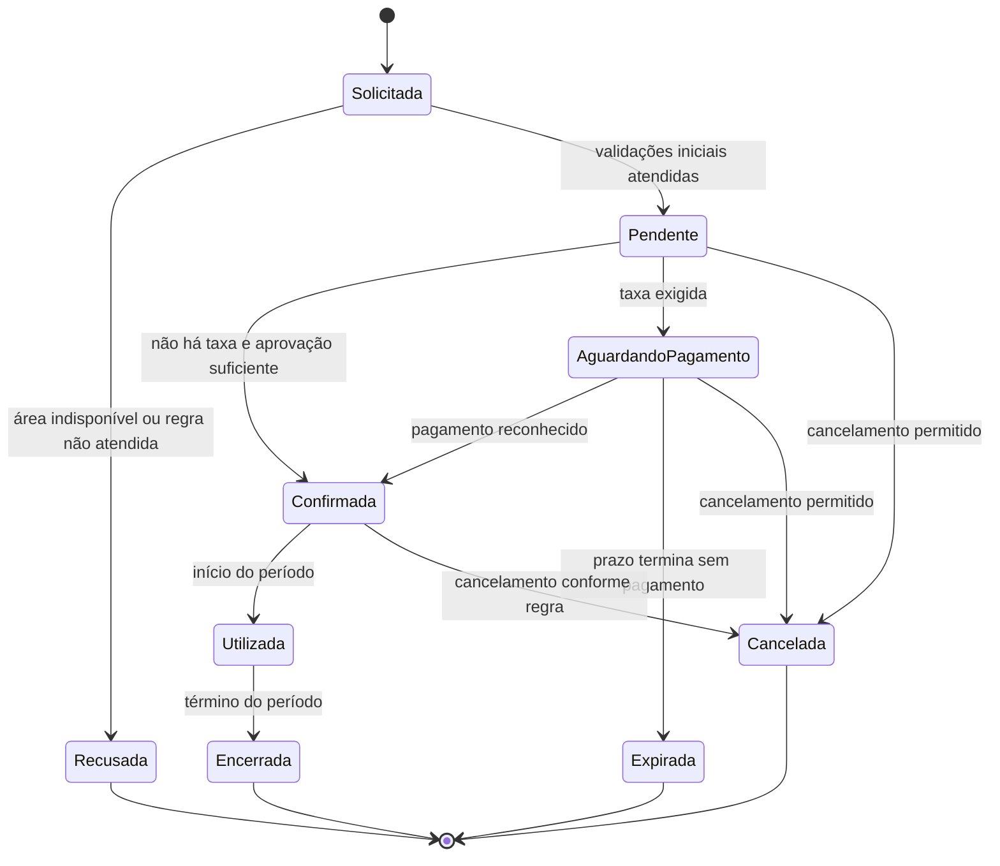
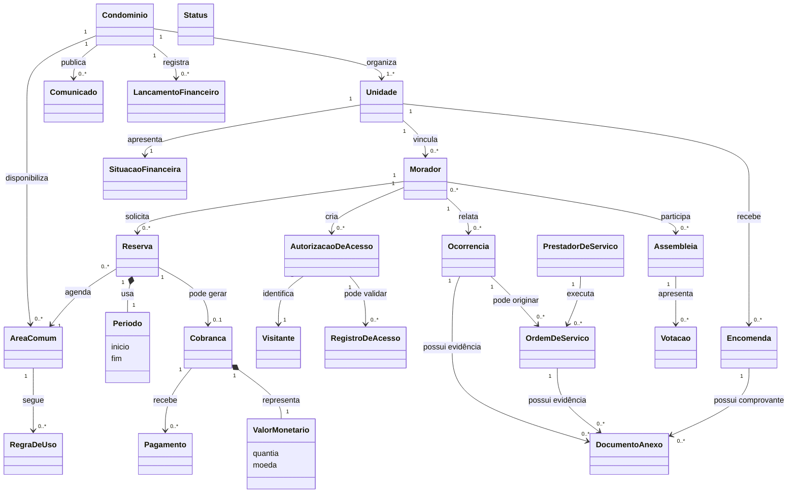

# Trabalho 4 — Modelagem conceitual do domínio do MyCondo

**Disciplina:** Sistemas Corporativos  
**Sistema:** MyCondo — Plataforma integrada de gestão de condomínios  
**Aluno:** Vinicius Martins Nunes  
**Data:** 5 de outubro de 2026

> **Nota metodológica:** este documento é uma evolução dos Trabalhos 1, 2 e 3. O modelo não é um banco de dados, nem define Bounded Contexts, agregados, APIs ou arquitetura física. Quando não há evidência suficiente, a decisão é registrada como hipótese ou questão em aberto.

## 1. Retomada do sistema

O **MyCondo** é uma plataforma Web e Mobile para centralizar a gestão de condomínios residenciais, comerciais e de múltiplas torres. O problema central é a dispersão de informações e operações em canais informais: reservas sem controle confiável, comunicação fragmentada, baixa rastreabilidade de acessos e encomendas, chamados sem acompanhamento e pouca transparência financeira.

O contexto envolve a convivência entre moradores, administração, portaria, prestadores de serviço e administradoras de condomínios. Os principais atores são **Morador/Condômino**, **Síndico/Administrador**, **Portaria/Operador de segurança**, **Prestador de serviço** e **Administradora de condomínios**. Gateway de pagamento e canal de notificação são sistemas externos; visitante é um participante do domínio cuja identidade persistente ainda precisa ser validada.

O objetivo da solução é preservar os fatos e compromissos da vida condominial, permitindo que reservas, acessos, encomendas, ocorrências, manutenções, assembleias e finanças sejam acompanhados por regras explícitas e com rastreabilidade.

O fluxo central é a **reserva de área comum**:

1. o morador solicita uma área e um período;
2. a disponibilidade, a situação financeira e as regras de uso são avaliadas;
3. a reserva é registrada como solicitada ou pendente;
4. se houver taxa, uma cobrança é criada;
5. após pagamento reconhecido ou aprovação aplicável, a reserva é confirmada;
6. o uso ocorre no período autorizado e a reserva é encerrada;
7. indisponibilidade, inadimplência, expiração ou cancelamento produzem transições alternativas.

Também foram identificados os fluxos de autorização e registro de acesso, recebimento e entrega de encomendas, abertura de ocorrências, execução de ordens de serviço, publicação de comunicados, assembleias e votações, cobranças, pagamentos, lançamentos e prestação de contas.

As principais operações são: cadastrar condomínios, unidades e moradores; reservar áreas; autorizar visitantes; registrar entradas e saídas; receber e entregar encomendas; abrir ocorrências; criar e executar ordens de serviço; comunicar avisos; realizar assembleias; registrar votos; controlar cobranças e pagamentos; e preservar lançamentos financeiros.

O sistema precisa conhecer ou preservar: vínculos entre moradores e unidades, áreas e regras de uso, períodos e estados de reservas, situação financeira, cobranças e pagamentos, autorizações e registros de acesso, encomendas, ocorrências, ordens de serviço, prestadores, comunicados, assembleias, votos, lançamentos e documentos de apoio.

## 2. Rastreabilidade do conhecimento anterior

| Elemento anterior | Descrição resumida | Como influencia a modelagem atual |
|---|---|---|
| Fluxo do Trabalho 1 | Morador solicita área e período; sistema verifica disponibilidade e adimplência; reserva pode gerar Pix | Origina Reserva, Área comum, Período, Unidade, Situação financeira, Cobrança e Pagamento |
| Estado do Trabalho 2 | Reserva percorre Solicitada, Pendente, Aguardando pagamento, Confirmada, Utilizada e Encerrada | Exige identidade para Reserva e regras de transição no modelo |
| Operação de portaria | Autorizar visitante, registrar entrada/saída e receber/entregar encomenda | Origina Visitante, Autorização, Registro de acesso e Encomenda |
| Operação de manutenção | Morador relata ocorrência; prestador atualiza ordem | Origina Ocorrência, Ordem de serviço e Prestador |
| Operação financeira | Registrar cobrança, pagamento, baixa e lançamento | Origina conceitos financeiros com histórico próprio |
| Fato confirmado | Uma área pode ser reservada em períodos diferentes, mas não deve haver conflito entre reservas confirmadas | Sustenta relação Reserva–Área–Período e invariante de não sobreposição |
| Fato confirmado | Encomendas e registros de acesso precisam ser rastreáveis | Impede tratá-los apenas como notificações ou dados transitórios |
| Hipótese do Trabalho 2 | Adimplência pode impedir confirmação de reserva | Entra como regra provisória e deve ser parametrizável até validação com condomínios |
| Hipótese do Trabalho 2 | Cobrança pode existir apenas para algumas reservas | Torna Reserva–Cobrança uma relação opcional |
| Hipótese do Trabalho 2 | Visitante pode possuir identidade recorrente | Visitante permanece entidade provisória, não ator autenticado definitivo |
| Decisão de trabalho | Regra de uso possui versão e vigência para preservar a política aplicada à reserva | Regra de uso é tratada provisoriamente como entidade versionada |
| Decisão de trabalho | Uma cobrança pode receber tentativas, parcelas, pagamentos parciais e estornos | Cardinalidade Cobrança–Pagamento é 1:0..N; estados e liquidação são controlados por transições |
| Decisão do Trabalho 3 | Manter monólito modular e camadas, sem antecipar microsserviços | Reforça que o modelo conceitual não deve incluir detalhes de persistência ou tecnologia |
| Decisão do Trabalho 3 | Domínio protege estados e invariantes; Aplicação coordena | Orienta as relações e a explicação das responsabilidades do modelo |

Essa rastreabilidade mostra que os conceitos não foram criados isoladamente. O fluxo ofereceu candidatos; as operações e informações ampliaram o conjunto; e as hipóteses e questões abertas impediram classificações definitivas onde faltava evidência.

## 3. Candidatos a conceitos do domínio

| Conceito candidato | De onde surgiu? | Por que parece relevante? | Grau de certeza |
|---|---|---|---|
| Condomínio | Contexto e operação de cadastro | Define o contexto no qual unidades, áreas e regras existem | Fato |
| Unidade | Fluxo financeiro e vínculo de moradores | É o espaço ao qual pessoas, encomendas e obrigações podem estar vinculadas | Fato |
| Morador | Ator e operações | Solicita reservas, relata ocorrências, autoriza visitantes e participa de assembleias | Fato |
| Área comum | Fluxo principal | É o recurso que pode ser utilizado e disputado por períodos | Fato |
| Reserva | Fluxo principal e estados | Representa uma solicitação e um compromisso de uso com ciclo próprio | Fato |
| Período | Disponibilidade | Permite comparar intervalos e identificar conflitos | Fato |
| Regra de uso | Operação de reservas | Determina horários, antecedência, limites e condições | Hipótese |
| Situação financeira | Regra de adimplência | Condiciona operações, mas pode ser resultado de outros fatos | Fato; forma de cálculo em aberto |
| Cobrança | Fluxo financeiro | Representa uma obrigação associada a uma reserva ou taxa | Fato; relação opcional |
| Pagamento | Fluxo financeiro e integração | Altera a situação de uma cobrança e precisa ser conciliado | Fato; multiplicidade em aberto |
| Visitante | Portaria | Pessoa autorizada ou registrada para entrar no condomínio | Fato; identidade persistente em dúvida |
| Autorização de acesso | Portaria | Define permissão, validade e condições de entrada | Hipótese forte |
| Registro de acesso | Portaria e segurança | Preserva o fato de entrada ou saída | Fato |
| Encomenda | Portaria | Possui recebimento, guarda e entrega para uma unidade | Fato |
| Ocorrência | Atendimento | Representa um problema relatado e acompanhado | Fato |
| Ordem de serviço | Manutenção | Formaliza uma execução atribuída a prestador | Fato |
| Prestador de serviço | Ator | Executa serviços e atualiza sua situação | Fato |
| Comunicado | Comunicação | Representa uma publicação oficial específica | Fato |
| Assembleia | Governança | Organiza pauta, participação e deliberações | Fato |
| Votação | Assembleia | Registra uma deliberação e seus votos | Fato; estrutura em aberto |
| Lançamento financeiro | Prestação de contas | Preserva receita, despesa ou outro movimento | Fato |
| Documento/anexo | Ocorrências, manutenção e portaria | Pode servir como evidência de foto, laudo ou registro | Hipótese |
| Período | Fluxo de reserva | Tem significado nos valores de início e fim, não em identidade própria | Fato |
| Valor monetário | Cobranças e lançamentos | Representa quantia e moeda sem ciclo independente | Fato |
| Status | Estados de vários conceitos | Descreve condição atual, não uma ocorrência autônoma | Outro conceito |

## 4. Investigação de identidade

| Conceito | Identidade parece relevante? | Evidência / justificativa | Classificação atual |
|---|---|---|---|
| Condomínio | Sim | Regras e fatos precisam ser distinguidos entre condomínios diferentes | Provável Entidade |
| Unidade | Sim | Permanece reconhecível quando moradores e situação financeira mudam | Provável Entidade |
| Morador | Sim | A mesma pessoa pode alterar dados e manter vínculo e histórico | Provável Entidade |
| Área comum | Sim | Possui regras, agenda e histórico de utilização | Provável Entidade |
| Reserva | Sim | Precisa ser consultada, cancelada, confirmada e encerrada | Provável Entidade |
| Período | Não, em princípio | O significado depende dos valores de início e fim | Provável Objeto de Valor |
| Regra de uso | Não sabemos | Pode ter versões e vigência, mas isso ainda não foi confirmado | Informação insuficiente |
| Situação financeira | Não como ocorrência | Parece uma condição calculada de cobranças e pagamentos | Estado/resultado |
| Cobrança | Sim | Possui vencimento, situação, conciliação e histórico | Provável Entidade |
| Pagamento | Sim | Um fato financeiro precisa ser distinguido mesmo com valores iguais | Provável Entidade |
| Visitante | Talvez | Pode ser reconhecido em acessos recorrentes ou ser apenas dados de uma autorização | Entidade provisória |
| Autorização de acesso | Sim | Tem validade, situação e uso específico | Provável Entidade |
| Registro de acesso | Sim | Cada entrada/saída é um fato histórico distinto | Provável Entidade |
| Encomenda | Sim | Percorre recebimento, guarda e entrega | Provável Entidade |
| Ocorrência | Sim | É acompanhada e encerrada sem perder histórico | Provável Entidade |
| Ordem de serviço | Sim | Tem atribuição, execução e conclusão próprias | Provável Entidade |
| Prestador de serviço | Sim | Mantém relação duradoura com várias ordens | Provável Entidade |
| Comunicado | Sim | Uma publicação específica pode ser consultada e auditada | Provável Entidade |
| Assembleia | Sim | Possui pauta, período e resultado próprios | Provável Entidade |
| Votação | Provavelmente | O resultado precisa ser preservado, mas a estrutura da deliberação ainda é incerta | Entidade provisória |
| Lançamento financeiro | Sim | Cada movimento deve permanecer rastreável | Provável Entidade |
| Documento/anexo | Não sabemos | Pode ser valor associado ou evidência com ciclo e auditoria próprios | Informação insuficiente |
| Valor monetário | Não | Quantia e moeda definem o significado | Provável Objeto de Valor |
| Status | Não | É condição de outra entidade | Estado |

A identidade foi atribuída quando o domínio precisa reconhecer a mesma ocorrência ao longo do tempo, acompanhar mudanças ou preservar histórico. Não foi atribuída a Período, Valor monetário e Status apenas para facilitar uma futura implementação.

## 5. Entidades, Objetos de Valor e outros conceitos

| Conceito | Classificação atual | Justificativa | Evidência | Grau de certeza |
|---|---|---|---|---|
| Condomínio | Provável Entidade | Delimita o contexto de regras e fatos | Sistema atende vários condomínios | Confirmado |
| Unidade | Provável Entidade | Mantém identidade e histórico de ocupação | Vínculos, encomendas e finanças | Confirmado |
| Morador | Provável Entidade | Participa de diferentes operações ao longo do tempo | Ator do sistema | Confirmado |
| Área comum | Provável Entidade | Possui agenda e regras próprias | Fluxo de reserva | Confirmado |
| Reserva | Provável Entidade | Possui ciclo de vida e estados | Fluxo e diagrama do Trabalho 2 | Confirmado |
| Período | Provável Objeto de Valor | Intervalo é definido por seus valores | Verificação de disponibilidade | Hipótese forte |
| Regra de uso | Entidade provisória versionada | Deve preservar a versão vigente quando uma reserva for avaliada | Políticas podem mudar ao longo do tempo | Decisão de trabalho |
| Situação financeira | Outro: estado/resultado | Condição derivada de cobranças e pagamentos | Regra de adimplência | Confirmado como estado |
| Cobrança | Provável Entidade | Tem vencimento, baixa, cancelamento e histórico | Fluxo financeiro | Hipótese forte |
| Pagamento | Provável Entidade | Precisa ser conciliado e auditado | Gateway e baixa | Hipótese |
| Visitante | Entidade provisória | Identidade pode ser relevante em visitas recorrentes | Portaria | Questão |
| Autorização de acesso | Provável Entidade | Possui validade e situação próprias | Pré-autorização | Confirmado como conceito |
| Registro de acesso | Provável Entidade | Preserva fato de segurança | Entrada e saída | Confirmado |
| Encomenda | Provável Entidade | Tem ciclo de recebimento, guarda e entrega | Portaria | Confirmado |
| Ocorrência | Provável Entidade | Tem acompanhamento até encerramento | Helpdesk | Confirmado |
| Ordem de serviço | Provável Entidade | Tem execução, responsável e conclusão | Manutenção | Confirmado |
| Prestador | Provável Entidade | Atua em múltiplas ordens | Atores | Confirmado |
| Comunicado | Provável Entidade | Publicação possui identidade e histórico | Mural | Confirmado |
| Assembleia | Provável Entidade | Evento de governança com pauta e participantes | Assembleia virtual | Confirmado |
| Votação | Entidade provisória | Deliberação e resultado precisam ser auditáveis | Votações | Hipótese |
| Lançamento financeiro | Provável Entidade | Receita ou despesa não deve desaparecer sem rastreio | Prestação de contas | Confirmado |
| Documento/anexo | Entidade provisória para evidências | Autoria, retenção, acesso e histórico podem ser necessários para fotos e laudos | Evidências de portaria e manutenção | Decisão de trabalho |
| Valor monetário | Provável Objeto de Valor | Quantia e moeda definem seu significado | Cobrança e lançamento | Confirmado |
| Status | Outro: estado | Expressa condição de outro conceito | Ciclos de vida | Confirmado |

## 6. Casos ambíguos

### 6.1 Visitante

**Dúvida:** tratar Visitante como Entidade ou como dados dentro de uma Autorização de acesso.

**Alternativas:** (a) entidade persistente, se o condomínio reconhece a mesma pessoa em autorizações recorrentes; (b) objeto ou informação da autorização, se cada visita é independente; (c) ator autenticado, se o visitante interage diretamente com o sistema.

**Evidências disponíveis:** a portaria registra entrada e saída e o morador pode pré-autorizar visitantes. Não há evidência sobre cadastro recorrente, login de visitante ou retenção do histórico por pessoa.

**Decisão atual:** entidade provisória, sem tratá-la como ator autenticado. A decisão poderá mudar após validar política de visitantes, privacidade e necessidade de recorrência.

### 6.2 Regra de uso

**Dúvida:** tratar Regra de uso como Entidade, Objeto de Valor ou política.

**Alternativas:** (a) Entidade, se possuir versões, vigência, aprovação e histórico; (b) Objeto de Valor, se for apenas conjunto de horários e limites da área; (c) outro conceito de política, se for uma decisão administrativa aplicada a reservas.

**Evidências disponíveis:** regras de antecedência, limites e adimplência foram mencionadas, mas sua alteração e validade histórica não foram descritas.

**Decisão atual:** entidade provisória versionada. Cada regra possui, conceitualmente, uma versão e uma vigência; a reserva conserva a referência à política aplicada. Se a validação com o condomínio demonstrar que regras são apenas parâmetros substituíveis sem histórico, a classificação será revertida para Objeto de Valor.

### 6.3 Documento/anexo

Fotos, laudos e documentos podem ser simples evidências de outros conceitos ou artefatos que precisam de autoria, retenção, substituição, controle de acesso e histórico.

**Decisão atual:** entidade provisória quando o documento for evidência com autoria, data, tipo, retenção, controle de acesso, substituição ou auditoria. Anexos descartáveis sem consulta independente continuam sendo valores associados ao conceito principal. Assim, a decisão é de domínio e pode ser revisada por tipo documental, não uma exigência técnica uniforme.

### 6.4 Cobrança e Pagamento

Cobrança e Pagamento possuem identidade financeira. Uma cobrança pode ter uma baixa única, várias tentativas, parcelamento, pagamento parcial ou estorno. A classificação como entidade é sustentada pelo histórico necessário; a política operacional de cada evento ainda precisa ser validada.

**Decisão de trabalho:** a cardinalidade adotada é **Cobrança 1 : 0..N Pagamentos**. Cada pagamento representa uma tentativa, parcela, pagamento parcial, confirmação ou estorno, e não necessariamente uma quitação. A cobrança só é considerada liquidada quando a soma dos pagamentos efetivamente compensados, descontados os estornos, atingir o valor devido. A decisão deverá ser confirmada com a administradora, mas já permite modelar o ciclo sem confundir tentativa com pagamento reconhecido.

| Estado da cobrança | Evento de entrada | Evento de saída permitido | Efeito sobre a reserva |
|---|---|---|---|
| Emitida | Cobrança criada | Em tentativa, Paga, Cancelada ou Vencida | Reserva permanece pendente |
| Em tentativa | Tentativa enviada ao gateway | Em tentativa, Parcialmente paga, Paga, Estornada ou Vencida | Não confirma sem pagamento reconhecido |
| Parcialmente paga | Valor compensado menor que o devido | Parcialmente paga, Paga ou Estornada | Permanece pendente, salvo política explícita |
| Paga | Valor devido compensado | Estornada ou contestada, conforme política | Pode permitir confirmação |
| Estornada | Estorno reconhecido | Em análise ou encerrada | Reserva não deve ser confirmada por esse pagamento |
| Vencida | Prazo expirado sem liquidação | Cancelada ou renegociada | Reserva pode expirar |

Tentativas rejeitadas não liquidam a cobrança; estornos reduzem o valor compensado; parcelas e pagamentos parciais permanecem vinculados à mesma cobrança. Não é permitido alterar manualmente o estado sem registrar evento, autor, data, valor e motivo.

## 7. Relações entre conceitos

| Conceito de origem | Relação | Conceito relacionado | Significado no domínio | Evidência |
|---|---|---|---|---|
| Condomínio | organiza | Unidade | O condomínio administra unidades dentro de seu contexto | Cadastro condominial |
| Unidade | vincula | Morador | Moradores possuem vínculo com uma unidade | Operações do morador |
| Condomínio | disponibiliza | Área comum | A área pode ser usada conforme regras do condomínio | Reservas |
| Morador | solicita | Reserva | O morador pede o uso de uma área em período determinado | Fluxo principal |
| Reserva | agenda | Área comum | A reserva ocupa um recurso comum | Disponibilidade |
| Reserva | é definida por | Período | O intervalo delimita o uso solicitado | Objeto de valor |
| Área comum | segue | Regra de uso | A utilização é limitada por políticas da área | Regras citadas |
| Unidade | possui | Situação financeira | A condição financeira é apurada no contexto da unidade | Adimplência |
| Reserva | pode gerar | Cobrança | Algumas reservas podem criar obrigação financeira | Taxa opcional |
| Cobrança | recebe | Pagamento | O pagamento pode liquidar ou alterar a situação da cobrança | Integração financeira |
| Morador | cria | Autorização de acesso | O morador pré-autoriza entrada de visitante | Portaria |
| Autorização de acesso | identifica | Visitante | A autorização informa quem pode entrar | Portaria |
| Registro de acesso | verifica | Autorização de acesso | A entrada pode ser comparada com autorização válida | Segurança; exceções em aberto |
| Unidade | recebe | Encomenda | A encomenda é destinada ao contexto da unidade | Portaria |
| Morador | relata | Ocorrência | O morador abre um chamado ou comunica um problema | Helpdesk |
| Ocorrência | pode originar | Ordem de serviço | O problema pode exigir execução de manutenção | Manutenção |
| Prestador | executa | Ordem de serviço | O prestador realiza o serviço atribuído | Operação de manutenção |
| Condomínio | publica | Comunicado | A administração divulga informação oficial | Comunicação |
| Assembleia | apresenta | Votação | A assembleia pode submeter deliberações | Governança |
| Morador | participa | Assembleia | O morador participa conforme elegibilidade | Assembleia virtual |
| Condomínio | registra | Lançamento financeiro | O condomínio preserva receitas e despesas | Prestação de contas |
| Lançamento financeiro | pode originar | Cobrança | Certos lançamentos representam valores a cobrar | Taxas |

As relações mais importantes para o núcleo são **Morador solicita Reserva**, **Reserva agenda Área comum**, **Reserva é definida por Período**, **Reserva pode gerar Cobrança** e **Unidade possui Situação financeira**. As relações de portaria e manutenção ampliam o modelo para contemplar os demais fluxos identificados, sem afirmar fronteiras técnicas definitivas.

## 8. Cardinalidades

| Relação | Cardinalidade atual | Evidência | Grau de certeza |
|---|---|---|---|
| Condomínio organiza Unidade | 1:N; um condomínio possui uma ou várias unidades | Contexto do sistema | Confirmada |
| Unidade vincula Morador | 0..N por unidade; uma unidade pode estar desocupada ou possuir vários moradores. Neste modelo, cada morador possui um vínculo ativo com uma unidade do condomínio | Unidades desocupadas, famílias e vínculo residencial | Decisão de trabalho |
| Condomínio disponibiliza Área comum | 1:0..N; pode não haver área reservável | Variação entre condomínios | Hipótese |
| Morador solicita Reserva | 1:N ao longo do tempo | Morador pode fazer várias solicitações | Confirmada |
| Reserva agenda Área comum | N:1; cada reserva aponta para uma área | Cada reserva usa uma área; uma área tem histórico de reservas | Confirmada |
| Reserva usa Período | N:1 no histórico; cada reserva tem um intervalo | Período pertence ao pedido e pode ter os mesmos valores em reservas diferentes | Confirmada como relação |
| Área segue Regra de uso | 1:0..N; uma área pode ter várias versões, mas apenas uma vigente para cada intervalo | Versionamento adotado como decisão de trabalho | Decisão de trabalho |
| Unidade possui Situação financeira | 1:1 como condição atual; histórico e cálculo em aberto | Adimplência é avaliada no contexto da unidade | Hipótese |
| Reserva gera Cobrança | 1:0..1 no modelo atual | Taxa é possível, mas não universal | Hipótese forte |
| Cobrança recebe Pagamento | 1:0..N | Tentativas, parcelas, pagamentos parciais e estornos são eventos financeiros distintos | Decisão de trabalho |
| Morador cria Autorização | 1:N; cada morador pode criar várias autorizações | Pré-autorização de visitantes | Hipótese forte |
| Autorização identifica Visitante | N:1; um visitante pode aparecer em várias autorizações e cada autorização identifica um visitante | Identidade recorrente adotada provisoriamente para histórico e segurança | Decisão de trabalho |
| Autorização é verificada por Registro de acesso | 1:0..N | Uma autorização pode ser usada ou não e pode permitir acessos múltiplos | Hipótese |
| Unidade recebe Encomenda | 1:0..N | Uma unidade pode receber várias encomendas | Confirmada |
| Morador relata Ocorrência | 1:0..N | Morador pode nunca abrir chamado ou abrir vários | Confirmada |
| Ocorrência origina Ordem de serviço | 1:0..N | Pode não exigir manutenção ou gerar várias execuções | Hipótese |
| Prestador executa Ordem de serviço | 1:0..N no histórico | Uma equipe ou múltiplos prestadores ainda não foram definidos | Questão em aberto |
| Condomínio publica Comunicado | 1:0..N | Mural pode ter vários comunicados | Confirmada |
| Assembleia apresenta Votação | 1:0..N | Assembleia pode não deliberar ou deliberar várias matérias | Hipótese |
| Morador participa de Assembleia | N:N | Vários moradores participam de várias assembleias | Hipótese; elegibilidade em aberto |
| Condomínio registra Lançamento | 1:N | Prestação de contas exige histórico de movimentos | Confirmada |

As cardinalidades não foram escolhidas por conveniência de banco. As decisões de trabalho já permitem raciocinar sobre o domínio; devem ser comparadas com regras reais do condomínio antes de se tornarem restrições definitivas.

## 9. Regras de negócio

| ID | Regra de negócio | Conceitos envolvidos | Origem / evidência | Situação |
|---|---|---|---|---|
| RN01 | Uma reserva só pode avançar quando o período solicitado estiver disponível para a área comum. | Reserva, Área comum, Período | Fluxo principal e invariante | Confirmada |
| RN02 | Uma reserva deve obedecer à versão da regra de uso vigente no momento da solicitação. | Reserva, Área comum, Regra de uso | Módulo de reservas e decisão de versionamento | Confirmada no modelo; parâmetros da política ainda devem ser cadastrados |
| RN03 | A condição de adimplência exigida pelo condomínio deve ser satisfeita para confirmar a reserva. | Unidade, Situação financeira, Reserva | Trabalho 1 e 2 | Confirmada no escopo atual |
| RN04 | Se a reserva possuir taxa, sua confirmação depende de pagamento reconhecido ou de uma forma de aprovação explicitamente permitida. Tentativas rejeitadas, pagamentos parciais e estornos não equivalem à quitação. | Reserva, Cobrança, Pagamento | Fluxo Pix, ciclo financeiro e revisão arquitetural | Confirmada no modelo; exceção de aprovação deve ser parametrizada |
| RN05 | Uma reserva não pode ser confirmada quando houver conflito com outra reserva confirmada para a mesma área e período. | Reserva, Área comum, Período | Invariante de agenda | Confirmada |
| RN06 | Um acesso de visitante deve possuir autorização válida ou exceção registrada por responsável autorizado, com motivo, momento e pessoa responsável. | Visitante, Autorização, Registro de acesso | Portaria e rastreabilidade de segurança | Confirmada no modelo; tipos de exceção devem ser parametrizados |
| RN07 | Uma encomenda recebida deve permanecer associada a uma unidade até ser entregue, devolvida ou ter outra destinação registrada com responsável e justificativa. | Encomenda, Unidade | Rastreabilidade de portaria | Confirmada no modelo |
| RN08 | Uma ocorrência encerrada deve manter seu histórico e só pode ser reaberta por ação explícita, com motivo, autor e data. | Ocorrência, Status | Ciclo de atendimento e auditoria | Confirmada no modelo |
| RN08.1 | Uma ordem de serviço só pode ser encerrada após conclusão registrada ou cancelamento justificado, com responsável e data. | Ordem de serviço, Prestador, Documento | Ciclo de manutenção e evidência de execução | Confirmada no modelo |
| RN09 | Um voto só pode ser contabilizado se o participante for elegível no momento da votação e ainda não tiver votado na deliberação. Após o encerramento, o resultado não pode ser alterado sem evento de auditoria. | Assembleia, Votação, Morador | Votação auditável | Confirmada no modelo; quórum e peso ainda devem ser parametrizados |
| RN10 | Um lançamento financeiro incluído na prestação de contas não pode desaparecer sem justificativa e rastreabilidade. | Lançamento financeiro, Condomínio | Transparência financeira | Confirmada |

### 9.1 Parâmetros e validações das regras

| Regra | Parâmetros necessários | Validação conceitual | Tratamento da violação |
|---|---|---|---|
| RN01/RN05 | Área, início, fim e reservas confirmadas | `início < fim` e nenhuma reserva confirmada se sobrepõe ao intervalo | Solicitação recusada ou mantida não confirmada; conflito informado |
| RN02 | Versão da regra, vigência, antecedência, duração máxima, horários e limite por unidade | A reserva é avaliada contra a única versão vigente no instante da solicitação | Solicitação não avança e o parâmetro violado é registrado |
| RN03 | Situação da unidade, data da consulta e exceções autorizadas | A condição está entre as situações permitidas pela política do condomínio | Confirmação bloqueada e justificativa preservada |
| RN04 | Valor devido, valores compensados, estornos, vencimento e aprovação alternativa | O saldo compensado é suficiente ou a exceção possui autorização válida | Reserva permanece pendente ou expira; pagamento não reconhecido não confirma |
| RN06 | Visitante, validade, área/horário, responsável e motivo da exceção | Autorização vigente ou exceção completa e autorizada | Entrada bloqueada ou registrada como exceção rejeitada |
| RN07 | Unidade, estado atual, responsável, momento e motivo de entrega/devolução/destinação | Toda transição parte de um único estado válido e mantém o vínculo até o destino | Operação rejeitada; estado anterior permanece |
| RN08 | Estado, evento, autor, data, motivo e solução | Apenas transições permitidas; reabertura exige justificativa | Mudança rejeitada ou registrada como reabertura auditável |
| RN08.1 | Ordem, conclusão/cancelamento, responsável, data e documento de evidência quando aplicável | Encerramento exige conclusão ou cancelamento justificado | Ordem permanece aberta |
| RN09 | Participante, elegibilidade, deliberação, voto existente, quórum e peso | Um voto por participante elegível; resultado congelado ao encerrar | Voto não contabilizado e tentativa registrada |
| RN10 | Tipo, valor, competência, descrição, origem e autor | Lançamento publicado só admite estorno/retificação rastreável | Exclusão rejeitada; correção gera novo evento |

### 9.2 Plano de validação com o domínio

As decisões acima são suficientes para uma modelagem conceitual consistente, mas não substituem a validação com partes interessadas. A próxima revisão deve coletar, no mínimo:

| Participante | Perguntas de validação | Decisão afetada |
|---|---|---|
| Síndico/administrador | Há regras versionadas? A inadimplência bloqueia todas as áreas? Existem aprovações alternativas? | RN02, RN03, RegraDeUso e Reserva–Cobrança |
| Administradora/responsável financeiro | Há parcelas, pagamentos parciais, estornos e renegociação? Quando uma cobrança é considerada liquidada? | Cobrança–Pagamento e RN04 |
| Portaria | Visitantes recorrentes são reconhecidos? Quais exceções de acesso existem? | Visitante–Autorização, RN06 e Registro de acesso |
| Responsável por manutenção | Quais evidências são obrigatórias para concluir ou cancelar uma ordem? | RN08.1 e DocumentoAnexo |
| Condôminos/administradora | Uma unidade pode estar vazia? Um morador pode manter vínculo com mais de uma unidade? | Unidade–Morador |

Até que essas respostas sejam obtidas, as marcações "decisão de trabalho" e "confirmada no modelo" devem ser lidas como escolhas conceituais explícitas, não como fatos universais.

## 10. Invariantes e proteção da consistência

| Conceito protegido | Possível invariante | O que poderia violá-la? | Consequência | Proteção conceitual | Evidência |
|---|---|---|---|---|---|
| Reserva | Toda reserva confirmada possui uma área e um período válidos | Confirmação com dados incompletos | Não se sabe qual uso foi autorizado | Validar atributos e transição antes da confirmação | Fluxo principal |
| Agenda da área | Não existem duas reservas confirmadas conflitantes para a mesma área e intervalo | Solicitações simultâneas | Dois moradores recebem o mesmo recurso | Revalidar sobreposição no momento da confirmação | Regra de disponibilidade |
| Reserva com cobrança | Reserva dependente de pagamento não fica confirmada sem saldo reconhecido ou aprovação prevista | Atualização manual indevida | Uso sem quitação ou inconsistência financeira | Separar tentativa, pagamento, estorno e quitação | Fluxo de cobrança |
| Reserva encerrada | Reserva encerrada não retorna silenciosamente a estado anterior | Alteração direta de status | Histórico do uso perde significado | Transições explícitas com autor, data e motivo | Ciclo da Reserva |
| Encomenda | Encomenda não pode estar simultaneamente pendente e entregue | Registrar entrega sem transição | Rastreabilidade incorreta | Estados exclusivos e responsável obrigatório | Operação da portaria |
| Registro de acesso | Todo registro indica pessoa, direção do movimento e momento do fato | Registro parcial | Histórico de segurança inconfiável | Validar os dados mínimos e justificar exceções | Controle de acesso |
| Ocorrência | Ocorrência encerrada conserva histórico e justificativa de reabertura, se admitida | Reabertura silenciosa | Perda do histórico de atendimento | Evento de reabertura obrigatório e auditável | Ciclo de ocorrência |
| Votação | Resultado considera somente votos elegíveis e sem duplicidade | Duplo voto ou alteração após encerramento | Deliberação inválida | Unicidade por participante/deliberação e congelamento auditável | Assembleia |
| Lançamento financeiro | Movimento publicado na prestação de contas permanece rastreável | Exclusão ou alteração sem justificativa | Relatório deixa de explicar o dinheiro | Estorno/retificação em vez de exclusão física | Prestação de contas |

Nem toda regra é invariante. Por exemplo, a adimplência pode ser uma condição de decisão, enquanto a ausência de reservas conflitantes é uma condição que deve permanecer verdadeira na agenda.

## 11. Estados e ciclo de vida

### 11.1 Entidade escolhida: Reserva

Reserva é a entidade mais adequada para representar o ciclo porque articula o fluxo principal, a área, o período, as regras de uso, a situação financeira e a cobrança.

O estado inicial é **Solicitada**. **Pendente** representa uma solicitação registrada que ainda não cumpriu todas as condições. **AguardandoPagamento** só se aplica quando houver taxa. **Confirmada** autoriza o uso; **Utilizada** e **Encerrada** representam a passagem pelo período. **Recusada**, **Expirada** e **Cancelada** são estados finais sem uso autorizado.

As transições válidas são provocadas por solicitação, validação de disponibilidade, aprovação, geração de cobrança, pagamento reconhecido, cancelamento permitido, expiração e passagem do tempo. São inválidas a confirmação com conflito de agenda, a confirmação sem pagamento quando ele for obrigatório, a utilização de reserva recusada ou expirada e o retorno silencioso de Encerrada para Pendente.

### 11.2 Outros ciclos relevantes

Encomenda possui, no mínimo, recebida, disponível para retirada, entregue ou devolvida. Ocorrência possui abertura, acompanhamento e encerramento. Ordem de serviço possui criação, atribuição, execução e conclusão/cancelamento. Esses ciclos ainda não foram detalhados no mesmo nível porque as regras de devolução, reabertura e atribuição precisam de validação.

## 12. Primeiro modelo conceitual do sistema

O diagrama representa conceitos do domínio, objetos de valor, relações e multiplicidades atuais. Não representa tabelas, chaves, tipos SQL ou detalhes de persistência.

O núcleo melhor sustentado é Condomínio–Unidade–Morador–Área comum–Reserva–Período. A relação Unidade–Morador permite zero moradores para unidades desocupadas e vários moradores para uma unidade ocupada; o vínculo individual é obrigatório para cada morador cadastrado no contexto condominial. Portaria, manutenção, comunicação e financeiro foram incluídos porque aparecem em operações e informações preservadas dos trabalhos anteriores. RegraDeUso, Visitante, DocumentoAnexo e Votação são decisões de trabalho conceituais, ainda sujeitas à validação de políticas reais; SituaçãoFinanceira e Status permanecem estados ou resultados, não entidades.

## 13. Explicação do modelo conceitual

### 13.1 Conceitos principais

- **Condomínio** delimita o contexto no qual todas as demais ocorrências fazem sentido.
- **Unidade** é o vínculo espacial e administrativo de moradores, encomendas e obrigações.
- **Morador** é um participante persistente do domínio e inicia ou participa de vários fluxos.
- **Área comum** é um recurso disputado e possui regras e agenda.
- **Reserva** é a entidade central porque registra uma intenção, passa por estados e pode criar obrigação financeira.
- **Período** é Objeto de Valor porque seu significado vem do intervalo de início e fim.
- **Cobrança**, **Pagamento** e **Lançamento financeiro** preservam fatos financeiros que precisam ser conciliados e auditados.
- **Autorização**, **Registro de acesso** e **Encomenda** explicam a rastreabilidade da portaria.
- **Ocorrência**, **Ordem de serviço** e **Prestador** explicam o atendimento e a manutenção.
- **Assembleia**, **Votação** e **Comunicado** representam governança e comunicação oficial.

### 13.2 Identidade e Objetos de Valor

Entidades foram usadas quando o domínio precisa reconhecer uma ocorrência ao longo do tempo: uma reserva específica, uma encomenda, uma ordem, uma assembleia ou um lançamento. Período e Valor monetário foram tratados como Objetos de Valor porque seus valores definem seu significado. Status e Situação financeira são estados ou resultados; não precisam ser entidades independentes.

### 13.3 Relações e cardinalidades

As relações do núcleo são sustentadas pelo fluxo de reserva. Relações como Condomínio–Unidade, Morador–Reserva, Reserva–Área e Unidade–Encomenda possuem evidência direta. Para viabilizar a discussão atual, foram adotadas decisões de trabalho para RegraDeUso, Cobrança–Pagamento, Visitante–Autorização e Unidade–Morador. Essas decisões não alegam validação com um condomínio específico: são a interpretação conceitual mais consistente com os trabalhos anteriores e possuem critérios explícitos de revisão.

### 13.4 Regras e incertezas

Disponibilidade, não sobreposição, adimplência, pagamento quando exigido, rastreabilidade de encomendas, validade de acesso, unicidade de voto e preservação financeira influenciam diretamente o modelo. Os parâmetros devem ser confirmados com síndico, administradora, portaria e responsável financeiro; até essa confirmação, a situação "Confirmada no modelo" significa regra necessária para coerência do modelo, não fato universal de todo condomínio.

## 14. Evolução do modelo

| Momento | Alteração realizada | Motivo | Evidência ou descoberta que provocou a mudança |
|---|---|---|---|
| Identificação inicial | Levantamento de Condomínio, Unidade, Morador, Área, Reserva, Período e conceitos operacionais | O fluxo e as operações oferecem candidatos | Trabalhos 1 e 2 |
| Investigação de identidade | Reserva, Encomenda, Ocorrência, Ordem, Acesso e Lançamento passaram a ser prováveis entidades | Possuem ciclo, histórico e necessidade de consulta posterior | Trabalho 2 |
| Investigação de valores | Período e Valor monetário passaram a ser Objetos de Valor | Significado principal está nos valores que os compõem | Comparação de intervalos e valores |
| Casos ambíguos | Visitante, RegraDeUso e DocumentoAnexo ficaram provisórios/insuficientes | Faltam evidências de persistência, vigência ou auditoria | Questões abertas dos trabalhos anteriores |
| Relações | Verbos foram usados para descrever solicita, agenda, recebe, relata, executa e participa | Evitar relações genéricas ou técnicas | Fluxos e operações |
| Cardinalidades | O núcleo recebeu cardinalidades mais sustentadas; relações financeiras e de portaria ficaram abertas | Não inventar limites de negócio | Evidências e hipóteses separadas |
| Regras | Foram registradas disponibilidade, adimplência, pagamento, acesso, votação e rastreabilidade | Regras orientam comportamento antes da implementação | Trabalho 2 e revisão do Trabalho 3 |
| Invariantes | Foram destacadas não sobreposição, estados válidos, unicidade de votos e histórico financeiro | Algumas condições devem permanecer verdadeiras | Ciclos e proteção da consistência |
| Modelo atual | Integração de entidades, valores, outros conceitos e incertezas em Mermaid | Responder como o domínio se organiza hoje | Síntese dos trabalhos anteriores |

## 15. Revisões identificadas em relação aos documentos anteriores

| Documento ou conhecimento anterior | Revisão identificada | Motivo | Impacto futuro |
|---|---|---|---|
| Trabalho 1 — fluxo de reserva | Atualizar o fluxo para incluir Solicitada, Pendente, AguardandoPagamento, Expirada e Cancelada | Trabalho 2 revelou estados e transições inválidas | Casos de uso e regras deverão refletir o ciclo real |
| Trabalho 1 — fluxo com Pix | Remover a interpretação de que toda reserva necessariamente depende de pagamento | Cobrança pode ser opcional e política ainda não foi validada | Revisar regra de confirmação e integração financeira |
| Trabalho 1 — diagrama arquitetural | Tornar explícito que invariantes pertencem ao Domínio, não à Aplicação ou Persistência | Trabalho 3 refinou responsabilidades | Documentação arquitetural deve ser atualizada |
| Trabalho 1 — biometria facial | Reclassificar como possibilidade futura de mecanismo de acesso, não como conceito central | Registro de acesso é o conceito de domínio; biometria é solução possível | Validar privacidade, necessidade e exceções |
| Trabalho 2 — relação Cobrança–Pagamento | Consolidar 1:0..N como decisão de trabalho e explicitar estados de tentativa, parcela, pagamento parcial e estorno | A relação precisa representar o histórico sem confundir pagamento com quitação | Validar eventos e saldo liquidado com administradora e financeiro |
| Trabalho 2 — Visitante | Registrar como Entidade provisória e não como ator autenticado | Identidade recorrente ainda é incerta | Validar política de visitantes e retenção |
| Trabalho 2 — RegraDeUso | Adotar Entidade provisória versionada para preservar a política aplicada à reserva | A vigência e o histórico são necessários para explicar decisões passadas, embora ainda não tenham sido confirmados | Confirmar versão, vigência e aprovação com síndico/administradora |
| Trabalho 2 — Documento/anexo | Adotar Entidade provisória somente para evidências auditáveis; demais anexos continuam valores | Fotos e laudos podem ter ciclos e exigências diferentes | Definir retenção, autoria e auditoria por tipo documental |
| Trabalho 3 — diagrama de módulos | Preservar módulos, mas impedir que Comunicação seja dona das regras de origem | Notificação é consequência, não decisão | Revisar dependências na arquitetura |
| Trabalho 3 — ADR-001 | Manter monólito modular como decisão provisória e rastreável | Integração forte e incertezas ainda existem | Reavaliar apenas com evidências de escala e autonomia |

Os documentos anteriores também deveriam ser atualizados futuramente para que o fluxo de reserva, o ADR e a funcionalidade de biometria não apresentem versões simplificadas ou prematuras.

## 16. Pendências de Governança

| Item a revisar futuramente | Motivo | Prioridade | Consequência se permanecer desatualizado |
|---|---|---|---|
| Fluxo principal do Trabalho 1 | Não contém todos os estados e exceções da Reserva | Alta | Equipe pode implementar confirmação, expiração ou cancelamento incorretamente |
| Diagrama arquitetural do Trabalho 1 | Responsabilidades do Domínio estão genéricas | Alta | Regras podem ser duplicadas na Aplicação ou Persistência |
| ADR-001 | Precisa refletir modularidade baseada em invariantes e dependências controladas | Média | Decisões futuras podem ignorar os riscos descobertos |
| Modelo conceitual do Trabalho 2 | Deve incorporar correção do diagrama e manter incertezas atuais | Alta | Documentos podem divergir sobre conceitos e relações |
| Política de reservas | Aprovação, adimplência, taxa e cancelamento não estão confirmados | Alta | Estados e cardinalidades podem ser definidos de forma errada |
| Política de visitantes e acessos | Identidade, autorização e exceções não foram definidas | Alta | Modelo de portaria pode violar privacidade ou rastreabilidade |
| Política de assembleias | Elegibilidade, quórum e voto não foram detalhados | Média | Votações podem ser representadas com regra inadequada |
| Política documental | Retenção, autoria e histórico de anexos não foram definidos | Média | Evidências podem ser perdidas ou protegidas inadequadamente |
| Decisão sobre biometria | Necessidade e tratamento de dados biométricos não foram validados | Baixa | Solução técnica pode ser adotada sem necessidade ou base adequada |

## 17. Análise crítica do modelo

1. **Parte mais bem sustentada:** o núcleo Condomínio–Unidade–Morador–Área comum–Reserva–Período, derivado diretamente do fluxo principal e das operações do sistema.
2. **Conceito com classificação mais incerta:** Visitante, pois sua identidade pode ser persistente ou limitada a cada autorização.
3. **Relação com justificativa mais frágil:** Registro de acesso verifica Autorização de acesso, porque há possíveis acessos emergenciais, presenciais ou excepcionais.
4. **Cardinalidade que precisa de validação operacional:** Cobrança–Pagamento foi definida conceitualmente como 1:0..N, mas os eventos de tentativa, pagamento parcial, parcela e estorno ainda precisam ser confirmados com o responsável financeiro.
5. **Regra de maior impacto:** RN03, sobre adimplência, porque conecta a situação financeira ao fluxo central de reservas.
6. **Decisão baseada principalmente em intuição:** a classificação provisória de Visitante como entidade e a possibilidade de biometria. Ambas estão explicitamente marcadas como hipóteses.
7. **Hipótese cuja rejeição provocaria maior mudança:** a confirmação de que a inadimplência bloqueia reservas. Se rejeitada, altera a relação entre Reservas e Financeiro e o fluxo de estados.
8. **Nova informação que modificaria significativamente o modelo:** a política real de reservas, incluindo aprovação, taxas, cancelamentos, compartilhamento entre torres e exceções.
9. **Parte provavelmente revisada:** parâmetros de RegraDeUso, estados de Pagamento, política de Visitante, Votação e tipos de DocumentoAnexo.
10. **Contradição com documentação anterior:** existe uma simplificação, não uma contradição completa: o Trabalho 1 apresenta o fluxo como se a cobrança Pix fosse parte recorrente da confirmação; este trabalho registra a cobrança como opcional e dependente da política.

O modelo é deliberadamente incompleto em pontos onde faltam evidências. Essa incompletude é preferível a criar conceitos, cardinalidades ou regras apenas para parecer completo.

## 18. Reflexão da equipe

- **Descoberta que não estava clara anteriormente:** a Reserva é um compromisso com ciclo de vida e invariantes, não apenas uma linha de agenda. A Encomenda também é uma entidade porque recebimento, guarda e entrega precisam ser rastreados.
- **Conceito mais difícil de classificar:** Visitante, pela dúvida entre pessoa persistente, dados da autorização e possível ator.
- **Relação que exigiu maior discussão:** Reserva–Cobrança–Pagamento, pois a taxa pode ser opcional e o ciclo de pagamento ainda não é conhecido.
- **Informação simples que passou a ser Entidade:** Encomenda e Registro de acesso ganharam importância como fatos históricos.
- **Conceito inicialmente considerado entidade que deixou de parecer necessário:** Status e Situação financeira deixaram de ser entidades independentes; são estados ou resultados.
- **Cardinalidade aparentemente óbvia que virou hipótese:** Cobrança–Pagamento, Unidade–Morador e Autorização–Visitante.
- **Regra que mais influenciou o modelo:** não confirmar reserva quando disponibilidade, adimplência ou condição de pagamento aplicável não forem satisfeitas.
- **Decisão anterior a revisar:** o fluxo do Trabalho 1 e a descrição da biometria precisam ser atualizados para não sugerirem decisões mais definitivas do que o conhecimento permite.
- **Mudança na compreensão:** modelar o domínio exige preservar histórico e significado, não apenas enumerar módulos e informações.
- **Suficiência para as próximas etapas:** o modelo está suficientemente fundamentado para discutir responsabilidades e fronteiras iniciais, porque há rastreabilidade, relações semânticas, regras e incertezas explícitas. Ainda não é suficiente para definir agregados, Bounded Contexts ou estruturas técnicas definitivas. As políticas de reservas, visitantes, pagamentos e assembleias precisam ser validadas.

## Apêndice — Uso de Inteligência Artificial

### Ferramenta utilizada

Foi utilizado um assistente de IA integrado ao VS Code, por meio do **Copilot SDK**. O modelo específico não foi informado pela ferramenta nesta sessão.

### Finalidade

A IA foi utilizada para ler o enunciado do Trabalho 4, comparar os Trabalhos 1, 2 e 3, verificar a continuidade dos conceitos, questionar classificações, identificar pendências documentais e organizar a modelagem conceitual no formato Markdown e Mermaid.

### Contribuições relevantes

- reforçou que o Trabalho 4 exige rastreabilidade do conhecimento anterior, e não apenas repetição do diagrama do Trabalho 2;
- ajudou a separar entidades, objetos de valor, estados, políticas e conceitos ainda incertos;
- questionou as cardinalidades de Cobrança–Pagamento, Unidade–Morador e Autorização–Visitante;
- destacou que o ciclo de Reserva deveria incluir expiração e cancelamento;
- identificou que documentos anteriores precisavam registrar revisões para manter governança;
- reforçou que notificações, biometria e persistência não devem ser confundidas com conceitos centrais do domínio.

### Hipóteses reveladas

Ficaram explícitas as hipóteses de que a adimplência pode impedir reserva, que a cobrança é opcional, que visitantes podem ser reconhecidos em autorizações recorrentes, que votos precisam ser únicos e elegíveis e que uma ordem de serviço pode se originar de uma ocorrência. Essas hipóteses foram marcadas como confirmadas, provisórias ou abertas conforme a evidência disponível.

### Classificações questionadas

Foram reconsiderados Visitante, RegraDeUso, DocumentoAnexo, SituaçãoFinanceira, Status, Cobrança, Pagamento e Votação. Também foram questionadas as relações e multiplicidades de acesso, pagamento, moradores por unidade e prestadores por ordem.

### Sugestões rejeitadas

Não foi incorporada qualquer sugestão de criar tabelas, chaves, agregados, Bounded Contexts ou microsserviços para completar o modelo. Também não foi adotada a biometria facial como conceito central, pois ela é uma possível solução de acesso e não uma necessidade conceitual comprovada.

### Avaliação crítica

A IA ajudou a estruturar o documento, localizar requisitos do enunciado e revelar hipóteses escondidas. Sua limitação é não conhecer a convenção, a legislação ou as políticas de um condomínio específico. Ela poderia produzir cardinalidades e regras convincentes sem evidência; por isso, as sugestões foram confrontadas com os Trabalhos 1, 2 e 3 e marcadas como fato, hipótese ou questão.

### Questão final obrigatória

Se a IA fosse retirada agora, a equipe conseguiria explicar, justificar e defender cada elemento do modelo? **Sim, com as limitações registradas.** O núcleo do modelo foi derivado dos fluxos, operações e informações já analisados; as classificações têm justificativas; e as partes incertas foram preservadas como hipóteses ou questões. A IA ajudou a revisar e organizar, mas não foi usada como evidência do domínio. A equipe ainda precisará validar as políticas reais antes de transformar as hipóteses em decisões definitivas.