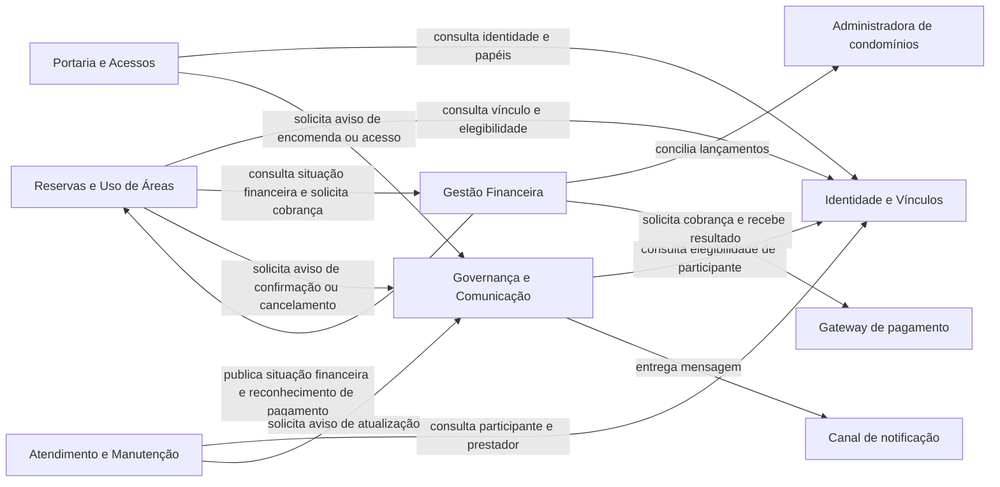
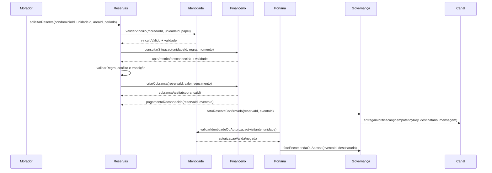

# Trabalho 5 — Organização arquitetural de domínio e fronteiras

**Disciplina:** Sistemas Corporativos  
**Sistema:** MyCondo — Plataforma integrada de gestão de condomínios  
**Aluno:** Vinicius Martins Nunes  
**Data:** 5 de outubro de 2026

> **Nota de escopo:** este documento consolida os Trabalhos 1 a 4 em uma hipótese de organização por responsabilidades e possíveis Bounded Contexts. As fronteiras propostas ainda não são definitivas, não equivalem automaticamente a microsserviços e não definem deploy, APIs, agregados finais ou infraestrutura.

## 1. Retomada do domínio

O **MyCondo** centraliza a gestão de condomínios residenciais, comerciais e de múltiplas torres. O problema central é a dispersão de informações e compromissos em canais informais, o que causa conflitos de reservas, pouca rastreabilidade na portaria, chamados sem acompanhamento e baixa transparência financeira.

Os atores principais são:

- **Morador/Condômino**, que solicita reservas, relata ocorrências, autoriza visitantes, recebe encomendas e participa de assembleias;
- **Síndico/Administrador**, que define políticas, supervisiona operações, comunica decisões e trata aprovações e exceções;
- **Portaria/Operador de segurança**, que registra acessos, visitantes e encomendas;
- **Prestador de serviço**, que executa ordens de serviço;
- **Administradora de condomínios**, que participa da operação financeira;
- **Gateway de pagamento** e **canal de notificação**, que são sistemas externos.

As capacidades mais importantes são reservar áreas comuns; controlar visitantes, acessos e encomendas; acompanhar ocorrências e manutenção; publicar comunicados e conduzir assembleias; e controlar cobranças, pagamentos, inadimplência e prestação de contas.

Os conceitos centrais identificados no Trabalho 4 são **Condomínio**, **Unidade**, **Morador**, **Área comum**, **Reserva**, **Período**, **Regra de uso**, **Cobrança**, **Pagamento**, **Visitante**, **Autorização de acesso**, **Registro de acesso**, **Encomenda**, **Ocorrência**, **Ordem de serviço**, **Prestador**, **Assembleia**, **Votação**, **Comunicado** e **Lançamento financeiro**. Período e Valor monetário são objetos de valor; Status e Situação financeira são estados ou resultados; Visitante, Regra de uso e Documento são decisões provisórias, com critérios de revisão ainda dependentes de evidências do domínio.

As principais regras e invariantes são:

- não confirmar duas reservas conflitantes para a mesma área e período;
- respeitar regras de uso e a condição de adimplência aplicável;
- confirmar uma reserva tarifada somente com pagamento reconhecido ou aprovação permitida;
- preservar o ciclo de vida da Reserva;
- manter a rastreabilidade de encomendas e acessos;
- contar apenas votos elegíveis e sem duplicidade;
- preservar lançamentos financeiros e suas justificativas.

Os possíveis agregados identificados até agora são **Reserva**, **Encomenda**, **Acesso**, **Ocorrência**, **Ordem de serviço**, **Assembleia/Votação**, **Cobrança** e **Lançamento financeiro**. Eles são hipóteses de agrupamento para proteger invariantes, não decisões finais de implementação. Condomínio, Unidade, Morador, Área comum e Prestador aparecem como entidades de referência que podem ser utilizadas por mais de uma área.

### Pistas para a divisão do sistema

As pistas não vêm da quantidade de telas ou tabelas. Elas vêm de:

1. ciclos de vida diferentes: Reserva, Encomenda, Ocorrência e Cobrança mudam por eventos distintos;
2. invariantes específicas: não sobreposição de reservas, unicidade de votos e rastreabilidade financeira;
3. vocabulários diferentes: “confirmar reserva”, “registrar acesso”, “baixar cobrança” e “encerrar ordem” não significam a mesma coisa;
4. razões de mudança diferentes: regras de agenda mudam por política de uso; pagamentos mudam por conciliação; portaria muda por segurança operacional;
5. dependências que precisam ser explícitas: Reservas consulta situação financeira, Portaria depende de identidade e Comunicação recebe consequências dos demais fluxos.

### Rastreabilidade consolidada dos Trabalhos 1 a 4

| Trabalho | Artefato ou decisão aproveitada | Refinamento realizado no Trabalho 5 |
|---|---|---|
| Trabalho 1 | Fluxo de reserva, atores, módulos, arquitetura em camadas e ADR-001 | O fluxo passa a ser protegido pelo contexto de Reservas; as camadas continuam válidas dentro dos módulos; a extração de Comunicação depende de métricas |
| Trabalho 1 | Portaria e Encomendas, QR Code e registro fotográfico | Portaria protege autorização, acesso e encomenda; QR Code é mecanismo, não identidade; foto pode ser evidência |
| Trabalho 1 | Financeiro, gateway e administradora externa | Financeiro é dono de cobrança, pagamento e lançamento; parceiros externos não controlam invariantes |
| Trabalho 2 | Entidades, objetos de valor, cardinalidades, regras e ciclo da Reserva | Cada fronteira é justificada por ciclo, vocabulário e invariante, e não só por módulo funcional |
| Trabalho 3 | Monólito modular, camadas, separação Domínio–Aplicação e Comunicação assíncrona | A decisão é mantida, mas contratos, eventos, idempotência e critérios de extração ficam explícitos |
| Trabalho 4 | Ambiguidades de Visitante, RegraDeUso, Documento, Pagamento e Unidade–Morador | Contextos usam modelos próprios e decisões provisórias; não há Shared Kernel amplo para conceitos instáveis |

Essa consolidação preserva o que foi mantido, explicita o que foi refinado e transforma a evolução prevista no Trabalho 1 em cenários condicionados a evidências.

## 2. Descoberta das áreas de responsabilidade

| Área candidata | Propósito | Principais responsabilidades | Conceitos envolvidos | Regras relevantes |
|---|---|---|---|---|
| Identidade e Vínculos | Saber quem interage e a que unidade/condomínio está vinculado | Identificar moradores, papéis, unidades e permissões de interação | Condomínio, Unidade, Morador, Prestador | Apenas participantes autorizados executam operações compatíveis com seu papel |
| Reservas e Uso de Áreas | Organizar o uso de recursos comuns | Avaliar disponibilidade, aplicar regras, criar e mudar estados de Reserva | Área comum, Reserva, Período, Regra de uso | Não sobrepor reservas; respeitar adimplência e política |
| Portaria e Acessos | Controlar presença, entrada, saída e encomendas | Autorizar visitantes, registrar acessos, receber e entregar encomendas | Visitante, Autorização, Registro de acesso, Encomenda | Acesso precisa de autorização ou exceção; encomenda mantém rastreabilidade |
| Atendimento e Manutenção | Transformar relatos em resolução e execução | Registrar ocorrências, atribuir e acompanhar ordens | Ocorrência, Ordem, Prestador, Documento | Encerramento exige conclusão ou cancelamento justificado |
| Gestão Financeira | Preservar compromissos e fatos financeiros | Criar cobranças, conciliar pagamentos, apurar situação e prestar contas | Cobrança, Pagamento, Lançamento, Valor monetário | Lançamento publicado não desaparece; baixa deve ser rastreável |
| Governança e Comunicação | Comunicar decisões e organizar deliberações | Publicar comunicados, assembleias, votações e notificações | Comunicado, Assembleia, Votação, Morador | Voto elegível não pode ser contabilizado duas vezes |

### Análise das áreas

**Identidade e Vínculos** possui propósito claro, mas pode ser ampla se assumir todas as regras de autorização. Sua responsabilidade é fornecer identidade e vínculos reconhecidos; não deve decidir regras de reserva, acesso físico ou voto.

**Reservas e Uso de Áreas** possui forte coesão: Área comum, Período, Reserva e Regra de uso mudam por razões relacionadas à agenda e à política de utilização. A situação financeira é consultada, mas não precisa ser possuída por essa área.

**Portaria e Acessos** reúne autorização, registro de acesso e encomenda porque são operações da guarita e dependem de segurança operacional. Existe uma possível divisão futura entre Acessos e Encomendas, mas ainda não há evidência suficiente de que mudem por razões independentes.

**Atendimento e Manutenção** é coerente enquanto a ocorrência for o caminho que inicia uma execução. Deve-se evitar fazer a Ordem de serviço desaparecer dentro do chamado, pois ela tem ciclo e participante próprios.

**Gestão Financeira** concentra regras de cobrança, pagamento, conciliação e prestação de contas, que possuem exigência de histórico e precisão. A situação financeira usada por Reservas deve ser uma informação publicada, não uma duplicação da regra de cálculo.

**Governança e Comunicação** é a área mais ampla. Assembleia e Votação têm invariantes próprias, enquanto comunicado e notificação podem ser mais simples. A decisão atual é mantê-las juntas como área de governança, mas tratar envio de mensagens como responsabilidade secundária e candidata a separação futura.

## 3. Investigação dos Bounded Contexts

### 3.1 Contexto de Identidade e Vínculos

**Propósito:** oferecer uma compreensão consistente dos participantes, condomínios, unidades e vínculos necessários para as demais operações.

**Responsabilidades:** reconhecer Condomínio, Unidade, Morador e Prestador; manter vínculos de moradores com unidades; informar papéis e permissões de interação; validar que uma pessoa pertence ao contexto condominial.

**O que não pertence:** disponibilidade de áreas, aprovação de reservas, conciliação de pagamento, decisão de voto, liberação física de visitante e execução de manutenção.

**Vocabulário:** participante, morador, unidade, condomínio, vínculo, papel, prestador, autorização de interação.

**Regras e invariantes:** uma operação só pode ser realizada por participante reconhecido; um vínculo deve indicar a unidade e o condomínio relevantes; alterações cadastrais não devem apagar o histórico de operações.

**Agregados relacionados:** Condomínio, Unidade e vínculo de Morador são hipóteses de agregados ou referências; a estrutura final ainda não foi decidida.

**Justificativa da fronteira:** esses conceitos são reutilizados por todas as áreas, mas sua razão de mudança é cadastral e administrativa. Separá-los conceitualmente evita que cada contexto crie sua própria versão de “morador autorizado”. A fronteira não é dona das regras de negócio específicas de cada operação.

### 3.2 Contexto de Reservas e Uso de Áreas

**Propósito:** proteger a agenda das áreas comuns e o ciclo de vida das reservas.

**Responsabilidades:** interpretar Área comum, Período e Regra de uso; solicitar e avaliar Reserva; impedir conflitos; aplicar condição financeira e política de uso; confirmar, recusar, expirar, cancelar e encerrar reservas.

**O que não pertence:** calcular ou conciliar pagamentos; cadastrar o morador; registrar entrada física na portaria; executar manutenção; contabilizar votos.

**Vocabulário:** área comum, período, solicitação, reserva pendente, confirmação, conflito, uso, expiração, cancelamento, regra de antecedência.

**Regras e invariantes:** não sobreposição de reservas confirmadas; transições válidas; confirmação condicionada à disponibilidade, regras e situação financeira aplicáveis; cobrança pode ser opcional.

**Agregados relacionados:** Reserva como principal; Área comum e Regra de uso como conceitos relacionados. O agrupamento não é uma decisão definitiva de agregado técnico.

**Justificativa da fronteira:** Reserva, Área e Período possuem relação natural e mudam pelas mesmas políticas de agenda. A fronteira deve ser separada de Financeiro porque “reserva confirmada” e “pagamento reconhecido” são significados diferentes, ainda que colaborem.

### 3.3 Contexto de Portaria e Acessos

**Propósito:** controlar fatos de presença e circulação e garantir rastreabilidade operacional na guarita.

**Responsabilidades:** registrar Autorização de acesso, Visitante, Registro de acesso e Encomenda; validar permissões de entrada conforme política; acompanhar recebimento, guarda e entrega de encomendas; registrar exceções autorizadas.

**O que não pertence:** definir identidade civil completa do morador; aprovar reserva; calcular inadimplência; publicar a regra da assembleia; executar a manutenção.

**Vocabulário:** visitante, autorização, entrada, saída, exceção, encomenda recebida, disponível para retirada, entregue, devolvida.

**Regras e invariantes:** registro de acesso conserva pessoa, direção e momento; encomenda não pode estar simultaneamente pendente e entregue; entrada deve ter autorização válida ou exceção registrada, caso essa política seja confirmada.

**Agregados relacionados:** Encomenda, Autorização de acesso e Registro de acesso. Visitante ainda é uma entidade provisória.

**Justificativa da fronteira:** os conceitos são usados pela operação 24/7 da portaria e possuem preocupação comum de segurança e rastreabilidade. Encomendas permanecem juntas por enquanto porque a portaria é responsável por recebê-las e entregá-las; uma separação futura dependerá de volume e autonomia das regras.

### 3.4 Contexto de Atendimento e Manutenção

**Propósito:** transformar problemas relatados em execução acompanhada e resolução verificável.

**Responsabilidades:** registrar Ocorrência, classificar e acompanhar seu estado, criar Ordem de serviço, atribuir Prestador, receber atualizações e encerrar ou cancelar com justificativa.

**O que não pertence:** agendar áreas; controlar visitantes; decidir cobrança de taxa condominial; definir elegibilidade de voto; publicar mensagens como regra de negócio.

**Vocabulário:** ocorrência, chamado, prioridade, ordem de serviço, atribuição, execução, laudo, conclusão, cancelamento.

**Regras e invariantes:** ocorrência encerrada conserva histórico; uma ordem só termina por conclusão ou cancelamento justificado; documentos técnicos são evidências, mas seu ciclo próprio ainda é incerto.

**Agregados relacionados:** Ocorrência e Ordem de serviço, possivelmente separados por ciclo, mas ligados por uma relação de origem.

**Justificativa da fronteira:** relato e execução pertencem ao mesmo fluxo de atendimento, mas não são a mesma coisa. Mantê-los no mesmo contexto evita uma integração artificial enquanto a relação entre ocorrências e ordens ainda é investigada.

### 3.5 Contexto de Gestão Financeira

**Propósito:** preservar obrigações, pagamentos, lançamentos e a prestação de contas do condomínio.

**Responsabilidades:** representar Cobrança, Pagamento, Lançamento financeiro e Valor monetário; conciliar pagamentos; calcular ou publicar situação financeira; registrar baixas; produzir explicações financeiras para o condomínio e para sistemas externos.

**O que não pertence:** decidir a disponibilidade da área; confirmar uma Reserva por conta própria; liberar acesso físico; escolher o conteúdo de um comunicado; executar ordem de serviço.

**Vocabulário:** cobrança, vencimento, pagamento reconhecido, baixa, estorno, lançamento, adimplência, inadimplência, prestação de contas.

**Regras e invariantes:** lançamentos permanecem rastreáveis; pagamento reconhecido deve corresponder a uma obrigação identificável; a situação publicada deve possuir data ou contexto de referência; detalhes de parcelamento e estorno ainda são questões.

**Agregados relacionados:** Cobrança, Pagamento e Lançamento financeiro. A forma final de agrupar esses conceitos depende das políticas financeiras.

**Justificativa da fronteira:** os conceitos possuem precisão, histórico e regras próprias. Financeiro publica uma situação ou resultado; Reservas decide como essa informação se aplica à confirmação de uma reserva. Essa separação evita duplicação de regras.

### 3.6 Contexto de Governança e Comunicação

**Propósito:** comunicar informações oficiais e apoiar decisões coletivas do condomínio.

**Responsabilidades:** publicar Comunicado; organizar Assembleia; conduzir Votação; controlar elegibilidade e unicidade de votos; solicitar entrega de notificações.

**O que não pertence:** decidir se uma reserva está disponível; conciliar pagamento; registrar acesso físico; encerrar manutenção.

**Vocabulário:** comunicado, público, assembleia, pauta, deliberação, voto elegível, quórum, resultado, notificação.

**Regras e invariantes:** voto válido é elegível e único; resultado deve ser derivado dos votos aceitos; comunicado publicado conserva seu conteúdo e contexto. Quórum e peso de voto ainda precisam de validação.

**Agregados relacionados:** Assembleia/Votação e Comunicado. O mecanismo de envio é subordinado à comunicação, mas pode ser extraído futuramente.

**Justificativa da fronteira:** assembleias e comunicados são meios oficiais de governança, mas não devem adquirir as regras dos contextos que originam os eventos comunicados. A fronteira existe pelo significado de decisão e publicação, não pela existência de uma tela de mural.

## 3.7 Regras por contexto e proteção dos agregados

As regras abaixo conectam cada Bounded Context aos agregados que ele protege. A proteção é conceitual: indica qual contexto valida a mudança e conserva a invariante, mesmo que a implementação inicial permaneça dentro do monólito.

| Contexto | Agregado protegido | Regra específica | Como a regra protege o agregado | Dependência externa |
|---|---|---|---|---|
| Identidade e Vínculos | Condomínio–Unidade–Morador | Um vínculo ativo deve referenciar uma unidade e um condomínio válidos; uma operação só pode ser atribuída a papel compatível | Impede referências órfãs e uso de uma identidade fora do contexto | Pode consultar autenticação, mas não delega a outro contexto a validade do vínculo |
| Reservas e Uso de Áreas | Reserva | Uma Reserva confirmada deve possuir área, período válido, regra vigente e nenhuma sobreposição | Mantém a agenda consistente e impede confirmação incompleta | Consulta Identidade e Financeiro; somente Reservas muda o estado da Reserva |
| Reservas e Uso de Áreas | Regra de uso | Para uma área e intervalo, apenas a versão vigente é aplicada; a política usada fica registrada na decisão | Evita que alteração posterior reinterprete silenciosamente reservas antigas | Recebe parâmetros administrativos, sem permitir que Governança altere a agenda |
| Portaria e Acessos | Acesso/Autorização | Um acesso exige autorização válida ou exceção com responsável, motivo e momento | Mantém o fato de segurança auditável sem confundir identidade com entrada física | Consulta Identidade; pode solicitar comunicação depois de registrar o fato |
| Portaria e Acessos | Encomenda | A encomenda mantém exatamente um estado operacional e um destino até entrega, devolução ou destinação justificada | Impede perda do pacote ou dupla entrega | Comunicação é consequência; não decide o estado da encomenda |
| Atendimento e Manutenção | Ocorrência | Reabertura exige evento explícito, autor, motivo e data; encerramento preserva histórico | Evita apagar atendimento ou reabrir por alteração silenciosa | Identidade fornece responsável; Governança só recebe aviso |
| Atendimento e Manutenção | Ordem de serviço | A ordem só termina por conclusão registrada ou cancelamento justificado | Impede declarar manutenção concluída sem evidência mínima | Prestador atualiza execução; Documento pode comprovar o serviço |
| Gestão Financeira | Cobrança | Uma cobrança mantém valor devido, vencimento e origem; estorno não apaga o pagamento anterior | Preserva a explicação do saldo e do histórico financeiro | Gateway e administradora fornecem eventos, mas não reescrevem o agregado |
| Gestão Financeira | Pagamento | Tentativa rejeitada, pagamento parcial, parcela e estorno são eventos distintos; somente saldo compensado suficiente liquida | Evita confirmar reserva por tentativa ou pagamento não reconhecido | Publica situação e reconhecimento para Reservas |
| Gestão Financeira | Lançamento financeiro | Movimento publicado só admite estorno ou retificação rastreável, nunca desaparecimento silencioso | Mantém prestação de contas auditável | Administradora participa da conciliação |
| Governança e Comunicação | Assembleia/Votação | Apenas participante elegível vota uma vez por deliberação; resultado encerrado exige auditoria para alteração | Protege unicidade, elegibilidade e resultado | Consulta Identidade; não importa regras de pagamento detalhadas |
| Governança e Comunicação | Comunicado/Entrega | Comunicação registra destinatário, conteúdo, origem e estado de entrega; falha do canal não desfaz o fato original | Separa publicação de entrega e evita perda silenciosa | Canal externo pode falhar ou processar depois |

Essa matriz evita uma divisão superficial por módulo: cada contexto é justificado pelo agregado e pela invariante que protege. Quando dois contextos participam de uma operação, o contexto de origem continua dono da regra de seu agregado; o outro fornece uma informação ou registra uma consequência.

## 4. Mudanças de significado entre contextos

| Conceito | Contexto A e significado | Contexto B e significado | É adequado usar exatamente o mesmo modelo? |
|---|---|---|---|
| Morador | Identidade e Vínculos: pessoa reconhecida, seus papéis e vínculos | Reservas: participante que solicita e titular de uma unidade para aplicação de regras | Não necessariamente. Reservas precisa de uma referência estável e dos dados necessários à elegibilidade, não de todo o cadastro da pessoa. |
| Unidade | Identidade e Vínculos: espaço e vínculo administrativo | Financeiro: referência de responsabilidade financeira e situação apurada | Não. Financeiro pode precisar de uma visão financeira da unidade, sem importar toda a estrutura cadastral. |
| Morador | Portaria: pessoa relacionada a autorização ou registro de acesso | Governança: participante elegível a votar | Não. Identificação para acesso e elegibilidade eleitoral são conceitos e regras diferentes. |
| Reserva | Reservas: compromisso com estados e agenda | Financeiro: possível origem de uma cobrança | Não. Financeiro deve conhecer a referência e o valor devido, não controlar os estados de uso da reserva. |
| Visitante | Portaria: pessoa que pode entrar e sair | Identidade e Vínculos: talvez apenas uma pessoa externa sem vínculo persistente | Não enquanto a identidade não for confirmada. Portaria pode manter o significado operacional sem exigir cadastro completo. |
| Status | Reservas: estado de solicitação e uso | Portaria: estado de encomenda ou acesso | Não. Um “confirmado” de reserva não significa “entregue” de encomenda. |
| Documento | Manutenção: laudo ou evidência técnica | Portaria: foto de encomenda ou registro | Não. Retenção, acesso e significado podem ser diferentes; um modelo único só deve surgir se as políticas forem comprovadamente comuns. |

O mesmo nome não implica o mesmo conceito. Compartilhar um vocabulário mínimo pode ajudar, mas compartilhar todo o modelo criaria acoplamento e obrigaria contextos a conhecer informações sem utilidade para suas regras.

## 5. Mapa das fronteiras



O mapa mostra dependências conceituais, não chamadas de API nem processos separados. Identidade fornece referências de participantes; Financeiro fornece fatos financeiros; Governança comunica consequências, mas não possui as regras que causaram essas consequências.

## 6. Conhecimento que atravessa as fronteiras

### 6.1 Reservas consulta situação financeira

1. **Iniciador:** Reservas e Uso de Áreas.
2. **Necessidade:** decidir se a reserva pode avançar conforme a política de adimplência.
3. **Informações que atravessam:** unidade ou referência do responsável, situação financeira aplicável, data/contexto da apuração, eventual restrição relevante e validade da informação.
4. **Informações que não atravessam:** lista completa de pagamentos, documentos bancários, dados de cartão, regras internas de conciliação e lançamentos que não influenciam a decisão.
5. **Detalhes internos necessários:** não. Reservas precisa do significado da situação, não de como Financeiro calculou a situação.
6. **Risco:** alto. Uma regra duplicada ou uma situação desatualizada pode permitir ou impedir uma reserva indevidamente.
7. **Redução do risco:** contrato semântico explícito, data de referência, responsável único pelo cálculo e registro da política aplicada à decisão.

### 6.2 Reservas solicita cobrança ou acompanha pagamento

1. **Iniciador:** Reservas e Uso de Áreas quando uma política exigir taxa.
2. **Necessidade:** vincular uma obrigação financeira à reserva sem assumir a responsabilidade pelo pagamento.
3. **Informações que atravessam:** referência da reserva, responsável/unidade, valor monetário, vencimento, motivo da cobrança e condição necessária para confirmação.
4. **Informações que não atravessam:** detalhes do gateway, credenciais, tentativas técnicas, dados bancários e estrutura de lançamentos internos.
5. **Detalhes internos necessários:** não; a reserva precisa saber se a cobrança foi reconhecida, não como o gateway operou.
6. **Risco:** acoplamento de ciclo: Reserva pode ficar dependente de um pagamento cuja política ainda não foi definida.
7. **Redução do risco:** separar “cobrança criada” de “pagamento reconhecido”, tratar expiração explicitamente e manter a política de confirmação em Reservas.

### 6.3 Portaria solicita comunicação

1. **Iniciador:** Portaria e Acessos, após recebimento de encomenda, registro de acesso relevante ou exceção.
2. **Necessidade:** avisar morador ou administração sem tornar o envio parte da transação de portaria.
3. **Informações que atravessam:** tipo do fato, destinatário, referência do condomínio/unidade, mensagem ou intenção de comunicação e momento.
4. **Informações que não atravessam:** regras internas de estados da encomenda, dados completos do visitante, imagem não necessária e credenciais de canal.
5. **Detalhes internos necessários:** não; Governança precisa entregar ou registrar a comunicação, não conhecer a operação completa da guarita.
6. **Risco:** falha do canal ser confundida com falha do recebimento ou do acesso.
7. **Redução do risco:** registrar o fato na Portaria antes de solicitar a notificação e permitir comunicação pendente ou posterior.

### 6.4 Governança consulta elegibilidade de voto

1. **Iniciador:** Governança e Comunicação ao abrir uma votação ou validar um voto.
2. **Necessidade:** saber quem pode participar sem importar toda a identidade e situação financeira.
3. **Informações que atravessam:** referência do participante, unidade, assembleia, regra de elegibilidade aplicável e resultado da verificação.
4. **Informações que não atravessam:** dados cadastrais desnecessários, histórico de reservas, pagamentos detalhados ou registros de acesso.
5. **Detalhes internos necessários:** não; Governança precisa de uma decisão de elegibilidade e da identidade mínima para auditoria.
6. **Risco:** quórum e elegibilidade podem mudar durante a assembleia.
7. **Redução do risco:** registrar a regra e o momento da elegibilidade, além de manter a decisão de voto no contexto de Governança.

## 7. Comunicação entre fronteiras

| Origem | Destino | Necessidade | Tipo | Justificativa |
|---|---|---|---|---|
| Reservas | Identidade e Vínculos | verificar vínculo, papel e unidade | Síncrona | A solicitação não pode prosseguir sem saber quem está solicitando e em qual contexto |
| Reservas | Financeiro | consultar situação financeira para uma decisão imediata | Síncrona conceitualmente | A resposta participa da decisão de aceitar ou recusar a reserva; cache só seria válido se sua semântica fosse confirmada |
| Reservas | Financeiro | criar cobrança quando a política exigir | Síncrona conceitualmente | No fluxo atual, a reserva precisa saber que a obrigação foi aceita ou que a criação falhou; a forma técnica pode mudar |
| Financeiro | Reservas | informar pagamento reconhecido ou situação atualizada | Assíncrona conceitualmente | O reconhecimento pode ocorrer depois da solicitação, e a Reserva precisa reagir sem manter detalhes do processamento |
| Portaria | Governança e Comunicação | avisar encomenda ou fato de acesso | Assíncrona | A portaria deve preservar o fato mesmo se o canal estiver indisponível |
| Atendimento e Manutenção | Governança e Comunicação | avisar atualização de ocorrência ou ordem | Assíncrona | A execução não deve depender da entrega imediata da mensagem |
| Governança | Identidade e Vínculos | verificar elegibilidade de participante | Síncrona | A validação é necessária no momento de registrar ou aceitar o voto |
| Financeiro | Administradora | sincronizar lançamentos e conciliações | Assíncrona, salvo operação que exija confirmação imediata | A integração externa pode demorar ou falhar sem apagar o histórico interno |

Síncrona não significa necessariamente HTTP, e assíncrona não significa necessariamente fila. A classificação descreve a necessidade temporal do domínio.

### 7.1 Trade-offs da comunicação

| Decisão | Benefício | Custo/risco aceito | Critério para mudar |
|---|---|---|---|
| Consultar Identidade de forma síncrona ao solicitar reserva, acesso ou voto | Rejeição imediata de participante inválido e mensagem clara ao usuário | Dependência temporal e indisponibilidade pode bloquear a operação | Cache ou cópia local só se houver política de validade, reconciliação e risco aceitável |
| Consultar Financeiro de forma síncrona para a decisão de reserva | Evita confirmar com situação financeira desconhecida ou vencida | Reserva fica sensível à disponibilidade de Financeiro | Usar situação publicada com validade explícita se o domínio aceitar decisão baseada em dado não instantâneo |
| Informar pagamento reconhecido de forma assíncrona | Não mantém a reserva presa ao tempo do gateway; suporta retentativas | Confirmação não é imediata e exige idempotência, ordenação e reconciliação | Tornar síncrono apenas se a política exigir confirmação durante a mesma interação |
| Enviar notificações de forma assíncrona | Fato de origem não depende do canal; permite fila, retentativa e isolamento de picos | Mensagem pode atrasar, duplicar ou permanecer pendente | Separar Comunicação operacionalmente se métricas mostrarem saturação ou impacto no fluxo crítico |
| Sincronizar lançamentos com a administradora de forma assíncrona | Tolera indisponibilidade externa e preserva histórico interno | Pode existir divergência temporária e necessidade de conciliação | Operação síncrona somente para ações que exigirem protocolo externo imediato |

Para qualquer fluxo assíncrono, o contrato deve prever identificador idempotente, estado de processamento, retentativa, erro observável e reconciliação. Para qualquer fluxo síncrono, o contrato deve definir timeout, resposta desconhecida e comportamento seguro: falha ou ausência de resposta não pode virar automaticamente “apto”, “pago” ou “entregue”.

### 7.2 Critérios de coesão e acoplamento

Para tornar a análise comparável, foram usados quatro critérios: regras compartilhadas (RS), dados trocados (DT), dependência temporal (DTp) e razões de mudança compartilhadas (RM). Cada critério recebe 0 (baixo), 1 (médio) ou 2 (alto). O acoplamento entre dois contextos varia de 0 a 8.

| Par de contextos | RS | DT | DTp | RM | Total | Classificação |
|---|---:|---:|---:|---:|---:|---|
| Reservas–Identidade | 1 | 1 | 2 | 0 | 4/8 | Médio: vínculo é necessário, mas o ciclo de identidade não é compartilhado |
| Reservas–Financeiro | 2 | 2 | 2 | 0 | 6/8 | Alto: adimplência e pagamento participam da confirmação |
| Portaria–Identidade | 1 | 1 | 2 | 0 | 4/8 | Médio: reconhecimento é imediato, autorização e acesso têm ciclos próprios |
| Portaria–Governança | 0 | 1 | 0 | 0 | 1/8 | Baixo: portaria publica fatos sem depender da entrega |
| Atendimento–Identidade | 1 | 1 | 1 | 0 | 3/8 | Baixo/médio: responsável é referência, não regra de atendimento |
| Atendimento–Governança | 0 | 1 | 0 | 0 | 1/8 | Baixo: atualização pode ser evento assíncrono |
| Governança–Identidade | 2 | 1 | 2 | 1 | 6/8 | Alto: elegibilidade é decidida no momento do voto |
| Financeiro–Administradora/Gateway | 1 | 2 | 1 | 0 | 4/8 | Médio: conciliação depende de contrato e reconciliação |

Essa heurística não substitui métricas operacionais. Acoplamento alto indica necessidade de contrato e propriedade de regra bem definidos; não implica fusão automática dos contextos.

### 7.3 Fluxo de dados entre os contextos



O fluxo mostra que Identidade e Financeiro participam de decisões síncronas, enquanto Governança e o canal processam consequências assíncronas. Cada retorno possui validade ou identificador de evento; nenhum contexto acessa o banco de outro diretamente.

## 8. Contratos entre fronteiras

### Contrato 1 — Consultar situação financeira para confirmar reserva

**Origem:** Reservas e Uso de Áreas  
**Destino:** Gestão Financeira  
**Objetivo:** obter a condição financeira aplicável à unidade no momento da avaliação da Reserva.

**Informações enviadas:**

- referência do condomínio e da unidade;
- referência da operação de reserva;
- momento de referência;
- tipo de regra financeira que está sendo aplicada, quando conhecido.

**Resultado esperado:**

- situação aplicável: apta, restrita ou não determinada;
- data/hora ou período de validade da apuração;
- motivo resumido da restrição, sem expor detalhes desnecessários;
- indicação de que a resposta é provisória ou definitiva, se essa distinção existir.

**Semântica importante:** a resposta informa uma condição financeira, não confirma a Reserva. Reservas continua responsável por combinar disponibilidade, regra de uso, política e situação financeira.

**Possíveis falhas:** Financeiro indisponível; situação não encontrada; resposta vencida; divergência com a administradora; política de inadimplência não configurada. A falha não deve ser convertida automaticamente em “apto”.

**Informações que não fazem parte:** credenciais de gateway, dados bancários, histórico completo de lançamentos, senha, cartão ou detalhes de conciliação.

### Contrato 2 — Solicitar comunicação de fato condominial

**Origem:** Portaria e Acessos, Reservas ou Atendimento e Manutenção  
**Destino:** Governança e Comunicação  
**Objetivo:** solicitar a comunicação de um fato já registrado, sem transferir a regra de origem para Comunicação.

**Informações enviadas:**

- tipo do fato: encomenda recebida, reserva confirmada, ocorrência atualizada ou outro evento validado;
- referência do condomínio e do destinatário;
- mensagem ou intenção comunicacional;
- momento do fato;
- prioridade, se o domínio a definir.

**Resultado esperado:** comunicação registrada para entrega, com destinatários e estado de entrega acompanháveis.

**Semântica importante:** a comunicação é consequência de um fato; sua falha não desfaz o fato original. Uma notificação pendente não transforma uma encomenda em não recebida nem uma reserva em não confirmada.

**Possíveis falhas:** destinatário inválido; canal indisponível; conteúdo não permitido; duplicidade; preferência de comunicação incompatível.

**Informações que não fazem parte:** dados completos da operação de origem, regras internas de agenda, detalhes de pagamento, credenciais de canais e documentos não necessários à mensagem.

### 8.1 Catálogo de mecanismos e regras de contrato

| Contrato | Mecanismo atual | Mecanismo futuro possível | Garantias obrigatórias |
|---|---|---|---|
| Reservas → Identidade | Chamada interna síncrona | REST/JSON ou gRPC | timeout, resposta negativa explícita, `contractVersion` e correlação |
| Reservas → Financeiro: situação | Chamada interna síncrona | REST/JSON ou gRPC | validade da situação, motivo resumido e nunca converter erro em “apta” |
| Reservas → Financeiro: cobrança | Chamada interna síncrona idempotente | REST/JSON; evento de confirmação posterior | `idempotencyKey`, origem, valor, vencimento e resposta determinística |
| Financeiro → Reservas: pagamento | Evento interno/outbox | Fila AMQP/Kafka ou webhook adaptado por ACL | `eventId`, ordenação por cobrança, deduplicação e reconciliação |
| Portaria → Identidade | Chamada interna síncrona | REST/JSON ou gRPC | validade da autorização, política aplicada e minimização de dados |
| Portaria → Governança | Evento interno/outbox | Fila de mensagens | fato persistido antes do evento, retentativa e dead-letter |
| Atendimento → Governança | Evento interno/outbox | Fila de mensagens | idempotência e estado de entrega sem alterar a ocorrência |

Todos os contratos devem evoluir com `schemaVersion` ou `contractVersion`. Alterações aditivas permanecem compatíveis; remoções, mudança de significado ou alteração de obrigatoriedade exigem nova versão e adaptador. O Shared Kernel fica restrito a tipos técnicos mínimos, como identificadores, moeda e instante; regras e entidades não são compartilhadas por referência.

### Contrato 3 — Validar identidade e autorização para a Portaria

**Formato conceitual:** `JSON/HTTPS` no monólito atual; o mesmo payload pode ser publicado por gRPC ou mensagem se a Portaria for extraída.

```json
{
  "contractVersion": "1",
  "correlationId": "uuid",
  "condominioId": "condominio-123",
  "unidadeId": "unidade-45",
  "visitante": {
    "referencia": "visitante-88",
    "documentoMascarado": "***1234"
  },
  "momentoAcesso": "2026-10-06T18:30:00-03:00",
  "tipoMovimento": "entrada"
}
```

**Resposta:** `valido`, `motivoResumido`, `autorizacaoId`, `validadeAte` e `policyVersion`. A Identidade valida vínculo e papel; Portaria decide o registro físico e conserva exceções. Documento completo, credenciais e histórico desnecessário não atravessam a fronteira.

### Contrato 4 — Solicitar cobrança de uma reserva

**Formato conceitual:** `JSON/HTTPS` síncrono para aceitar a obrigação; o reconhecimento posterior é evento assíncrono.

```json
{
  "contractVersion": "1",
  "idempotencyKey": "reserva-789-cobranca-1",
  "reservaId": "reserva-789",
  "condominioId": "condominio-123",
  "unidadeId": "unidade-45",
  "valor": { "quantia": 150.00, "moeda": "BRL" },
  "vencimento": "2026-10-10",
  "condicaoConfirmacao": "pagamento_reconhecido"
}
```

**Resposta:** `cobrancaAceita`, `cobrancaId`, `estado` e `contractVersion`. O evento posterior `PagamentoReconhecido` deve conter `eventoId`, `reservaId`, `cobrancaId`, `valorCompensado`, `saldoRestante`, `ocorridoEm` e `schemaVersion`. O consumidor deve aceitar repetição do mesmo `eventoId` sem confirmar duas vezes a Reserva.

### Contrato 5 — Evento de notificação

**Formato conceitual:** mensagem JSON em fila/outbox, com `schemaVersion`, `eventId`, `occurredAt`, `aggregateId`, `recipient` e `payload`. A fila deve permitir retentativa, dead-letter e observação do estado.

```json
{
  "schemaVersion": "1",
  "eventId": "evento-456",
  "eventType": "ReservaConfirmada",
  "aggregateId": "reserva-789",
  "occurredAt": "2026-10-06T18:40:00-03:00",
  "recipient": { "moradorId": "morador-12", "channels": ["push", "email"] },
  "payload": { "titulo": "Reserva confirmada", "referencia": "Salão de festas" }
}
```

Governança/Comunicação não pode alterar o agregado de origem. A versão do esquema deve ser compatível durante a migração; mudanças incompatíveis exigem nova versão ou adaptador Anti-Corruption Layer.

## 9. Teste crítico das fronteiras

| Fronteira | Responsabilidades demais? | Responsabilidades insuficientes? | Dependências e comunicação | Problema identificado | Revisão atual |
|---|---|---|---|---|---|
| Identidade e Vínculos | Pode assumir autorização de todos os negócios se não for delimitada | Talvez precise de histórico de vínculos, ainda não detalhado | Depende pouco, mas é consultada por quase todos | Risco de virar “módulo de tudo” | Manter apenas identidade, vínculo e autorização de interação |
| Reservas e Uso de Áreas | Reúne agenda, política e aplicação de condição financeira | Não possui cálculo financeiro próprio | Depende de Identidade e Financeiro; comunica Governança | Adimplência pode ser duplicada | Reservas interpreta a situação; Financeiro calcula/publica |
| Portaria e Acessos | Encomendas podem ampliar demais a fronteira | Exceções e regras de visitantes ainda incompletas | Consulta Identidade e comunica Governança | Acesso e encomenda podem mudar em ritmos diferentes | Manter juntos provisoriamente; monitorar candidato à separação |
| Atendimento e Manutenção | Ocorrência e Ordem têm ciclos distintos | Gestão de documentos ainda incerta | Consulta Identidade e comunica Governança | Ordem pode ser tratada como detalhe da ocorrência | Preservar Ordem como conceito próprio dentro do contexto |
| Gestão Financeira | Cobranças, pagamentos e prestação podem formar área ampla | A origem das cobranças precisa ser modelada | Depende de Administradora/Gateway e é consultada por Reservas | Reserva pode conhecer detalhes de pagamento | Contratos expõem apenas situação e reconhecimento |
| Governança e Comunicação | Assembleia e entrega de mensagens são diferentes | Regras de quórum e votação ainda incompletas | Recebe solicitações de várias áreas | Notificação pode dominar e diluir governança | Manter área; considerar separar Entrega de Comunicação no futuro |

### Problemas de fronteira encontrados

1. **Hipótese inicial:** o módulo de Comunicação poderia concentrar avisos, notificações e assembleias sem distinção. **Problema:** entrega de mensagem e decisão coletiva têm regras e razões de mudança diferentes. **Decisão de revisão:** manter uma fronteira de Governança e Comunicação provisória, mas separar conceitualmente Assembleia/Votação de entrega de notificações.
2. **Hipótese inicial:** IAM seria responsável por todos os acessos. **Problema:** identidade de usuário, autorização de visitante e registro de entrada possuem significados diferentes. **Decisão de revisão:** Identidade fornece reconhecimento e papéis; Portaria protege o fato de acesso.
3. **Hipótese inicial:** Reservas poderia consultar e interpretar detalhes de pagamento. **Problema:** isso duplicaria regras e criaria dependência de implementação financeira. **Decisão de revisão:** Financeiro publica situação e reconhecimento; Reservas decide a transição.
4. **Hipótese inicial:** Encomendas seriam apenas uma função de Portaria sem ciclo destacado. **Problema:** recebimento, guarda e entrega possuem estados e invariante próprios. **Decisão de revisão:** Encomenda permanece conceito protegido em Portaria e é candidata a separação apenas se houver evidência de escala.

Nenhuma fronteira foi criada apenas por entidade, tela ou pasta. As áreas foram propostas porque possuem ciclos, regras, vocabulários e razões de mudança que podem ser explicados.

## 9.1 Teste crítico por cenários de falha

O teste crítico simula falhas e conflitos para verificar se cada fronteira mantém a propriedade do seu agregado, se os contratos evitam decisões implícitas e se o monólito modular continua operável.

| Cenário | Risco | Resposta da fronteira | Resultado esperado | Critério de aprovação |
|---|---|---|---|---|
| Duas reservas concorrentes para a mesma área | Dupla confirmação | Reservas revalida sobreposição na confirmação e rejeita uma transição | No máximo uma Reserva confirmada | Nenhum conflito confirmado em teste concorrente |
| Financeiro indisponível durante reserva | “Apto” incorreto ou bloqueio sem explicação | Reservas recebe estado desconhecido e não confirma automaticamente | Operação pendente/recusada com motivo | Zero confirmações por fallback positivo |
| Pagamento reconhecido duplicado ou fora de ordem | Dupla transição ou saldo incorreto | Financeiro publica `eventId`; Reservas deduplica e valida versão/estado | Uma única consequência para o mesmo evento | Reprocessamento idempotente e reconciliação |
| Estorno após Reserva confirmada | Reserva continuar autorizada sem política | Financeiro publica estorno; Reservas aplica política explícita de cancelamento/revisão | Estado auditável, sem apagar pagamento | Nenhuma mudança silenciosa de estado |
| Identidade e Portaria divergentes | Acesso indevido ou bloqueio de visitante válido | Portaria exige autorização/validade e registra exceção; não usa cadastro incompleto | Entrada decidida e auditável | Toda entrada tem autorização ou exceção responsável |
| Notificação duplicada ou canal fora do ar | Spam ou dependência indevida do canal | Governança usa idempotência, fila, retentativa e dead-letter | Fato original permanece válido | Falha de canal não altera Reserva/Encomenda |
| Contrato com versão incompatível | Contexto interpreta campo removido ou alterado | `schemaVersion`, ACL e rejeição explícita de versão não suportada | Evento não causa alteração inválida | Compatibilidade testada antes do deploy |
| Documento sensível atravessa fronteira | Exposição de dados e violação de privacidade | Portaria/Atendimento enviam referência e metadados mínimos | Contexto destino não recebe arquivo desnecessário | Payload sem credencial, documento completo ou dado excessivo |
| Ordem encerrada sem conclusão | Falsa evidência de manutenção | Atendimento exige conclusão ou cancelamento justificado | Ordem permanece aberta quando faltar evidência | Regra bloqueia encerramento inválido |

### Desafios de implementação observados

O teste revela que a maior dificuldade não é desenhar setas, mas preservar semântica em transições distribuídas: ordenação e deduplicação de eventos financeiros, validade de consultas síncronas, reconciliação com administradora/gateway, autorização offline da portaria e evolução de esquemas. No monólito, esses contratos devem ser implementados como interfaces internas e eventos transacionais; na extração, devem ganhar outbox, fila, observabilidade, dead-letter e reprocessamento controlado.

O teste é considerado satisfatório somente se uma falha em um contexto não permitir que outro invente um resultado positivo, apague histórico ou assuma a propriedade de uma regra que não lhe pertence.

## 10. Monólito modular ou distribuição?

### Avaliação atual

As fronteiras conceituais já são úteis, mas ainda não estão maduras o suficiente para justificar implantação independente:

- **Maturidade:** Reservas e Financeiro possuem responsabilidades reconhecíveis, mas a política de cobrança, pagamento e adimplência ainda tem questões abertas. Portaria e Comunicação também dependem de exceções e volume reais.
- **Equipe:** o Trabalho 1 descreve uma equipe inicial pequena, para a qual operação distribuída acrescentaria custo de observabilidade, testes de integração, segurança e diagnóstico.
- **Deploy independente:** não há requisito confirmado de que uma área precise ser implantada sem as demais.
- **Escalabilidade independente:** o cenário de crescimento da Comunicação é uma hipótese, não uma medição. A portaria exige disponibilidade, mas isso não prova que precise ser outro serviço.
- **Complexidade operacional:** microsserviços introduziriam chamadas remotas, falhas parciais, consistência eventual e contratos de versionamento antes de as regras estarem validadas.
- **Frequência de mudanças:** comunicação pode mudar com frequência, mas Reservas, Financeiro e Portaria ainda compartilham decisões importantes.
- **Dependências:** Reserva depende de identidade e condição financeira; Portaria e Atendimento publicam consequências em Governança. A distribuição agora aumentaria o custo dessas dependências.

### Decisão atual

As fronteiras devem existir **como módulos internos de um monólito modular**, com contratos conceituais e dependências controladas. Não há evidência concreta para transformar qualquer contexto em microsserviço agora.

Isso não significa que o monólito possa compartilhar livremente dados ou regras. Os módulos devem manter vocabulários e responsabilidades separados, mesmo no mesmo processo. A fronteira de domínio não é automaticamente uma fronteira de deploy.

## 11. Hipótese de evolução arquitetural


### Estado atual → próxima evolução possível

**O que precisaria mudar no contexto:** aumento comprovado de condomínios, volume de notificações ou exigência de disponibilidade independente do canal de comunicação.  

**Problema que justificaria:** notificações degradam o fluxo crítico de portaria ou atrasam confirmações sem que a regra de origem esteja falhando.  
**Evidências necessárias:** métricas de volume e latência, incidentes de indisponibilidade, custo de processamento e capacidade da equipe de operar o componente isoladamente.  
**Riscos:** duplicação de mensagens, perda de eventos, inconsistência de preferências, observabilidade e contratos versionados.

### Próxima evolução → evolução futura condicionada a evidências

**O que precisaria mudar no contexto:** uma fronteira demonstrar autonomia real de dados, regras, ciclo de mudança, disponibilidade e escala.  
**Problema que justificaria:** falhas ou crescimento de um contexto não podem mais compartilhar o mesmo ciclo de deploy sem prejuízo operacional.  
**Evidências necessárias:** baixa dependência síncrona, contratos estáveis, equipe responsável, métricas de carga e necessidade de escalabilidade ou disponibilidade independente.  
**Riscos:** consistência eventual entre Reservas e Financeiro, falhas parciais na Portaria, maior custo operacional e dificuldade de rastrear uma operação completa.

A evolução é uma hipótese condicional. O primeiro candidato é a **entrega de Comunicação**, não necessariamente todo o contexto de Governança, porque o envio de mensagens possui comportamento operacional diferente de Assembleia e Votação. Reservas e Financeiro só seriam distribuídos após validação das políticas e dos contratos.

### 11.1 Cenários concretos de evolução

| Cenário | Sinal observável | Passos de evolução | Impacto e risco |
|---|---|---|---|
| Comunicação degrada a portaria | Latência de notificações cresce junto com o pico das 18h e afeta recursos do monólito | Implantar outbox, fila, consumidor idempotente, métricas e depois extrair somente Entrega de Comunicação | Reduz impacto no caminho crítico; exige duplicidade controlada e reconciliação |
| Governança cresce independentemente | Assembleias, quórum e auditoria mudam em ritmo diferente das notificações | Separar primeiro Assembleia/Votação dentro do módulo; definir contratos de elegibilidade; só depois avaliar serviço próprio | Protege governança, mas aumenta custo de contratos e consistência |
| Financeiro exige disponibilidade própria | Gateway/administradora impõem janelas ou volume incompatíveis com Reserva | Estabilizar eventos de cobrança, publicar situação com validade, criar ACL para parceiro e medir dependência síncrona | Maior autonomia, mas confirmação passa a lidar com consistência eventual |
| Portaria precisa operar isolada | Queda de conectividade central não pode impedir registro de entrada | Definir modo local, sincronização posterior e política de conflitos antes de extrair | Aumenta resiliência, mas exige reconciliação e segurança |

Em todos os cenários, a ordem é: medir, explicitar contrato, testar invariantes no monólito, introduzir eventos idempotentes, operar em paralelo e só então separar deploy. A evolução do Trabalho 1, de 50 para 5.000 condomínios com Comunicação degradando a portaria, é mantida como cenário de validação, não como fato atual.

### 11.1.1 Cronograma hipotético e critérios de decisão

O cronograma abaixo é uma hipótese de planejamento, não uma promessa de entrega. As semanas começam somente após a decisão de instrumentar o sistema.

| Período | Atividade | Entrega/evidência | Critério de passagem |
|---|---|---|---|
| Semanas 1–2 | Instrumentar latência, volume, erros, duplicidades e dependências síncronas | Painel de métricas por contexto e fluxo crítico | Dados de pelo menos duas semanas e definição de linha de base |
| Semanas 3–4 | Formalizar contratos, versões, eventos e testes de invariantes | Schemas versionados, testes de contrato e catálogo de erros | 100% dos contratos críticos com consumidor/produtor identificado |
| Semanas 5–6 | Introduzir outbox e fila interna para notificações e eventos financeiros | Eventos persistidos, retentativa e dead-letter | Reprocessamento idempotente sem alterar resultado do agregado |
| Semanas 7–8 | Executar piloto em paralelo para Entrega de Comunicação | Comparação de latência, falhas e duplicidades | Sem degradação do caminho crítico e reconciliação automática |
| Semanas 9–10 | Decidir sobre extração de Comunicação ou permanência modular | ADR revisado com métricas e riscos | Extração somente se critérios quantitativos e operacionais forem atendidos |
| Após semana 10 | Operar componente separado, se aprovado, e revisar demais contextos | Runbook, alertas, rollback e contrato público | Equipe consegue implantar, observar e recuperar sem depender do monólito |

Critérios mínimos para extrair um contexto: (1) aumento comprovado de carga ou disponibilidade; (2) coesão interna alta e baixa dependência síncrona; (3) dados e regras com proprietário único; (4) contratos versionados e testados; (5) idempotência e reconciliação demonstradas; (6) equipe e operação para deploy, observabilidade, segurança e rollback. Se qualquer critério falhar, a decisão permanece no monólito modular e o risco é registrado.

### 11.2 Roteiro de evolução baseado nos trabalhos anteriores

| Fase | Conhecimento disponível | Arquitetura adequada | Evidência para avançar | Risco controlado |
|---|---|---|---|---|
| Atual | Trabalhos 2 e 4 ainda mantêm dúvidas sobre pagamentos, visitantes, regras e votação | Módulos internos com contratos conceituais | Testes de invariantes e contratos entre módulos | Evitar distribuição prematura |
| Preparação | Trabalho 3 consolidou camadas e responsabilidades; contratos de evento e consulta podem ser medidos | Monólito modular com eventos internos e outbox para consequências | Métricas de latência, volume, falhas e duplicidades | Descobrir acoplamento antes de extrair |
| Primeira extração possível | Comunicação recebe fatos de vários contextos, mas não decide as regras de origem | Entrega de Comunicação como componente/processo separado | Picos comprovados, fila controlada, idempotência e equipe responsável | Isolar canal sem deslocar invariantes |
| Evolução condicionada | Um contexto demonstra autonomia de dados, regras, escala e ciclo de deploy | Serviço independente somente para esse contexto | Contratos estáveis, baixa dependência síncrona e operação recuperável | Evitar sistema distribuído sem necessidade |

O roteiro conecta diretamente as descobertas anteriores à decisão atual: primeiro preservar fronteiras dentro do monólito, depois medir as consequências e somente então considerar distribuição. Uma extração que exija duplicar a regra de adimplência, o ciclo de Reserva ou a elegibilidade de voto deve ser adiada até que a propriedade desses conceitos esteja inequívoca.

## 12. Decisão arquitetural

### Decisão: manter as fronteiras como módulos internos e não distribuir o contexto de Comunicação neste momento

**Contexto:** foram identificadas fronteiras de domínio com responsabilidades diferentes, mas as dependências entre Reservas, Financeiro, Identidade, Portaria e Governança ainda são relevantes. O cenário de alta escala da Comunicação é possível, porém não foi comprovado.

**Decisão adotada:** manter os possíveis Bounded Contexts dentro de um monólito modular. Utilizar contratos conceituais explícitos entre eles e tratar a entrega de notificações como candidata futura à separação. Nenhum contexto será transformado em microsserviço nesta etapa.

**Justificativa:** o domínio ainda está em investigação; Reservas precisa de resposta financeira para decisões imediatas; regras de acesso, votação, pagamento e visitantes possuem questões abertas; e a equipe não demonstrou necessidade de deploy independente. As fronteiras são justificadas por coesão e vocabulário, não por tecnologia.

**Alternativas consideradas:**

- transformar cada contexto em microsserviço imediatamente;
- manter um monólito sem fronteiras internas;
- separar apenas Comunicação como serviço independente;
- manter módulos internos e extrair somente quando houver evidência.

**Trade-offs:** ganhamos simplicidade operacional, consistência mais fácil de coordenar, menor custo e possibilidade de revisar as regras sem contratos remotos prematuros. Aceitamos menor isolamento de falhas, necessidade de disciplina modular e risco de o monólito crescer sem separação real.

**Condições para revisão:** evidência de que a entrega de comunicação causa degradação mensurável; necessidade de escala ou disponibilidade independente; contratos semânticos estáveis; baixa dependência síncrona; equipe capaz de operar implantação, observabilidade e recuperação separadas.

### 12.1 Matriz de trade-offs arquiteturais

| Alternativa | O que melhora | O que piora | Escolha atual e motivo |
|---|---|---|---|
| Um módulo sem fronteiras explícitas | Implementação inicial rápida e poucas abstrações | Regras duplicadas, vocabulário misturado e dificuldade de testar invariantes | Rejeitada: os Trabalhos 2 e 4 demonstraram significados e ciclos diferentes |
| Monólito modular | Consistência local, depuração simples, custo operacional menor e contratos revisáveis | Exige disciplina para impedir acesso direto a dados e pode concentrar falhas | Escolhida agora: melhor equilíbrio para equipe e domínio ainda incerto |
| Microsserviço por contexto | Isolamento, deploy e escala independentes | Falhas parciais, consistência eventual, observabilidade e contratos remotos | Rejeitada neste momento: não há evidência de autonomia ou escala suficiente |
| Extrair apenas Comunicação | Isola picos e indisponibilidade do canal de mensagens | Exige outbox/fila, idempotência, monitoramento e tratamento de atraso | Candidata futura: é a separação com menor impacto sobre invariantes de origem |
| Extrair Financeiro | Isola integração com gateway e dados sensíveis | Aumenta a complexidade da confirmação de Reserva e da consistência financeira | Não recomendada agora: a política de pagamento e adimplência ainda está em consolidação |
| Comunicação síncrona na transação de origem | Resposta imediata ao usuário | Canal externo pode bloquear ou desfazer indevidamente o fluxo principal | Rejeitada: notificação é consequência, não condição da Reserva, Acesso ou Encomenda |
| Comunicação assíncrona | Resiliência e retentativa; fatos de origem não são desfeitos | Atraso, duplicidade e consistência eventual | Escolhida conceitualmente: exige contrato idempotente e observabilidade |

O trade-off central não é “monólito versus microsserviços” isoladamente. É decidir onde uma invariante precisa de resposta imediata e onde uma consequência pode ser processada depois. Reservas e Identidade participam de decisões síncronas; pagamento reconhecido, comunicação e conciliação externa podem produzir eventos assíncronos sem transferir a propriedade das regras.

### 12.2 Trade-offs das decisões arquiteturais

| Decisão | Alternativa considerada | Benefício da escolha atual | Custo ou risco aceito | Por que a alternativa não foi escolhida |
|---|---|---|---|---|
| Manter Bounded Contexts em monólito modular | Microsserviço por contexto | Transações e depuração mais simples enquanto as políticas ainda mudam | Falha compartilhada e necessidade de disciplina interna | Distribuir agora criaria consistência eventual antes de haver autonomia comprovada |
| Reservas consultar Financeiro, mas não possuir suas regras | Copiar adimplência e pagamentos em Reservas | Uma fonte de verdade e menor duplicação | Dependência síncrona para decisões de reserva | A cópia ficaria desatualizada e produziria divergência de confirmação |
| Pagamento reconhecido assíncrono | Bloquear a reserva até resposta do gateway | Tolera demora e falha externa, com histórico de eventos | Reserva pode permanecer pendente e exige reconciliação | Síncrono acoplaria o ciclo de Reserva à disponibilidade do gateway |
| Notificações assíncronas | Enviar mensagem dentro da transação de origem | Fato de origem não depende do canal e suporta fila/retentativa | Atraso, duplicidade e necessidade de outbox | Síncrono faria falha de push parecer falha de reserva ou encomenda |
| Portaria e Encomendas juntas inicialmente | Separar Acessos e Encomendas agora | Menor integração artificial na operação da guarita | Uma fronteira pode crescer por razões distintas | Ainda não há volume ou autonomia suficientes para justificar duas operações |
| Governança e Comunicação juntas, com separação conceitual | Separar Assembleia e Notificações desde o início | Menor custo agora e vocabulários já diferenciados | Notificações podem dominar o contexto e mascarar regras de votação | Separar deploy antes de medir duplicaria contratos e operação |
| Contratos JSON com versionamento e ACL | Compartilhar entidades ou banco entre contextos | Minimiza dados, protege significados e permite evolução | Custo de adaptar payloads e manter versões | Shared Kernel amplo cristalizaria conceitos ainda ambíguos |
| Identidade síncrona para autorização | Cache sem validade ou cópia completa do cadastro | Rejeição imediata e decisão baseada em vínculo atual | Indisponibilidade pode bloquear o fluxo | Cache sem política poderia liberar acesso ou voto com dado vencido |

Esses trade-offs mostram que cada escolha compra uma propriedade e aceita um risco. A decisão não é permanente: o cronograma e os critérios da Seção 11 definem quais evidências autorizam revisá-la.

## 13. Impacto sobre os trabalhos anteriores

| Descoberta atual | Documento/modelo afetado | Revisão necessária | Justificativa |
|---|---|---|---|
| Reservas possui vocabulário e invariantes próprios | Trabalho 1 — módulos e diagrama | Identificar Reservas como responsabilidade de agenda, separada de detalhes financeiros | Não sobreposição e ciclo de Reserva exigem proteção própria |
| Situação financeira é publicada por Financeiro e interpretada por Reservas | Trabalhos 2 e 3 | Evitar duplicação da regra de adimplência em dois módulos | Reduz acoplamento e inconsistência |
| Identidade e acesso físico têm significados diferentes | Trabalho 1 — IAM e Portaria | Atualizar IAM para não ser dono de todo “acesso” | Identidade, autorização e registro de entrada são conceitos distintos |
| Encomenda possui ciclo de vida | Trabalho 2 — modelo conceitual | Destacar responsabilidade de Portaria sobre recebimento, guarda e entrega | Não é apenas notificação |
| Assembleia/Votação tem regras próprias | Trabalho 2 — Comunicação e Assembleias | Separar conceitualmente governança de entrega de mensagens | Elegibilidade e unicidade de voto são invariantes |
| Ocorrência e Ordem de serviço possuem ciclos relacionados, mas distintos | Trabalhos 2 e 3 | Não tratar Ordem como simples atributo de Ocorrência | Prestador executa uma ordem com estado próprio |
| Comunicação recebe fatos de outros contextos | Trabalho 3 — diagrama de módulos | Registrar que notificações são consequências e não regras de origem | Evita que Comunicação controle Reserva ou Portaria |
| Fronteiras não implicam deploy | ADR-001 e Trabalho 3 | Manter monólito modular como decisão atual | Não há evidência de escala ou autonomia suficiente |
| Termos “acesso”, “status”, “morador” e “situação” são ambíguos | Trabalhos 2 e 4 | Criar glossário contextual antes de definir contratos finais | O mesmo nome possui significados diferentes |

### 13.1 Impacto específico nos Trabalhos 2 e 4

| Artefato | Descoberta arquitetural do Trabalho 5 | Refinamento ou validação |
|---|---|---|
| Trabalho 2 — Reserva | Reservas protege agenda, transições e confirmação | Valida tratá-la como agregado do contexto de Reservas, sem permitir que Financeiro altere seus estados |
| Trabalho 2 — Cobrança/Pagamento | Pagamento atravessa fronteira por evento reconhecido, não por detalhes do gateway | Refinamento da relação 1:0..N e da distinção entre tentativa, quitação e estorno |
| Trabalho 2 — RegraDeUso | A política aplicada à reserva pode precisar de versão e vigência | A classificação versionada é útil para contratos, mas continua revisável |
| Trabalho 2 — Visitante/Documento | Portaria usa referência mínima; documento atravessa somente como evidência necessária | Evita Shared Kernel e reduz exposição de dados |
| Trabalho 4 — Unidade–Morador | Identidade fornece vínculo e unidade; Reservas consome elegibilidade | Valida a separação entre entidade de referência e modelo local |
| Trabalho 4 — Invariantes | Cada invariante foi associada a um contexto proprietário | Não sobreposição em Reservas, histórico em Financeiro e unicidade em Governança |
| Trabalho 4 — ciclo da Reserva | Confirmação recebe respostas síncronas; pagamento reconhecido pode chegar assíncrono | Acrescenta idempotência, validade e correlação aos eventos |

O Trabalho 5 não transforma incertezas dos Trabalhos 2 e 4 em fatos; mostra como acomodá-las sem espalhar regras ou congelar um modelo instável.

### Elementos que permanecem válidos

Continuam válidos o núcleo de Reserva e Área comum, a arquitetura em camadas, o monólito modular inicial, a necessidade de uma camada de Domínio e a separação entre fatos do negócio e mecanismos externos de pagamento e notificação. O Trabalho 5 não descarta o conhecimento anterior; reposiciona responsabilidades e torna as dependências explícitas.

## 14. Síntese crítica

1. **Principal mudança na compreensão arquitetural:** a organização deixou de ser apenas uma lista de módulos funcionais e passou a ser uma hipótese de fronteiras baseada em ciclos de vida, vocabulários, invariantes e razões de mudança.
2. **Fronteira mais difícil:** Reservas e Gestão Financeira. A Reserva precisa de uma resposta financeira imediata, mas não deve possuir cobrança, pagamento ou cálculo de inadimplência. O contrato precisa ser preciso para não duplicar regra.
3. **Maior risco de acoplamento:** a relação entre Reservas, Financeiro e Identidade, especialmente quando uma confirmação depende de situação financeira e quando a mesma pessoa/unidade é interpretada por vários contextos.
4. **Decisão com maior incerteza:** manter Governança, Assembleia e entrega de Comunicação na mesma fronteira provisória. A política de votação e o volume operacional de notificações ainda não foram validados.
5. **Evidência que poderia alterar a arquitetura:** métricas reais de volume e disponibilidade, entrevistas sobre regras de reserva e votação, política de visitantes, comportamento de pagamentos, limites de equipe e incidentes de comunicação.
6. **O que deliberadamente não foi distribuído:** Reservas, Financeiro, Portaria, Identidade e Atendimento não foram transformados em microsserviços. Também não foi distribuída a Assembleia separadamente, pois suas regras ainda não estão maduras.
7. **Contribuição dos trabalhos anteriores:** o Trabalho 1 forneceu atores, módulos e fluxo; o Trabalho 2 forneceu conceitos, entidades, valores, regras, invariantes e estados; o Trabalho 3 revelou impactos arquiteturais; o Trabalho 4 organizou rastreabilidade, ambiguidade e governança. Juntos, eles sustentam as fronteiras atuais.

O resultado é uma hipótese arquitetural defensável e evolutiva: há fronteiras conceituais porque existem responsabilidades e significados diferentes, mas ainda não há evidência para concluir que essas fronteiras devam ser processos, repositórios ou deploys independentes.

### 14.1 Síntese crítica ampliada

O modelo atual permite distinguir três níveis que antes poderiam ser confundidos:

1. **Conceito do domínio:** por exemplo, Reserva, Cobrança ou Encomenda;
2. **Contexto que protege seu significado e suas invariantes:** Reservas, Financeiro ou Portaria;
3. **Mecanismo de implantação:** módulo no monólito hoje, possível processo separado apenas no futuro.

Essa distinção é a principal aprendizagem arquitetural dos Trabalhos 1 a 5. O Trabalho 1 identificou atores, fluxos e módulos; o Trabalho 2 mostrou identidades, objetos de valor, relações e estados; o Trabalho 3 atribuiu responsabilidades e sustentou o monólito modular; o Trabalho 4 refinou ambiguidades, regras e governança; e este trabalho transforma esse conhecimento em fronteiras justificadas por mudanças, vocabulário e invariantes.

As fronteiras mais fortes são Reservas, Financeiro e Portaria, porque cada uma protege fatos que não podem ser reinterpretados por outro contexto. Identidade é uma capacidade de referência compartilhada, não o dono de todos os significados de “acesso” ou “morador”. Governança é necessária para Assembleia, Votação e publicação oficial, mas a entrega de notificações tem um perfil operacional diferente e é o primeiro candidato à extração.

Também há limites claros para a confiança da proposta: não foram obtidas métricas de carga, políticas reais de condomínios, regras definitivas de votação ou detalhes completos de pagamentos. Por isso, a decisão arquitetural correta neste estágio é manter opções abertas, registrar contratos e medir antes de distribuir. A arquitetura evolutiva não significa adiar decisões indefinidamente; significa transformar cada possível extração em uma hipótese com evidências, critérios de sucesso, riscos e plano de retorno.

Se a situação financeira estiver indisponível, a arquitetura deve preferir uma decisão explicitamente inconclusiva a um “apto” automático. Se o canal de notificação falhar, o fato original deve permanecer válido. Se uma votação ou lançamento precisar ser corrigido, a correção deve ser auditável. Esses exemplos mostram que a qualidade da arquitetura é medida pela proteção dos significados do domínio, e não pela quantidade de serviços implantados.

## Apêndice — Uso de Inteligência Artificial

### Ferramenta utilizada

Foi utilizado um assistente de IA integrado ao VS Code, por meio do **Copilot SDK**. O modelo específico não foi informado pela ferramenta nesta sessão.

### Finalidade

A IA foi utilizada para comparar o enunciado do Trabalho 5 com os Trabalhos 3 e 4, questionar se as fronteiras tinham fundamento no domínio, identificar acoplamentos, separar Bounded Contexts de microsserviços e organizar os contratos conceituais.

### Contribuições relevantes

- questionou a criação de fronteiras apenas por entidade ou tela;
- destacou que Reserva e Financeiro colaboram, mas possuem regras e vocabulários diferentes;
- separou identidade, autorização e registro de acesso;
- apontou que Comunicação não deve ser dona das regras que geram notificações;
- sugeriu testar se Portaria e Encomendas realmente precisam de fronteiras independentes;
- reforçou que comunicação assíncrona só é adequada quando a operação não precisa da resposta para permanecer válida;
- identificou que a maturidade das fronteiras não justifica microsserviços imediatos.

### Hipóteses reveladas

Ficaram explícitas as hipóteses de que a situação financeira pode ser publicada como informação consumida por Reservas, de que Assembleia e entrega de mensagens podem ter razões de mudança diferentes, de que Visitante pode exigir identidade própria e de que Comunicação seria o primeiro candidato à extração somente diante de evidências de escala.

### Classificações e fronteiras questionadas

Foram reconsiderados IAM, Portaria, Encomendas, Comunicação e Assembleias. IAM deixou de ser interpretado como dono de todo acesso; Portaria passou a proteger registro físico; Governança passou a proteger votação; e entrega de notificações passou a ser consequência comunicacional.

### Sugestões rejeitadas

Não foi adotada a divisão automática de cada módulo em um microsserviço. Também não foram definidos Bounded Contexts como decisões definitivas nem agregados finais, porque o enunciado pede uma hipótese arquitetural e os trabalhos anteriores ainda possuem questões sobre pagamento, visitantes, votação e regras de uso.

### Avaliação crítica

A IA ajudou a organizar o raciocínio e a confrontar fronteiras com responsabilidades e invariantes. Sua limitação é não conhecer o tamanho real da equipe, métricas de operação, legislação condominial ou políticas dos usuários. Ela poderia sugerir uma fronteira elegante, mas sem evidência de autonomia ou necessidade de deploy.

As sugestões foram verificadas contra os conceitos, regras, ciclos, invariantes, dependências e pendências registrados nos Trabalhos 2, 3 e 4. Quando a evidência não era suficiente, a proposta foi apresentada como hipótese ou condição para revisão.

### Questão final

Se a IA fosse retirada, a equipe conseguiria explicar e defender as fronteiras? **Sim, como hipótese atual e não como arquitetura definitiva.** A justificativa está baseada no fluxo de reservas, nos ciclos de portaria, atendimento e financeiro, nas invariantes e nas diferentes razões de mudança. As decisões sobre distribuição, identidade de visitante, política de pagamento e separação de Governança ainda dependem de evidências futuras e permanecem explicitamente abertas.