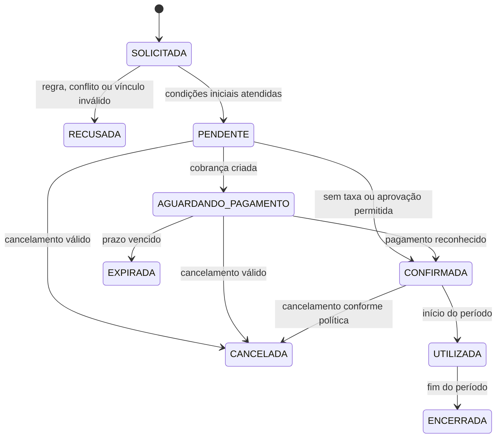
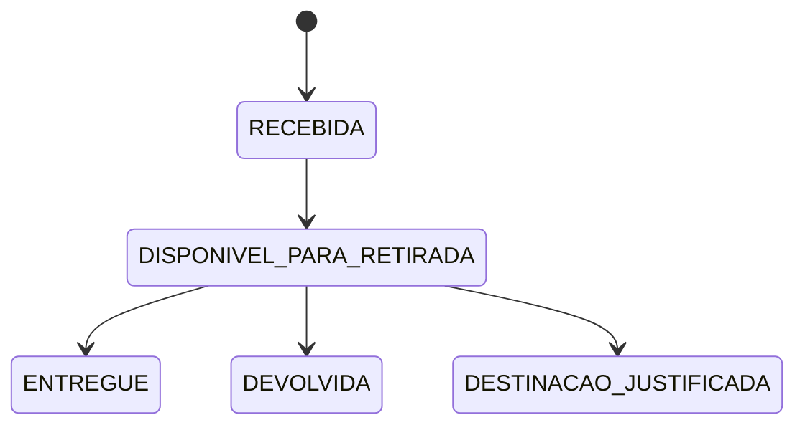
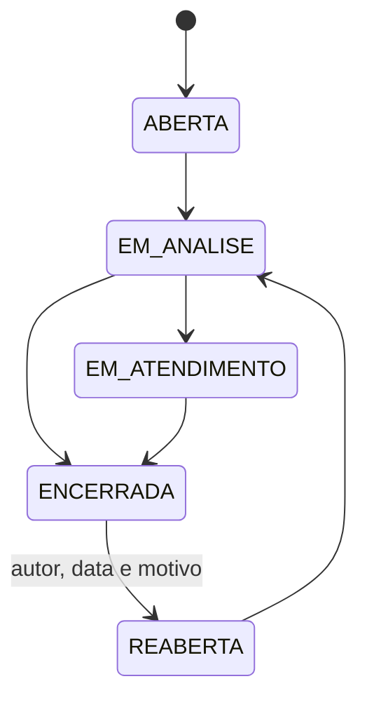
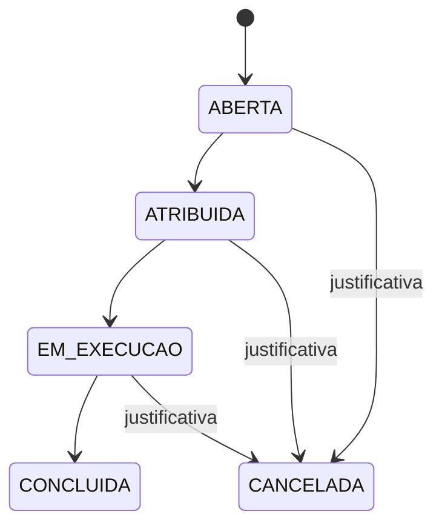
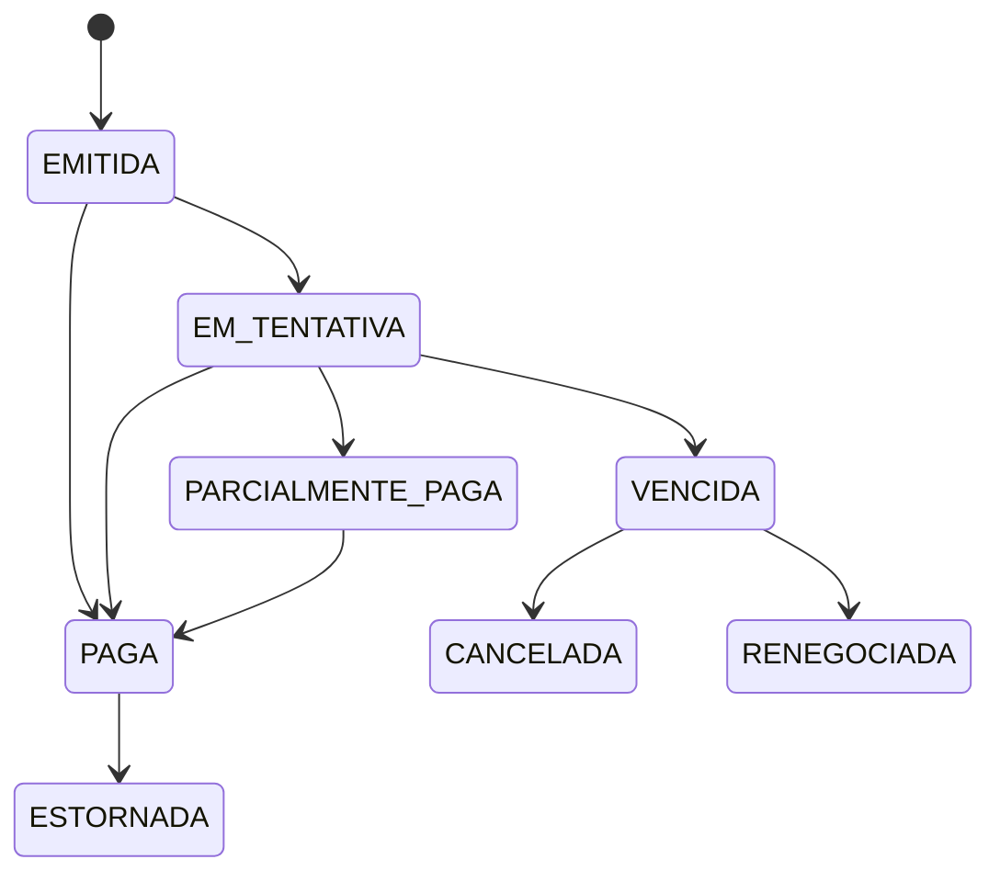

# Trabalho 6 — Casos de uso do MyCondo

**Disciplina:** Sistemas Corporativos  
**Sistema:** MyCondo — Plataforma integrada de gestão de condomínios  
**Aluno:** Vinicius Martins Nunes  
**Data:** 6 de outubro de 2026  
**Base:** Trabalhos 1 a 5

> **Nota de escopo:** este documento transforma os atores, fluxos, regras, invariantes e Bounded Contexts propostos nos Trabalhos 1 a 5 em casos de uso. Os casos de uso descrevem comportamento e responsabilidades do domínio; não definem telas, endpoints, tabelas, microsserviços ou uma arquitetura física definitiva. Onde os trabalhos anteriores registraram hipótese ou questão em aberto, a incerteza permanece explicitamente indicada.

## 1. Objetivo e escopo

O MyCondo centraliza os compromissos e fatos da vida condominial: reservas de áreas comuns, identidade e vínculos, acessos, encomendas, ocorrências, manutenção, comunicação, assembleias e finanças.

Este documento tem cinco objetivos:

1. identificar os atores que iniciam ou participam dos casos de uso;
2. organizar os casos de uso por ator;
3. organizar os casos de uso por contexto de domínio;
4. especificar os fluxos, regras, exceções e resultados esperados;
5. rastrear cada caso de uso até os conceitos e regras dos Trabalhos 1 a 5.

### 1.1 Princípios adotados

- A **Aplicação** coordena os casos de uso, mas as invariantes pertencem ao **Domínio**.
- O contexto que protege um agregado continua dono da regra, mesmo quando consulta outro contexto.
- Uma falha de notificação não desfaz o fato original de uma reserva, encomenda, ocorrência ou acesso.
- Uma situação financeira desconhecida não deve ser interpretada automaticamente como apta.
- Estados são alterados por transições válidas e auditáveis, não por edição arbitrária de status.
- Os Bounded Contexts permanecem módulos internos de um monólito modular nesta etapa.

## 2. Atores

| Código | Ator | Tipo | Responsabilidade no sistema |
|---|---|---|---|
| A01 | Morador/Condômino | Humano | Solicita reservas, relata ocorrências, autoriza visitantes, acompanha encomendas e participa de assembleias. |
| A02 | Síndico/Administrador | Humano | Administra cadastros e políticas, trata aprovações e exceções, acompanha a operação e publica decisões. |
| A03 | Portaria/Operador de segurança | Humano | Registra visitantes, acessos e encomendas e atua nas decisões operacionais da guarita. |
| A04 | Prestador de serviço | Humano externo | Executa ordens de serviço e registra atualizações e evidências da manutenção. |
| A05 | Administradora de condomínios | Sistema/organização externa | Sincroniza lançamentos, cobranças, pagamentos, baixas e conciliações conforme contrato. |
| A06 | Gateway de pagamento | Sistema externo | Processa cobranças e retorna tentativas, pagamentos reconhecidos e estornos. |
| A07 | Canal de notificação | Sistema externo | Entrega mensagens por push, e-mail, WhatsApp ou outro canal configurado. |
| A08 | Relógio/serviço de tempo | Serviço de apoio | Fornece momento de referência para validade, vencimento, expiração e auditoria. |

> **Visitante** é participante do domínio, mas não é considerado ator autenticado neste documento. Ele é registrado pelo morador ou pela portaria até que a política de identidade seja validada.

## 3. Visão geral dos casos de uso

### 3.1 Catálogo geral

| Código | Caso de uso | Ator iniciador | Contexto proprietário | Resultado principal |
|---|---|---|---|---|
| UC01 | Autenticar e identificar participante | A01, A02, A03, A04 | Identidade e Vínculos | Participante reconhecido com papel e vínculo aplicáveis. |
| UC02 | Cadastrar condomínio, unidade e vínculo | A02 | Identidade e Vínculos | Cadastro e vínculo administrativo registrados. |
| UC03 | Consultar vínculo e elegibilidade | Contextos internos | Identidade e Vínculos | Decisão de vínculo, papel ou elegibilidade com validade. |
| UC04 | Solicitar reserva de área comum | A01 | Reservas e Uso de Áreas | Reserva criada no estado inicial ou recusada com motivo. |
| UC05 | Avaliar disponibilidade e regras da reserva | A01, A02, UC04 | Reservas e Uso de Áreas | Reserva validada contra período, regra, conflito e política. |
| UC06 | Criar cobrança de reserva | UC04, A02 | Gestão Financeira | Cobrança aceita e vinculada à reserva, quando aplicável. |
| UC07 | Reconhecer pagamento e confirmar reserva | A06, A05 | Gestão Financeira/Reservas | Pagamento conciliado e reserva confirmada ou mantida pendente. |
| UC08 | Cancelar, expirar ou encerrar reserva | A01, A02, A08 | Reservas e Uso de Áreas | Transição válida e histórico preservado. |
| UC09 | Criar autorização de acesso | A01, A02 | Portaria e Acessos | Autorização de visitante registrada com validade e condições. |
| UC10 | Registrar entrada ou saída | A03 | Portaria e Acessos | Registro histórico de acesso criado ou exceção documentada. |
| UC11 | Receber encomenda | A03 | Portaria e Acessos | Encomenda associada à unidade e disponível para retirada. |
| UC12 | Entregar ou devolver encomenda | A03, A01 | Portaria e Acessos | Encomenda entregue, devolvida ou destinada com justificativa. |
| UC13 | Registrar ocorrência | A01, A02, A03 | Atendimento e Manutenção | Ocorrência aberta com autor, contexto e descrição. |
| UC14 | Acompanhar e encerrar ocorrência | A01, A02 | Atendimento e Manutenção | Ocorrência atualizada ou encerrada com histórico. |
| UC15 | Criar e atribuir ordem de serviço | A02 | Atendimento e Manutenção | Ordem criada e atribuída a prestador. |
| UC16 | Executar e encerrar ordem de serviço | A04, A02 | Atendimento e Manutenção | Execução atualizada e ordem concluída ou cancelada com justificativa. |
| UC17 | Publicar comunicado | A02 | Governança e Comunicação | Comunicado oficial publicado e pronto para entrega. |
| UC18 | Solicitar entrega de notificação | Contextos internos | Governança e Comunicação | Mensagem registrada, entregue, pendente ou rejeitada sem alterar o fato de origem. |
| UC19 | Convocar assembleia e criar votação | A02 | Governança e Comunicação | Assembleia e deliberações configuradas. |
| UC20 | Registrar voto elegível | A01, A02 | Governança e Comunicação | Voto único e auditável registrado. |
| UC21 | Encerrar votação e publicar resultado | A02 | Governança e Comunicação | Resultado calculado, encerrado e preservado. |
| UC22 | Registrar cobrança, pagamento e lançamento | A02, A05, A06 | Gestão Financeira | Fato financeiro registrado e rastreável. |
| UC23 | Consultar situação financeira | A02, UC04 | Gestão Financeira | Situação apta, restrita ou desconhecida com validade. |
| UC24 | Conciliar prestação de contas | A02, A05 | Gestão Financeira | Lançamentos conciliados e divergências registradas. |

### 3.2 Relações entre casos de uso

| Relação | Casos | Justificativa |
|---|---|---|
| `<<include>>` | UC04 inclui UC01 e UC05 | Toda solicitação precisa identificar o participante e avaliar as condições da reserva. |
| `<<include>>` | UC04 inclui UC23 | A política vigente pode exigir consulta à situação financeira. |
| `<<extend>>` | UC06 estende UC04 | Somente reservas tarifadas criam cobrança. |
| `<<extend>>` | UC07 estende UC06 | O reconhecimento pode ocorrer depois da criação da cobrança. |
| `<<include>>` | UC10 inclui UC03 | A portaria verifica autorização, vínculo ou permissão aplicável. |
| `<<extend>>` | UC10 estende com exceção autorizada | Uma entrada pode prosseguir por exceção completa e auditável. |
| `<<extend>>` | UC13 estende com anexos/documentos | Anexos são opcionais e dependem da política do atendimento. |
| `<<include>>` | UC16 inclui atualização de evidência | O encerramento precisa de conclusão ou cancelamento justificado. |
| `<<include>>` | UC20 inclui UC03 | Elegibilidade é verificada no momento do voto. |
| `<<include>>` | UC17 e UC18 registram entrega | Publicação e entrega são fatos diferentes. |
| `<<include>>` | UC24 inclui preservação de histórico | Conciliação não pode apagar lançamentos publicados. |

### 3.3 Três casos de uso prioritários

A tabela abaixo atende à atividade de conectar o comportamento dos casos de uso aos conceitos e regras do domínio. Foram selecionados três fluxos representativos: a reserva, que é o fluxo central do MyCondo; o registro de acesso, que protege a operação da portaria; e o voto, que protege uma decisão coletiva auditável.

| UC | Ator | Contexto | Agregado principal | Regras | Dependência externa |
|---|---|---|---|---|---|
| UC04 — Solicitar reserva de área comum | Morador/Condômino | Reservas e Uso de Áreas | Reserva | O período deve ser válido; a área deve estar disponível; a regra de uso e a situação financeira aplicáveis devem ser atendidas; não pode haver sobreposição de reservas confirmadas. | Identidade e Vínculos para validar morador e unidade; Gestão Financeira para consultar adimplência e, quando houver taxa, criar cobrança; Canal de notificação para comunicar o resultado. |
| UC10 — Registrar entrada ou saída | Portaria/Operador de segurança | Portaria e Acessos | Registro de acesso | A entrada deve possuir autorização válida ou exceção autorizada com responsável, motivo e momento; o registro deve preservar direção, pessoa e horário. | Identidade e Vínculos para validar pessoa, unidade e autorização; Canal de notificação quando a política exigir aviso; relógio/serviço de tempo para validade e auditoria. |
| UC20 — Registrar voto elegível | Morador/Condômino ou Síndico/Administrador | Governança e Comunicação | Assembleia/Votação | A votação deve estar aberta; o participante deve ser elegível no momento; cada participante pode votar uma única vez na deliberação; o voto aceito deve ser auditável. | Identidade e Vínculos para verificar elegibilidade e unidade; Canal de notificação para convocação ou confirmação; relógio/serviço de tempo para controlar o período da votação. |

## 4. Casos de uso por ator

### 4.1 Morador/Condômino

| Código | Caso de uso | Participação |
|---|---|---|
| UC01 | Autenticar e identificar participante | Inicia o acesso ao sistema. |
| UC04 | Solicitar reserva de área comum | Inicia a solicitação para uma área e período. |
| UC05 | Avaliar disponibilidade e regras da reserva | Participa como beneficiário da decisão. |
| UC08 | Cancelar, expirar ou encerrar reserva | Pode solicitar cancelamento conforme política. |
| UC09 | Criar autorização de acesso | Autoriza visitante ou prestador. |
| UC11 | Receber encomenda | É destinatário da encomenda. |
| UC12 | Entregar ou devolver encomenda | Pode confirmar retirada conforme política. |
| UC13 | Registrar ocorrência | Relata problema ou situação. |
| UC14 | Acompanhar e encerrar ocorrência | Consulta andamento e interage com o atendimento. |
| UC17 | Publicar comunicado | Consulta comunicados publicados; não publica por padrão. |
| UC19 | Convocar assembleia e criar votação | Participa da assembleia convocada. |
| UC20 | Registrar voto elegível | Registra voto único em deliberação elegível. |
| UC21 | Encerrar votação e publicar resultado | Consulta resultado publicado. |
| UC23 | Consultar situação financeira | Consulta sua situação conforme permissão. |

### 4.2 Síndico/Administrador

| Código | Caso de uso | Participação |
|---|---|---|
| UC01 | Autenticar e identificar participante | Inicia o acesso administrativo. |
| UC02 | Cadastrar condomínio, unidade e vínculo | Mantém cadastros autorizados. |
| UC03 | Consultar vínculo e elegibilidade | Trata validações e exceções administrativas. |
| UC04 | Solicitar reserva de área comum | Pode solicitar ou operar em nome autorizado. |
| UC06 | Criar cobrança de reserva | Aprova ou solicita cobrança quando a política permitir. |
| UC08 | Cancelar, expirar ou encerrar reserva | Trata cancelamentos e exceções. |
| UC09 | Criar autorização de acesso | Pode registrar autorização administrativa. |
| UC10 | Registrar entrada ou saída | Consulta e audita registros, sem substituir a operação da portaria. |
| UC13 | Registrar ocorrência | Pode abrir ocorrência administrativa. |
| UC14 | Acompanhar e encerrar ocorrência | Supervisiona atendimento. |
| UC15 | Criar e atribuir ordem de serviço | Cria e atribui execução. |
| UC16 | Executar e encerrar ordem de serviço | Valida conclusão ou cancelamento. |
| UC17 | Publicar comunicado | Publica informação oficial. |
| UC19 | Convocar assembleia e criar votação | Define pauta e deliberações. |
| UC20 | Registrar voto elegível | Pode votar se elegível. |
| UC21 | Encerrar votação e publicar resultado | Encerra conforme autoridade definida. |
| UC22 | Registrar cobrança, pagamento e lançamento | Registra ou supervisiona fatos financeiros. |
| UC23 | Consultar situação financeira | Consulta a situação do condomínio ou unidade permitida. |
| UC24 | Conciliar prestação de contas | Analisa conciliação e divergências. |

### 4.3 Portaria/Operador de segurança

| Código | Caso de uso | Participação |
|---|---|---|
| UC01 | Autenticar e identificar participante | Inicia a operação da guarita. |
| UC03 | Consultar vínculo e elegibilidade | Consulta autorização, unidade e condições de acesso. |
| UC09 | Criar autorização de acesso | Pode registrar exceção ou autorização administrativa conforme política. |
| UC10 | Registrar entrada ou saída | Caso de uso principal da portaria. |
| UC11 | Receber encomenda | Registra recebimento e guarda. |
| UC12 | Entregar ou devolver encomenda | Registra retirada, devolução ou destinação. |
| UC13 | Registrar ocorrência | Registra fato operacional ou de segurança. |
| UC18 | Solicitar entrega de notificação | Origina aviso após preservar o fato de portaria. |

### 4.4 Prestador de serviço

| Código | Caso de uso | Participação |
|---|---|---|
| UC01 | Autenticar e identificar participante | Inicia acesso restrito. |
| UC03 | Consultar vínculo e elegibilidade | Confirma autorização e ordens atribuídas. |
| UC16 | Executar e encerrar ordem de serviço | Atualiza execução, evidências e conclusão. |
| UC18 | Solicitar entrega de notificação | Pode provocar atualização ao concluir ou encontrar impedimento. |

### 4.5 Administradora de condomínios

| Código | Caso de uso | Participação |
|---|---|---|
| UC06 | Criar cobrança de reserva | Pode aceitar ou sincronizar obrigação. |
| UC07 | Reconhecer pagamento e confirmar reserva | Informa pagamento reconhecido ou estorno. |
| UC22 | Registrar cobrança, pagamento e lançamento | Integra fatos financeiros. |
| UC23 | Consultar situação financeira | Fornece ou consulta situação conforme contrato. |
| UC24 | Conciliar prestação de contas | Sincroniza lançamentos e divergências. |

### 4.6 Gateway de pagamento

| Código | Caso de uso | Participação |
|---|---|---|
| UC06 | Criar cobrança de reserva | Recebe solicitação técnica de cobrança. |
| UC07 | Reconhecer pagamento e confirmar reserva | Retorna eventos de pagamento, falha ou estorno. |
| UC22 | Registrar cobrança, pagamento e lançamento | Participa do processamento financeiro. |

### 4.7 Canal de notificação

| Código | Caso de uso | Participação |
|---|---|---|
| UC18 | Solicitar entrega de notificação | Recebe mensagem e informa entrega, falha ou pendência. |

## 5. Casos de uso por contexto

| Contexto | Casos de uso principais | Agregado ou conceito protegido |
|---|---|---|
| Identidade e Vínculos | UC01, UC02, UC03 | Condomínio, Unidade, Morador, vínculo e papel. |
| Reservas e Uso de Áreas | UC04, UC05, UC08 | Reserva, Área comum, Período e Regra de uso. |
| Portaria e Acessos | UC09, UC10, UC11, UC12 | Autorização, Registro de acesso e Encomenda. |
| Atendimento e Manutenção | UC13, UC14, UC15, UC16 | Ocorrência, Ordem de serviço e evidência. |
| Gestão Financeira | UC06, UC07, UC22, UC23, UC24 | Cobrança, Pagamento, Situação financeira e Lançamento. |
| Governança e Comunicação | UC17, UC18, UC19, UC20, UC21 | Comunicado, Assembleia, Votação e entrega. |

### 5.1 Dependências entre contextos

| Origem | Destino | Casos relacionados | Tipo conceitual | Informação mínima |
|---|---|---|---|---|
| Reservas | Identidade e Vínculos | UC04, UC05 | Síncrona | Participante, unidade, papel e validade do vínculo. |
| Reservas | Gestão Financeira | UC04, UC06, UC07, UC23 | Consulta/solicitação e evento posterior | Situação resumida, validade, cobrança e reconhecimento. |
| Portaria | Identidade e Vínculos | UC09, UC10 | Síncrona | Autorização, participante, unidade e validade. |
| Portaria | Governança e Comunicação | UC10, UC11, UC12, UC18 | Assíncrona | Fato registrado, destinatário e referência do evento. |
| Atendimento | Identidade e Vínculos | UC13, UC15, UC16 | Síncrona | Responsável, papel e prestador autorizado. |
| Atendimento | Governança e Comunicação | UC14, UC16, UC18 | Assíncrona | Atualização e referência da ocorrência/ordem. |
| Governança | Identidade e Vínculos | UC19, UC20 | Síncrona | Elegibilidade, unidade, assembleia e momento da decisão. |
| Gestão Financeira | Administradora/Gateway | UC06, UC07, UC22, UC24 | Integração externa | Identificador idempotente, valor, estado e evento. |
| Governança e Comunicação | Canal de notificação | UC18 | Assíncrona | Mensagem, destinatário, canal, idempotência e versão. |

## 6. Modelo geral de estados

### 6.1 Reserva

### 6.2 Encomenda

### 6.3 Ocorrência e ordem de serviço

### 6.4 Cobrança

## 7. Especificações detalhadas dos casos de uso

### UC01 — Autenticar e identificar participante

| Campo | Especificação |
|---|---|
| Objetivo | Permitir que um participante reconhecido acesse operações compatíveis com seu papel. |
| Atores | Morador, Síndico/Administrador, Portaria, Prestador. |
| Gatilho | O participante fornece credenciais ou mecanismo de autenticação aceito. |
| Pré-condições | O cadastro existe e o canal de autenticação está disponível. |
| Pós-condições de sucesso | Identidade, papel, condomínio e vínculo aplicáveis são disponibilizados à sessão. |
| Pós-condições de falha | O acesso é recusado sem revelar dados sensíveis ou criar uma sessão válida. |
| Regras | Apenas participante reconhecido executa operação compatível; autenticação não substitui autorização contextual. |

**Fluxo principal:**

1. O participante informa suas credenciais ou apresenta o mecanismo aceito.
2. O sistema valida a autenticidade.
3. O sistema recupera papéis e vínculos ativos.
4. O sistema cria uma sessão com escopo e validade.
5. O sistema registra o evento de autenticação para auditoria.

**Alternativas e exceções:** credencial inválida recusa o acesso; vínculo inexistente impede a operação específica; sessão expirada exige nova autenticação; indisponibilidade do provedor não deve criar uma identidade positiva por fallback não definido.

### UC02 — Cadastrar condomínio, unidade e vínculo

| Campo | Especificação |
|---|---|
| Objetivo | Manter a estrutura administrativa necessária para reconhecer unidades e moradores. |
| Ator iniciador | Síndico/Administrador. |
| Pré-condições | Ator autenticado e autorizado a administrar o condomínio. |
| Pós-condições | Condomínio, unidade ou vínculo criado/atualizado com autor e momento. |
| Regras | Uma operação deve referenciar condomínio válido; alterações cadastrais não apagam o histórico de operações. |

**Fluxo principal:** selecionar o condomínio; informar a unidade ou participante; validar duplicidade e consistência; registrar o vínculo; auditar autor e momento; disponibilizar o vínculo para consultas.

**Exceções:** dados incompletos, unidade inexistente, vínculo incompatível ou duplicado rejeitam a operação e preservam o estado anterior.

### UC03 — Consultar vínculo e elegibilidade

| Campo | Especificação |
|---|---|
| Objetivo | Fornecer a outro caso de uso a decisão mínima sobre identidade, vínculo, papel ou elegibilidade. |
| Atores | Casos de uso de Reservas, Portaria, Atendimento e Governança. |
| Pré-condições | A referência do participante, unidade e condomínio está disponível. |
| Pós-condições | Resposta contém resultado, validade/momento e motivo resumido quando negativo. |
| Não faz | Não decide disponibilidade de área, liberação física, pagamento ou resultado de votação. |

**Fluxo principal:** receber a referência; localizar vínculo; avaliar papel e condição solicitada; registrar o momento da decisão; retornar `válido`, `inválido` ou `não determinado`.

**Regra de segurança:** ausência de resposta ou dado vencido não deve ser convertido automaticamente em válido.

### UC04 — Solicitar reserva de área comum

| Campo | Especificação |
|---|---|
| Objetivo | Registrar a intenção de uso de uma área comum em um período. |
| Ator iniciador | Morador/Condômino. |
| Contexto | Reservas e Uso de Áreas. |
| Pré-condições | Participante autenticado; área pertence ao condomínio; período informado. |
| Pós-condições de sucesso | Reserva persistida como `SOLICITADA`, `PENDENTE` ou `AGUARDANDO_PAGAMENTO`, conforme política. |
| Pós-condições de falha | Nenhuma reserva confirmada indevidamente; motivo da recusa retornado e auditável. |
| Inclui | UC01, UC03, UC05 e, quando exigido, UC23. |
| Pode estender | UC06, quando houver taxa. |

**Fluxo principal:**

1. O morador informa área, período e finalidade exigida.
2. O sistema identifica o participante e o vínculo da unidade.
3. O sistema valida o intervalo e a área.
4. O sistema consulta regras de uso vigentes.
5. O sistema consulta a situação financeira quando a política exigir.
6. O sistema verifica conflito com reservas confirmadas.
7. O sistema cria a Reserva com a política aplicada registrada.
8. Se houver cobrança, encaminha a criação da obrigação.
9. O sistema informa o estado atual e as próximas condições.

**Fluxos alternativos:** período inválido recusa; área indisponível recusa ou mantém solicitação não confirmada conforme política; situação financeira restrita bloqueia; situação desconhecida mantém pendente ou recusa, nunca confirma automaticamente; conflito concorrente é revalidado no momento da confirmação.

**Invariantes:** uma Reserva confirmada tem área e Período válidos; não existem duas reservas confirmadas conflitantes para a mesma área; a Reserva mantém seu histórico de transições.

### UC05 — Avaliar disponibilidade e regras da reserva

| Campo | Especificação |
|---|---|
| Objetivo | Combinar período, agenda, política de uso e condições de elegibilidade sem transferir a propriedade da Reserva. |
| Ator iniciador | UC04 ou Síndico/Administrador autorizado. |
| Entradas | Área, Período, unidade, participante, regra vigente e momento de referência. |
| Saída | `apta`, `restrita`, `conflitante` ou `desconhecida`, com motivos. |
| Regra central | A avaliação usa a versão de Regra de uso vigente e registra a política aplicada. |

**Fluxo:** validar `início < fim`; localizar regra vigente; verificar antecedência, duração, horários e limites; verificar sobreposição; consultar situação financeira se necessário; produzir decisão explicável.

**Exceção de concorrência:** a confirmação deve repetir a verificação dentro da operação que protege a agenda; uma avaliação anterior não reserva o recurso sozinha.

### UC06 — Criar cobrança de reserva

| Campo | Especificação |
|---|---|
| Objetivo | Criar uma obrigação financeira para uma reserva sujeita a taxa. |
| Atores | UC04, Síndico/Administrador, Administradora, Gateway. |
| Pré-condições | Reserva identificada; valor, vencimento e condição de confirmação definidos. |
| Pós-condições | Cobrança aceita com identificador idempotente ou falha explícita. |
| Não faz | Não confirma a Reserva e não decide a política de uso. |
| Regras | Uma Reserva pode ter zero ou uma cobrança no modelo atual; tentativa não é pagamento reconhecido. |

**Fluxo principal:** receber reserva, unidade, valor, vencimento e condição; validar idempotência; criar cobrança no Financeiro; solicitar processamento externo; registrar identificadores e estado; retornar cobrança aceita.

**Exceções:** valor inválido, cobrança duplicada, gateway indisponível ou contrato incompatível. A reserva permanece pendente ou aguarda política de retentativa.

### UC07 — Reconhecer pagamento e confirmar reserva

| Campo | Especificação |
|---|---|
| Objetivo | Processar pagamento reconhecido e permitir que Reservas aplique a transição adequada. |
| Atores | Gateway, Administradora, Financeiro; Reservas é o contexto que altera o estado da Reserva. |
| Pré-condições | Cobrança identificada e evento com `eventId` e versão. |
| Pós-condições | Pagamento conciliado; Reserva confirmada somente se todas as condições forem satisfeitas. |
| Regras | Evento repetido não produz segunda consequência; parcial, rejeição ou estorno não equivalem automaticamente à quitação. |

**Fluxo principal:** receber evento; validar versão e origem; verificar duplicidade; registrar Pagamento; recalcular saldo compensado; publicar reconhecimento; Reservas revalida estado e conflito; confirmar ou manter pendente; registrar evento e solicitar notificação.

**Alternativas:** pagamento parcial mantém pendente; estorno provoca reavaliação conforme política; evento fora de ordem fica pendente de reconciliação; cobrança inexistente é rejeitada e observada.

### UC08 — Cancelar, expirar ou encerrar reserva

| Campo | Especificação |
|---|---|
| Objetivo | Aplicar transições posteriores da Reserva sem apagar seu histórico. |
| Atores | Morador, Síndico/Administrador, serviço de tempo. |
| Gatilhos | Solicitação de cancelamento, vencimento de cobrança, início ou fim do período. |
| Pós-condições | Estado permitido registrado com autor, momento e motivo quando necessário. |
| Regra | Reserva encerrada não retorna silenciosamente a estado anterior. |

**Fluxo:** identificar Reserva; verificar ator, prazo e política; validar transição; registrar evento; atualizar estado; tratar eventual cobrança de forma financeira; solicitar comunicação como consequência.

**Exceções:** cancelamento fora do prazo, Reserva inexistente, estado incompatível ou expiração já processada. Reprocessamento idempotente não cria novo efeito.

### UC09 — Criar autorização de acesso

| Campo | Especificação |
|---|---|
| Objetivo | Registrar permissão de entrada de visitante ou prestador em condições delimitadas. |
| Ator iniciador | Morador ou Síndico/Administrador. |
| Pré-condições | Ator possui vínculo e permissão; unidade e condomínio são válidos. |
| Pós-condições | Autorização possui visitante, validade, condições, autor e estado. |
| Regras | QR Code é mecanismo de apresentação, não identidade; dados devem ser minimizados. |

**Fluxo:** informar visitante, unidade, período, finalidade e condições; validar vínculo; criar autorização; gerar referência/QR Code se aplicável; disponibilizar à Portaria; registrar auditoria.

**Exceções:** validade inválida, visitante incompatível, duplicidade ou falta de permissão rejeitam a autorização.

### UC10 — Registrar entrada ou saída

| Campo | Especificação |
|---|---|
| Objetivo | Preservar o fato de circulação de visitante, prestador ou outro participante. |
| Ator iniciador | Portaria/Operador de segurança. |
| Pré-condições | Operador autenticado; pessoa identificada no mínimo necessário. |
| Pós-condições | Registro de acesso com direção, momento, responsável e autorização/exceção. |
| Regra | Entrada exige autorização válida ou exceção com responsável, motivo e momento. |

**Fluxo:** consultar autorização; validar pessoa, unidade, horário e condição; registrar entrada ou saída; associar evidência mínima; emitir alerta quando política exigir; preservar o registro.

**Alternativas:** autorização vencida bloqueia; autorização ausente permite apenas exceção completa; saída sem entrada correspondente é registrada como ocorrência operacional ou rejeitada conforme política, sem apagar o fato.

### UC11 — Receber encomenda

| Campo | Especificação |
|---|---|
| Objetivo | Registrar recebimento e guarda de encomenda destinada a uma unidade. |
| Ator iniciador | Portaria/Operador de segurança. |
| Pré-condições | Operador autenticado; destinatário/unidade identificável. |
| Pós-condições | Encomenda associada à unidade, com estado `RECEBIDA` ou `DISPONIVEL_PARA_RETIRADA`. |
| Regras | A encomenda mantém um único estado operacional; foto é evidência opcional conforme política. |

**Fluxo:** identificar destinatário; registrar transportador, momento e descrição mínima; associar unidade; anexar evidência quando aplicável; guardar encomenda; solicitar notificação sem tornar o envio parte da transação.

**Exceções:** destinatário não identificado, encomenda danificada ou recusa de recebimento gera ocorrência/estado apropriado e mantém rastreabilidade.

### UC12 — Entregar ou devolver encomenda

| Campo | Especificação |
|---|---|
| Objetivo | Finalizar a guarda com entrega, devolução ou destinação justificada. |
| Atores | Portaria; Morador como destinatário ou conferente. |
| Pré-condições | Encomenda está disponível e a pessoa pode retirar ou a devolução foi autorizada. |
| Pós-condições | Estado final, responsável, momento e evidência são registrados. |
| Regra | Encomenda não pode estar simultaneamente pendente e entregue. |

**Fluxo:** localizar encomenda; validar destinatário/autorização; confirmar retirada ou motivo da devolução; registrar responsável e momento; alterar estado; solicitar comunicação.

**Exceções:** pessoa não autorizada, encomenda já finalizada ou divergência de identidade bloqueia a operação e preserva o estado anterior.

### UC13 — Registrar ocorrência

| Campo | Especificação |
|---|---|
| Objetivo | Registrar um problema, relato ou situação que precisa de acompanhamento. |
| Atores | Morador, Síndico/Administrador, Portaria. |
| Pré-condições | Ator reconhecido; condomínio e contexto identificados. |
| Pós-condições | Ocorrência aberta com descrição, categoria, autor, momento e prioridade quando aplicável. |
| Pode incluir | Documento/anexo como evidência. |

**Fluxo:** informar problema; classificar; anexar evidência se necessário; validar dados mínimos; criar ocorrência `ABERTA`; registrar autor; notificar responsáveis conforme política.

**Exceções:** categoria inválida, conteúdo insuficiente ou anexo não permitido impede a criação sem eliminar o relato original da tentativa.

### UC14 — Acompanhar e encerrar ocorrência

| Campo | Especificação |
|---|---|
| Objetivo | Atualizar o atendimento e encerrar uma ocorrência com solução ou justificativa. |
| Atores | Morador, Síndico/Administrador. |
| Pré-condições | Ocorrência existente e ator autorizado. |
| Pós-condições | Estado e histórico atualizados; encerramento preserva solução, autor e momento. |
| Regra | Reabertura exige ação explícita, motivo, autor e data. |

**Fluxo:** consultar ocorrência; adicionar interação ou atualização; encaminhar para ordem se necessário; registrar solução; encerrar; solicitar comunicação.

**Alternativas:** ocorrência pode permanecer em análise; reabertura cria evento novo; atualização de terceiro sem permissão é rejeitada.

### UC15 — Criar e atribuir ordem de serviço

| Campo | Especificação |
|---|---|
| Objetivo | Transformar uma ocorrência ou demanda preventiva em execução acompanhada. |
| Ator iniciador | Síndico/Administrador. |
| Pré-condições | Demanda identificada; prestador disponível e autorizado quando necessário. |
| Pós-condições | Ordem criada, vinculada à origem, com escopo, prazo e atribuição. |
| Regra | Ordem é conceito próprio e não desaparece dentro da ocorrência. |

**Fluxo:** selecionar ocorrência ou plano preventivo; definir escopo e prioridade; estimar prazo/custo quando aplicável; selecionar prestador; criar ordem; notificar prestador; registrar atribuição.

**Exceções:** prestador inexistente, falta de autorização, escopo incompleto ou conflito de agenda mantém a demanda aberta.

### UC16 — Executar e encerrar ordem de serviço

| Campo | Especificação |
|---|---|
| Objetivo | Permitir execução, atualização e encerramento comprovável de uma ordem. |
| Atores | Prestador, Síndico/Administrador. |
| Pré-condições | Ordem atribuída e em estado que aceite atualização. |
| Pós-condições | Ordem concluída ou cancelada com justificativa, responsável, data e evidências aplicáveis. |
| Regra | Encerramento exige conclusão registrada ou cancelamento justificado. |

**Fluxo:** prestador consulta ordem; inicia execução; informa progresso e impedimentos; anexa laudo/evidência quando exigido; solicita conclusão; administrador valida; sistema encerra e registra histórico; comunicação é consequência.

**Exceções:** impedimento mantém ordem em execução ou replanejamento; evidência faltante bloqueia conclusão; cancelamento exige motivo e autoridade.

### UC17 — Publicar comunicado

| Campo | Especificação |
|---|---|
| Objetivo | Publicar informação oficial para público determinado. |
| Ator iniciador | Síndico/Administrador. |
| Pré-condições | Conteúdo, público e origem definidos; ator autorizado. |
| Pós-condições | Comunicado publicado com conteúdo, contexto, autor e momento imutáveis após publicação, salvo retificação auditável. |
| Regra | Publicação é diferente de entrega; falha do canal não desfaz o comunicado. |

**Fluxo:** redigir; definir público e validade; validar permissão e conteúdo; publicar; registrar versão; solicitar entrega aos canais; acompanhar estado sem alterar a origem.

### UC18 — Solicitar entrega de notificação

| Campo | Especificação |
|---|---|
| Objetivo | Entregar ou enfileirar uma mensagem originada por fato de outro contexto. |
| Atores | Reservas, Portaria, Atendimento, Governança; Canal de notificação. |
| Pré-condições | Fato de origem persistido; destinatário e mensagem mínima definidos. |
| Pós-condições | Comunicação registrada como entregue, pendente, falha ou rejeitada, com idempotência. |
| Regra | Falha de entrega não altera Reserva, Encomenda, Acesso ou Ocorrência. |

**Fluxo:** receber evento; validar `schemaVersion` e `eventId`; deduplicar; registrar destinatário e canais; enviar ou enfileirar; atualizar estado; permitir retentativa e dead-letter; expor resultado observável.

**Exceções:** destinatário inválido, canal indisponível ou conteúdo incompatível deixa a mensagem pendente/rejeitada sem reverter o fato original.

### UC19 — Convocar assembleia e criar votação

| Campo | Especificação |
|---|---|
| Objetivo | Organizar assembleia, pauta e deliberações elegíveis. |
| Ator iniciador | Síndico/Administrador. |
| Pré-condições | Assembleia, período, pauta e regra de participação definidos. |
| Pós-condições | Assembleia convocada e votações criadas com regras versionadas. |
| Regras | Elegibilidade e quórum ainda são parâmetros dependentes da política do condomínio. |

**Fluxo:** criar assembleia; definir convocação e pauta; configurar matéria, abertura e encerramento; definir regra de elegibilidade; comunicar participantes; abrir votação no momento previsto.

**Exceções:** pauta incompleta, período inválido ou autoridade insuficiente impede convocação.

### UC20 — Registrar voto elegível

| Campo | Especificação |
|---|---|
| Objetivo | Registrar uma decisão individual válida em uma deliberação. |
| Atores | Morador, Síndico/Administrador, conforme elegibilidade. |
| Pré-condições | Votação aberta; participante reconhecido e elegível. |
| Pós-condições | Um voto associado ao participante e à matéria é registrado com momento e regra aplicada. |
| Invariante | Um participante elegível não pode ser contabilizado duas vezes na mesma deliberação. |

**Fluxo:** identificar participante; verificar elegibilidade no momento; verificar voto anterior; receber escolha; registrar voto e versão da regra; confirmar ao participante sem expor votos indevidos.

**Exceções:** votação fechada, participante inelegível ou voto duplicado rejeita a operação; indisponibilidade não deve registrar voto incerto sem reconciliação.

### UC21 — Encerrar votação e publicar resultado

| Campo | Especificação |
|---|---|
| Objetivo | Encerrar a coleta, calcular resultado e preservar a deliberação auditável. |
| Ator iniciador | Síndico/Administrador ou serviço de tempo autorizado. |
| Pré-condições | Votação aberta; prazo ou condição de encerramento atingido. |
| Pós-condições | Resultado calculado, encerrado e publicado; alterações futuras exigem auditoria. |
| Regras | Resultado é derivado apenas dos votos aceitos; quórum e peso seguem a política registrada. |

**Fluxo:** encerrar coleta; congelar novos votos; validar duplicidade; calcular totais; verificar quórum; registrar resultado e auditoria; publicar comunicado/resultado.

**Exceções:** divergência de votos suspende publicação para reconciliação; alteração posterior cria evento de correção, não sobrescreve o resultado anterior.

### UC22 — Registrar cobrança, pagamento e lançamento

| Campo | Especificação |
|---|---|
| Objetivo | Preservar fatos financeiros e seus vínculos, incluindo eventos externos. |
| Atores | Administradora, Síndico/Administrador, Gateway. |
| Pré-condições | Origem, valor, moeda, competência e identificadores disponíveis. |
| Pós-condições | Cobrança, Pagamento ou Lançamento registrado com histórico e origem. |
| Regras | Lançamento publicado não desaparece; estorno ou retificação é novo fato rastreável. |

**Fluxo:** receber fato; validar contrato e idempotência; localizar origem; registrar evento financeiro; atualizar situação derivada; publicar situação resumida aos consumidores; registrar divergências para conciliação.

**Exceções:** evento duplicado é ignorado de forma idempotente; origem desconhecida fica pendente; valor divergente não é aplicado silenciosamente.

### UC23 — Consultar situação financeira

| Campo | Especificação |
|---|---|
| Objetivo | Informar a condição financeira aplicável a uma unidade em um momento de referência. |
| Atores | Reservas, Síndico/Administrador, Administradora. |
| Pré-condições | Unidade e condomínio identificados; regra de consulta definida. |
| Pós-condições | Resultado `APTA`, `RESTRITA` ou `DESCONHECIDA`, com validade e motivo resumido. |
| Não faz | Não confirma ou recusa Reserva diretamente; essa decisão pertence a Reservas. |

**Fluxo:** receber unidade e momento; localizar obrigações e pagamentos reconhecidos; aplicar política financeira; produzir situação; informar validade, origem e motivo mínimo.

**Exceções:** dados vencidos, divergência externa ou sistema indisponível retornam `DESCONHECIDA` ou erro explícito. Nunca retornar `APTA` por ausência de informação.

### UC24 — Conciliar prestação de contas

| Campo | Especificação |
|---|---|
| Objetivo | Comparar fatos internos e externos e preservar divergências e ajustes. |
| Atores | Síndico/Administrador, Administradora. |
| Pré-condições | Período e fonte de conciliação definidos; dados acessíveis. |
| Pós-condições | Lançamentos conciliados, divergências registradas e correções auditáveis. |
| Regra | Conciliação não apaga o lançamento original. |

**Fluxo:** selecionar competência; importar ou receber dados; correlacionar identificadores; comparar valores e estados; marcar conciliados; registrar divergências; criar retificação/estorno quando autorizado; publicar relatório.

**Exceções:** duplicidade, valor divergente, fonte indisponível ou evento sem origem ficam pendentes para análise.

## 8. Tabela de regras por caso de uso

| Caso | Regras principais | Invariante protegida |
|---|---|---|
| UC04/UC05 | RN01, RN02, RN03, RN05 | Nenhuma Reserva confirmada conflitante e política aplicada corretamente. |
| UC06/UC07 | RN04 | Pagamento reconhecido, parcial, tentativa e estorno não são confundidos. |
| UC08 | Ciclo de Reserva | Transições válidas e histórico preservado. |
| UC09/UC10 | RN06 | Todo acesso possui autorização ou exceção auditável. |
| UC11/UC12 | RN07 | Encomenda possui exatamente um estado operacional e destino rastreável. |
| UC13/UC14 | RN08 | Ocorrência encerrada conserva histórico e reabertura é explícita. |
| UC15/UC16 | RN08.1 | Ordem termina somente por conclusão ou cancelamento justificado. |
| UC19/UC20/UC21 | RN09 | Voto elegível é único e resultado encerrado é auditável. |
| UC22/UC24 | RN10 | Lançamento publicado não desaparece sem estorno ou retificação. |
| UC18 | Idempotência e versionamento | Falha de canal não altera o fato de origem. |

## 9. Pré-condições e pós-condições por contexto

| Contexto | Pré-condições comuns | Pós-condições comuns |
|---|---|---|
| Identidade e Vínculos | Participante administrativo autorizado e dados mínimos válidos. | Vínculo, papel ou decisão de elegibilidade preservado com validade. |
| Reservas e Uso de Áreas | Área, período, participante e regra vigente identificados. | Reserva em estado válido, política aplicada e histórico registrado. |
| Portaria e Acessos | Operador autenticado e pessoa/unidade identificáveis. | Acesso ou encomenda em estado único, com responsável e momento. |
| Atendimento e Manutenção | Relato ou demanda identificada e responsável autorizado. | Ocorrência/ordem atualizada sem perda de histórico. |
| Gestão Financeira | Origem, valor, moeda, competência e identificador idempotente. | Fato financeiro registrado, conciliável e nunca apagado silenciosamente. |
| Governança e Comunicação | Autoridade, público, pauta ou fato de origem definidos. | Publicação, voto ou entrega registrada independentemente de falha externa. |

## 10. Rastreabilidade para os trabalhos anteriores

| Caso de uso | Trabalho 1 | Trabalho 2 | Trabalho 3 | Trabalho 4 | Trabalho 5 |
|---|---|---|---|---|---|
| UC04/UC05 | Fluxo principal de reserva e módulo de reservas | Reserva, Área, Período, Regras RN01–RN05 | Domínio protege agenda e Aplicação coordena | Estados e relações da Reserva | Contexto Reservas e Uso de Áreas |
| UC06/UC07/UC23 | Pix, gateway e adimplência | Cobrança, Pagamento e Situação financeira | Dependência Reserva–Financeiro | Cardinalidade 1:0..N e estados financeiros | Contratos de situação, cobrança e pagamento |
| UC09/UC10 | IAM, QR Code, portaria | Visitante, autorização e registro | IAM não é dono de todo acesso | Acesso, autorização e visitante | Contexto Portaria e Acessos |
| UC11/UC12 | Recebimento e entrega com foto | Encomenda e Unidade | Encomenda possui ciclo próprio | Estados e rastreabilidade | Agregado Encomenda em Portaria |
| UC13–UC16 | Chamados e manutenção | Ocorrência, Ordem e Prestador | Relato e execução possuem ciclos | Relações e estados de manutenção | Contexto Atendimento e Manutenção |
| UC17–UC21 | Mural, assembleias e votações | Comunicado, Assembleia e Votação | Comunicação recebe consequências | Elegibilidade e unicidade | Governança e Comunicação |
| UC22–UC24 | Financeiro, administradora e relatórios | Lançamento, Cobrança e Pagamento | Histórico e integração externa | Regras de rastreabilidade | Gestão Financeira |

## 11. Requisitos de auditoria e idempotência

Todos os casos que alteram estado devem registrar, no mínimo:

| Dado | Aplicação |
|---|---|
| `eventId` ou identificador da operação | Evita duplicidade e permite rastreamento. |
| Ator/responsável | Identifica quem solicitou, aprovou ou executou. |
| Momento de ocorrência | Permite validar vigência, prazo e ordem dos eventos. |
| Estado anterior e novo estado | Explica a transição. |
| Motivo ou regra aplicada | Permite justificar recusas, exceções, cancelamentos e correções. |
| `schemaVersion`/`contractVersion` | Permite evolução controlada dos contratos. |
| Referência do agregado | Liga o evento ao conceito protegido. |

Casos assíncronos, especialmente UC07, UC18, UC22 e UC24, devem aceitar reprocessamento sem produzir efeitos duplicados. Toda falha deve ter estado observável, retentativa definida, dead-letter quando aplicável e mecanismo de reconciliação.

## 12. Requisitos não funcionais relacionados aos casos de uso

| Categoria | Requisito |
|---|---|
| Segurança | Controle de acesso por papel e contexto; minimização de documentos e dados de visitante; auditoria de operações sensíveis. |
| Privacidade | Não transportar dados completos de documentos, pagamentos ou visitantes quando uma referência mínima for suficiente. |
| Consistência | Revalidar conflito de Reserva na confirmação; não transformar ausência de informação em aprovação. |
| Disponibilidade | Portaria deve preservar fatos operacionais; indisponibilidade de notificação não pode bloquear o fato de origem. |
| Rastreabilidade | Estados, pagamentos, acessos, encomendas, votos e lançamentos devem manter histórico. |
| Integração | Contratos externos devem ter versão, correlação, idempotência, timeout e tratamento de resposta desconhecida. |
| Usabilidade | Mensagens de recusa devem indicar motivo compreensível sem expor detalhes indevidos. |
| Evolução | Contextos devem usar modelos próprios e contratos mínimos, sem Shared Kernel amplo de entidades instáveis. |

## 13. Cenários críticos de validação

| Cenário | Casos envolvidos | Comportamento esperado |
|---|---|---|
| Duas solicitações simultâneas para a mesma área | UC04, UC05, UC08 | No máximo uma Reserva confirmada; a confirmação repete a validação de conflito. |
| Financeiro indisponível | UC04, UC07, UC23 | Reserva fica pendente, recusada ou inconclusiva conforme política; nunca é confirmada por fallback positivo. |
| Pagamento duplicado | UC07, UC22 | Mesmo `eventId` não gera segunda baixa nem segunda confirmação. |
| Estorno após confirmação | UC07, UC08, UC22 | Estorno é novo fato; Reservas aplica política explícita e mantém auditoria. |
| Visitante sem autorização | UC09, UC10 | Entrada bloqueada ou registrada como exceção completa e responsável. |
| Encomenda entregue duas vezes | UC11, UC12 | Segunda operação é rejeitada porque o estado já é final. |
| Notificação indisponível | UC17, UC18 | Fato original permanece válido; mensagem fica pendente ou em retentativa. |
| Voto repetido | UC19, UC20, UC21 | Segundo voto não altera o resultado e a tentativa pode ser auditada. |
| Ordem encerrada sem evidência | UC15, UC16 | Encerramento é bloqueado ou exige cancelamento justificado. |
| Lançamento divergente na conciliação | UC22, UC24 | Divergência fica registrada; lançamento original não é apagado. |

## 14. Questões em aberto

| Questão | Casos afetados | Impacto da resposta |
|---|---|---|
| Inadimplência bloqueia todas as áreas ou apenas algumas? | UC04, UC05, UC23 | Define políticas de elegibilidade e mensagens. |
| Reserva tarifada pode ser confirmada por aprovação sem pagamento? | UC06, UC07, UC08 | Define transição alternativa à quitação. |
| Visitante possui cadastro recorrente ou apenas dados da autorização? | UC09, UC10 | Define identidade, retenção e histórico. |
| Quais exceções de acesso são permitidas? | UC10 | Define autoridade, justificativa e modo operacional. |
| Quais evidências são obrigatórias para concluir uma ordem? | UC15, UC16 | Define uso de Documento/anexo e aprovação. |
| Como são calculados quórum e peso de voto? | UC19, UC20, UC21 | Define elegibilidade e resultado. |
| Qual é o limite entre administradora e MyCondo na conciliação? | UC22, UC24 | Define propriedade de fatos e contrato externo. |
| Portaria precisa operar offline? | UC10, UC11, UC12 | Pode exigir sincronização e reconciliação posterior. |
| Notificações precisam de preferências por canal? | UC17, UC18 | Define seleção de destinatários e tratamento de falhas. |

## 15. Conclusão

Os casos de uso do MyCondo foram derivados dos fluxos, atores, conceitos, regras e fronteiras acumulados nos Trabalhos 1 a 5. O catálogo não trata o sistema como uma coleção de telas: cada caso de uso identifica um resultado de negócio, um ator, um contexto proprietário, pré-condições, pós-condições, regras e falhas relevantes.

O fluxo de reserva continua sendo o caso central porque combina Identidade, Reservas e Financeiro. Mesmo assim, a confirmação da Reserva permanece propriedade de Reservas; Financeiro fornece situação e reconhecimento de pagamento, enquanto Governança recebe a consequência comunicacional. O mesmo princípio vale para Portaria, Atendimento e Governança: cada contexto preserva o significado e a invariante de seus próprios fatos.

A decisão arquitetural permanece a do Trabalho 5: implementar esses casos inicialmente como módulos internos de um monólito modular, com contratos conceituais, dependências controladas, eventos idempotentes e histórico auditável. A eventual separação técnica de Comunicação ou de outro contexto depende de métricas, maturidade das regras, autonomia operacional e contratos estáveis.

A próxima validação deve ser feita com síndico/administrador, portaria, administradora financeira, prestador e moradores. As respostas às questões em aberto devem atualizar as regras, os fluxos alternativos e os critérios de autorização sem transformar hipóteses atuais em fatos não comprovados.
