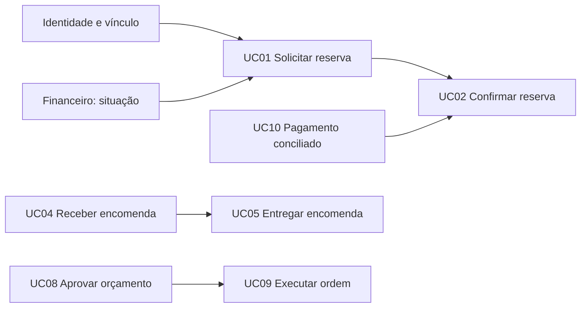
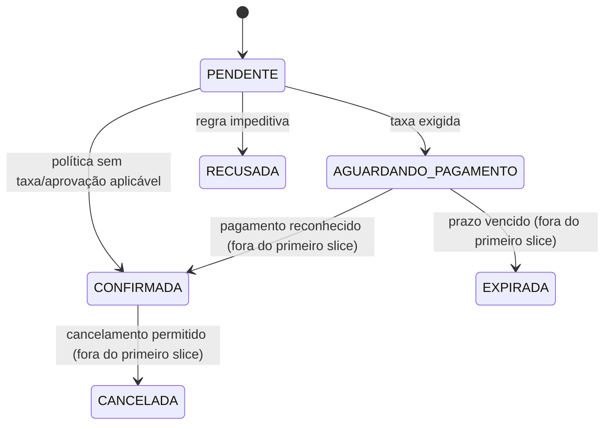
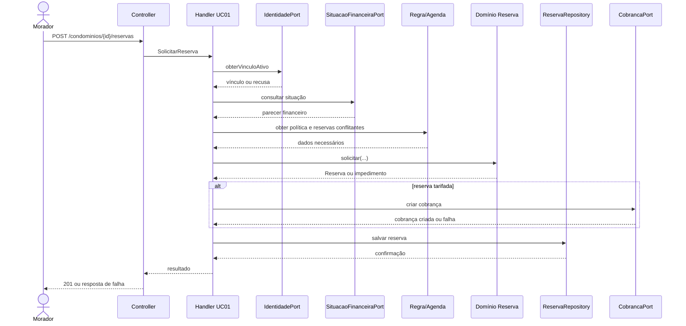
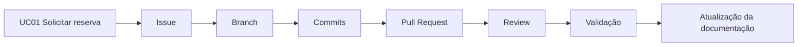

# Trabalho 6 — Blueprint de implementação do primeiro slice do MyCondo

**Disciplina:** Sistemas Corporativos  
**Sistema:** MyCondo — Plataforma integrada de gestão de condomínios  
**Aluno:** Vinicius Martins Nunes  
**Data:** 23 de outubro de 2026

> Este documento transforma o conhecimento produzido nos Trabalhos 1 a 5 em um plano de implementação futura. Ele não implementa código, banco, ORM, endpoint ou testes automatizados.

## 1. Retomada do sistema

O **MyCondo** é uma plataforma para gestão de condomínios residenciais, comerciais e de múltiplas torres. O problema central é a dispersão de informações e compromissos em canais informais: reservas podem conflitar, a portaria pode perder rastreabilidade, chamados podem ficar sem acompanhamento e a prestação de contas pode não ser transparente.

Os principais atores são:

- **Morador/Condômino:** utiliza áreas comuns, acompanha encomendas, relata ocorrências e participa de decisões;
- **Síndico/Administrador:** define políticas, aprova exceções e acompanha a operação;
- **Portaria/Operador de segurança:** controla acessos e a custódia de encomendas;
- **Prestador de serviço:** executa ordens de serviço;
- **Administradora de condomínios:** apoia a operação financeira;
- **Gateway de pagamento** e **canal de notificação:** sistemas externos que colaboram com o sistema.

O objetivo da solução é preservar fatos e compromissos da vida condominial por meio de regras explícitas, ciclos de vida controlados e rastreabilidade.

Os principais conceitos são **Condomínio**, **Unidade**, **Morador**, **Área comum**, **Reserva**, **Período**, **Regra de uso**, **Situação financeira**, **Cobrança**, **Pagamento**, **Visitante**, **Autorização de acesso**, **Registro de acesso**, **Encomenda**, **Ocorrência**, **Ordem de serviço**, **Prestador**, **Assembleia**, **Votação**, **Comunicado** e **Lançamento financeiro**.

As regras mais importantes já identificadas são:

1. Não podem existir duas reservas ativas conflitantes para a mesma área e período.
2. A política do condomínio pode exigir adimplência para solicitar ou confirmar uma reserva.
3. Uma reserva tarifada só pode ser confirmada após pagamento reconhecido ou aprovação prevista pela política.
4. Uma encomenda só pode ser entregue depois de recebida e protocolada pela portaria.
5. Uma ordem de serviço só pode entrar em execução ou gerar custo após orçamento aprovado.
6. Registros de acesso, encomendas e lançamentos financeiros devem conservar histórico e justificativa.

As decisões arquiteturais mantidas são o **monólito modular**, a separação entre **Fronteira, Aplicação, Domínio e Infraestrutura**, o domínio protegendo invariantes e a aplicação coordenando os casos de uso. Comunicação pode evoluir para processamento assíncrono, mas isso não justifica antecipar microsserviços.

## 2. Atores e objetivos

| Ator | Objetivo | Resultado observável |
| :--- | :--- | :--- |
| Morador/Condômino | Solicitar o uso de uma área comum | Reserva criada ou recusa explicada |
| Morador/Condômino | Acompanhar uma encomenda | Situação da encomenda e histórico disponíveis |
| Síndico/Administrador | Aprovar orçamento de manutenção | Ordem autorizada ou rejeitada com justificativa |
| Portaria/Operador | Registrar recebimento e entrega de encomenda | Custódia protocolada e baixa rastreável |
| Portaria/Operador | Registrar entrada ou saída | Registro de acesso associado à autorização |
| Prestador de serviço | Atualizar execução de uma ordem | Andamento ou conclusão registrada |
| Administradora | Conciliar cobranças e pagamentos | Situação financeira atualizada |
| Gateway de pagamento | Informar resultado de uma cobrança | Pagamento reconhecido, recusado ou pendente |
| Canal de notificação | Entregar uma comunicação | Mensagem entregue ou pendente para retentativa |

Banco de dados, ORM, cache, logger e módulos internos não são atores. São detalhes internos ou mecanismos de suporte.

## 3. Identificação e revisão dos Casos de Uso

| ID | Caso de Uso | Ator principal | Objetivo | Resultado observável | Situação |
| :--- | :--- | :--- | :--- | :--- | :--- |
| UC01 | Solicitar reserva de área comum | Morador | Obter um período de uso permitido | Reserva registrada, pendente ou recusada | Mantido e escolhido para o slice |
| UC02 | Confirmar reserva mediante pagamento ou aprovação | Morador / Síndico | Tornar o uso efetivo quando a condição estiver satisfeita | Reserva confirmada ou impedida | Revisado |
| UC03 | Cancelar reserva | Morador / Síndico | Liberar o compromisso de uso conforme a política | Reserva cancelada com motivo | Mantido |
| UC04 | Registrar recebimento de encomenda | Portaria | Protocolar a entrada de um volume | Encomenda em custódia e morador notificado | Mantido |
| UC05 | Entregar encomenda | Portaria | Registrar a retirada pelo destinatário | Encomenda entregue com evidência | Mantido |
| UC06 | Autorizar e registrar acesso | Morador / Portaria | Permitir e auditar entrada ou saída | Acesso autorizado e registrado | Mantido |
| UC07 | Abrir ocorrência | Morador | Relatar problema do condomínio | Ocorrência aberta e acompanhável | Mantido |
| UC08 | Aprovar orçamento de ordem de serviço | Síndico | Autorizar execução de manutenção | Orçamento aprovado ou rejeitado | Mantido e revisado |
| UC09 | Executar ordem de serviço | Prestador | Registrar execução autorizada | Ordem em execução ou concluída | Mantido |
| UC10 | Registrar e conciliar pagamento | Administradora / Gateway | Atualizar obrigação financeira | Pagamento conciliado ou rejeitado | Mantido |
| UC11 | Publicar comunicado | Síndico | Comunicar informação oficial | Comunicado publicado e disponível | Mantido |
| UC12 | Realizar votação em assembleia | Morador / Síndico | Registrar deliberação elegível | Voto contabilizado ou recusado | Mantido |

Os nomes descrevem objetivos de atores. “Tela de reservas”, “POST /reservas” e “salvarReserva” não são Casos de Uso; são, respectivamente, interface, mecanismo de acesso e operação interna.

## 4. Verificação dos Casos de Uso

| Item inicialmente identificado | Classificação inicial | Classificação atual | Justificativa |
| :--- | :--- | :--- | :--- |
| Reservar área | Caso de Uso | UC01 — Solicitar reserva de área comum | Possui ator, intenção e resultado observável |
| Confirmar pagamento | Operação interna | UC02 — Confirmar reserva mediante pagamento ou aprovação | O ator possui o objetivo de efetivar o uso; o pagamento é apenas uma condição |
| Validar adimplência | Caso de Uso | Regra/consulta colaboradora do UC01 | Não é um objetivo autônomo do morador no escopo atual |
| Verificar disponibilidade | Caso de Uso | Regra e comportamento de Reserva/agenda | É necessário ao UC01, mas não constitui resultado independente |
| Gerar QR Code | Caso de Uso | Capacidade de infraestrutura ou apoio da portaria | O QR Code é mecanismo de autorização, não objetivo do ator |
| Notificar morador | Caso de Uso | Responsabilidade de Comunicação acionada por consequência | O objetivo principal continua sendo receber encomenda, confirmar reserva etc. |
| Gerenciar sistema | Caso de Uso | Removido como nome vago | Foi substituído por objetivos específicos |

Todos os UC01 a UC12 possuem ator, resultado observável e interação relevante. Operações internas foram mantidas como regras, portas ou responsabilidades.

## 5. Organização por ator e contexto

### 5.1 Casos de Uso por ator

| Ator | Casos de Uso |
| :--- | :--- |
| Morador/Condômino | UC01, UC02, UC03, UC05 como destinatário, UC06, UC07, UC12 |
| Síndico/Administrador | UC02 por aprovação, UC03 por exceção, UC08, UC11, UC12 |
| Portaria/Operador | UC04, UC05, UC06 |
| Prestador | UC09 |
| Administradora | UC10 |
| Gateway de pagamento | Colabora com UC02 e UC10 |
| Canal de notificação | Colabora com consequências de UC01, UC04 e UC08 |

### 5.2 Casos de Uso por contexto

```mermaid
flowchart TB
    M[Morador]
    S[Síndico]
    P[Portaria]
    T[Prestador]
    A[Administradora]

    subgraph RES[Gestão de Reservas]
        UC01[UC01 Solicitar reserva]
        UC02[UC02 Confirmar reserva]
        UC03[UC03 Cancelar reserva]
    end
    subgraph PORT[Controle de Portaria]
        UC04[UC04 Receber encomenda]
        UC05[UC05 Entregar encomenda]
        UC06[UC06 Registrar acesso]
    end
    subgraph MAN[Manutenção]
        UC07[UC07 Abrir ocorrência]
        UC08[UC08 Aprovar orçamento]
        UC09[UC09 Executar ordem]
    end
    subgraph FIN[Financeiro]
        UC10[UC10 Conciliar pagamento]
    end
    subgraph GOV[Governança e Comunicação]
        UC11[UC11 Publicar comunicado]
        UC12[UC12 Realizar votação]
    end

    M --> UC01
    M --> UC02
    M --> UC03
    M --> UC05
    M --> UC06
    M --> UC07
    M --> UC12
    S --> UC02
    S --> UC08
    S --> UC11
    S --> UC12
    P --> UC04
    P --> UC05
    P --> UC06
    T --> UC09
    A --> UC10
```



## 6. Especificações funcionais dos Casos de Uso centrais

### UC01 — Solicitar reserva de área comum

- **Objetivo:** registrar a intenção do morador de utilizar uma área em um período permitido.
- **Ator principal:** Morador/Condômino.
- **Atores secundários:** Identidade e Vínculos; Gestão Financeira; canal de notificação, apenas como consequência futura.
- **Pré-condições:** o ator está autenticado; existe vínculo reconhecido com uma unidade; a área pertence ao condomínio; a política de uso está vigente.
- **Pós-condições de sucesso:** existe uma Reserva identificada, vinculada à área, unidade e período; o valor da taxa aplicável foi congelado; a reserva possui situação coerente (`PENDENTE` ou `AGUARDANDO_PAGAMENTO`); eventual cobrança foi solicitada.
- **Fluxo principal:**
  1. O morador informa área e período.
  2. A fronteira traduz a solicitação para uma intenção de aplicação.
  3. A aplicação obtém o vínculo e consulta a situação financeira necessária.
  4. A aplicação obtém a regra vigente da área.
  5. O domínio verifica período, antecedência, limites e conflito de agenda.
  6. A Reserva é criada por comportamento de domínio.
  7. Se houver taxa, a aplicação solicita sua criação ao Financeiro; caso contrário, mantém a condição definida pela política.
  8. A Reserva é persistida e o resultado é traduzido ao ator.
- **Fluxos alternativos:** vínculo inexistente; situação financeira impedida; área fora do horário; período inválido; conflito com reserva ativa; limite de reservas atingido; cobrança necessária indisponível; falha de persistência.
- **Regras relacionadas:** não sobreposição; adimplência quando aplicável; regra de uso vigente; taxa congelada; reserva cancelada ou expirada não é reativada por atribuição.

### UC04 — Registrar recebimento de encomenda

- **Objetivo:** protocolar a custódia de um volume recebido pela portaria.
- **Ator principal:** Portaria/Operador.
- **Atores secundários:** Morador destinatário; canal de notificação.
- **Pré-condições:** o operador está autorizado; o condomínio e a unidade destinatária são identificáveis; a portaria recebeu fisicamente o volume.
- **Pós-condições de sucesso:** existe Encomenda em situação `AGUARDANDO_RETIRADA`, com unidade, momento, operador e evidência do recebimento; a notificação pode ser solicitada sem desfazer o protocolo.
- **Fluxo principal:** identificar destinatário, registrar remetente e evidência, criar a encomenda, proteger a transição para custódia, persistir e solicitar notificação.
- **Fluxos alternativos:** unidade inexistente; evidência obrigatória ausente; volume recusado; notificação indisponível depois de o recebimento já ter sido persistido; tentativa de duplicar protocolo.
- **Regras relacionadas:** entrega só ocorre após recebimento; histórico de custódia não pode ser apagado; falha do canal não desfaz o fato físico protocolado.

### UC08 — Aprovar orçamento de ordem de serviço

- **Objetivo:** autorizar a execução de manutenção dentro das condições aprovadas.
- **Ator principal:** Síndico/Administrador.
- **Atores secundários:** Manutenção; Financeiro; Portaria.
- **Pré-condições:** a ordem existe; o orçamento está associado à ordem; o ator possui competência para aprovar; a ordem ainda não foi concluída ou cancelada.
- **Pós-condições de sucesso:** o orçamento é aprovado com autor, momento e valor; a ordem pode avançar para execução; o fato pode gerar uma solicitação ao Financeiro e uma pré-autorização à Portaria.
- **Fluxo principal:** localizar a ordem, verificar autoridade, revisar orçamento, invocar o comportamento de aprovação, persistir a decisão e publicar as consequências necessárias.
- **Fluxos alternativos:** ordem inexistente; ator sem autoridade; orçamento ausente ou inválido; ordem já concluída; valor acima do limite; falha do Financeiro após aprovação local.
- **Regras relacionadas:** ordem não entra em execução sem orçamento aprovado; aprovação deve ser auditável; falha de integração não apaga a decisão de domínio.

## 7. Rastreabilidade com o domínio

| Caso de Uso | Conceitos do domínio | Regras/Invariantes | Contexto/responsabilidade |
| :--- | :--- | :--- | :--- |
| UC01 | Morador, Unidade, Área comum, Reserva, Período, Regra de uso, Situação financeira, Cobrança | Não sobreposição, adimplência aplicável, taxa congelada, transições válidas | Gestão de Reservas coordena a decisão; Financeiro fornece parecer |
| UC04 | Encomenda, Unidade, Morador, Registro de custódia, Evidência | Recebimento antes da entrega, rastreabilidade | Controle de Portaria protege o ciclo da encomenda |
| UC08 | Ordem de serviço, Orçamento, Síndico, Prestador, Lançamento | Aprovação antes da execução/custo, auditoria | Manutenção decide aprovação; Financeiro e Portaria colaboram |

Esses casos são justificados pelos fluxos, operações, regras e candidatos a agregados dos Trabalhos 1 e 2, refinados pelas fronteiras dos Trabalhos 3 a 5. O UC01 revelou que a situação financeira não deve ser duplicada em Reservas: deve atravessar a fronteira como parecer com data e significado. Também revelou que a criação da reserva e a confirmação após pagamento são momentos diferentes.

## 8. Dependências entre Casos de Uso

| Caso de Uso | Depende de | Tipo | Justificativa |
| :--- | :--- | :--- | :--- |
| UC01 | Identidade e Vínculos | Informação | É necessário saber a unidade e a autorização do solicitante |
| UC01 | Situação financeira | Informação/estado | A política pode impedir a solicitação ou confirmação |
| UC02 | UC01 | Estado | Só há confirmação para uma reserva existente e elegível |
| UC02 | UC10 | Informação/estado | Pagamento reconhecido pode ser condição de confirmação |
| UC04 | Identidade e Vínculos | Informação | A encomenda precisa de destinatário identificável |
| UC05 | UC04 | Estado | Não se entrega encomenda que não esteja em custódia |
| UC09 | UC08 | Estado/comportamento | Execução exige aprovação de orçamento |



## 9. Priorização e MVP

| Caso de Uso | Valor central | Dependências | Risco | Pode ser adiado? | Classificação |
| :--- | :--- | :--- | :--- | :--- | :--- |
| UC01 | Controla o uso de áreas sem conflito | Identidade, agenda, Financeiro | Concorrência e política de adimplência | Não | Central |
| UC02 | Transforma solicitação em compromisso efetivo | UC01, pagamento/aprovação | Integração e estados | Parcialmente | Central |
| UC03 | Libera agenda e preserva histórico | UC01 | Política de cancelamento | Sim, após o caminho feliz | Secundário |
| UC04 | Resolve perda de rastreabilidade na portaria | Identidade, evidência | Operação física | Sim | Secundário |
| UC05 | Completa o ciclo de custódia | UC04 | Identificação do destinatário | Sim | Secundário |
| UC06 | Reduz risco de acesso indevido | Identidade, autorização | Segurança física | Não no produto completo | Central |
| UC07 | Dá visibilidade aos problemas | Identidade | Priorização operacional | Sim | Secundário |
| UC08 | Controla gasto sem autorização | Manutenção | Alçadas e exceções | Sim | Secundário |
| UC09 | Acompanha execução técnica | UC08 | Evidências e laudos | Sim | Futuro |
| UC10 | Mantém situação financeira confiável | Gateway/administradora | Conciliação | Não como contexto, sim no primeiro slice por contrato | Central |
| UC11 | Melhora comunicação | Demais contextos | Entrega de mensagens | Sim | Futuro |
| UC12 | Preserva decisões coletivas | Identidade e regras de voto | Elegibilidade e duplicidade | Sim | Futuro |

O MVP reduz o número de comportamentos entregues, mas não relaxa invariantes do comportamento escolhido.

## 10. Escolha do primeiro slice

O primeiro slice será **UC01 — Solicitar reserva de área comum**.

O ator é o morador, que recebe o valor de saber imediatamente se sua intenção pode ser registrada. O caso é representativo porque combina objetivo real, entidade com ciclo de vida, objeto de valor, regra de uso, consulta a outro contexto e necessidade de persistência. Ele também materializa as decisões dos trabalhos anteriores sem exigir que todo o MyCondo seja implementado.

### Entra no slice

- Receber a intenção de reserva;
- verificar vínculo e unidade do solicitante;
- consultar o parecer mínimo de situação financeira;
- obter a regra vigente da área;
- validar período, antecedência e conflito;
- criar Reserva em estado coerente;
- congelar eventual taxa;
- solicitar cobrança quando a política exigir;
- persistir a reserva;
- retornar resultado e falha com significado.

### Não entra no slice

- Confirmação após webhook de pagamento;
- cancelamento, expiração e encerramento de uso;
- lista de convidados e integração completa com Portaria;
- geração de QR Code;
- telas, aplicativo mobile e notificações reais;
- implementação concreta de PostgreSQL, ORM, Docker e gateway;
- reservas recorrentes, rateio e políticas ainda não confirmadas.

Esses itens não são ignorados; são dependências ou evoluções registradas para não contaminar o primeiro recorte.

## 11. Linguagem ubíqua do slice

| Termo | Significado no sistema | Não usar como sinônimo sem justificativa |
| :--- | :--- | :--- |
| Reserva | Compromisso ou solicitação de uso de uma área em um período | Agendamento, bloqueio |
| Solicitação de reserva | Intenção recebida antes da decisão do domínio | Pedido genérico |
| Área comum | Recurso compartilhado sujeito a regras | Equipamento, sala, recurso |
| Período | Intervalo com início e fim, comparável com outros intervalos | Data, horário |
| Regra de uso | Política vigente que limita e orienta a utilização | Validação de tela |
| Adimplência | Parecer financeiro aplicável à unidade na data da decisão | Saldo, pagamento |
| Situação financeira | Resultado interpretável fornecido pelo contexto Financeiro | Tabela de débitos |
| Taxa de uso | Valor cobrado pela utilização, congelado na solicitação | Preço atual |
| Cobrança | Obrigação financeira criada para a reserva | Pagamento |
| Conflito de agenda | Sobreposição com reserva ativa incompatível | Erro técnico |
| Reserva pendente | Estado que aguarda condição posterior, como pagamento | Reserva confirmada |

## 12. Regra central e comportamento do domínio

A regra central é: **não criar uma reserva válida para período conflitante e não permitir que a política aplicável seja contornada por uma solicitação de morador não elegível**.

O conceito que deve proteger o ciclo é a **Reserva**, apoiada por `Período`, `RegraDeUso` e uma decisão de disponibilidade da agenda. A verificação de situação financeira é uma colaboração com Financeiro; o domínio de Reservas não deve recalcular débitos.

Estados mínimos do slice:



O comportamento futuro deve ser expresso conceitualmente como `Reserva.solicitar(...)` ou uma fábrica de domínio que aplique as regras, e não como `reserva.status = CONFIRMADA`. A aplicação pode ordenar a consulta e a persistência, mas não deve decidir sozinha se há conflito ou se uma transição é válida.

## 13. Responsabilidades arquiteturais

| Responsabilidade | Papel | Quem deverá assumi-la? | Justificativa |
| :--- | :--- | :--- | :--- |
| Receber JSON e autenticação da requisição | Fronteira | Controller HTTP | Traduz protocolo sem decidir negócio |
| Representar intenção de mudança | Aplicação | Command `SolicitarReserva` | Separa transporte da entidade |
| Coordenar UC01 | Aplicação | Handler/Application Service | Ordena consultas, domínio e persistência |
| Verificar vínculo do ator | Porta/aplicação | `IdentidadePort` | O contexto de Reservas precisa do significado, não do cadastro completo |
| Obter situação financeira | Porta/aplicação | `SituacaoFinanceiraPort` | Mantém Financeiro fora do domínio de Reservas |
| Obter regra e agenda relevante | Domínio/porta | `ReservaAgendaPort` e política de uso | A aplicação fornece dados; o domínio decide |
| Proteger conflito e transição | Domínio | Reserva e serviço de domínio de disponibilidade | Invariante não pode depender do Controller |
| Criar cobrança, se necessária | Porta/aplicação | `CobrancaPort` | Reservas não processa pagamento |
| Persistir estado | Porta | `ReservaRepository` | Contrato expressa a necessidade do núcleo |
| Implementar banco e integração | Infraestrutura | Adaptadores futuros | Detalhes ficam fora do domínio |
| Traduzir resultado e falhas | Fronteira | Controller/Presenter | Mapeia significado interno para HTTP |

## 14. Modelo mínimo necessário ao slice

**Reutilizados:** Condomínio, Unidade, Morador, Área comum, Período, Regra de uso, Situação financeira e Cobrança, conforme os trabalhos anteriores.

**Refinados:** Reserva terá identidade, estado, responsável, área, período, política aplicada, taxa congelada quando houver e datas de criação. `Período` validará início anterior ao fim e oferecerá operação de sobreposição. A regra de uso deverá ser identificável por versão/vigência para preservar qual política foi aplicada.

**Comportamentos necessários:**

- criar uma reserva a partir de uma intenção válida;
- avaliar se uma reserva está ativa para fins de conflito;
- representar se aguarda pagamento ou se pode confirmar;
- recusar transições incompatíveis;
- manter a taxa da solicitação sem buscar o preço atual depois.

**Estados necessários:** `PENDENTE`, `AGUARDANDO_PAGAMENTO`, `CONFIRMADA`, `RECUSADA`; os estados de cancelamento e expiração serão adicionados quando seus casos de uso entrarem no escopo.

**Fora do modelo:** Visitante, Encomenda, Ordem de serviço, Votação, QR Code, tabelas, entidades ORM e detalhes de gateway.

## 15. Portas e dependências externas

| Porta/Contrato | Necessidade | Operações realmente necessárias | Dependente |
| :--- | :--- | :--- | :--- |
| `IdentidadePort` | Confirmar vínculo do solicitante | `obterVinculoAtivo(atorId, condominioId)` | Handler |
| `SituacaoFinanceiraPort` | Consultar parecer de adimplência | `consultar(unidadeId, referencia)` | Handler |
| `RegraDeUsoPort` | Obter política vigente | `obterVigente(areaId, instante)` | Handler |
| `ReservaAgendaPort` | Consultar reservas que podem conflitar | `listarAtivas(areaId, periodo)` | Handler/domínio |
| `ReservaRepository` | Persistir e localizar reserva | `salvar(reserva)`; consulta mínima de idempotência | Handler |
| `CobrancaPort` | Solicitar cobrança tarifada | `criarParaReserva(dadosDaObrigacao)` | Handler |
| `Clock` | Tornar data da decisão controlável | `agora()` | Handler/domínio |

Nenhuma porta é um CRUD genérico. Seus métodos expressam necessidades do UC01. A implementação pode usar PostgreSQL, API externa ou outro mecanismo sem alterar o núcleo.

## 16. Planejamento da interface HTTP

O acesso futuro poderá ser:

- **Método:** `POST`
- **Rota:** `/condominios/{condominioId}/reservas`
- **Parâmetros de rota:** `condominioId`
- **Corpo:**

```json
{
  "areaId": "area-123",
  "inicio": "2026-11-14T18:00:00-03:00",
  "fim": "2026-11-14T23:00:00-03:00"
}
```

- **Identidade:** obtida do contexto autenticado, não confiada no corpo.
- **Sucesso de criação:** `201 Created`, com `reservaId`, estado, área, período, taxa congelada quando aplicável e condição seguinte.
- **Entrada idempotente/repetida:** `200 OK` ou resposta definida pelo contrato, desde que a política de idempotência seja formalizada; não se deve criar duas reservas por reenvio da mesma intenção.
- **Respostas principais:** `400` para formato inválido; `401` para ausência de autenticação; `403` para vínculo ou permissão insuficiente; `409` para conflito de agenda ou estado concorrente; `422` para regra de negócio como inadimplência ou período fora da política; `503` para indisponibilidade de dependência essencial; `500` apenas para falha técnica não classificada.

O endpoint é somente uma fronteira para UC01. Um futuro aplicativo mobile poderá chamar o mesmo comportamento por outra fronteira.

## 17. DTO, Command e Query

| Artefato | Necessidade | Responsabilidade | Decisão |
| :--- | :--- | :--- | :--- |
| `SolicitarReservaRequest` | Sim | Transportar JSON e parâmetros HTTP | DTO de entrada, sem regra de domínio |
| `SolicitarReserva` | Sim | Expressar intenção de criar reserva | Command interno da aplicação |
| `ReservaResponse` | Sim | Transportar resultado ao cliente | DTO de saída, sem expor entidade diretamente |
| `ConsultarSituacaoFinanceira` | Não como UC independente | A consulta é colaboração necessária ao UC01 | Pode ser contrato de porta, não precisa virar endpoint |
| Query de agenda | Sim internamente | Obter reservas ativas para decisão | Consulta da porta; não implica CQRS completo |
| Entidade `Reserva` | Sim | Proteger identidade, estado e comportamento | Não é DTO, Command ou Query |

Os artefatos existem porque há fronteiras reais entre HTTP, aplicação, domínio e contextos. Não haverá uma classe técnica para cada operação sem necessidade.

## 18. Planejamento da persistência

Precisam ser recuperados: vínculo do solicitante, política vigente, parecer financeiro e reservas ativas da mesma área que possam conflitar. Precisam ser persistidos: identidade da reserva, referências de condomínio, unidade e área, período, política aplicada, taxa congelada, estado, timestamps e eventual identificador da cobrança.

Esse estado precisa sobreviver entre execuções porque a disponibilidade, o histórico e a confirmação futura dependem dele. A porta `ReservaRepository` deve expressar salvar e recuperar o que a aplicação precisa; não deve expor tabela, sessão ORM ou SQL.

A proteção contra concorrência será uma preocupação da implementação futura: consulta mais gravação precisa impedir duas confirmações conflitantes. A estratégia exata, como restrição transacional ou bloqueio, será escolhida na infraestrutura após validar o modelo.

O domínio permanece independente de ORM e PostgreSQL. O adaptador futuro traduz entidades e valores para o armazenamento e reconstrói o domínio sem transferir decisão de negócio para mapeamentos.

## 19. Planejamento de ORM, PostgreSQL e Docker

### ORM

O ORM deverá reduzir o trabalho mecânico de mapear Reserva, Período e referências persistentes, além de participar da transação. Ficará isolado em adaptadores de infraestrutura e não será importado pelo domínio. O domínio não conhecerá decorators, sessões, lazy loading ou tipos específicos do ORM.

### PostgreSQL

PostgreSQL deverá oferecer persistência transacional, consultas de agenda, integridade referencial e recursos para tratar concorrência. Não deverá definir o significado de Reserva, Adimplência, Regra de uso ou transições; esses conceitos continuarão no núcleo.

### Docker

Docker deverá tornar reproduzível o ambiente futuro de desenvolvimento e validação, especialmente o serviço PostgreSQL e, se necessário, um adaptador de gateway simulado. Não há necessidade de definir `docker-compose.yml` nesta entrega. O aplicativo, banco e dependências de teste deverão ter configuração explícita e separada de credenciais reais.

## 20. Resultados e falhas

| Situação | Categoria | Quem identifica | Significado interno | HTTP futuro |
| :--- | :--- | :--- | :--- | :--- |
| Corpo malformado | Aplicação/fronteira | Controller | Não foi possível interpretar a intenção | 400 |
| Usuário não autenticado | Aplicação | Fronteira | Não há ator para iniciar o caso | 401 |
| Vínculo inexistente | Aplicação/domínio | `IdentidadePort`/Handler | Ator não pode operar naquela unidade | 403 ou 422 |
| Área inexistente | Aplicação | `RegraDeUsoPort`/Handler | Recurso necessário não foi encontrado | 404 |
| Período inválido | Domínio | `Período` | Valor não representa intervalo válido | 422 |
| Inadimplência impeditiva | Domínio/aplicação | Política de Reserva com parecer Financeiro | Operação não permitida pela regra | 422 |
| Conflito de agenda | Domínio | Reserva/agenda | Já existe compromisso ativo incompatível | 409 |
| Cobrança não criada | Aplicação/integração | `CobrancaPort` | A reserva tarifada não pode prosseguir na condição exigida | 503 ou erro de aplicação definido |
| Falha ao persistir | Infraestrutura | Adaptador/repositório | Não há garantia de que o estado foi salvo | 503/500 |
| Resposta financeira indisponível | Aplicação/infraestrutura | `SituacaoFinanceiraPort` | A decisão não pode ser tomada com informação essencial ausente | 503 |

Falhas não devem ser convertidas em uma reserva “aparentemente criada”. Em especial, uma falha depois da decisão de negócio precisa deixar claro se houve persistência, cobrança ou nenhuma alteração.

## 21. Fluxo arquitetural planejado



O caminho de falha relevante é a recusa por conflito ou inadimplência antes da persistência. Se uma dependência essencial estiver indisponível, o Handler não deve decidir com valor padrão.

## 22. Blueprint de implementação

| Ordem | Passo | Objetivo | Dependência |
| :---: | :--- | :--- | :--- |
| 1 | Consolidar UC01 | Fixar objetivo, pré/pós-condições e fluxos | Trabalhos 1 a 5 |
| 2 | Refinar domínio mínimo | Definir Reserva, Período, estado, taxa e política | Passo 1 |
| 3 | Definir erros de significado | Diferenciar conflito, regra, ausência e falha técnica | Passos 1 e 2 |
| 4 | Definir coordenação da aplicação | Ordenar vínculo, Financeiro, agenda, domínio e persistência | Passos 2 e 3 |
| 5 | Definir portas | Expressar necessidades sem CRUD ou tecnologia | Passo 4 |
| 6 | Planejar DTO e interface HTTP | Traduzir entrada/saída sem contaminar o domínio | Passo 4 |
| 7 | Planejar persistência | Garantir histórico e concorrência | Passos 2 e 5 |
| 8 | Planejar adaptadores | Mapear ORM, PostgreSQL e colaborações externas | Passos 5 e 7 |
| 9 | Planejar notificações/eventos | Integrar consequências sem misturar ciclos | UC01 estável |
| 10 | Validar comportamento | Verificar sucesso, regras, falhas e concorrência | Todos os passos |

## 23. Planejamento de validação

O cenário principal será um morador vinculado, com unidade elegível, área existente, período válido, sem conflito e política aplicável. O resultado esperado é uma Reserva persistida no estado correto e, quando necessário, uma cobrança associada.

Devem ser verificadas as seguintes variações:

- área sem taxa;
- área com taxa;
- período no limite de antecedência;
- tentativa com período sobreposto;
- unidade inadimplente quando a política bloquear;
- área inexistente ou regra expirada;
- reenvio da mesma intenção;
- resposta financeira indisponível;
- falha de cobrança;
- falha de persistência;
- duas solicitações concorrentes para o mesmo intervalo.

Na camada de domínio, verificar Período, sobreposição, taxa congelada e transições. Na aplicação, verificar a ordem das colaborações e que nenhuma falha vira sucesso. Na interface, verificar contratos e traduções HTTP. Na persistência, verificar sobrevivência entre execuções, histórico, idempotência e proteção contra conflito concorrente.

## 24. Governança futura



Cada issue deverá referenciar o ID do Caso de Uso e declarar o recorte. A branch deverá usar o mesmo identificador, por exemplo `feature/UC01-solicitar-reserva`. Commits pequenos deverão explicar a responsabilidade implementada. O Pull Request deverá apontar para a issue, listar regras cobertas, falhas tratadas e pendências.

A revisão deverá verificar se o Controller não decide regras, se o Handler não absorve invariantes, se as portas expressam necessidades e se a infraestrutura não vazou para o domínio. A validação deverá registrar cenários executados e resultados. Alterações de regra ou fronteira exigirão atualização deste blueprint e dos documentos impactados.

## 25. Revisões descobertas nesta atividade

| Conhecimento anterior | Descoberta atual | Revisão necessária | Impacto |
| :--- | :--- | :--- | :--- |
| Reserva era descrita como um fluxo único | Solicitação e confirmação são momentos distintos | Separar UC01 e UC02 | Evita confirmar antes de pagamento/aprovação |
| Adimplência aparecia como validação genérica | A decisão depende de parecer com momento e política | Formalizar `SituacaoFinanceiraPort` | Evita duplicação entre contextos |
| Repository poderia ser lido como CRUD | O slice só precisa de operações orientadas à decisão | Definir contratos mínimos | Reduz acoplamento ao banco |
| Taxa podia ser consultada depois | O valor aplicável precisa ser preservado na solicitação | Congelar taxa na Reserva | Mantém histórico e previsibilidade |
| Endpoint e caso de uso apareciam próximos | HTTP é apenas uma fronteira | Documentar UC01 independentemente de HTTP | Permite outras interfaces |
| Comunicação aparecia no fluxo principal | Notificação não deve desfazer o fato de negócio | Tratar como consequência posterior | Isola indisponibilidade de canal |

## 26. Pendências de governança

| Artefato/documento | Alteração necessária | Motivo | Prioridade |
| :--- | :--- | :--- | :---: |
| [trabalho_4_sistema_condominio.md](./trabalho_4_sistema_condominio.md) | Separar explicitamente solicitação e confirmação da reserva | Refinamento revelado pelo slice | Alta |
| [trabalho_5_sistema_condominio.md](./trabalho_5_sistema_condominio.md) | Registrar `ReservaAgendaPort` e o contrato do parecer financeiro | Tornar dependências implementáveis | Alta |
| [sistema_condominio_regras_agregado.md](./sistema_condominio_regras_agregado.md) | Descrever estados `PENDENTE` e `AGUARDANDO_PAGAMENTO` com transições | Alinhar invariante ao comportamento | Alta |
| [sistema_condominio_bounded_context.md](./sistema_condominio_bounded_context.md) | Registrar o significado mínimo que atravessa Financeiro–Reservas | Evitar modelo compartilhado indevido | Média |
| Contratos de integração | Definir idempotência e validade do parecer financeiro | Evitar decisões com dados repetidos ou vencidos | Alta |
| Política do condomínio | Confirmar quando inadimplência bloqueia solicitação ou apenas confirmação | Hipótese ainda parametrizável | Alta |
| Política de cancelamento | Definir antecedência, taxas e restituição | Necessária para UC03 | Média |

## 27. Reflexão crítica

1. **O caso escolhido entrega valor real?** Sim. O morador sabe se pode reservar e o condomínio protege a agenda.
2. **Faria sentido sem HTTP?** Sim. O comportamento é uma decisão de domínio que poderia ser acionada por aplicativo, rotina administrativa ou outra interface.
3. **Principal regra:** não aceitar período conflitante e respeitar a política de elegibilidade.
4. **Quem a protege?** Reserva, Período, política de uso e serviço de disponibilidade; não o Controller.
5. **O que apenas coordena?** O Handler de aplicação, que organiza consultas, invoca o domínio e persiste.
6. **Quais dependências externas?** Identidade, parecer financeiro, regra/agenda, cobrança e armazenamento.
7. **Artefato técnico desnecessário?** Um endpoint ou Query separado para validar adimplência não é necessário para este slice; a porta é suficiente.
8. **Responsabilidade mal posicionada?** Recalcular adimplência dentro de Reservas seria incorreto; Financeiro é responsável por esse significado.
9. **Falha mais difícil de classificar?** Cobrança criada com falha posterior de persistência, pois exige uma política explícita de consistência e reconciliação.
10. **A persistência influenciou o modelo?** O risco foi considerado na concorrência, mas não se usou tabela ou ORM para definir Reserva.
11. **O que o trabalho revelou?** O primeiro fluxo possuía pelo menos dois casos de uso e uma colaboração financeira imediata.
12. **Documentação a revisar?** Trabalhos 4 e 5, regras de agregado e contratos entre contextos.
13. **O blueprint é suficiente?** É suficiente para iniciar uma implementação futura porque define comportamento, escopo, regras, responsabilidades, portas, resultados, validação e governança; decisões ainda abertas estão explicitamente marcadas.

## 28. Apêndice — Uso de Inteligência Artificial

- **Ferramenta utilizada:** AI assistant using Copilot SDK in VS Code.
- **Finalidade:** comparar o enunciado do Trabalho 6 com os trabalhos anteriores, questionar o recorte do primeiro slice e organizar a rastreabilidade.
- **Principais contribuições:** identificação de UC01 como primeiro slice; separação entre solicitação e confirmação; estruturação de responsabilidades, portas, falhas e plano futuro.
- **Hipóteses reveladas:** validade do parecer financeiro, política de bloqueio por inadimplência, congelamento de taxa, necessidade de tratar concorrência e idempotência.
- **Decisões questionadas:** transformar validações internas em Casos de Uso, tratar Repository como CRUD e colocar notificação no caminho transacional.
- **Sugestões rejeitadas:** implementar banco, Docker, ORM, endpoint funcional, testes automatizados ou microsserviços nesta entrega, pois o enunciado explicitamente os coloca como planejamento futuro.

### Avaliação crítica

A IA ajudou a comparar várias fontes e a verificar se as 27 etapas do enunciado estavam cobertas. Sua limitação é não possuir evidência operacional dos condomínios nem poder decidir políticas ainda abertas. Por isso, as regras foram baseadas nos documentos anteriores e as hipóteses foram marcadas como pendências, em vez de serem apresentadas como fatos.

Não foram utilizados dados externos, credenciais ou informações de terceiros. A equipe deverá revisar a política de adimplência, cancelamento e concorrência com evidências do domínio antes da implementação.

Se a IA fosse retirada agora, a equipe conseguiria explicar e defender o Caso de Uso, pois o blueprint mantém a justificativa em linguagem do domínio: o morador solicita uma área, a política e a situação financeira são verificadas, o domínio protege o conflito e a aplicação coordena as dependências. As decisões técnicas aparecem apenas como meios futuros e não substituem essa explicação.
