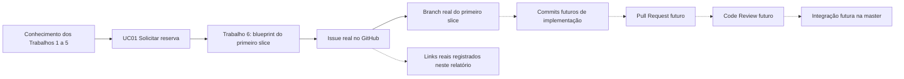

# Trabalho 7 — Preparação e governança do repositório do primeiro slice

**Disciplina:** Desenvolvimento de Software — DSC 2026/1  
**Sistema:** MyCondo — Plataforma integrada de gestão de condomínios  
**Aluno:** Vinicius Martins Nunes  
**Data:** 23 de outubro de 2026

> **Nota sobre os links:** os links reais informados e verificados foram registrados neste relatório. Os links de permissões apontam para páginas do GitHub que podem exigir autenticação administrativa.

## 1. Identificação do sistema e do primeiro slice

O **MyCondo** é uma plataforma para centralizar a gestão de condomínios residenciais, comerciais e de múltiplas torres. O sistema reduz a dispersão de informações e compromissos em canais informais, protegendo regras de reservas, portaria, manutenção, comunicação e finanças.

O primeiro slice definido no Trabalho 6 é o **UC01 — Solicitar reserva de área comum**.

| Elemento | Informação do projeto | Origem na documentação anterior |
| :--- | :--- | :--- |
| Sistema | MyCondo — Plataforma integrada de gestão de condomínios | [Trabalho 5](./trabalho_5_sistema_condominio.md) |
| Caso de Uso | UC01 — Solicitar reserva de área comum | [Trabalho 6](./trabalho_6_sistema_condominio.md), seção 3 |
| Ator | Morador/Condômino | Trabalhos 1 a 6 |
| Objetivo | Solicitar o uso de uma área comum em período válido | [Trabalho 6](./trabalho_6_sistema_condominio.md), seção 6 |
| Resultado observável | Reserva criada em estado coerente ou recusa explicada | [Trabalho 6](./trabalho_6_sistema_condominio.md), seção 6 |
| Regra central | Não aceitar período conflitante e respeitar a política de elegibilidade financeira | [Trabalho 6](./trabalho_6_sistema_condominio.md), seção 12 |
| Conceito principal | Reserva, apoiada por Área comum, Período e Regra de uso | [Trabalho 4](./trabalho_4_sistema_condominio.md) |
| Limites do slice | Inclui solicitação, vínculo, situação financeira, regra, conflito, taxa e persistência planejada; não inclui confirmação por pagamento, cancelamento, Portaria ou implementação técnica | [Trabalho 6](./trabalho_6_sistema_condominio.md), seção 10 |

O slice não será apresentado como implementado. Nesta atividade, o objetivo é preparar o repositório para sua implementação futura.

## 2. Organization e repositório

### 2.1 Links que devem ser preenchidos

- **Organization:** [MyCondo - Sistema Corporativo](https://github.com/MyCondo-Sistema-Corporativo)
- **Repositório:** [mycondo_backend](https://github.com/MyCondo-Sistema-Corporativo/mycondo_backend)
- **Branch principal do projeto:** [master](https://github.com/MyCondo-Sistema-Corporativo/mycondo_backend/tree/master)

> **Justificativa:** o projeto utiliza `master` porque essa foi a branch inicial e principal adotada desde o começo do desenvolvimento. Todos os documentos, histórico e organização inicial do repositório foram construídos a partir dela. Embora o enunciado use `main` como exemplo, neste projeto a função de branch principal é exercida pela `master`.

> **Onde colocar os links:** os links reais da Organization, do repositório e da branch principal estão registrados acima. Neste projeto, a branch principal é `master`, e não `main`, por ser a convenção adotada desde a criação do repositório.

O repositório pertence à Organization, possui nome representativo do sistema, descrição clara, branch principal `master` e permissões compatíveis com a orientação da disciplina. O repositório é um ativo do projeto porque concentra documentação, histórico, decisões e, futuramente, o código que implementará o primeiro slice. A Issue, a branch, os commits e os Pull Requests poderão ser relacionados ao mesmo projeto.

Caso o repositório esteja privado, o professor deverá receber acesso por meio da Organization ou da configuração de colaboradores. Não é necessário torná-lo público se o acesso de avaliação estiver garantido.

## 3. README e documentação inicial

O repositório deverá conter os seguintes arquivos:

| Arquivo | Conteúdo esperado | Link no relatório |
| :--- | :--- | :--- |
| `README.md` | Propósito, contexto, responsáveis, estágio atual, tecnologias previstas e primeiro slice | [README.md](https://github.com/MyCondo-Sistema-Corporativo/mycondo_backend/blob/master/README.md) |
| `docs/visao-geral.md` | Síntese do domínio, fronteiras, UC01, regra central e decisões arquiteturais | [docs/visao-geral.md](https://github.com/MyCondo-Sistema-Corporativo/mycondo_backend/blob/master/docs/visao-geral.md) |
| `.gitignore` | Exclusão de artefatos locais, segredos, caches e arquivos de ferramentas realmente utilizados | [.gitignore](https://github.com/MyCondo-Sistema-Corporativo/mycondo_backend/blob/master/.gitignore) |
| `.env.example` | Somente variáveis conhecidas, sem valores sensíveis; pode ser omitido se ainda não houver configuração | Não aplicável nesta etapa, caso o arquivo não exista |

O `README.md` deve declarar que ORM, PostgreSQL, Docker e API são tecnologias previstas, não configuradas ou funcionais nesta etapa, salvo se isso tiver sido realmente realizado. Também deverá apontar para a documentação complementar e para o Trabalho 6.

O arquivo `docs/visao-geral.md` deverá conter, de forma resumida:

- o problema do MyCondo;
- os atores e os contextos principais;
- o UC01 e seu ator;
- a regra de não sobreposição e a política financeira;
- os conceitos Reserva, Área comum, Período e Regra de uso;
- o monólito modular e a separação entre aplicação, domínio e infraestrutura;
- o que entra e o que não entra no primeiro slice;
- links para a documentação anterior.

Uma pessoa externa deverá conseguir descobrir, sem explicação informal, o que é o sistema, em que estágio está e qual será o próximo comportamento implementado.

## 4. Registro das operações Git e commits

### 4.1 Sequência utilizada ou a utilizar

Se o repositório ainda não estiver clonado:

```bash
git clone <URL_REAL_DO_REPOSITORIO>
cd <NOME_DO_REPOSITORIO>
```

Se já estiver clonado, não é necessário repetir o clone. Antes de alterações:

```bash
git status
git switch master
git pull --rebase origin master
```

Depois de criar ou atualizar a documentação:

```bash
git status
git add README.md docs/visao-geral.md .gitignore .env.example
git commit -m "docs (project): registra visão geral do sistema"
git push origin master
```

Os comandos devem ser adaptados aos arquivos realmente alterados. Não se deve criar um commit vazio ou repetir artificialmente um commit que já exista.

### 4.2 Evidências

| Ação real | Evidência ou referência | O que demonstra |
| :--- | :--- | :--- |
| `git status` local | Estado local verificado antes das operações de preparação e publicação | Que o estado local foi conferido antes da alteração |
| Preparação com `git add` | Arquivos de documentação selecionados para o staging antes do commit | Que a seleção da mudança foi intencional |
| Commit de documentação | [Commit `98fb51b`](https://github.com/MyCondo-Sistema-Corporativo/mycondo_backend/commit/98fb51bec4f54775b0088f14e81242ea85c1ae38) — hash completo: `98fb51bec4f54775b0088f14e81242ea85c1ae38` | Que a mudança foi registrada no histórico |
| Publicação no remoto | [Commit publicado no GitHub](https://github.com/MyCondo-Sistema-Corporativo/mycondo_backend/commit/98fb51bec4f54775b0088f14e81242ea85c1ae38) | Que o commit foi enviado ao repositório remoto |

Editar altera o arquivo no diretório de trabalho. `git add` prepara uma versão específica para o próximo commit. `git commit` registra essa versão no histórico local. `git push` publica commits em uma branch remota. Um `push` não substitui revisão nem integração: ele apenas torna o commit remoto disponível.

## 5. Membros, Teams e permissões

### 5.1 Links de configuração

- **Página de pessoas da Organization:** [People](https://github.com/orgs/MyCondo-Sistema-Corporativo/people)
- **Página de acesso do repositório:** [Acesso do repositório](https://github.com/MyCondo-Sistema-Corporativo/mycondo_backend/settings/access)
- **Team:** [Teams da Organization](https://github.com/orgs/MyCondo-Sistema-Corporativo/teams)

### 5.2 Matriz de acesso

| Membro ou Team | Função | Acesso concedido ou necessário | Justificativa |
| :--- | :--- | :--- | :--- |
| Vinicius Martins Nunes (`ViniciusNunes01`) | Responsável pelo projeto | Owner na Organization; administração do repositório | Administrar o repositório e preparar o trabalho |
| Professor/orientador | Avaliação e revisão | Read ou Triage, conforme orientação | Permitir leitura e acompanhamento sem conceder administração |
| Team da Organization | Organização do projeto | Team existente; detalhar acesso ao repositório conforme configuração | Evitar atribuir permissões individuais desnecessárias |
| Outros colaboradores | Não se deve inventar | Registrar apenas se existirem | Conceder Write somente se participarem da implementação |

Em um projeto individual, não é necessário criar integrantes fictícios nem um Team artificial. O princípio do menor privilégio recomenda conceder apenas o acesso necessário: leitura para avaliação, triagem para organização de Issues, escrita para quem implementa e administração somente para quem gerencia configurações e permissões.

## 6. Issue vinculada ao primeiro slice

### 6.1 Issue real

- **Issue:** [Implementar UC01 — solicitar reserva de área comum](https://github.com/MyCondo-Sistema-Corporativo/mycondo_backend/issues/1)
- **Número:** `#1`
- **Título esperado:** `Implementar UC01 — solicitar reserva de área comum`

> **Evidência:** o link e o número da Issue real estão registrados acima. O título descreve o comportamento do MyCondo, não uma tela ou tecnologia.

### 6.2 Conteúdo recomendado da Issue

**Objetivo**

Permitir que um morador solicite uma área comum em um período válido, com verificação de vínculo, situação financeira aplicável, regra de uso e conflito de agenda.

**Referência funcional**

Consultar o [Trabalho 6](./trabalho_6_sistema_condominio.md), especialmente as seções 6, 10, 12, 15, 20 e 23.

**Regras relacionadas**

- não aceitar duas reservas ativas conflitantes;
- respeitar a política de adimplência vigente;
- validar período e antecedência;
- congelar a taxa de uso quando aplicável;
- não tratar falha de dependência como sucesso;
- manter o domínio independente de HTTP, ORM e PostgreSQL.

**Dependências**

- vínculo ativo do solicitante;
- parecer de situação financeira;
- regra vigente da área;
- consulta à agenda;
- contrato de cobrança, quando houver taxa;
- persistência da Reserva.

**Limites**

Não inclui confirmação após pagamento, cancelamento, expiração, lista de convidados, QR Code, notificações reais, implementação de gateway, Docker, migrations ou integração ponta a ponta.

**Resultado esperado**

Uma Reserva é criada em estado coerente e persistida, ou a solicitação é recusada com significado identificável. Os critérios abaixo não estão concluídos nesta etapa; serão verificados somente quando houver implementação e validação.

### 6.3 Critérios de aceitação futuros

- [ ] Solicitação de morador com vínculo ativo e período válido cria uma Reserva.
- [ ] Período que se sobrepõe a uma reserva ativa é recusado.
- [ ] Situação financeira impeditiva é respeitada conforme a política vigente.
- [ ] Taxa aplicável é congelada no momento da solicitação.
- [ ] Reserva não é criada quando uma dependência essencial está indisponível.
- [ ] Reenvio idêntico não cria reservas duplicadas, conforme política de idempotência.
- [ ] O domínio não depende de Controller, ORM ou PostgreSQL.
- [ ] Os resultados e falhas são traduzidos de forma consistente na fronteira HTTP futura.

A Issue é uma unidade de trabalho rastreável: concentra objetivo, limites, dependências e critérios. Ela não substitui a especificação funcional, porque a especificação explica o comportamento do domínio e os fluxos, enquanto a Issue organiza a execução futura.

## 7. Branch e propósito

- **Nome planejado:** `feat/issue-[NUMERO]-solicitar-reserva`
- **Nome real:** `feat/issue-1-solicitar-reserva`
- **Link da branch:** [feat/issue-1-solicitar-reserva](https://github.com/MyCondo-Sistema-Corporativo/mycondo_backend/tree/feat/issue-1-solicitar-reserva)
- **Relação com a Issue:** [Issue #1](https://github.com/MyCondo-Sistema-Corporativo/mycondo_backend/issues/1)

> **Evidência:** o nome, o link e a relação com a Issue real estão registrados acima. O nome utiliza o número `1` da Issue.

Antes de criar a branch:

```bash
git switch master
git pull --rebase origin master
git status
git switch -c feat/issue-<NUMERO>-solicitar-reserva
git push -u origin feat/issue-<NUMERO>-solicitar-reserva
```

A branch `feat/...` ficará preparada para o desenvolvimento futuro e não deve ser apresentada como implementação concluída. Se a alteração real desta etapa for apenas documental, uma branch `docs/...` também seria válida, desde que o nome e a relação com a mudança estejam registrados.

## 8. Planejamento do Pull Request

Não é obrigatório abrir um Pull Request nesta entrega. Um futuro PR para implementar o UC01 deverá conter:

- **Objetivo:** implementar a solicitação de reserva de área comum;
- **Issue relacionada:** `Closes #[NUMERO_REAL_DA_ISSUE]`;
- **Resumo:** domínio mínimo, coordenação da aplicação, portas e adaptadores incluídos;
- **Decisões:** Reserva protege estados; aplicação coordena; Financeiro fornece parecer; infraestrutura implementa persistência;
- **Validação:** cenários de sucesso, conflito, inadimplência, período inválido, idempotência e falhas de dependência;
- **Evidências:** links para testes, logs de validação e documentação atualizada;
- **Limitações:** confirmação por pagamento, cancelamento, portaria e demais contextos permanecem fora do PR;
- **Atenções para revisão:** concorrência, consistência entre cobrança e persistência, vazamento de ORM e classificação das falhas.

Um `push` para uma branch remota não integra a mudança à `master`. O `push` apenas publica commits naquela branch. A integração exige análise do Pull Request, revisão, resolução de comentários e merge conforme a política do projeto.

## 9. Planejamento do Code Review

| Dimensão | Pergunta de revisão relacionada ao primeiro slice |
| :--- | :--- |
| Domínio | A regra de não sobreposição e a política financeira estão protegidas no domínio correto? |
| Aplicação/Arquitetura | A aplicação apenas coordena? As portas expressam necessidades e as fronteiras previstas foram respeitadas? |
| Persistência | A solução trata concorrência, histórico e idempotência sem transformar o domínio em modelo de banco? |
| Qualidade | Os nomes comunicam Reserva, Período, Regra de uso e situação financeira sem sinônimos ambíguos? |
| Falhas | Conflito, regra impeditiva, ausência e falha técnica possuem significados distintos? |
| Validação futura | As evidências correspondem aos critérios de aceitação e não apenas à execução feliz? |
| Documentação | O README, a visão geral e o Trabalho 6 continuam coerentes com a mudança? |

**Exemplo de comentário construtivo:**

> “A verificação de conflito parece estar apenas no Handler, depois da consulta à agenda. Como o domínio deve proteger a invariante e solicitações concorrentes podem produzir duas reservas, poderia mover a decisão para o comportamento de Reserva/agenda e explicar como a persistência garante a consistência? Se essa responsabilidade permanecer no Handler, justifique a decisão e apresente a proteção equivalente.”

O autor deve analisar o comentário, corrigir a responsabilidade ou justificar tecnicamente a escolha com evidência. Depois, deve solicitar nova avaliação; comentário de revisão não deve ser ignorado nem tratado como aprovação automática.

## 10. Rastreabilidade em Mermaid



**Legenda:** linhas contínuas representam artefatos já documentados no projeto; linhas tracejadas representam trabalho futuro ou ainda dependente da execução prática. Depois de criar os artefatos, os links reais devem substituir os marcadores nas seções 2, 3, 4, 5, 6 e 7.

Um futuro desenvolvedor poderá começar pelo `README.md`, seguir para `docs/visao-geral.md`, abrir a Issue do UC01, consultar o Trabalho 6 e percorrer a branch e os commits. Essa cadeia explica por que o código foi criado e quais regras não podem ser perdidas.

## 11. Revisões e pendências de governança

| Artefato ou decisão anterior | Revisão identificada | Justificativa | Impacto futuro |
| :--- | :--- | :--- | :--- |
| [Trabalho 4](./trabalho_4_sistema_condominio.md) | Separar solicitação de reserva de confirmação | O primeiro fluxo contém mais de um comportamento | Evita implementar confirmação prematura |
| [Trabalho 5](./trabalho_5_sistema_condominio.md) | Registrar formalmente as portas de agenda e situação financeira | A Issue precisa declarar dependências implementáveis | Facilita a divisão futura de responsabilidades |
| [Trabalho 6](./trabalho_6_sistema_condominio.md) | Usar UC01, Issue e branch com o mesmo identificador | A governança precisa de uma chave rastreável | Permite navegar do domínio até o código |
| Política financeira | Confirmar se inadimplência bloqueia solicitação ou somente confirmação | A documentação trata a política como parametrizável | Evita codificar uma hipótese como fato |
| Repositório | Verificar Organization, `master`, permissões e acesso do professor | Os links precisam ser avaliáveis | Evita perda de pontos por artefato inacessível |

### Reflexão crítica

1. **O que a organização revelou sobre o estágio real?** O projeto está na preparação documental e arquitetural; o backend, o banco, o ORM, os containers e os testes do slice ainda não devem ser apresentados como prontos.
2. **Qual é a ligação verificável entre UC, Issue e branch?** O UC01 é definido no Trabalho 6, a Issue deve referenciá-lo pelo título e conteúdo, e a branch deve conter o número real da Issue no nome. Os três links serão registrados neste relatório.
3. **Por que uma mensagem clara é melhor que “final”?** Porque comunica intenção, facilita busca no histórico, revisão e auditoria, e não depende de adivinhação.
4. **Qual o risco de alterações sem revisão na `master`?** Regras podem ser violadas, decisões podem ficar sem discussão e uma mudança difícil de reverter pode contaminar a base principal.
5. **O que ainda precisará ser praticado?** Abrir PR com evidências, revisar concorrência e fronteiras, responder comentários, atualizar a Issue e integrar somente após validação.
6. **O que deve estar pronto para outra pessoa continuar?** README, visão geral, Trabalho 6, Issue, branch identificada, critérios de aceitação, regras do domínio, dependências, comandos de desenvolvimento e acesso ao repositório.

## 12. Apêndice — Uso de Inteligência Artificial

- **Ferramenta utilizada:** AI assistant using Copilot SDK in VS Code.
- **Finalidade:** ler o enunciado do Trabalho 7, relacioná-lo ao Trabalho 6 e estruturar o relatório de governança.
- **Principais sugestões:** separar evidências reais de planejamento, utilizar UC01 como identificador comum, documentar Issue, branch, permissões, PR e Code Review.
- **Verificações efetuadas:** conferência das etapas A a J, dos critérios de aceitação, da necessidade de links verificáveis e da proibição de apresentar implementação fictícia.
- **Ajustes e sugestões rejeitadas:** não foram inventados dados do GitHub. Organization, repositório, Issue, commit e branch foram preenchidos com os links fornecidos. A captura da página de pessoas confirmou o responsável da Organization; o acesso do professor continua sendo uma configuração futura, caso necessário.

A IA ajudou a organizar a governança e a identificar quais evidências ainda faltam. A execução das operações e a verificação dos links continuam sendo responsabilidade do aluno. O conteúdo compreendido independentemente da ferramenta é que uma especificação explica o comportamento, enquanto a Issue organiza a unidade de trabalho; a branch separa mudanças; o commit registra intenção; o PR permite revisão; e o merge integra uma mudança validada à `master`, que é a branch principal deste projeto.

## Checklist final antes da entrega

- [x] A Organization pertence ao projeto e seu link foi inserido.
- [x] O repositório possui nome e descrição adequados.
- [x] A branch principal `master` existe e o professor deverá receber acesso para avaliá-la.
- [x] `README.md`, `docs/visao-geral.md` e `.gitignore` estão no repositório.
- [x] `.env.example` foi considerado não aplicável nesta etapa.
- [x] O commit real de documentação foi publicado e seu link foi inserido.
- [x] A Issue real do UC01 foi criada e seu link foi inserido.
- [x] A branch real foi criada, publicada e seu link foi inserido.
- [x] As permissões existentes foram verificadas sem inventar colaboradores; o professor deverá ser adicionado somente se necessário para avaliação.
- [ ] Nenhum critério de aceitação foi marcado como concluído antes da implementação.
- [x] Os marcadores de links reais foram removidos; `.env.example` foi indicado como não aplicável nesta etapa.
