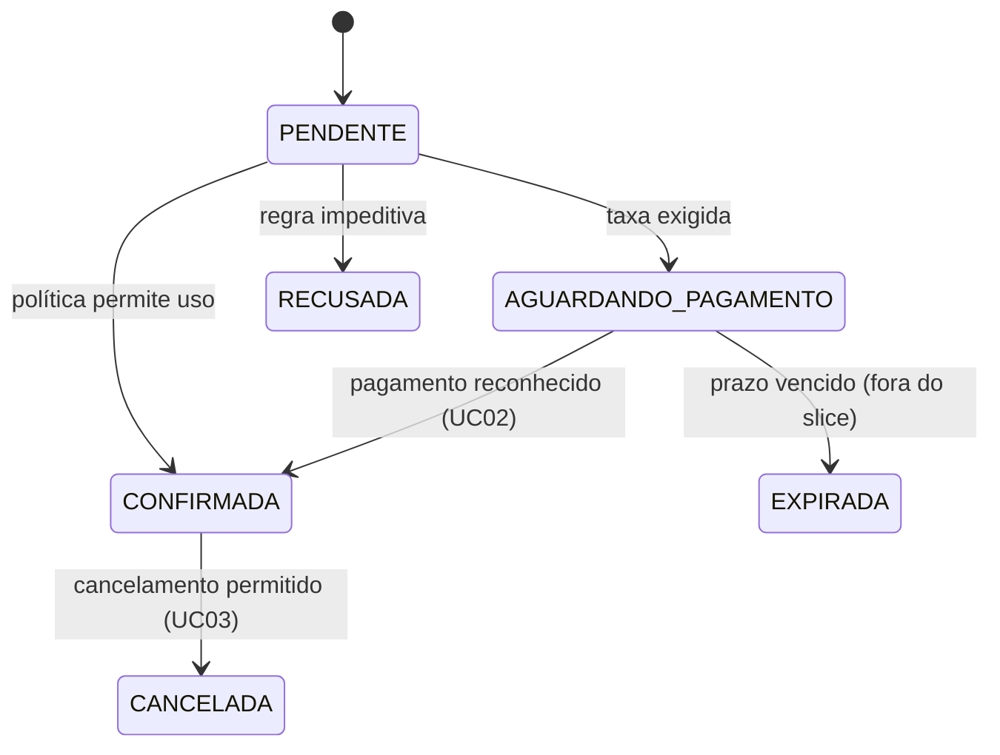
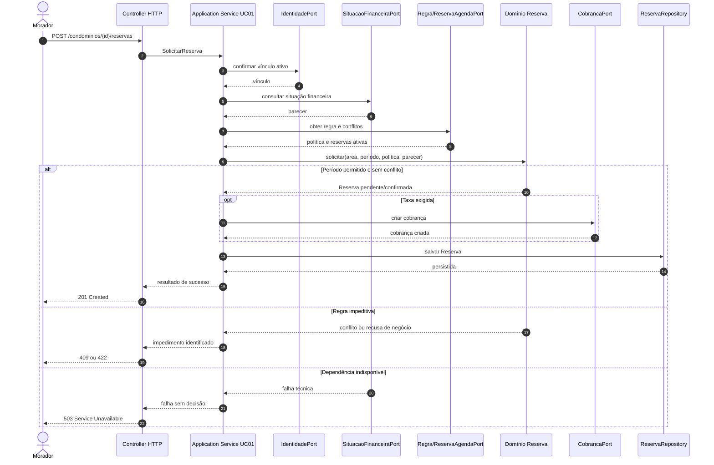

# Trabalho 8 — Base técnica NestJS 12 e planejamento do primeiro slice

**Disciplina:** Desenvolvimento de Sistemas — DSC 2026/1  
**Sistema:** MyCondo — Plataforma integrada de gestão de condomínios  
**Aluno:** Vinicius Martins Nunes  
**Data:** 24 de outubro de 2026  
**Aplicação local:** `mycondo_backend`  
**Organization:** [MyCondo - Sistema Corporativo](https://github.com/MyCondo-Sistema-Corporativo)  
**Repositório:** [mycondo_backend](https://github.com/MyCondo-Sistema-Corporativo/mycondo_backend)  
**Branch principal documentada anteriormente:** `master`

> Este relatório registra a preparação prática da base NestJS e o planejamento arquitetural do UC01. A aplicação criada nesta atividade contém somente o template `Hello World!`; o comportamento de reservas continua planejado, não implementado.

## 1. Identificação do sistema e ponto de partida

O **MyCondo** centraliza a gestão de condomínios residenciais, comerciais e de múltiplas torres. O sistema reduz a dispersão de informações em canais informais e preserva regras e compromissos de reservas, portaria, manutenção, comunicação e finanças.

O primeiro slice é o **UC01 — Solicitar reserva de área comum**. Seu ator é o morador/condômino, que deseja solicitar uma área comum em um período válido. O resultado esperado é uma Reserva criada em estado coerente ou uma recusa com significado identificável. A regra central é não aceitar sobreposição de reservas ativas e respeitar a política de elegibilidade financeira.

| Item | Definição | Referência |
| :--- | :--- | :--- |
| Sistema | MyCondo — Plataforma integrada de gestão de condomínios | [Trabalho 5](./trabalho_5_sistema_condominio.md) |
| Caso de Uso | UC01 — Solicitar reserva de área comum | [Trabalho 6](./trabalho_6_sistema_condominio.md), seções 3, 10 e 12 |
| Ator e objetivo | Morador/condômino solicita o uso de uma área comum | [Trabalho 6](./trabalho_6_sistema_condominio.md), seção 2 |
| Resultado | Reserva registrada, pendente ou recusa explicada | [Trabalho 6](./trabalho_6_sistema_condominio.md), seção 10 |
| Conceitos | Reserva, Área comum, Período, Regra de uso, Situação financeira e Cobrança | [Trabalho 4](./trabalho_4_sistema_condominio.md) |
| Limite | Solicitação, vínculo, política, conflito, taxa e persistência futura | [Trabalho 6](./trabalho_6_sistema_condominio.md), seção 10 |

Antes desta atividade não havia aplicação NestJS no diretório local de trabalhos. O backend foi criado durante esta atividade em `mycondo_backend`. O código de negócio, banco, ORM, Docker e autenticação ainda não foram implementados.

## 2. Inventário e compatibilidade do ambiente

Os comandos foram executados no Windows, em terminal PowerShell:

```text
node -v
v24.21.0

npm -v
11.6.0

pnpm -v
12.14.0

nest --version
```

A chamada direta de `nest --version` não encerrou de forma utilizável no terminal. A existência da CLI foi confirmada pelo executável do pnpm e pela execução do gerador; a versão observada pelo executável direto foi:

```text
Nest CLI 12.0.8
```

| Ferramenta | Versão observada | Linha adotada | Compatível? | Intervenção |
| :--- | :---: | :--- | :---: | :--- |
| Node.js | 24.21.0 | 24 | Sim | Nenhuma |
| npm | 11.6.0 | Compatível com Node.js | Sim | Nenhuma |
| pnpm | 12.14.0 | 12 | Sim | Nenhuma |
| Nest CLI | 12.0.8 | 12 | Sim | CLI executada pelo `pnpm dlx` |

Node.js é o runtime JavaScript/TypeScript. npm e pnpm são gerenciadores de dependências; TypeScript é a linguagem compilada para JavaScript; NestJS é o framework; e Nest CLI é a ferramenta que gera, compila e executa projetos Nest. A versão global ou temporária da CLI não substitui a versão local de `@nestjs/core`.

Foi adotado **pnpm** como único gerenciador do projeto porque o enunciado o padroniza e porque o lockfile `pnpm-lock.yaml` registra uma resolução reprodutível. Não foi necessário reinstalar as ferramentas já compatíveis.

## 3. Diagnóstico e recuperação

Não houve incompatibilidade de runtime ou dependência. A única ocorrência foi operacional: a primeira tentativa de executar testes recebeu a opção `--runInBand`, que é uma opção conhecida do Jest, mas não do Vitest.

| Sintoma | Interpretação | Diagnóstico | Correção | Validação |
| :--- | :--- | :--- | :--- | :--- |
| Vitest informou `Unknown option --runInBand` | Opção de outro executor de testes | Leitura da mensagem do Vitest 4.1.12 | Executar o script padrão `pnpm test`, sem a opção | 1 arquivo e 1 teste passaram |

Não houve alteração preventiva de `PATH` ou `PNPM_HOME`, nem instalação global desnecessária.

## 4. Criação e configuração da aplicação

O comando efetivamente utilizado foi:

```bash
pnpm dlx @nestjs/cli@12 new mycondo_backend --package-manager pnpm --skip-git --strict --language ts
```

A CLI gerou a aplicação e instalou as dependências. A estrutura já veio com:

- `package.json` e `pnpm-lock.yaml`;
- módulo, controller, provider e ponto de entrada;
- configuração ESM (`"type": "module"`);
- Vitest para testes unitários e e2e;
- scripts `start:dev`, `build`, `test` e `test:e2e`.

O projeto foi criado sem Git interno pelo `--skip-git`, pois o diretório de trabalhos não era um clone local do repositório remoto. A publicação da aplicação no GitHub ainda é uma ação de governança pendente; portanto, não é declarada neste relatório como concluída.

## 5. Dependências, projeto e execução

O script utilizado para desenvolvimento é:

```json
"start:dev": "nest start --watch"
```

A versão local foi verificada dentro da raiz da aplicação:

```text
mycondo_backend@0.0.1
└── @nestjs/core@12.2.0
```

O lockfile presente é `pnpm-lock.yaml`, com `lockfileVersion: '9.0'`. A aplicação foi iniciada com:

```bash
pnpm start:dev
```

Saída relevante:

```text
$ nest start --watch
[8:17:09 PM] Starting compilation in watch mode...
[8:17:17 PM] Found 0 errors. Watching for file changes.
```

A porta observada foi `3000`, com URL `http://localhost:3000/`. Um log de inicialização apenas demonstra que o processo compilou e iniciou; não demonstra, sozinho, que a rota está acessível. Por isso foram feitas requisições HTTP independentes.

## 6. Leitura dos arquivos gerados

| Arquivo | Identificação no código | Papel no `Hello World!` |
| :--- | :--- | :--- |
| `package.json` | Declara ESM, scripts, dependências Nest e Vitest | Define como instalar, testar, compilar e iniciar |
| `src/main.ts` | Cria `NestFactory` com `AppModule` e chama `app.listen` | Inicializa o servidor HTTP na porta 3000 |
| `src/app.module.ts` | Registra `AppController` e `AppService` | Monta o módulo e conecta controller ao provider |
| `src/app.controller.ts` | Expõe `@Get()` e chama `appService.getHello()` | Traduz `GET /` para a operação da aplicação |
| `src/app.service.ts` | `getHello()` retorna `Hello World!` | Fornece o corpo da resposta |

O caminho da resposta é:

1. `main.ts` cria o contexto Nest e inicia o listener;
2. `AppModule` registra controller e provider;
3. uma requisição `GET /` é roteada por `AppController`;
4. o controller delega ao `AppService`;
5. o texto retornado pelo provider é serializado pelo adaptador HTTP e enviado ao cliente.

No template, `Module` organiza dependências, `Controller` trata a fronteira HTTP e `Provider/Service` fornece uma operação injetável. Esses nomes não significam automaticamente Bounded Context, domínio ou Application Service. No MyCondo, a regra de conflito deve permanecer no domínio de Reservas; o controller futuro apenas traduzirá a entrada, e um serviço de aplicação coordenará o UC01.

## 7. Experimentos HTTP

### 7.1 Navegador

A URL `http://localhost:3000/` foi aberta no navegador integrado e apresentou:

```text
Hello World!
```

O snapshot da página identificou o conteúdo como texto visível. O navegador observou a rota e o corpo, embora não exiba os cabeçalhos como o cURL.

### 7.2 REST Client

Foi criado o arquivo [`requests.http`](./mycondo_backend/requests.http) com:

```http
GET http://localhost:3000/
```

Como o cliente REST extension não estava disponível nesta sessão, a mesma requisição foi validada por um cliente HTTP do PowerShell, representando a mesma operação:

```text
Status: 200
Body: Hello World!
```

O arquivo está pronto para ser executado pelo REST Client no VS Code sem alteração da requisição.

### 7.3 cURL

Com a aplicação em execução, foi executado:

```bash
curl.exe -i http://localhost:3000/
```

Resultado observado:

```text
HTTP/1.1 200 OK
X-Powered-By: Express
Content-Type: text/html; charset=utf-8
Content-Length: 12
Hello World!
```

| Cliente | Requisição | Status | Corpo | Evidência |
| :--- | :--- | :---: | :--- | :--- |
| Navegador | `GET http://localhost:3000/` | 200 observado | `Hello World!` | Página local aberta |
| REST Client | `GET http://localhost:3000/` | 200 equivalente | `Hello World!` | `requests.http` e `Invoke-WebRequest` |
| cURL | `curl.exe -i http://localhost:3000/` | 200 OK | `Hello World!` | Cabeçalhos e corpo no terminal |

Os três cenários usam o mesmo servidor e rota. O que muda é o cliente e a forma de apresentação: navegador mostra a página, cliente REST organiza a requisição e cURL permite visualizar os cabeçalhos.

## 8. Checkpoint de prontidão técnica

| Verificação | Situação | Evidência |
| :--- | :---: | :--- |
| Ferramentas compatíveis | Sim | Node 24.21.0, pnpm 12.14.0 e CLI 12.0.8 |
| Projeto NestJS 12 criado | Sim | Gerador concluiu `mycondo_backend` |
| pnpm utilizado | Sim | Comando de criação e scripts executados com pnpm |
| ESM/Vitest conferidos | Sim | `type: module`, configs Vitest e scripts presentes |
| Dependências instaladas | Sim | Geração concluída e lockfile criado |
| Framework NestJS 12 verificado | Sim | `@nestjs/core@12.2.0` |
| Aplicação iniciada | Sim | Compilação em watch sem erros |
| Porta identificada | Sim | `3000` |
| Arquivos principais compreendidos | Sim | Seção 6 |
| `GET /` no navegador | Sim | `Hello World!` visível |
| `GET /` no REST Client | Parcial | Arquivo pronto; validação equivalente feita pelo PowerShell |
| `GET /` no cURL | Sim | `200 OK` e corpo observado |
| Versionado no GitHub | Não | Aplicação local criada; publicação ainda pendente |

O `Hello World!` comprova que a base NestJS compila, inicia, registra uma rota e responde HTTP. Não comprova UC01, regras de domínio, persistência, concorrência, autenticação, banco, integração financeira ou qualquer comportamento real do MyCondo.

## 9. Da prova de vida ao comportamento real

| Item | Definição |
| :--- | :--- |
| Caso de Uso | UC01 — Solicitar reserva de área comum |
| Ator e objetivo | Morador solicita o uso permitido de uma área comum |
| Resultado | Reserva criada em estado coerente ou recusa explicada |
| Conceitos | Reserva, Área comum, Período, Regra de uso, vínculo e situação financeira |
| Regra central | Não permitir conflito ativo e não contornar a política financeira vigente |
| Incluído | Vínculo, parecer financeiro, política, período, agenda, taxa, persistência e resultado |
| Excluído | Confirmação por pagamento, cancelamento, expiração, QR Code, convidados, Docker e integrações reais |

`Hello World!` não substitui o UC01 porque não recebe uma intenção de reserva, não consulta contexto algum, não aplica invariantes, não cria estado de domínio e não preserva uma decisão.

## 10. Responsabilidades antes de classes e pastas

| Responsabilidade | Papel | Justificativa | Evidência no UC01 |
| :--- | :--- | :--- | :--- |
| Receber JSON, rota e identidade HTTP | Interface | Traduz protocolo sem decidir regra | Entrada da solicitação |
| Representar a intenção de solicitar | Aplicação | Separa comando de transporte | Objetivo do morador |
| Coordenar vínculos, Financeiro, agenda e persistência | Aplicação | Ordena colaboradores e controla o fluxo | Pré-condições do caso |
| Confirmar vínculo ativo | Porta/Aplicação | Reservas precisa do significado, não do cadastro inteiro | Elegibilidade do ator |
| Obter política e situação financeira | Porta/Aplicação | Financeiro permanece em sua fronteira | Política de adimplência |
| Validar período e não sobreposição | Domínio | Protege invariante do uso da área | Regra central |
| Criar Reserva e decidir estado | Domínio | Estado não deve ser simples atribuição HTTP | Resultado da solicitação |
| Persistir a Reserva | Infraestrutura por porta | Detalhe técnico substituível | Preservação do fato |
| Criar cobrança quando aplicável | Infraestrutura por porta | Não transformar Reservas em gateway | Taxa de uso |
| Traduzir resultado para HTTP | Interface | Representa significado interno | Status e corpo futuros |

## 11. Comportamento, estados e invariantes

O conceito que protege a decisão é **Reserva**, apoiado por `Período` e pela política vigente. A operação de negócio é `solicitar(...)`, e não uma atribuição como `reserva.status = CONFIRMADA`.

Condições para permitir a operação:

- solicitante possui vínculo ativo;
- área existe e possui regra vigente;
- início é anterior ao fim e atende à antecedência;
- não há reserva ativa incompatível no período;
- situação financeira atende à política;
- cobrança é criada quando a política exigir.

Condições impeditivas incluem período inválido, conflito, inadimplência impeditiva e dependência essencial indisponível. A aplicação deve fornecer ao domínio a área, período, política, parecer financeiro, reservas relevantes, instante e eventual taxa congelada.



As transições de pagamento, expiração e cancelamento aparecem como contexto futuro, mas não fazem parte da implementação deste slice.

## 12. Portas, persistência e limites técnicos

| Necessidade | Porta candidata | Utiliza | Implementação futura | Justificativa |
| :--- | :--- | :--- | :--- | :--- |
| Confirmar vínculo | `IdentidadePort` | Handler UC01 | Adaptador de Identidade | Reservas não possui todos os dados cadastrais |
| Consultar situação | `SituacaoFinanceiraPort` | Handler | Adaptador Financeiro | Evita recalcular débitos |
| Obter política | `RegraDeUsoPort` | Handler/domínio | Persistência de políticas | Política tem vigência |
| Consultar conflitos | `ReservaAgendaPort` | Handler/domínio | Consulta transacional | Agenda precisa de consistência |
| Salvar reserva | `ReservaRepository` | Aplicação | PostgreSQL/ORM futuro | Contrato orientado à necessidade |
| Criar cobrança | `CobrancaPort` | Aplicação | Integração Financeira | Pagamento não pertence ao núcleo de Reservas |
| Determinar instante | `Clock` | Aplicação/domínio | Relógio do sistema injetado | Testabilidade e decisões temporais |

Repository é uma porta que expressa uma necessidade do domínio/aplicação; não é automaticamente uma tabela, um ORM ou o PostgreSQL. Futuramente PostgreSQL poderá persistir fatos, ORM poderá implementar adaptadores e Docker poderá padronizar o ambiente, mas nenhum desses elementos é necessário para a prova de vida atual.

## 13. Fronteira HTTP e intenção

| Elemento | Proposta | Justificativa |
| :--- | :--- | :--- |
| Método e rota | `POST /condominios/{condominioId}/reservas` | Expressa criação de solicitação |
| Entrada | `areaId`, `inicio`, `fim`; identidade vem do contexto autenticado | Não confiar no morador informado no corpo |
| DTO | Sim, na fronteira | Validar forma e traduzir transporte |
| Intenção | Command `SolicitarReserva` | É uma mudança de estado |
| Coordenador | Application Service/Handler UC01 | Coordena portas, domínio e persistência |
| Comportamento do domínio | `Reserva.solicitar(...)` | Protege período, conflito e estado |
| Resultado independente de HTTP | Reserva criada, pendente ou recusa com significado | Permite outras interfaces |
| Representação HTTP possível | `201`, `409`, `422`, `404` ou `503`, conforme significado | Status não substitui classificação arquitetural |

Nenhum DTO, Command ou endpoint de negócio foi implementado nesta atividade.

## 14. Resultados, impedimentos e falhas

| Cenário | Significado | Categoria | Reconhece | HTTP possível | Certeza |
| :--- | :--- | :--- | :--- | :---: | :--- |
| Solicitação válida | Reserva criada/persistida | Sucesso | Aplicação e domínio | 201 | Planejado |
| Área ou vínculo ausente | Dependência necessária não localizada | Aplicação | Handler/porta | 404 | Planejado |
| Período inválido | Intervalo não representa período válido | Domínio | `Período` | 422 | Planejado |
| Conflito de agenda | Reserva ativa incompatível já existe | Domínio | Reserva/agenda | 409 | Planejado |
| Inadimplência impeditiva | Política não permite a solicitação | Domínio/aplicação | Política com parecer Financeiro | 422 | Política a confirmar |
| Financeiro indisponível | Não é possível decidir com informação essencial | Infraestrutura/aplicação | Adaptador/handler | 503 | Planejado |
| Falha de persistência | Não há garantia de que o estado foi salvo | Infraestrutura | Repositório | 503 ou 500 | Planejado |

Uma falha não pode ser convertida em resposta de sucesso. Em especial, o sistema não deve responder que a reserva foi criada se a persistência ou uma dependência essencial falhou.

## 15. Diagrama do slice futuro



O que existe de fato hoje é a base NestJS e a rota `GET /` do template. Controller de reservas, Application Service, domínio, portas e adaptadores do diagrama são planejamento futuro.

## 16. Próximos passos, rastreabilidade e governança

| Passo futuro | Objetivo | Dependência | Evidência esperada |
| :--- | :--- | :--- | :--- |
| Publicar a aplicação no repositório | Versionar `package.json`, lockfile, fonte e `requests.http` | Acesso ao repositório | Commit e link GitHub |
| Refinar domínio mínimo | Definir Reserva, Período, estados e erros | UC01 e Trabalhos 4–6 | Testes de unidade do domínio |
| Definir portas e aplicação | Coordenar vínculos, Financeiro, agenda e persistência | Domínio refinado | Contratos e testes de aplicação |
| Implementar fronteira HTTP | Traduzir DTO e resultado | Application Service | Requisições HTTP do UC01 |
| Implementar persistência | Garantir histórico, idempotência e concorrência | Portas e decisão PostgreSQL | Testes de integração |
| Revisar e integrar | Associar branch, Issue e PR | Critérios de aceitação | Review, CI e merge |

O trabalho é rastreável à [Issue #1 do UC01](https://github.com/MyCondo-Sistema-Corporativo/mycondo_backend/issues/1) e à branch [feat/issue-1-solicitar-reserva](https://github.com/MyCondo-Sistema-Corporativo/mycondo_backend/tree/feat/issue-1-solicitar-reserva), registradas no Trabalho 7. Como a execução desta sessão ocorreu fora de um clone local, a publicação efetiva da aplicação criada permanece pendente.

### Pendências documentais

| Artefato | Revisão | Motivo | Impacto | Prioridade |
| :--- | :--- | :--- | :--- | :---: |
| [Trabalho 4](./trabalho_4_sistema_condominio.md) | Separar solicitação e confirmação | UC01 e UC02 possuem momentos distintos | Evita confirmar antes da condição necessária | Alta |
| [Trabalho 5](./trabalho_5_sistema_condominio.md) | Registrar portas de agenda e parecer financeiro | Dependências ficaram mais explícitas | Facilita implementação | Alta |
| [Trabalho 6](./trabalho_6_sistema_condominio.md) | Manter estados e critérios coerentes com a base técnica | O backend real ainda é somente template | Evita declarar slice pronto | Alta |
| [trabalho_7_sistema_condominio.md](./trabalho_7_sistema_condominio.md) | Publicar o backend e atualizar links/evidências | Aplicação foi criada localmente nesta sessão | Completa governança do repositório | Alta |

## 17. Reflexão crítica

1. A evidência além do log é a resposta real `200 OK` de navegador, cliente HTTP equivalente e cURL.
2. A dificuldade encontrada foi a opção `--runInBand`, corrigida usando o script Vitest padrão; o teste passou.
3. Nest CLI gera, compila e executa o projeto; NestJS é o framework usado em runtime.
4. Os arquivos mostram que `main.ts` inicia, o módulo registra dependências, o controller roteia e o provider retorna o corpo.
5. NestJS fornece mecanismos técnicos, mas não decide agregados, invariantes, fronteiras ou regras do domínio.
6. `Hello World!` é uma prova de infraestrutura; UC01 exige decisão de negócio, estado, dependências e persistência.
7. A regra mais sensível será a não sobreposição sob concorrência, combinada com a política financeira.
8. Seria fácil colocar a verificação de conflito no controller ou em um service genérico; ela deve ser protegida pelo domínio e apoiada por persistência consistente.
9. O blueprint do Trabalho 6 foi confirmado: monólito modular, aplicação coordenadora, domínio protegido e portas explícitas.
10. Ainda não estão prontos o domínio, a persistência, as integrações, os testes do UC01, a autenticação e a publicação do backend no GitHub.

## Apêndice — Uso de inteligência artificial

- **Ferramenta:** AI assistant using Copilot SDK in VS Code.
- **Finalidade:** interpretar o enunciado, relacionar os Trabalhos 4–7, preparar a aplicação NestJS e estruturar o relatório.
- **Contribuição real:** organização do documento, síntese arquitetural e orientação dos comandos.
- **Sugestões corrigidas:** não foram aceitas saídas fictícias; versões, logs, respostas HTTP e testes foram obtidos no ambiente.
- **Método de verificação:** leitura dos arquivos gerados, `pnpm list`, `pnpm build`, `pnpm test`, navegador, PowerShell HTTP e `curl.exe`.
- **Conclusão:** os procedimentos podem ser repetidos e defendidos sem a IA; as evidências são do terminal e da aplicação local.

## Checklist de entrega

- [x] Documento único em Markdown com identificação e links.
- [x] Ambiente Node.js 24, pnpm 12 e Nest CLI 12 registrado.
- [x] Aplicação NestJS criada com ESM, pnpm e Vitest.
- [x] `@nestjs/core` local verificado na versão 12.2.0.
- [x] Compilação, teste do template e execução HTTP validados.
- [x] `requests.http` criado.
- [x] Distinção entre base técnica real e slice futuro.
- [x] Planejamento de responsabilidades, portas, falhas e sequência Mermaid.
- [ ] Publicação do backend local no GitHub.
- [ ] Execução pelo cliente REST extension do VS Code.

