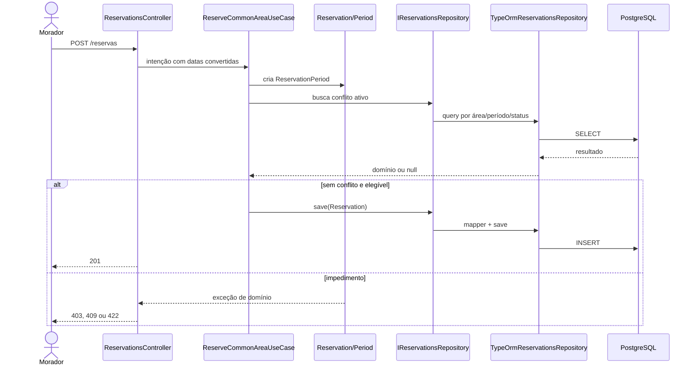

# Trabalho 9 — Do domínio à API persistente

## 1. Identificação e recorte

| Item | Informação |
|---|---|
| Sistema | MyCondo — Plataforma Integrada de Gestão de Condomínios |
| Responsável | Vinicius Martins Nunes |
| Repositório | [MyCondo-Sistema-Corporativo/mycondo_backend](https://github.com/MyCondo-Sistema-Corporativo/mycondo_backend) |
| Branch/commit | `master` / `5279e990a983c8a4206c850b525968e747c84dee` (base local antes destas alterações) |
| Caso de uso | UC01 — Solicitar reserva de área comum |
| Ator/objetivo | Morador elegível / solicitar período de uso |
| Regra principal | Não permitir conflito ativo na mesma área e período |
| Resultado observável | Reserva `pending` gravada no PostgreSQL e recuperável por GET |
| Origem | Trabalhos 4, 6 e 8; planejamento em `docs/planejamento/` |

O recorte tem valor porque preserva um compromisso real do condomínio. Entram
validação de elegibilidade, período, conflito, persistência e HTTP. Ficam fora
autenticação, cobrança, confirmação e cancelamento, que são outros casos de uso.
Como a autenticação ainda não foi implementada, `residentId` é recebido no
body e a elegibilidade é configurada por `ELIGIBLE_RESIDENT_IDS`; essa é uma
limitação explícita, não uma simulação de autenticação.

## 2. Estado inicial e arquitetura preservada

O domínio, objeto de valor, exceções, contrato e testes unitários já existiam.
O Trabalho 8 ainda registrava Controller e persistência como futuros. Foram
adicionados apenas os adaptadores necessários ao slice.

| Responsabilidade | Elemento | Existia? | Alteração |
|---|---|---:|---|
| Domínio | `Reservation`, `ReservationPeriod`, estados e exceções | Sim | Nenhuma regra removida |
| Aplicação | `ReserveCommonAreaUseCase` | Sim | Passa a receber adaptadores reais |
| Porta | `IReservationsRepository` | Sim | `findById` para leitura observável |
| Infraestrutura | ORM, mapper e `TypeOrmReservationsRepository` | Não | Implementado |
| HTTP | `ReservationsController` e filtro | Não | Implementado |

O fluxo é:



## 3. PostgreSQL e configuração

`compose.yaml` usa `postgres:17`, serviço `postgres`, porta `5432`, volume
nomeado `mycondo_postgres_data` e healthcheck com `pg_isready`. Usuário,
senha e banco são variáveis com defaults exclusivamente locais. O backend usa
`DB_HOST`, `DB_PORT`, `DB_USERNAME`, `DB_PASSWORD` e `DB_NAME`; `.env.example`
não contém credencial real e `.env` está no `.gitignore`.

Comandos reproduzíveis:

```bash
docker compose config
docker compose up -d
docker compose ps
docker compose exec postgres psql -U mycondo_user -d mycondo_db -c "select current_database(), current_user;"
pnpm run migration:run
```

`synchronize: false` está configurado em `AppModule` e no `DataSource`. A
migration `1792519206237-CreateReservations.ts` cria enum, tabela, chave
primária, tipos, nulidade, check de período e índice. A migration anterior de
orders foi tornada reversível e inicializa o schema legado necessário; ela não
participa do slice de reservas. O volume não deve ser removido com `down -v`:
recriar o container sem removê-lo preserva os dados no volume nomeado.

## 4. Fronteira domínio/ORM

`Reservation` e `ReservationPeriod` não importam TypeORM, PostgreSQL ou HTTP.
`ReservationOrmEntity` existe somente em infraestrutura. `ReservationMapper`
reconstitui o período sem chamar `confirm()` ou outra transição de negócio;
assim, estado e identidade persistidos são preservados sem repetir uma decisão.
Uma conversão errada de `startsAt`/`endsAt` poderia permitir consulta de
conflito incorreta mesmo com o banco funcionando.

O identificador é criado pela aplicação com `randomUUID()`. Datas e status são
persistidos; `pending`, `confirmed` e `cancelled` são os estados do domínio.
O banco reforça `startsAt < endsAt`, enquanto elegibilidade e conflito continuam
protegidos no domínio/aplicação.

## 5. Providers e contrato HTTP

O `ReservationsModule` registra:

| Token | Implementação |
|---|---|
| `RESERVATIONS_REPOSITORY` | `TypeOrmReservationsRepository` |
| `RESIDENT_ELIGIBILITY_SERVICE` | `ConfiguredResidentEligibilityService` |
| `RESERVE_COMMON_AREA_USE_CASE` | `ReserveCommonAreaUseCase` |

`POST /reservas` recebe `residentId`, `commonAreaId`, `startsAt` e `endsAt`.
O Controller valida forma e datas, invoca a aplicação e serializa o resultado.
`GET /reservas/:reservationId` prova leitura e reconstituição. O Controller
não consulta `Repository` do TypeORM nem muda status do domínio.

| Cenário | Categoria | Status |
|---|---|---:|
| Reserva criada | sucesso | 201 |
| Campo/data inválido | entrada | 400 |
| Morador não elegível | domínio/aplicação | 403 |
| Período inválido | domínio | 422 |
| Conflito de agenda | domínio | 409 |
| UUID inexistente | aplicação | 404 |
| Falha de banco | infraestrutura | tratamento padrão do Nest, sem detalhes SQL |

## 6. Cenários e testes

Os cenários estão versionados em [`requests/reservations.http`](../requests/reservations.http).
Após iniciar o banco, aplicar migration e iniciar a API:

```bash
curl -X POST http://localhost:3200/reservas -H "Content-Type: application/json" \
  -d "{\"residentId\":\"resident-1\",\"commonAreaId\":\"11111111-1111-4111-8111-111111111111\",\"startsAt\":\"2026-11-15T18:00:00.000Z\",\"endsAt\":\"2026-11-15T22:00:00.000Z\"}"
```

O sucesso retorna um UUID. Use-o em `GET /reservas/{id}` e confirme no banco
com `SELECT` na tabela `reservations`. Repetir o mesmo período demonstra `409`;
usar `resident-ineligible` demonstra `403`; inverter datas demonstra `422`.
Nenhuma dessas falhas executa `save`, portanto não cria nova linha.

Validações executadas nesta entrega:

| Verificação | Comando | Resultado |
|---|---|---|
| Compilação | `pnpm run build` | passou |
| Lint | `pnpm exec oxlint --type-aware src/ test/` | passou |
| Unitários | `pnpm run test` | 3 arquivos/6 testes passaram |
| Migrations | `pnpm run migration:run` | executar com PostgreSQL local disponível |
| E2E real | `pnpm run test:e2e` | executar com PostgreSQL e `.env` preparados |

Os testes unitários cobrem criação, inelegibilidade e conflito usando o
repositório em memória. A validação E2E com PostgreSQL deve ser executada no
ambiente que disponibilizar Docker; não se declara aqui um resultado que não
foi executado neste ambiente.

## 7. Análise crítica e pendências

1. A persistência substitui o dublê por mapper, query, migration e uma
   reconstituição verificável, sem alterar a regra do domínio.
2. A independência é evidenciada pela ausência de imports TypeORM/HTTP nas
   classes de domínio e no use case.
3. O mapper usa o construtor e `ReservationPeriod`; não chama transições.
4. A migration materializa identidade, enum, nulidade, chave e período; o
   conflito e a elegibilidade ainda precisam de proteção transacional/domínio.
5. A aplicação retorna uma entidade; HTTP escolhe status e representação JSON.
6. O conflito foi o caso que exigiu distinguir regra de domínio de erro HTTP.
7. Um `201` isolado não prova gravação; o GET e o SELECT após o POST provam.
8. O fluxo E2E deve limpar suas linhas por UUID ao terminar e usar banco
   dedicado de teste; não deve executar `down -v` em banco compartilhado.
9. A limitação concreta é a ausência de autenticação e de integração real com
   cadastro/financeiro.
10. O Trabalho 8 dizia que o slice era futuro e o planejamento assumia
    repositório em memória; este trabalho revisa essas decisões ao introduzir
    PostgreSQL, mantendo o dublê para testes unitários.

## 8. Apêndice de uso de IA

A IA foi usada para leitura de artefatos, identificação de contratos,
implementação inicial e revisão de compilação. A validação humana foi feita
comparando o código com os Trabalhos 4, 6 e 8, executando build, lint e testes,
e mantendo explícitas as verificações de Docker/E2E não executadas. Sugestões
que inventariam pagamentos, autenticação ou entidades fora do slice foram
rejeitadas.
